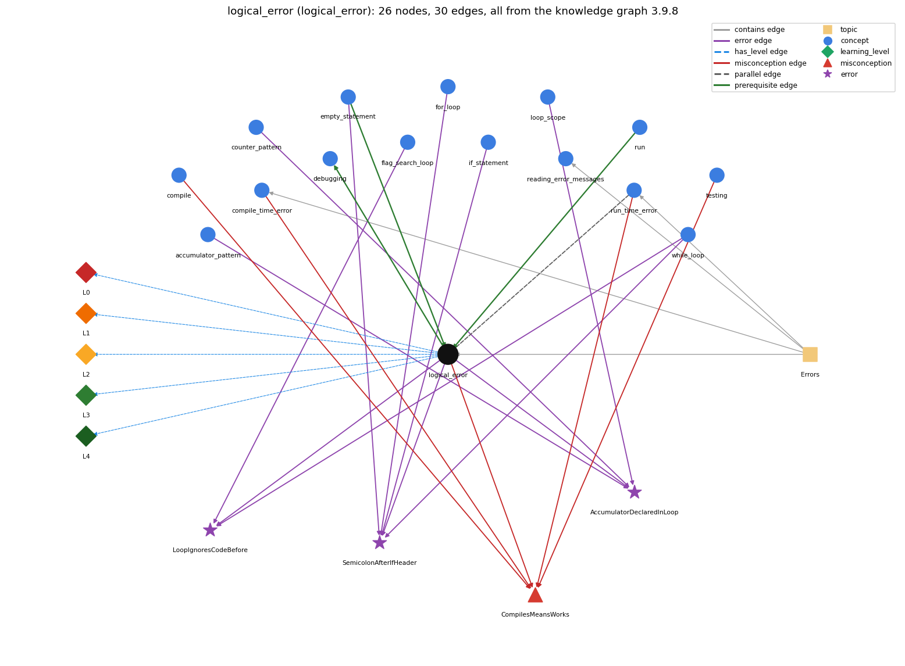

# logical_error (`logical_error`)

the program runs but computes the wrong result

Section 1.1 Your First Program, topic 1.1.c Errors. From the knowledge graph 3.9.8 (`data/raw/chapter1_kg_updated.json`).

## Concepts associated with logical\_error (15)

| Concept | Description | How it is associated |
| --- | --- | --- |
| **accumulator\_pattern** | building up a running total/result | shares error AccumulatorDeclaredInLoop |
| **compile** | javac turns source into bytecode | shares misconception CompilesMeansWorks |
| **compile\_time\_error** | an error javac reports before the program can run (syntax, types) | shares misconception CompilesMeansWorks same topic (topic1.1.c) |
| **counter\_pattern** | counting occurrences across passes | shares error AccumulatorDeclaredInLoop |
| **debugging** | finding and fixing the cause of a wrong result or error by forming a hypothesis, changing the program and checking the prediction | builds on it (needs it) composition rule (R) with it |
| **empty\_statement** | a lone ; is an empty statement; a block can stand alone | prerequisite of it (it needs this) shares error SemicolonAfterIfHeader |
| **flag\_search\_loop** | a boolean flag that a loop sets once and never resets | shares error LoopIgnoresCodeBefore |
| **for\_loop** | a while with init/condition/update packaged together | shares error SemicolonAfterIfHeader |
| **if\_statement** | run a block only when the condition holds | shares error SemicolonAfterIfHeader |
| **loop\_scope** | lifetime/scope of variables in/around the loop | shares error AccumulatorDeclaredInLoop |
| **reading\_error\_messages** | how to read compiler error messages: first error first; reported line may follow the real fault | same topic (topic1.1.c) |
| **run** | java executes main in the JVM | prerequisite of it (it needs this) composition rule (R) with it |
| **run\_time\_error** | an error raised while the program executes (e.g. ArrayIndexOutOfBounds, NumberFormatException) | parallel concept composition rule (R) with it shares misconception CompilesMeansWorks same topic (topic1.1.c) |
| **testing** | running a program on chosen inputs, including boundary and unusual ones, and comparing the output with what it should be | shares misconception CompilesMeansWorks |
| **while\_loop** | repeat a block while a condition holds | shares error SemicolonAfterIfHeader shares error LoopIgnoresCodeBefore |

## Every edge in this view and its full label (30)

| From | Edge | To | Full edge label |
| --- | --- | --- | --- |
| **empty\_statement** | prerequisite | **logical\_error** | A ; right after an if or loop header is an empty statement, so the header controls nothing and the next line always runs: the program compiles but computes the wrong result. grounding: spec\_passage |
| **logical\_error** | prerequisite | **debugging** | Debugging is mostly the search for logic errors, which give wrong output without any message. grounding: book\_passage composition rule (R) of debugging with logical\_error: A logic error gives no message, so it is found only by comparing actual values with expected ones. |
| **run** | prerequisite | **logical\_error** | A logical error is seen only by running the program and comparing its output with the intended output. grounding: book\_passage composition rule (R) of run with logical\_error: A logic error is seen only by running the program and comparing its output with the intended output. composition rule (R) of logical\_error with run: A logic error is seen only by running the program and comparing its output with the intended output. |
| **run\_time\_error** | parallel | **logical\_error** | A run-time error stops the program with an exception; a logical error lets it finish with wrong output. grounding: book\_passage composition rule (R) of run\_time\_error with logical\_error: A run-time error stops the program with an exception message; a logic error lets it finish with wrong output and no message. composition rule (R) of logical\_error with run\_time\_error: A run-time error stops the program with an exception; a logic error lets it finish with wrong output. |
| **compile** | misconception | **CompilesMeansWorks** | **wrong rule:** Code that compiles is code that works. **right rule:** Code that compiles can still have run-time and logical errors. role: primary |
| **compile\_time\_error** | misconception | **CompilesMeansWorks** | **wrong rule:** Code that compiles is code that works. **right rule:** Code that compiles can still have run-time and logical errors. role: context |
| **logical\_error** | misconception | **CompilesMeansWorks** | **wrong rule:** Code that compiles is code that works. **right rule:** Code that compiles can still have run-time and logical errors. role: context |
| **run\_time\_error** | misconception | **CompilesMeansWorks** | **wrong rule:** Code that compiles is code that works. **right rule:** Code that compiles can still have run-time and logical errors. role: context |
| **testing** | misconception | **CompilesMeansWorks** | **wrong rule:** Code that compiles is code that works. **right rule:** Code that compiles can still have run-time and logical errors. role: context |
| **accumulator\_pattern** | error | **AccumulatorDeclaredInLoop** | **wrong rule:** Declaring sum inside the loop body keeps a running total across passes. **right rule:** The accumulator must be declared and initialised before the loop. role: context |
| **counter\_pattern** | error | **AccumulatorDeclaredInLoop** | **wrong rule:** Declaring sum inside the loop body keeps a running total across passes. **right rule:** The accumulator must be declared and initialised before the loop. role: context |
| **empty\_statement** | error | **SemicolonAfterIfHeader** | **wrong rule:** if (x &gt; 0); System.out.println("positive"); prints only for positive x. **right rule:** The ; ends the if with an empty statement, so the next line always runs. role: context |
| **flag\_search\_loop** | error | **LoopIgnoresCodeBefore** | **wrong rule:** Initializes the flag before the loop so that the loop condition is already false, and the loop body never runs. **right rule:** A while loop tests its condition before the first pass: if the values set before the loop make the condition false, the body never runs. role: context |
| **for\_loop** | error | **SemicolonAfterIfHeader** | **wrong rule:** if (x &gt; 0); System.out.println("positive"); prints only for positive x. **right rule:** The ; ends the if with an empty statement, so the next line always runs. role: context |
| **if\_statement** | error | **SemicolonAfterIfHeader** | **wrong rule:** if (x &gt; 0); System.out.println("positive"); prints only for positive x. **right rule:** The ; ends the if with an empty statement, so the next line always runs. role: primary |
| **logical\_error** | error | **AccumulatorDeclaredInLoop** | **wrong rule:** Declaring sum inside the loop body keeps a running total across passes. **right rule:** The accumulator must be declared and initialised before the loop. role: context |
| **logical\_error** | error | **LoopIgnoresCodeBefore** | **wrong rule:** Initializes the flag before the loop so that the loop condition is already false, and the loop body never runs. **right rule:** A while loop tests its condition before the first pass: if the values set before the loop make the condition false, the body never runs. role: context |
| **logical\_error** | error | **SemicolonAfterIfHeader** | **wrong rule:** if (x &gt; 0); System.out.println("positive"); prints only for positive x. **right rule:** The ; ends the if with an empty statement, so the next line always runs. role: context |
| **loop\_scope** | error | **AccumulatorDeclaredInLoop** | **wrong rule:** Declaring sum inside the loop body keeps a running total across passes. **right rule:** The accumulator must be declared and initialised before the loop. role: primary |
| **while\_loop** | error | **LoopIgnoresCodeBefore** | **wrong rule:** Initializes the flag before the loop so that the loop condition is already false, and the loop body never runs. **right rule:** A while loop tests its condition before the first pass: if the values set before the loop make the condition false, the body never runs. role: primary |
| **while\_loop** | error | **SemicolonAfterIfHeader** | **wrong rule:** if (x &gt; 0); System.out.println("positive"); prints only for positive x. **right rule:** The ; ends the if with an empty statement, so the next line always runs. role: context |
| **logical\_error** | has\_level | **logical\_error@L0** | logical error -&gt; L0 (Prestructural): the answer holds a rule that contradicts Java (3 ways). **[0] everyday\_reading** (E): Everyday reading: the computer understands what you meant and will complain if the program is wrong. Java rule: a program with a logic error compiles and runs without any message and does exactly what the code says, which differs from what was intended. **[1] misconception** (M) &rarr; CompilesMeansWorks: wrong rule: Code that compiles is code that works. Right rule: Code that compiles and runs can still compute the wrong result (a logic error). **[2] inconsistent\_trace** (T) &rarr; CompilesMeansWorks: Applies the 'computer does exactly what is written' rule unevenly: traces some lines literally but reads the intended meaning into the faulty line, and so does not see the bug. (here mixing in: "Code that compiles is code that works") |
| **logical\_error** | has\_level | **logical\_error@L1** | logical error -&gt; L1 (Unistructural): the answer states one correct rule without applying it (2 ways). **[0] names\_the\_element** (N): A logic error is an error that makes a program do something other than what the programmer intended, without any compiler or run-time message. **[1] states\_the\_rule** (S): If a program has a logic error, it will compile and run without generating error messages, but it will not do the right thing; the compiler and JVM cannot detect it since they don't know what the right thing is. |
| **logical\_error** | has\_level | **logical\_error@L2** | logical error -&gt; L2 (Multistructural): the answer applies the rules of logical error to every part of the code, in order (3 ways). **[0] line\_by\_line\_trace** (LT): Execution proceeds normally, statement by statement; the faulty statement executes without complaint and passes a wrong value or output onward. **[1] output\_prediction** (OP): Result is a normal-looking but wrong output, e.g. println("Hello, "); println("World!"); prints two lines where one was intended. **[2] one\_step\_execution** (OS): Each step makes a legal state change (e.g. an empty statement after if, or resetting sum each pass), but not the intended one. |
| **logical\_error** | has\_level | **logical\_error@L3** | logical error -&gt; L3 (Relational): the answer relates the parts (4 ways). **[0] relation\_to\_neighbour** (R): A logic error is seen only by running the program and comparing its output with the intended output. **[1] relation\_to\_neighbour** (R): A run-time error stops the program with an exception; a logic error lets it finish with wrong output. **[2] relation\_to\_neighbour** (R): Debugging is mostly the search for logic errors, which give wrong output without any message. **[3] purpose\_of\_the\_whole** (P): Purpose (of the category): name the errors that only testing against the intended behaviour can find, so they are found by tracing, test cases and added print statements. |
| **logical\_error** | has\_level | **logical\_error@L4** | logical error -&gt; L4 (Extended abstract): the answer reasons beyond the given code (6 ways). **[0] predict\_a\_change** (C) &rarr; CompilesMeansWorks: A logic error survives recompiling and rerunning unchanged; changing input may hide or reveal it; fixing it changes output only on the inputs it affected. **[1] diagnose\_an\_error** (D): rule broken: A ; right after if (...) is an empty statement that forms the whole if body. Kind: silent logic error. Trigger class: if (x &gt; 0); System.out.println("positive"); prints for every x **[2] diagnose\_an\_error** (D): rule broken: The accumulator must be declared and initialized before the loop. Kind: silent logic error. Trigger class: int sum = 0; written inside the loop body: sum is reset each pass (and is out of scope after the loop) **[3] transfer\_to\_a\_new\_program** (X): Suspect a logic error when the program compiles and runs to the end but the output is wrong for some inputs; locate it by hand tracing, minimal test cases and print statements, since tools give no message. **[4] diagnose\_an\_error** (D): rule broken: A while loop tests its condition before the first pass. Kind: silent logic error. Trigger class: values set before the loop already make the condition false, so the body never runs **[5] diagnose\_an\_error** (D): rule broken: print vs println decides line breaks. Kind: silent logic error. Trigger class: println used where print was meant (or the reverse) |
| **topic1.1.c** | contains | **compile\_time\_error** | topic topic1.1.c contains compile\_time\_error |
| **topic1.1.c** | contains | **logical\_error** | topic topic1.1.c contains logical\_error |
| **topic1.1.c** | contains | **reading\_error\_messages** | topic topic1.1.c contains reading\_error\_messages |
| **topic1.1.c** | contains | **run\_time\_error** | topic topic1.1.c contains run\_time\_error |
