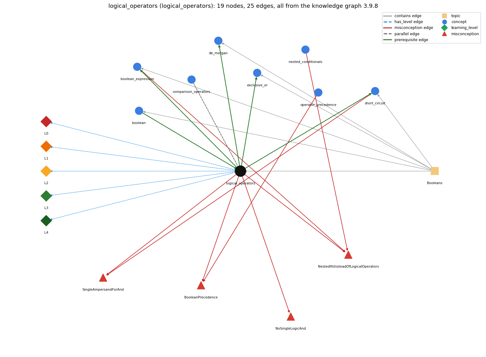

# logical_operators (`logical_operators`)

&amp;&amp; \|\| !

Section 1.2 Built-in Types of Data, topic 1.2.e Booleans. From the knowledge graph 3.9.8 (`data/raw/chapter1_kg_updated.json`).

## Concepts associated with logical\_operators (8)

| Concept | Description | How it is associated |
| --- | --- | --- |
| **boolean** | true/false primitive | prerequisite of it (it needs this) composition rule (R) with it same topic (topic1.2.e) |
| **boolean\_expression** | an expression that evaluates to true/false | builds on it (needs it) composition rule (R) with it shares misconception NestedIfsInsteadOfLogicalOperators same topic (topic1.2.e) |
| **comparison\_operators** | == != &lt; &gt; &lt;= &gt;= | parallel concept composition rule (R) with it |
| **de\_morgan** | !(a &amp;&amp; b) == !a \|\| !b and !(a \|\| b) == !a &amp;&amp; !b | builds on it (needs it) composition rule (R) with it same topic (topic1.2.e) |
| **exclusive\_or** | ^ on booleans is true when the operands differ | builds on it (needs it) composition rule (R) with it same topic (topic1.2.e) |
| **nested\_conditionals** | else-if chains and conditionals inside conditionals | shares misconception NestedIfsInsteadOfLogicalOperators |
| **operator\_precedence** | the order operators bind in an expression | shares misconception BooleanPrecedence |
| **short\_circuit** | &amp;&amp;/\|\| stop evaluating once the result is known | builds on it (needs it) composition rule (R) with it shares misconception SingleAmpersandForAnd same topic (topic1.2.e) |

## Every edge in this view and its full label (25)

| From | Edge | To | Full edge label |
| --- | --- | --- | --- |
| **boolean** | prerequisite | **logical\_operators** | &amp;&amp;, \|\| and ! are the operations defined on the boolean type: they take booleans and give a boolean. grounding: book\_passage composition rule (R) of boolean with logical\_operators: &amp;&amp;, \|\| and ! accept only boolean operands and return a boolean; applying them to ints (if (x &amp;&amp; y) with int x, y) is a compile-time error. composition rule (R) of logical\_operators with boolean: The operands must be boolean, and the result is boolean; int operands are a compile-time error. |
| **logical\_operators** | prerequisite | **boolean\_expression** | &amp;&amp;, \|\| and ! combine conditions p and q into one larger condition that is still true or false. grounding: book\_passage composition rule (R) of logical\_operators with boolean\_expression: Combining boolean sub-expressions with &amp;&amp;, \|\| and ! yields another boolean expression, so arbitrarily complex conditions can be built with parentheses. composition rule (R) of boolean\_expression with logical\_operators: &amp;&amp;, \|\| and ! combine boolean sub-expressions into a larger one; ! binds tighter than comparisons, so negating a comparison needs parentheses: !(x &gt; 0). |
| **logical\_operators** | prerequisite | **de\_morgan** | De Morgan's laws rewrite expressions built from &amp;&amp; , \|\| and !. grounding: book\_passage composition rule (R) of logical\_operators with de\_morgan: De Morgan's laws rewrite negated &amp;&amp; / \|\| expressions: !(A &amp;&amp; B) is !A \|\| !B and !(A \|\| B) is !A &amp;&amp; !B. composition rule (R) of de\_morgan with logical\_operators: De Morgan's laws relate the three logical operators: a negated &amp;&amp; becomes an \|\| of negations and a negated \|\| becomes an &amp;&amp; of negations. |
| **logical\_operators** | prerequisite | **exclusive\_or** | ^ on booleans is another logical operator, defined by a truth table like &amp;&amp;, \|\| and !: true exactly when its operands differ. grounding: order\_only composition rule (R) of logical\_operators with exclusive\_or: ^ on booleans is a further logical operator, true exactly when the operands differ (it equals (a \|\| b) &amp;&amp; !(a &amp;&amp; b)), but unlike &amp;&amp; and \|\| it always evaluates both operands. composition rule (R) of exclusive\_or with logical\_operators: ^ belongs with &amp;&amp;, \|\| and ! as a boolean operator defined by a truth table, but it is not short-circuit and it binds tighter than &amp;&amp; and \|\|; a ^ b equals (a \|\| b) &amp;&amp; !(a &amp;&amp; b). |
| **logical\_operators** | prerequisite | **short\_circuit** | &amp;&amp; and \|\| evaluate their second operand only when the first has not already decided the result (false &amp;&amp; x is false, true \|\| x is true). grounding: book\_passage composition rule (R) of logical\_operators with short\_circuit: &amp;&amp; and \|\| are the short-circuit operators: in a guard such as (x != 0 &amp;&amp; y / x &gt; 1) the operand order matters, because the right test runs only when the left one allows it. composition rule (R) of short\_circuit with logical\_operators: Short-circuiting is the defining evaluation order of &amp;&amp; and \|\| only; the book's other boolean operators (! and ^, and &amp; / \| if used) evaluate all their operands. |
| **comparison\_operators** | parallel | **logical\_operators** | Relational operators compare two numbers to give a boolean; logical operators combine booleans into one boolean. grounding: book\_passage composition rule (R) of comparison\_operators with logical\_operators: Comparisons bind tighter than &amp;&amp; and \|\|, so they are evaluated first and logical operators combine their boolean results. composition rule (R) of logical\_operators with comparison\_operators: Comparisons bind tighter than &amp;&amp; and \|\|, so comparisons are evaluated first and their boolean results are then combined (month &gt;= 1 &amp;&amp; month &lt;= 12). |
| **boolean\_expression** | misconception | **NestedIfsInsteadOfLogicalOperators** | **wrong rule:** A condition on several values has to be written as nested if statements, one value per if. **right rule:** Several conditions combine into one boolean expression with &amp;&amp; and \|\|, e.g. if (x == 0 &amp;&amp; y == 0). role: context |
| **logical\_operators** | misconception | **BooleanPrecedence** | **wrong rule:** a \|\| b &amp;&amp; c is evaluated left to right as (a \|\| b) &amp;&amp; c. **right rule:** &amp;&amp; binds tighter than \|\|, so it is a \|\| (b &amp;&amp; c). role: primary |
| **logical\_operators** | misconception | **NestedIfsInsteadOfLogicalOperators** | **wrong rule:** A condition on several values has to be written as nested if statements, one value per if. **right rule:** Several conditions combine into one boolean expression with &amp;&amp; and \|\|, e.g. if (x == 0 &amp;&amp; y == 0). role: primary |
| **logical\_operators** | misconception | **NoSingleLogicAnd** | **wrong rule:** &amp; only works on bits, so p &amp; q cannot be used with booleans. **right rule:** Java also has a &amp; operator, which the book does not use; logical and is written &amp;&amp;. role: primary |
| **logical\_operators** | misconception | **SingleAmpersandForAnd** | **wrong rule:** &amp; and \| are the same as &amp;&amp; and \|\| for conditions, so either can be used. **right rule:** &amp;&amp; and \|\| skip the right operand when the left decides the result; &amp; and \| always evaluate both, which fails when the right side depends on the left (e.g. x != 0 &amp; y / x &gt; 1). role: context |
| **nested\_conditionals** | misconception | **NestedIfsInsteadOfLogicalOperators** | **wrong rule:** A condition on several values has to be written as nested if statements, one value per if. **right rule:** Several conditions combine into one boolean expression with &amp;&amp; and \|\|, e.g. if (x == 0 &amp;&amp; y == 0). role: context |
| **operator\_precedence** | misconception | **BooleanPrecedence** | **wrong rule:** a \|\| b &amp;&amp; c is evaluated left to right as (a \|\| b) &amp;&amp; c. **right rule:** &amp;&amp; binds tighter than \|\|, so it is a \|\| (b &amp;&amp; c). role: context |
| **short\_circuit** | misconception | **SingleAmpersandForAnd** | **wrong rule:** &amp; and \| are the same as &amp;&amp; and \|\| for conditions, so either can be used. **right rule:** &amp;&amp; and \|\| skip the right operand when the left decides the result; &amp; and \| always evaluate both, which fails when the right side depends on the left (e.g. x != 0 &amp; y / x &gt; 1). role: primary |
| **logical\_operators** | has\_level | **logical\_operators@L0** | logical operators -&gt; L0 (Prestructural): the answer holds a rule that contradicts Java (6 ways). **[0] everyday\_reading** (E): Folk meaning: English 'or' is often exclusive ('tea or coffee') and 'and' can join alternatives ('x is 1 and 2' meaning either value). Java rule: \|\| is inclusive (true when either or both operands are true) and &amp;&amp; is true only when both operands are true, so x == 1 &amp;&amp; x == 2 is always false. **[1] misconception** (M) &rarr; NoSingleLogicAnd: wrong rule: &amp; is only a bitwise operator. Right rule: Java also has a &amp; operator, which the book does not use; on boolean operands it is a logical and that always evaluates both operands; logical and is written &amp;&amp;. **[2] misconception** (M) &rarr; BooleanPrecedence: wrong rule: a \|\| b &amp;&amp; c is evaluated left to right as (a \|\| b) &amp;&amp; c. Right rule: &amp;&amp; binds tighter than \|\|, so a \|\| b &amp;&amp; c means a \|\| (b &amp;&amp; c); with a = true, b = false, c = false the value is true, not false. **[3] misconception** (M) &rarr; NestedIfsInsteadOfLogicalOperators: wrong rule: A condition on several values has to be written as nested if statements, one value per if. Right rule: Several conditions combine into one boolean expression with &amp;&amp; and \|\|, e.g. if (x == 0 &amp;&amp; y == 0). **[4] inconsistent\_trace** (T) &rarr; NoSingleLogicAnd: Points to LT (! first, then &amp;&amp;, then \|\|; left operand first; right operand of &amp;&amp; / \|\| only if needed). Applied unevenly: in one row of a trace the student evaluates the right operand of &amp;&amp; although the left was false (or reads \|\| as exclusive when both operands are true) and in another row applies the rule correctly. (here mixing in: "&amp; is only a bitwise operator") **[5] misconception** (M) &rarr; SingleAmpersandForAnd: wrong rule: &amp; and \| are the same as &amp;&amp; and \|\| for conditions, so either can be used. Right rule: &amp;&amp; and \|\| skip the right operand when the left decides the result; &amp; and \| always evaluate both, which fails when the right side depends on the left (e.g. x != 0 &amp; y / x &gt; 1 throws when x is 0). |
| **logical\_operators** | has\_level | **logical\_operators@L1** | logical operators -&gt; L1 (Unistructural): the answer states one correct rule without applying it (2 ways). **[0] names\_the\_element** (N): Logical (boolean) operators: &amp;&amp; (and), \|\| (or) and ! (not), which take boolean operands and produce a boolean. **[1] states\_the\_rule** (S): a &amp;&amp; b is true if both operands are true and false otherwise; a \|\| b is false if both are false and true otherwise; !a is the opposite of a; these definitions are given in full by truth tables. |
| **logical\_operators** | has\_level | **logical\_operators@L2** | logical operators -&gt; L2 (Multistructural): the answer applies the rules of logical operators to every part of the code, in order (3 ways). **[0] line\_by\_line\_trace** (LT): ! is applied before &amp;&amp; and \|\|, and &amp;&amp; before \|\|; the left operand is evaluated first, and for &amp;&amp; and \|\| the right operand is evaluated only when the left has not already decided the result. **[1] output\_prediction** (OP): The result is a boolean: with x = 10, x &gt; 0 &amp;&amp; x &lt; 10 is false and x &lt; 0 \|\| x &gt; 10 is false; true \|\| anything is true. **[2] one\_step\_execution** (OS): The operators themselves change no variable; any side effect inside the right operand (i++, a method call) happens only if that operand is evaluated. |
| **logical\_operators** | has\_level | **logical\_operators@L3** | logical operators -&gt; L3 (Relational): the answer relates the parts (7 ways). **[0] relation\_to\_neighbour** (R): Combining boolean sub-expressions with &amp;&amp;, \|\| and ! yields another boolean expression, so arbitrarily complex conditions can be built with parentheses. **[1] relation\_to\_neighbour** (R): &amp;&amp; and \|\| are the short-circuit operators: in a guard such as (x != 0 &amp;&amp; y / x &gt; 1) the operand order matters, because the right test runs only when the left one allows it. **[2] relation\_to\_neighbour** (R): Comparisons bind tighter than &amp;&amp; and \|\|, so comparisons are evaluated first and their boolean results are then combined (month &gt;= 1 &amp;&amp; month &lt;= 12). **[3] relation\_to\_neighbour** (R): ^ on booleans is a further logical operator, true exactly when the operands differ (it equals (a \|\| b) &amp;&amp; !(a &amp;&amp; b)), but unlike &amp;&amp; and \|\| it always evaluates both operands. **[4] relation\_to\_neighbour** (R): De Morgan's laws rewrite negated &amp;&amp; / \|\| expressions: !(A &amp;&amp; B) is !A \|\| !B and !(A \|\| B) is !A &amp;&amp; !B. **[5] relation\_to\_neighbour** (R): The operands must be boolean, and the result is boolean; int operands are a compile-time error. **[6] purpose\_of\_the\_whole** (P): Used to combine several conditions into one test: a range check (lo &lt;= x &amp;&amp; x &lt;= hi), alternatives (x == 0 \|\| y == 0), a guard followed by the real test (i &lt; n &amp;&amp; a[i] != 0), or a rule built step by step as in LeapYear. |
| **logical\_operators** | has\_level | **logical\_operators@L4** | logical operators -&gt; L4 (Extended abstract): the answer reasons beyond the given code (5 ways). **[0] predict\_a\_change** (C) &rarr; NoSingleLogicAnd: Swapping &amp;&amp; for \|\| changes the meaning; negating a whole condition requires De Morgan (negate each term and flip the operator); swapping the operands of &amp;&amp; or \|\| keeps the truth value but can change which side effects or exceptions occur. **[1] transfer\_to\_a\_new\_program** (X): Use &amp;&amp; and \|\| to combine conditions into a single test, ordering operands so that cheap or protective tests come first; use nested ifs only when the cases need different actions; do not use &amp; and \| for conditions. **[2] diagnose\_an\_error** (D): rule broken: Conditions are combined with &amp;&amp; and \|\|; &amp; and \| evaluate both operands. Kind: run-time exception. Trigger class: Using &amp; or \| where the right operand is only safe when the left decides first, e.g. x != 0 &amp; y / x &gt; 1 with x == 0 (ArithmeticException) or an out-of-range index; otherwise a silent difference only when the right side has side effects. **[3] diagnose\_an\_error** (D): rule broken: &amp;&amp; has higher precedence than \|\|. Kind: silent logic error. Trigger class: Mixed &amp;&amp; and \|\| without parentheses intended to group the \|\| first, e.g. a \|\| b &amp;&amp; c meant as (a \|\| b) &amp;&amp; c. **[4] diagnose\_an\_error** (D): rule broken: Logical operators take boolean operands only. Kind: compile-time. Trigger class: Applying &amp;&amp; or \|\| to int operands (if (x &amp;&amp; y) with ints) or writing and/or as words. |
| **topic1.2.e** | contains | **boolean** | topic topic1.2.e contains boolean |
| **topic1.2.e** | contains | **boolean\_expression** | topic topic1.2.e contains boolean\_expression |
| **topic1.2.e** | contains | **de\_morgan** | topic topic1.2.e contains de\_morgan |
| **topic1.2.e** | contains | **exclusive\_or** | topic topic1.2.e contains exclusive\_or |
| **topic1.2.e** | contains | **logical\_operators** | topic topic1.2.e contains logical\_operators |
| **topic1.2.e** | contains | **short\_circuit** | topic topic1.2.e contains short\_circuit |
