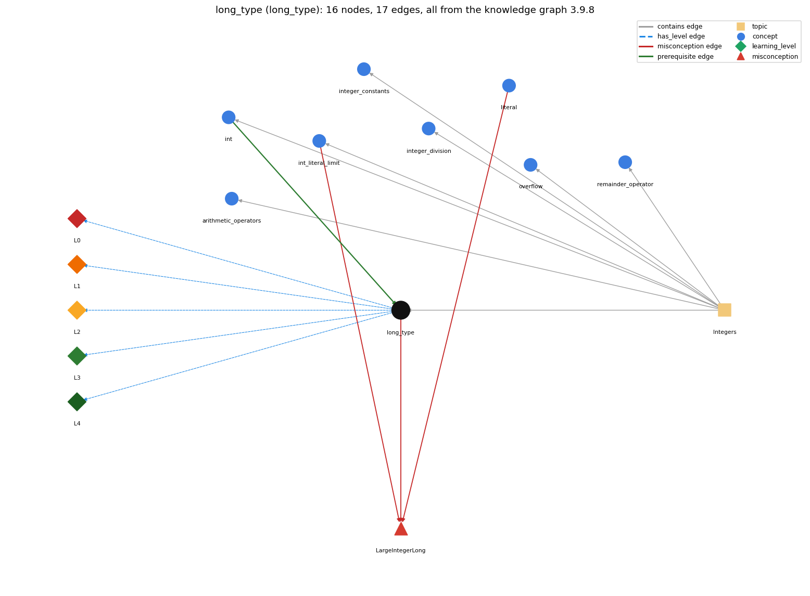

# long_type (`long_type`)

64-bit integer type for values beyond the int range

Section 1.2 Built-in Types of Data, topic 1.2.c Integers. From the knowledge graph 3.9.8 (`data/raw/chapter1_kg_updated.json`).

## Concepts associated with long\_type (8)

| Concept | Description | How it is associated |
| --- | --- | --- |
| **arithmetic\_operators** | + - \* / % | same topic (topic1.2.c) |
| **int** | 32-bit integer primitive | prerequisite of it (it needs this) composition rule (R) with it same topic (topic1.2.c) |
| **int\_literal\_limit** | 2147483648 is legal only as -2147483648 | shares misconception LargeIntegerLong same topic (topic1.2.c) |
| **integer\_constants** | Integer.MAX\_VALUE, Integer.MIN\_VALUE and their edge cases | same topic (topic1.2.c) |
| **integer\_division** | / on two ints truncates; % is the remainder | same topic (topic1.2.c) |
| **literal** | a constant value written in code (42, 3.14, true, 'a', "hi") | shares misconception LargeIntegerLong |
| **overflow** | int arithmetic wraps around outside the 32-bit range | same topic (topic1.2.c) |
| **remainder\_operator** | % gives the remainder of integer division | same topic (topic1.2.c) |

## Every edge in this view and its full label (17)

| From | Edge | To | Full edge label |
| --- | --- | --- | --- |
| **int** | prerequisite | **long\_type** | long is the wider integer type used when int's range is too small. grounding: book\_passage composition rule (R) of int with long\_type: If either operand is long, the operation is 64-bit and the result is long. Storing a long into an int needs a cast. composition rule (R) of long\_type with int: long is the wider integer type: an int widens to long automatically, and mixing an int with a long in an operation gives a long. |
| **int\_literal\_limit** | misconception | **LargeIntegerLong** | **wrong rule:** a large integer literal is automatically long **right rule:** A sequence of digits is an int literal only if its value falls within the int range; for larger values the book advises the long type. role: context |
| **literal** | misconception | **LargeIntegerLong** | **wrong rule:** A whole-number literal that is too big for an int automatically becomes a long. **right rule:** A sequence of digits is an int literal only if its value falls within the int range; for larger values the book advises the long type. role: primary |
| **long\_type** | misconception | **LargeIntegerLong** | **wrong rule:** a large integer literal is automatically long **right rule:** A sequence of digits is an int literal only if its value falls within the int range; for larger values the book advises the long type. role: context |
| **long\_type** | has\_level | **long\_type@L0** | long type -&gt; L0 (Prestructural): the answer holds a rule that contradicts Java (3 ways). **[0] everyday\_reading** (E): In English 'long' just means lengthy, so novices expect any big number to become a long automatically. In Java long is a separate 64-bit type that must be declared, and an integer literal outside the int range needs the L suffix. **[1] misconception** (M) &rarr; LargeIntegerLong: wrong rule: a large integer literal is automatically long. Right rule: A sequence of digits is an int literal only if its value falls within the int range; for larger values the book advises the long type. **[2] inconsistent\_trace** (T) &rarr; LargeIntegerLong: Points to LT (only operations with a long operand run in 64 bits). Applied unevenly, a student treats long x = a \* b (int a, b) as 64-bit because the target is long. (here mixing in: "a large integer literal is automatically long") |
| **long\_type** | has\_level | **long\_type@L1** | long type -&gt; L1 (Unistructural): the answer states one correct rule without applying it (2 ways). **[0] names\_the\_element** (N): long: Java's 64-bit signed integer primitive type. **[1] states\_the\_rule** (S): long ranges from -9223372036854775808 to 9223372036854775807, and its literals end in L. An integer operation with at least one long operand is done in 64 bits and gives a long. int widens to long automatically, but long to int needs a cast. |
| **long\_type** | has\_level | **long\_type@L2** | long type -&gt; L2 (Multistructural): the answer applies the rules of long type to every part of the code, in order (3 ways). **[0] line\_by\_line\_trace** (LT): In a mixed expression each operation checks its own operands. Only operations with a long operand run in 64 bits, so pure-int subexpressions that came earlier were already computed in 32 bits. **[1] output\_prediction** (OP): 2147483647L + 1 is the long 2147483648. Math.round(3.14159) has type long and value 3. **[2] one\_step\_execution** (OS): Assigning to a long variable stores a 64-bit value. Storing a long in an int requires an (int) cast, which keeps only the low 32 bits. |
| **long\_type** | has\_level | **long\_type@L3** | long type -&gt; L3 (Relational): the answer relates the parts (2 ways). **[0] relation\_to\_neighbour** (R): long is the wider integer type: an int widens to long automatically, and mixing an int with a long in an operation gives a long. **[1] purpose\_of\_the\_whole** (P): long holds huge integers: counts or sums beyond 2 billion, factorials up to 20!, products of large ints, and times in milliseconds. |
| **long\_type** | has\_level | **long\_type@L4** | long type -&gt; L4 (Extended abstract): the answer reasons beyond the given code (5 ways). **[0] predict\_a\_change** (C) &rarr; LargeIntegerLong: Changing int to long removes overflow below about 9.2e18, but a literal product is still computed in int unless one operand is long (1000000 \* 1000000 overflows, while 1000000L \* 1000000 does not). **[1] transfer\_to\_a\_new\_program** (X): Use long when integer values may reach ten digits or more, and int otherwise. Use BigInteger beyond long's range, and double for non-integers. **[2] diagnose\_an\_error** (D): rule broken: A long value needs an explicit cast to be stored in an int. Kind: compile-time. Trigger class: int r = Math.round(x); or int n = someLong;: 'possible lossy conversion from long to int'. **[3] diagnose\_an\_error** (D): rule broken: An integer literal outside the int range needs an L suffix. Kind: compile-time. Trigger class: long big = 3000000000;: 'integer number too large'. **[4] diagnose\_an\_error** (D): rule broken: A long target does not make int operands 64-bit. Kind: silent logic error. Trigger class: long x = a \* b; with int a and b whose product exceeds the int range. |
| **topic1.2.c** | contains | **arithmetic\_operators** | topic topic1.2.c contains arithmetic\_operators |
| **topic1.2.c** | contains | **int** | topic topic1.2.c contains int |
| **topic1.2.c** | contains | **int\_literal\_limit** | topic topic1.2.c contains int\_literal\_limit |
| **topic1.2.c** | contains | **integer\_constants** | topic topic1.2.c contains integer\_constants |
| **topic1.2.c** | contains | **integer\_division** | topic topic1.2.c contains integer\_division |
| **topic1.2.c** | contains | **long\_type** | topic topic1.2.c contains long\_type |
| **topic1.2.c** | contains | **overflow** | topic topic1.2.c contains overflow |
| **topic1.2.c** | contains | **remainder\_operator** | topic topic1.2.c contains remainder\_operator |
