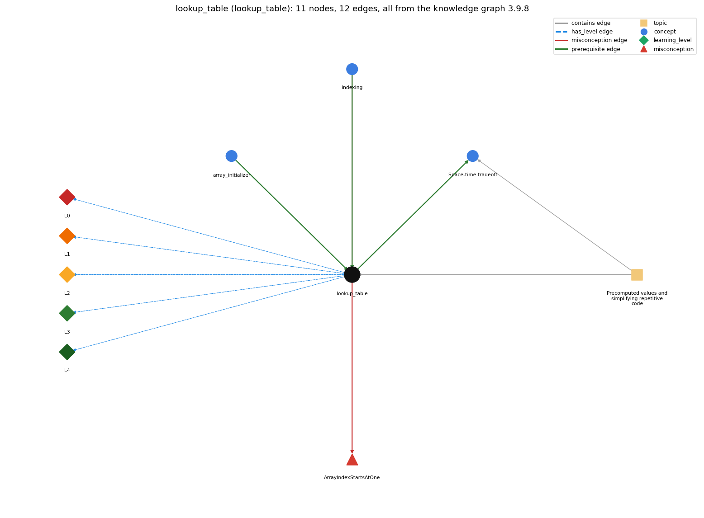

# lookup_table (`lookup_table`)

an array of precomputed values or names indexed by position

Section 1.4 Arrays, topic 1.4.e Precomputed values and simplifying repetitive code. From the knowledge graph 3.9.8 (`data/raw/chapter1_kg_updated.json`).

## Concepts associated with lookup\_table (3)

| Concept | Description | How it is associated |
| --- | --- | --- |
| **array\_initializer** | {1, 2, 3} literal initialization | prerequisite of it (it needs this) |
| **indexing** | a[i] -- 0-based access | prerequisite of it (it needs this) composition rule (R) with it shares misconception ArrayIndexStartsAtOne |
| **space\_time\_tradeoff** | investing memory (an array of saved values) to save computation time | builds on it (needs it) composition rule (R) with it same topic (topic1.4.e) |

## Every edge in this view and its full label (12)

| From | Edge | To | Full edge label |
| --- | --- | --- | --- |
| **array\_initializer** | prerequisite | **lookup\_table** | A lookup table is usually an array of fixed values written as a literal and read by index. grounding: book\_passage |
| **indexing** | prerequisite | **lookup\_table** | A lookup table is read by index, a[i]. grounding: book\_passage composition rule (R) of indexing with lookup\_table: A lookup table uses a data value as the index (months[m]), so the data must lie in 0..length-1. composition rule (R) of lookup\_table with indexing: The key itself is the index (months[m], rank[i]), so keys must fall in 0..length-1. |
| **lookup\_table** | prerequisite | **space\_time\_tradeoff** | Saving precomputed values in an array trades memory for time: each value is computed once and then looked up. grounding: book\_passage composition rule (R) of lookup\_table with space\_time\_tradeoff: Storing precomputed values trades memory for time: each value is computed once and then looked up. composition rule (R) of space\_time\_tradeoff with lookup\_table: The lookup table is the stored space: each value is computed once and then read by index. |
| **indexing** | misconception | **ArrayIndexStartsAtOne** | **wrong rule:** The first element of a is a[1]. **right rule:** Numbering begins with 0; the first element is a[0]. role: primary |
| **lookup\_table** | misconception | **ArrayIndexStartsAtOne** | **wrong rule:** The first element of a is a[1]. **right rule:** Numbering begins with 0; the first element is a[0]. role: context |
| **lookup\_table** | has\_level | **lookup\_table@L0** | lookup table -&gt; L0 (Prestructural): the answer holds a rule that contradicts Java (3 ways). **[0] everyday\_reading** (E): Folk meaning: everyday tables are numbered from 1 (month 1 is January) and are looked up by scanning. Java rule: array tables are 0-origin and are read directly by index, so either waste slot 0 (months[0] = "") or subtract 1 from the key. **[1] misconception** (M) &rarr; ArrayIndexStartsAtOne: wrong rule: The first element of a is a[1]. Right rule: Numbering begins with 0; a 1-based key needs a padding slot at index 0 or the index key-1. **[2] inconsistent\_trace** (T) &rarr; ArrayIndexStartsAtOne: Points to LT: compute the index from the data, then read the table entry. Inconsistent application: 1 is subtracted from the key on some lookups but not on others, or the padding slot is counted as January. (here mixing in: "The first element of a is a[1]") |
| **lookup\_table** | has\_level | **lookup\_table@L1** | lookup table -&gt; L1 (Unistructural): the answer states one correct rule without applying it (2 ways). **[0] names\_the\_element** (N): Identity: a lookup table is an array whose element i holds a precomputed value or name for i, read by indexing. **[1] states\_the\_rule** (S): Declarative: build the table once (initializer or loop), e.g. String[] months = {"", "Jan", ..., "Dec"}; or H[i] = H[i-1] + 1.0/i; then use months[m] or H[i] in place of recomputing. |
| **lookup\_table** | has\_level | **lookup\_table@L2** | lookup table -&gt; L2 (Multistructural): the answer applies the rules of lookup table to every part of the code, in order (3 ways). **[0] line\_by\_line\_trace** (LT): Sequencing: the whole table is built before the first lookup. Each lookup evaluates the index expression, checks the bounds and reads one element. **[1] output\_prediction** (OP): Result: months[m] is the name of month m for m = 1..12 (months[0] is the empty string); H[i] is the i-th harmonic number. **[2] one\_step\_execution** (OS): State transition: a lookup changes nothing; only the building phase stores values (one element per step). |
| **lookup\_table** | has\_level | **lookup\_table@L3** | lookup table -&gt; L3 (Relational): the answer relates the parts (3 ways). **[0] relation\_to\_neighbour** (R): The key itself is the index (months[m], rank[i]), so keys must fall in 0..length-1. **[1] relation\_to\_neighbour** (R): Storing precomputed values trades memory for time: each value is computed once and then looked up. **[2] purpose\_of\_the\_whole** (P): Plan/role: the table is a fixed value (Sajaniemi). It replaces long if-else chains or repeated computation with one indexed read. |
| **lookup\_table** | has\_level | **lookup\_table@L4** | lookup table -&gt; L4 (Extended abstract): the answer reasons beyond the given code (4 ways). **[0] predict\_a\_change** (C) &rarr; ArrayIndexStartsAtOne: Conservation: adding entries at the end keeps existing lookups valid. Removing the padding slot shifts every entry down one, so months[1] becomes Feb (off by one). Changing a stored value changes every lookup of it. **[1] transfer\_to\_a\_new\_program** (X): Applicability: use a table when the same values are needed many times for small integer keys. It is not effective for huge key ranges, for values needed only once, or for keys that are not small integers. **[2] diagnose\_an\_error** (D): rule broken: Keys must map to legal indices. Kind: run-time exception. Trigger class: a key outside the table, e.g. months[13] or months[0-1] (ArrayIndexOutOfBoundsException) **[3] diagnose\_an\_error** (D): rule broken: The key-to-index mapping must match the table layout. Kind: silent logic error. Trigger class: a 1-based key used with a table that has no padding slot, so every lookup returns the next entry |
| **topic1.4.e** | contains | **lookup\_table** | topic topic1.4.e contains lookup\_table |
| **topic1.4.e** | contains | **space\_time\_tradeoff** | topic topic1.4.e contains space\_time\_tradeoff |
