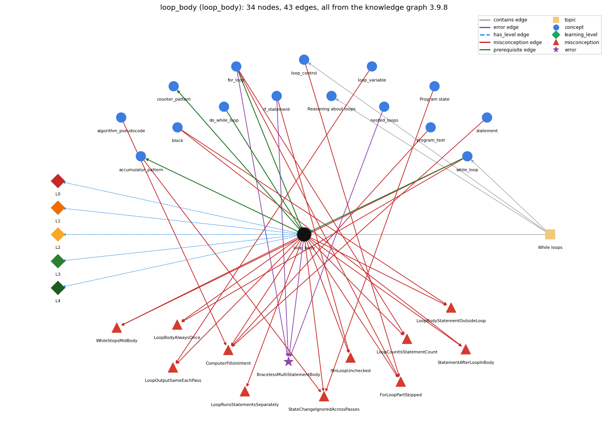

# loop_body (`loop_body`)

the block repeated each pass

Section 1.3 Conditionals and Loops, topic 1.3.c While loops.

## At a glance

- **Needs first:** `do_while_loop`, `for_loop`, `while_loop`
- **Leads to:** `accumulator_pattern`, `counter_pattern`
- **Learned alongside:** nothing
- **Misconceptions:** `ComputerFillsInIntent`, `ForLoopPartSkipped`, `IfInLoopUnchecked`, `LoopBodyAlwaysOnce`, `LoopBodyStatementOutsideLoop`, `LoopCountIsStatementCount`, `LoopOutputSameEachPass`, `LoopRunsStatementsSeparately`, `StateChangeIgnoredAcrossPasses`, `StatementAfterLoopInBody`, `WhileStopsMidBody`
- **Errors:** `BracelessMultiStatementBody`
- **Levels:** L0, L1, L2, L3, L4

Everything below comes from the knowledge graph 3.9.8 (`data/raw/chapter1_kg_updated.json`): 43 edges around this concept, each explained in the graph's own words.

## What it needs first (3)

A prerequisite edge means the other concept has to be understood before `loop_body`.

### `do_while_loop` comes before `loop_body`

*do { body } while (c); -- body first, test after*

The block between do and while is the loop body; it runs first and is repeated while the condition holds.

- **Grounding:** book passage

### `for_loop` comes before `loop_body`

*a while with init/condition/update packaged together*

The statements in braces after the for header are the loop body; they run once on every pass, between the test and the increment, exactly as in a while loop.

- **Grounding:** book passage

### `while_loop` comes before `loop_body`

*repeat a block while a condition holds*

The loop body is the block of statements that a while (or for) loop repeats on each pass.

- **Grounding:** book passage
- **How `loop_body` combines with `while_loop`:** The body is what the while repeats; the condition is tested only between complete executions of it.
- **How `while_loop` combines with `loop_body`:** The body is the block that the while repeats; it runs only after a true test and is completed before the next test.

## What it leads to (2)

These concepts need `loop_body` first.

### `loop_body` comes before `accumulator_pattern`

*building up a running total/result*

The accumulator update sum += x sits inside the body, so it runs once on every pass.

- **Grounding:** book passage
- **How `loop_body` combines with `accumulator_pattern`:** The accumulator update (sum += x) is placed inside the body so it runs once per pass, while the accumulator is declared and initialized before the loop.
- **How `accumulator_pattern` combines with `loop_body`:** The update sum += x sits inside the body so it runs once per pass, while the declaration and initialization stay before the loop.

### `loop_body` comes before `counter_pattern`

*counting occurrences across passes*

count++ sits inside the body, usually under an if, so it runs once on every pass that matches.

- **Grounding:** order only
- **How `loop_body` combines with `counter_pattern`:** count++ sits inside the body, often under an if, so it runs once on each pass that matches; the counter is declared before the loop.
- **How `counter_pattern` combines with `loop_body`:** The \`count++\` (with its guard) must be inside the loop body, while the declaration \`int count = 0;\` must be outside and before it. Inside the body it runs once for each matching pass. After the loop it runs only once, so the count is at most 1.

## Learned alongside (0)

A parallel edge joins two concepts that sit side by side: neither is needed before the other.

No parallel edge touches this concept.

## Misconceptions (11)

A misconception edge states the wrong rule a student may hold about this concept, and the right rule.

### ComputerFillsInIntent

- **Wrong rule:** The computer fills in omitted steps or values that the programmer meant, e.g. REPEAT 4 [FORWARD 30] draws a square without a turn command.
- **Right rule:** The computer executes only what the code states; every needed step and value must be written.
- **Role of this concept:** context
- **Shows at level L0 as:** misconception: wrong rule: The computer fills in omitted steps or values that the programmer meant, e.g. REPEAT 4 [FORWARD 30] draws a square without a turn command. Right rule: The computer executes only what the code states; every needed step and value must be written.
- **Also an edge from `algorithm_pseudocode`:** The computer fills in omitted steps or values that the programmer meant, e.g. REPEAT 4 [FORWARD 30] draws a square without a turn command.
- **Also an edge from `program_text`:** The computer fills in omitted steps or values that the programmer meant, e.g. REPEAT 4 [FORWARD 30] draws a square without a turn command.
- **Also an edge from `statement`:** The computer fills in omitted steps or values that the programmer meant, e.g. REPEAT 4 [FORWARD 30] draws a square without a turn command.

### ForLoopPartSkipped

- **Wrong rule:** A pass of a loop may leave out one of its parts (the condition test, the body, the update, or the initialization).
- **Right rule:** Each pass of a for loop runs test, then body, then update, every time; the initialization runs once, at the start.
- **Role of this concept:** context
- **Shows at level L0 as:** misconception: wrong rule: A pass of a loop may leave out one of its parts (the condition test, the body, the update, or the initialization). Right rule: Each pass of a for loop runs test, then body, then update, every time; the initialization runs once, at the start.
- **Also an edge from `for_loop`:** A pass of a loop may leave out one of its parts (the condition test, the body, the update, or the initialization).
- **Also an edge from `loop_control`:** A pass of a loop may leave out one of its parts (the condition test, the body, the update, or the initialization).

### IfInLoopUnchecked

- **Wrong rule:** An if inside a loop body runs its branch on every pass without testing its condition.
- **Right rule:** The if condition is tested again on every pass, with the current values, so the branch runs only on passes where it is true.
- **Role of this concept:** context
- **Shows at level L0 as:** misconception: wrong rule: An if inside a loop body runs its branch on every pass without testing its condition. Right rule: The if condition is tested again on every pass, with the current values, so the branch runs only on passes where it is true.
- **Also an edge from `if_statement`:** An if inside a loop body runs its branch on every pass without testing its condition.

### LoopBodyAlwaysOnce

- **Wrong rule:** The loop body always runs at least once, even if the condition is false at the start.
- **Right rule:** A while or for body runs zero times when the condition is false at the start.
- **Role of this concept:** context
- **Shows at level L0 as:** misconception: wrong rule: The loop body always runs at least once, even if the condition is false at the start. Right rule: A while or for body runs zero times when the condition is false at the start.
- **Shows at level L0 as:** inconsistent trace: Applies the body rule (LT) unevenly: runs all body statements on some passes but only some on others, includes the statement after the loop on some passes, or uses stale values from the first pass later. (here mixing in: "The loop body always runs at least once, even if the condition is false at the start")
- **Also an edge from `while_loop`:** The loop body always runs at least once, even if the condition is false at the start.

### LoopBodyStatementOutsideLoop

- **Wrong rule:** Some statements inside the braces of a loop body are not repeated; they run once, before or after the loop.
- **Right rule:** Every statement inside the loop braces is part of the body and runs on every pass.
- **Role of this concept:** primary
- **Shows at level L0 as:** misconception: wrong rule: Some statements inside the braces of a loop body are not repeated; they run once, before or after the loop. Right rule: Every statement inside the loop braces is part of the body and runs on every pass.
- **Also an edge from `block`:** Some statements inside the braces of a loop body are not repeated; they run once, before or after the loop.

### LoopCountIsStatementCount

- **Wrong rule:** The repeat count of a counted loop says how many of the body statements are executed.
- **Right rule:** The repeat count is how many times the whole body runs; every pass runs all body statements.
- **Role of this concept:** context
- **Shows at level L0 as:** misconception: wrong rule: The repeat count of a counted loop says how many of the body statements are executed. Right rule: The repeat count is how many times the whole body runs; every pass runs all body statements.
- **Also an edge from `for_loop`:** The repeat count of a counted loop says how many of the body statements are executed.

### LoopOutputSameEachPass

- **Wrong rule:** A loop prints the same thing on every pass; the changing loop variable does not affect what the body does.
- **Right rule:** The body uses the current value of the loop variable, so its output can differ on each pass.
- **Role of this concept:** context
- **Shows at level L0 as:** misconception: wrong rule: A loop prints the same thing on every pass; the changing loop variable does not affect what the body does. Right rule: The body uses the current value of the loop variable, so its output can differ on each pass.
- **Also an edge from `loop_variable`:** A loop prints the same thing on every pass; the changing loop variable does not affect what the body does.

### LoopRunsStatementsSeparately

- **Wrong rule:** A loop runs its first body statement all N times, then its second body statement all N times.
- **Right rule:** Each pass runs the whole body in order, so the body statements interleave: S1, S2, S1, S2, ...
- **Role of this concept:** primary
- **Shows at level L0 as:** misconception: wrong rule: A loop runs its first body statement all N times, then its second body statement all N times. Right rule: Each pass runs the whole body in order, so the body statements interleave: S1, S2, S1, S2, ...

### StateChangeIgnoredAcrossPasses

- **Wrong rule:** Values changed by one pass of a loop (other than the loop variable) do not affect later passes.
- **Right rule:** Each pass starts from the state left by the previous pass, so a change in one pass carries into the next ones.
- **Role of this concept:** primary
- **Shows at level L0 as:** misconception: wrong rule: Values changed by one pass of a loop (other than the loop variable) do not affect later passes. Right rule: Each pass starts from the state left by the previous pass, so a change in one pass carries into the next ones.
- **Also an edge from `accumulator_pattern`:** Values changed by one pass of a loop (other than the loop variable) do not affect later passes.
- **Also an edge from `program_state`:** Values changed by one pass of a loop (other than the loop variable) do not affect later passes.

### StatementAfterLoopInBody

- **Wrong rule:** A statement written after the loop is repeated with the loop body.
- **Right rule:** The body ends at the closing brace (or after its single statement); code after it runs once, after the loop ends.
- **Role of this concept:** primary
- **Shows at level L0 as:** misconception: wrong rule: A statement written after the loop is repeated with the loop body. Right rule: The body ends at the closing brace (or after its single statement); code after it runs once, after the loop ends.
- **Also an edge from `block`:** A statement written after the loop is repeated with the loop body.

### WhileStopsMidBody

- **Wrong rule:** The loop stops the moment the condition becomes false, even in the middle of the body.
- **Right rule:** The condition is tested only before each pass, so the whole body finishes before the loop can stop.
- **Role of this concept:** context
- **Shows at level L0 as:** misconception: wrong rule: The loop stops the moment the condition becomes false, even in the middle of the body. Right rule: The condition is tested only before each pass, so the whole body finishes before the loop can stop.
- **Also an edge from `while_loop`:** The loop stops the moment the condition becomes false, even in the middle of the body.

## Errors (1)

An error edge states the rule that gets broken in a program, and the right rule.

### BracelessMultiStatementBody

- **Wrong rule:** Indenting several statements under an if or for makes them all part of its body, even without braces.
- **Right rule:** Without braces only the first statement belongs to the if/for; the rest run once, after it.
- **Role of this concept:** primary
- **Also an edge from `for_loop`:** Indenting several statements under an if or for makes them all part of its body, even without braces.
- **Also an edge from `if_statement`:** Indenting several statements under an if or for makes them all part of its body, even without braces.
- **Also an edge from `nested_loops`:** Indenting several statements under an if or for makes them all part of its body, even without braces.

## Levels L0 to L4 (5 of 5)

Each level edge lists the ways a student shows that level, each with its exact rule.

### L0: Prestructural / sensorimotor

L0 for loop body: the answer holds a rule that contradicts Java.

*Deciding question: Does every rule the answer applies to loop body agree with the language rule? If it reads the code with everyday meanings, applies a wrong rule, or switches rules within one trace, it is L0. A slip in an otherwise rule-correct trace is L2 with an error, not L0.*

loop body -&gt; L0 (Prestructural): the answer holds a rule that contradicts Java (13 ways).

- **everyday reading** (folk-meaning rule): Folk meaning: an everyday 'repeat this' instruction can be read loosely - a helper fills in missing steps, does each step N times in turn, or stops partway. A Java loop body is exactly the statements inside its braces (or one statement), all executed in order on every pass.
- **misconception** (wrong rule / right rule; shows `LoopBodyAlwaysOnce`): wrong rule: The loop body always runs at least once, even if the condition is false at the start. Right rule: A while or for body runs zero times when the condition is false at the start.
- **misconception** (wrong rule / right rule; shows `LoopBodyStatementOutsideLoop`): wrong rule: Some statements inside the braces of a loop body are not repeated; they run once, before or after the loop. Right rule: Every statement inside the loop braces is part of the body and runs on every pass.
- **misconception** (wrong rule / right rule; shows `StatementAfterLoopInBody`): wrong rule: A statement written after the loop is repeated with the loop body. Right rule: The body ends at the closing brace (or after its single statement); code after it runs once, after the loop ends.
- **misconception** (wrong rule / right rule; shows `LoopRunsStatementsSeparately`): wrong rule: A loop runs its first body statement all N times, then its second body statement all N times. Right rule: Each pass runs the whole body in order, so the body statements interleave: S1, S2, S1, S2, ...
- **misconception** (wrong rule / right rule; shows `StateChangeIgnoredAcrossPasses`): wrong rule: Values changed by one pass of a loop (other than the loop variable) do not affect later passes. Right rule: Each pass starts from the state left by the previous pass, so a change in one pass carries into the next ones.
- **inconsistent trace** (uneven-application rule; shows `LoopBodyAlwaysOnce`): Applies the body rule (LT) unevenly: runs all body statements on some passes but only some on others, includes the statement after the loop on some passes, or uses stale values from the first pass later. (here mixing in: "The loop body always runs at least once, even if the condition is false at the start")
- **misconception** (wrong rule / right rule; shows `WhileStopsMidBody`): wrong rule: The loop stops the moment the condition becomes false, even in the middle of the body. Right rule: The condition is tested only before each pass, so the whole body finishes before the loop can stop.
- **misconception** (wrong rule / right rule; shows `ComputerFillsInIntent`): wrong rule: The computer fills in omitted steps or values that the programmer meant, e.g. REPEAT 4 [FORWARD 30] draws a square without a turn command. Right rule: The computer executes only what the code states; every needed step and value must be written.
- **misconception** (wrong rule / right rule; shows `IfInLoopUnchecked`): wrong rule: An if inside a loop body runs its branch on every pass without testing its condition. Right rule: The if condition is tested again on every pass, with the current values, so the branch runs only on passes where it is true.
- **misconception** (wrong rule / right rule; shows `LoopCountIsStatementCount`): wrong rule: The repeat count of a counted loop says how many of the body statements are executed. Right rule: The repeat count is how many times the whole body runs; every pass runs all body statements.
- **misconception** (wrong rule / right rule; shows `ForLoopPartSkipped`): wrong rule: A pass of a loop may leave out one of its parts (the condition test, the body, the update, or the initialization). Right rule: Each pass of a for loop runs test, then body, then update, every time; the initialization runs once, at the start.
- **misconception** (wrong rule / right rule; shows `LoopOutputSameEachPass`): wrong rule: A loop prints the same thing on every pass; the changing loop variable does not affect what the body does. Right rule: The body uses the current value of the loop variable, so its output can differ on each pass.

### L1: Unistructural / atom x text surface

L1 for loop body: the answer states one correct rule without applying it.

*Deciding question: Does the answer cover every part of the code, in order, with the values (L2)? If it covers one part or only states the rule, it is L1.*

loop body -&gt; L1 (Unistructural): the answer states one correct rule without applying it (2 ways).

- **names the element** (identity rule): The loop body is the statement block that a loop repeats on each pass.
- **states the rule** (declarative rule): The body is the block after the loop header; braces are optional only if it is a single statement, in which case only that one statement is repeated.

### L2: Multistructural / block x execution / preoperational

L2 for loop body: the answer applies these rules to every part of the code, in order.

*Deciding question: Is the answer many segments mapped onto lines (L2), or one segment stating the purpose of the whole (L3)? A correct output with no value-by-value justification is not levelled.*

loop body -&gt; L2 (Multistructural): the answer applies the rules of loop body to every part of the code, in order (3 ways).

- **line by line trace** (operational sequencing rule): On each pass the body's statements run in order, first to last, after a true test (and, in a for loop, before the update); the next pass starts from the state left by this one.
- **output prediction** (evaluation / result rule): The body's output on each pass depends on the current values, so successive passes can print different lines: TenHellos prints '4th Hello', '5th Hello', ...; the number of executions of each body statement equals the number of passes.
- **one step execution** (state-transition rule): One pass of the body changes exactly the variables it assigns (e.g. print i and v, double v, increment i) and these changes carry into the next test and pass.

### L3: Relational / relations x function (concrete operational begins)

L3 for loop body: the answer relates the parts by these rules.

*Deciding question: Was the purpose deduced from the code, or only guessed from traced input/output pairs (then L2)? Does the answer stay within the given code (L3), or reason about changed code, an error class or a new program (L4)?*

loop body -&gt; L3 (Relational): the answer relates the parts (4 ways).

- **relation to neighbour** (composition rule (with a neighbour)): The accumulator update (sum += x) is placed inside the body so it runs once per pass, while the accumulator is declared and initialized before the loop.
- **relation to neighbour** (composition rule (with a neighbour)): count++ sits inside the body, often under an if, so it runs once on each pass that matches; the counter is declared before the loop.
- **relation to neighbour** (composition rule (with a neighbour)): The body is what the while repeats; the condition is tested only between complete executions of it.
- **purpose of the whole** (plan / role rule): Plan: the body is the 'process one item / one step' part of a loop plan: each pass performs the same process on a new value (next element, next bet, next term).

### L4: Extended abstract (concrete-operational reversibility and conservation)

L4 for loop body: the answer reasons beyond the given code by these rules.

*Deciding question: Does the answer link the code to a broader context: a changed program, a class of inputs, an unseen problem? Re-tracing changed code value by value is L2; fixing one given failing case is L3.*

loop body -&gt; L4 (Extended abstract): the answer reasons beyond the given code (3 ways).

- **predict a change** (conservation rule; shows `LoopBodyAlwaysOnce`): Moving a statement from inside the body to after the loop changes it from running once per pass to once in total (and vice versa); reordering two body statements that share a variable changes the results (e.g. increment before vs after use).
- **diagnose an error** (error rule): rule broken: Without braces, the body of an if, while or for is exactly one statement; indentation does not add statements to it. Kind: silent logic error. Trigger class: A braceless header followed by two or more indented statements: only the first is controlled, the others run once, after the if/loop, on every input.
- **transfer to a new program** (applicability rule): Put inside the body exactly what must happen once per pass; put set-up before the loop and final reporting after it. Always brace a multi-statement body.

## Same topic

`loop_body` belongs to the topic **While loops** (`topic1.3.c`). The topic also contains: `loop_control`, `loop_invariant_reasoning`, `while_loop`.

## Rules of the concept (25)

- **folk-meaning rule:** Folk meaning: an everyday 'repeat this' instruction can be read loosely - a helper fills in missing steps, does each step N times in turn, or stops partway. A Java loop body is exactly the statements inside its braces (or one statement), all executed in order on every pass.
- **wrong rule / right rule:** LoopBodyAlwaysOnce: wrong: The loop body always runs at least once, even if the condition is false at the start. \| right: A while or for body runs zero times when the condition is false at the start.
- **wrong rule / right rule:** WhileStopsMidBody: wrong: The loop stops the moment the condition becomes false, even in the middle of the body. \| right: The condition is tested only before each pass, so the whole body finishes before the loop can stop.
- **wrong rule / right rule:** ComputerFillsInIntent: wrong: The computer fills in omitted steps or values that the programmer meant, e.g. REPEAT 4 [FORWARD 30] draws a square without a turn command. \| right: The computer executes only what the code states; every needed step and value must be written.
- **wrong rule / right rule:** IfInLoopUnchecked: wrong: An if inside a loop body runs its branch on every pass without testing its condition. \| right: The if condition is tested again on every pass, with the current values, so the branch runs only on passes where it is true.
- **wrong rule / right rule:** LoopCountIsStatementCount: wrong: The repeat count of a counted loop says how many of the body statements are executed. \| right: The repeat count is how many times the whole body runs; every pass runs all body statements.
- **wrong rule / right rule:** LoopBodyStatementOutsideLoop: wrong: Some statements inside the braces of a loop body are not repeated; they run once, before or after the loop. \| right: Every statement inside the loop braces is part of the body and runs on every pass.
- **wrong rule / right rule:** StatementAfterLoopInBody: wrong: A statement written after the loop is repeated with the loop body. \| right: The body ends at the closing brace (or after its single statement); code after it runs once, after the loop ends.
- **wrong rule / right rule:** ForLoopPartSkipped: wrong: A pass of a loop may leave out one of its parts (the condition test, the body, the update, or the initialization). \| right: Each pass of a for loop runs test, then body, then update, every time; the initialization runs once, at the start.
- **wrong rule / right rule:** LoopRunsStatementsSeparately: wrong: A loop runs its first body statement all N times, then its second body statement all N times. \| right: Each pass runs the whole body in order, so the body statements interleave: S1, S2, S1, S2, ...
- **wrong rule / right rule:** LoopOutputSameEachPass: wrong: A loop prints the same thing on every pass; the changing loop variable does not affect what the body does. \| right: The body uses the current value of the loop variable, so its output can differ on each pass.
- **wrong rule / right rule:** StateChangeIgnoredAcrossPasses: wrong: Values changed by one pass of a loop (other than the loop variable) do not affect later passes. \| right: Each pass starts from the state left by the previous pass, so a change in one pass carries into the next ones.
- **uneven-application rule:** Applies the body rule (LT) unevenly: runs all body statements on some passes but only some on others, includes the statement after the loop on some passes, or uses stale values from the first pass later.
- **identity rule:** The loop body is the statement block that a loop repeats on each pass.
- **declarative rule:** The body is the block after the loop header; braces are optional only if it is a single statement, in which case only that one statement is repeated.
- **operational sequencing rule:** On each pass the body's statements run in order, first to last, after a true test (and, in a for loop, before the update); the next pass starts from the state left by this one.
- **evaluation / result rule:** The body's output on each pass depends on the current values, so successive passes can print different lines: TenHellos prints '4th Hello', '5th Hello', ...; the number of executions of each body statement equals the number of passes.
- **state-transition rule:** One pass of the body changes exactly the variables it assigns (e.g. print i and v, double v, increment i) and these changes carry into the next test and pass.
- **composition rule (with a neighbour):** with accumulator\_pattern: The accumulator update (sum += x) is placed inside the body so it runs once per pass, while the accumulator is declared and initialized before the loop.
- **composition rule (with a neighbour):** with counter\_pattern: count++ sits inside the body, often under an if, so it runs once on each pass that matches; the counter is declared before the loop.
- **composition rule (with a neighbour):** with while\_loop: The body is what the while repeats; the condition is tested only between complete executions of it.
- **plan / role rule:** Plan: the body is the 'process one item / one step' part of a loop plan: each pass performs the same process on a new value (next element, next bet, next term).
- **conservation rule:** Moving a statement from inside the body to after the loop changes it from running once per pass to once in total (and vice versa); reordering two body statements that share a variable changes the results (e.g. increment before vs after use).
- **error rule:** rule broken: Without braces, the body of an if, while or for is exactly one statement; indentation does not add statements to it. (silent logic error)
- **applicability rule:** Put inside the body exactly what must happen once per pass; put set-up before the loop and final reporting after it. Always brace a multi-statement body.

## The whole prerequisite chain

- **Everything it builds on (16):** `arithmetic_operators`, `boolean`, `boolean_expression`, `comparison_operators`, `data_type`, `do_while_loop`, `expression`, `for_loop`, `identifier`, `literal`, `logical_operators`, `loop_control`, `loop_variable`, `primitive_type`, `variable`, `while_loop`
- **Everything that builds on it (6):** `accumulator_pattern`, `counter_pattern`, `frequency_counting`, `monte_carlo_simulation`, `sentinel_loop`, `two_models`
