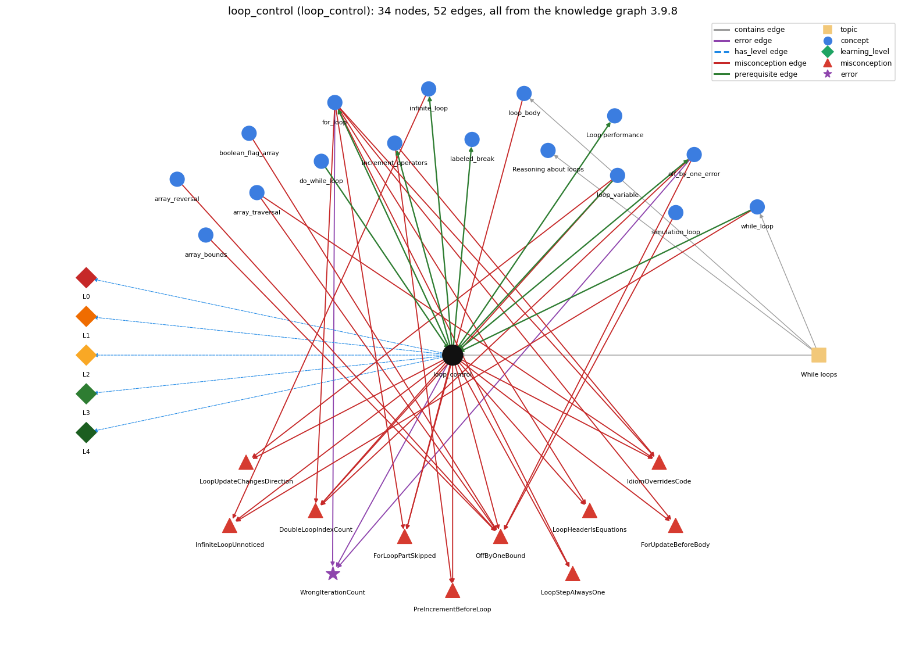

# loop_control (`loop_control`)

the three slots: init ; condition ; update

Section 1.3 Conditionals and Loops, topic 1.3.c While loops.

## At a glance

- **Needs first:** `do_while_loop`, `loop_variable`, `while_loop`
- **Leads to:** `for_loop`, `increment_operators`, `infinite_loop`, `labeled_break`, `loop_performance`, `off_by_one_error`
- **Learned alongside:** nothing
- **Misconceptions:** `DoubleLoopIndexCount`, `ForLoopPartSkipped`, `ForUpdateBeforeBody`, `IdiomOverridesCode`, `InfiniteLoopUnnoticed`, `LoopHeaderIsEquations`, `LoopStepAlwaysOne`, `LoopUpdateChangesDirection`, `OffByOneBound`, `PreIncrementBeforeLoop`
- **Errors:** `WrongIterationCount`
- **Levels:** L0, L1, L2, L3, L4

Everything below comes from the knowledge graph 3.9.8 (`data/raw/chapter1_kg_updated.json`): 52 edges around this concept, each explained in the graph's own words.

## What it needs first (3)

A prerequisite edge means the other concept has to be understood before `loop_control`.

### `do_while_loop` comes before `loop_control`

*do { body } while (c); -- body first, test after*

A do-while loop has the same control parts as a while loop (the variable set before, the condition, the update in the body); only the test is moved after the body.

- **Grounding:** book passage

### `loop_variable` comes before `loop_control`

*the counter that drives the loop*

The init, condition and update all act on the loop variable: the init sets it, the condition tests it, the update changes it.

- **Grounding:** book passage
- **How `loop_control` combines with `loop_variable`:** All three control parts act on the loop variable: the init sets it, the condition tests it, the update changes it.
- **How `loop_variable` combines with `loop_control`:** The init, condition and update all act on the loop variable: the init sets it, the condition tests it, the update changes it.

### `while_loop` comes before `loop_control`

*repeat a block while a condition holds*

A while loop has the same three control parts as a for loop, written in other places: the index set before the loop, the loop-continuation condition in the header, and the update as the last statement of the body.

- **Grounding:** book passage

## What it leads to (6)

These concepts need `loop_control` first.

### `loop_control` comes before `for_loop`

*a while with init/condition/update packaged together*

The for header is exactly the three control slots, and the body runs after the test and before the update on each pass.

- **Grounding:** book passage
- **How `loop_control` combines with `for_loop`:** The for header is exactly the three control slots, separated by semicolons; the body runs after the test and before the update.
- **How `for_loop` combines with `loop_control`:** The for header is exactly the three loop-control slots; the body runs after the test and before the update on each pass.

### `loop_control` comes before `increment_operators`

*++ / -- (and +=)*

The loop update i = i + 1 comes first; ++ (and +=) are then introduced as shorthand for that update.

- **Grounding:** book passage
- **How `loop_control` combines with `increment_operators`:** The update i = i + 1 is usually written i++ (or i += k for other steps); as a whole update statement ++i and i++ are equivalent.
- **How `increment_operators` combines with `loop_control`:** The usual for-loop update is i++ (shorthand for i = i + 1); as a stand-alone update statement ++i and i++ give the same loop.

### `loop_control` comes before `infinite_loop`

*a loop whose condition never becomes false*

A loop is infinite when its update never moves the condition towards false.

- **Grounding:** book passage
- **How `loop_control` combines with `infinite_loop`:** A loop is infinite when the update never moves the variable toward making the condition false (e.g. condition i &gt; 3 with update i = i + 1).
- **How `infinite_loop` combines with `loop_control`:** A loop is finite only if its update moves the control variable towards making the condition false. Wrong direction (\`i--\` with \`i &lt; n\`), wrong step (\`i += 0\` or \`x += 0.5\` on an int), or a condition that the update can step over (\`i != 10\` with \`i += 3\`) all give infinite loops.

### `loop_control` comes before `labeled_break`

*labeled break/continue exit or continue an outer loop*

break with a label leaves the labelled outer loop, not only the innermost one.

- **Grounding:** spec passage

### `loop_control` comes before `loop_performance`

*Loop performance: the running time of a loop program depends on how many iterations it makes*

The loop condition decides how many iterations run, so a better test (i &lt;= n/i instead of i &lt; n) makes the program much faster.

- **Grounding:** book passage
- **How `loop_control` combines with `loop_performance`:** The continuation condition fixes the number of iterations, so a sharper bound (i &lt;= n/i instead of i &lt; n) can make a program dramatically faster.
- **How `loop_performance` combines with `loop_control`:** The loop's condition and update set the iteration count. A tighter test that keeps correctness (i &lt;= n/i instead of i &lt; n) or a faster update (doubling instead of incrementing) can make the program dramatically faster with identical output.

### `loop_control` comes before `off_by_one_error`

*a loop or index that runs one time too many or too few (&lt; vs &lt;=, 0..n vs 1..n, length vs length-1)*

The initialization and the condition of a loop fix how many times it runs; one wrong bound makes it run once too many or too few.

- **Grounding:** book passage
- **How `off_by_one_error` combines with `loop_control`:** The start value and the condition together fix the number of passes; changing either by one changes the count by one.

## Learned alongside (0)

A parallel edge joins two concepts that sit side by side: neither is needed before the other.

No parallel edge touches this concept.

## Misconceptions (10)

A misconception edge states the wrong rule a student may hold about this concept, and the right rule.

### DoubleLoopIndexCount

- **Wrong rule:** for (double x = 0.0; x &lt;= 1.0; x += 0.1) runs exactly 11 times.
- **Right rule:** Using a double as a for-loop index is legal but bad practice: the number of iterations depends on an equality test between double values, which may not give the result you expect.
- **Role of this concept:** context
- **Shows at level L0 as:** misconception: wrong rule: for (double x = 0.0; x &lt;= 1.0; x += 0.1) runs exactly 11 times. Right rule: Using a double as a for-loop index is legal but bad practice: the number of iterations depends on an equality test between double values, which may not give the result you expect.
- **Also an edge from `for_loop`:** for (double x = 0.0; x &lt;= 1.0; x += 0.1) runs exactly 11 times.
- **Also an edge from `loop_variable`:** for (double x = 0.0; x &lt;= 1.0; x += 0.1) runs exactly 11 times.
- **Also an edge from `off_by_one_error`:** for (double x = 0.0; x &lt;= 1.0; x += 0.1) runs exactly 11 times.

### ForLoopPartSkipped

- **Wrong rule:** A pass of a loop may leave out one of its parts (the condition test, the body, the update, or the initialization).
- **Right rule:** Each pass of a for loop runs test, then body, then update, every time; the initialization runs once, at the start.
- **Role of this concept:** context
- **Shows at level L0 as:** misconception: wrong rule: A pass of a loop may leave out one of its parts (the condition test, the body, the update, or the initialization). Right rule: Each pass of a for loop runs test, then body, then update, every time; the initialization runs once, at the start.
- **Also an edge from `for_loop`:** A pass of a loop may leave out one of its parts (the condition test, the body, the update, or the initialization).
- **Also an edge from `loop_body`:** A pass of a loop may leave out one of its parts (the condition test, the body, the update, or the initialization).

### ForUpdateBeforeBody

- **Wrong rule:** The update part of a for header (e.g. i = i - 4) runs before the body on each pass, so the first pass already sees the updated value.
- **Right rule:** The update runs after the body, before the next condition test; the first pass uses the initial value.
- **Role of this concept:** context
- **Shows at level L0 as:** misconception: wrong rule: The update part of a for header (e.g. i = i - 4) runs before the body on each pass, so the first pass already sees the updated value. Right rule: The update runs after the body, before the next condition test; the first pass uses the initial value.
- **Also an edge from `for_loop`:** The update part of a for header (e.g. i = i - 4) runs before the body on each pass, so the first pass already sees the updated value.

### IdiomOverridesCode

- **Wrong rule:** An array loop processes the whole array from index 0 to length-1 and increments its index at the end of the body, whatever the code says.
- **Right rule:** The loop visits exactly the indices that its initialisation, guard and update produce, in the order in which its statements are written.
- **Role of this concept:** context
- **Shows at level L0 as:** misconception: wrong rule: An array loop processes the whole array from index 0 to length-1 and increments its index at the end of the body, whatever the code says. Right rule: The loop visits exactly the indices that its initialisation, guard and update produce, in the order in which its statements are written.
- **Also an edge from `array_traversal`:** An array loop processes the whole array from index 0 to length-1 and increments its index at the end of the body, whatever the code says.
- **Also an edge from `for_loop`:** An array loop processes the whole array from index 0 to length-1 and increments its index at the end of the body, whatever the code says.
- **Also an edge from `increment_operators`:** An array loop processes the whole array from index 0 to length-1 and increments its index at the end of the body, whatever the code says.

### InfiniteLoopUnnoticed

- **Wrong rule:** A while loop always stops on its own, even if nothing in its body can make the condition false.
- **Right rule:** A while loop stops only when its condition is false at a check, so if no pass changes the variables in the condition, it never stops.
- **Role of this concept:** context
- **Shows at level L0 as:** misconception: wrong rule: a condition that never goes false still terminates. Right rule: A while loop stops only when its condition is false at a check, so if no pass changes the variables in the condition, it never stops.
- **Also an edge from `infinite_loop`:** a condition that never goes false still terminates
- **Also an edge from `while_loop`:** a condition that never goes false still terminates

### LoopHeaderIsEquations

- **Wrong rule:** The initialization, condition and update of a for header are equations that all hold at the same time.
- **Right rule:** The three header parts are statements run at different moments: init once, then condition test, body, update, repeated.
- **Role of this concept:** context
- **Shows at level L0 as:** misconception: wrong rule: The initialization, condition and update of a for header are equations that all hold at the same time. Right rule: The three header parts are statements run at different moments: init once, then condition test, body, update, repeated.
- **Also an edge from `for_loop`:** The initialization, condition and update of a for header are equations that all hold at the same time.

### LoopStepAlwaysOne

- **Wrong rule:** A loop variable always goes up or down by 1, whatever the update says (so i = i - 4 is read as i--).
- **Right rule:** The loop variable changes exactly as the update expression says (i += 2, i = i - 4, i \*= 2, ...).
- **Role of this concept:** context
- **Shows at level L0 as:** misconception: wrong rule: A loop variable always goes up or down by 1, whatever the update says (so i = i - 4 is read as i--). Right rule: The loop variable changes exactly as the update expression says (i += 2, i = i - 4, i \*= 2, ...).
- **Also an edge from `for_loop`:** A loop variable always goes up or down by 1, whatever the update says (so i = i - 4 is read as i--).

### LoopUpdateChangesDirection

- **Wrong rule:** The update of the loop variable can change from pass to pass (e.g. switch direction) although the code is the same.
- **Right rule:** The update expression is the same on every pass; the loop variable changes by the rule written in the update.
- **Role of this concept:** context
- **Shows at level L0 as:** misconception: wrong rule: The update of the loop variable can change from pass to pass (e.g. switch direction) although the code is the same. Right rule: The update expression is the same on every pass; the loop variable changes by the rule written in the update.
- **Also an edge from `loop_variable`:** The update of the loop variable can change from pass to pass (e.g. switch direction) although the code is the same.

### OffByOneBound

- **Wrong rule:** i &lt; n and i &lt;= n mean the same, so the loop runs until i equals n and the last pass can use a[n].
- **Right rule:** for (i = 0; i &lt; n; i++) runs n times with i going up to n - 1; with &lt;= it runs n + 1 times and reaches i = n.
- **Role of this concept:** primary
- **Shows at level L0 as:** misconception: wrong rule: &lt; vs &lt;= and 0..n vs 0..n-1 are interchangeable. Right rule: for (i = 0; i &lt; n; i++) runs n times with i going up to n - 1; with &lt;= it runs n + 1 times and reaches i = n.
- **Also an edge from `array_bounds`:** &lt; vs &lt;= and 0..n vs 0..n-1 are interchangeable
- **Also an edge from `array_reversal`:** &lt; vs &lt;= and 0..n vs 0..n-1 are interchangeable
- **Also an edge from `array_traversal`:** &lt; vs &lt;= and 0..n vs 0..n-1 are interchangeable
- **Also an edge from `boolean_flag_array`:** &lt; vs &lt;= and 0..n vs 0..n-1 are interchangeable
- **Also an edge from `off_by_one_error`:** &lt; vs &lt;= and 0..n vs 0..n-1 are interchangeable
- **Also an edge from `simulation_loop`:** t &lt; T and t &lt;= T give the same number of moves.

### PreIncrementBeforeLoop

- **Wrong rule:** With ++i in the update of for (int i = s; i &lt; n; ++i), i is increased before the body runs, so the first pass uses s + 1.
- **Right rule:** The update runs after each pass of the body, so with either ++i or i++ the first pass uses i = s.
- **Role of this concept:** primary
- **Shows at level L0 as:** misconception: wrong rule: ++i in the for-update runs before the body each pass. Right rule: The update runs after each pass of the body, so with either ++i or i++ the first pass uses i = s.
- **Shows at level L0 as:** inconsistent trace: Applies the init-test-update rule (LT) unevenly: updates before the body on some passes, skips the test or the update on a pass, or re-runs the init. (here mixing in: "++i in the for-update runs before the body each pass")
- **Also an edge from `increment_operators`:** ++i in the for-update runs before the body each pass

## Errors (1)

An error edge states the rule that gets broken in a program, and the right rule.

### WrongIterationCount

- **Wrong rule:** Updates the loop counter so that the loop runs the wrong number of times.
- **Right rule:** The init, test and update together decide the number of passes; trace them to check the count.
- **Role of this concept:** context
- **Also an edge from `for_loop`:** Updates the loop counter so that the loop runs the wrong number of times.
- **Also an edge from `off_by_one_error`:** Updates the loop counter so that the loop runs the wrong number of times.

## Levels L0 to L4 (5 of 5)

Each level edge lists the ways a student shows that level, each with its exact rule.

### L0: Prestructural / sensorimotor

L0 for loop control: the answer holds a rule that contradicts Java.

*Deciding question: Does every rule the answer applies to loop control agree with the language rule? If it reads the code with everyday meanings, applies a wrong rule, or switches rules within one trace, it is L0. A slip in an otherwise rule-correct trace is L2 with an error, not L0.*

loop control -&gt; L0 (Prestructural): the answer holds a rule that contradicts Java (12 ways).

- **everyday reading** (folk-meaning rule): Folk meaning: in mathematics i = 0, i &lt; n and i = i + 1 are equations or constraints that hold at the same time (and i = i + 1 is nonsense). In Java they are three actions run at different moments: init once, test before each pass, update after each pass.
- **misconception** (wrong rule / right rule; shows `PreIncrementBeforeLoop`): wrong rule: ++i in the for-update runs before the body each pass. Right rule: The update runs after each pass of the body, so with either ++i or i++ the first pass uses i = s.
- **misconception** (wrong rule / right rule; shows `OffByOneBound`): wrong rule: &lt; vs &lt;= and 0..n vs 0..n-1 are interchangeable. Right rule: for (i = 0; i &lt; n; i++) runs n times with i going up to n - 1; with &lt;= it runs n + 1 times and reaches i = n.
- **inconsistent trace** (uneven-application rule; shows `PreIncrementBeforeLoop`): Applies the init-test-update rule (LT) unevenly: updates before the body on some passes, skips the test or the update on a pass, or re-runs the init. (here mixing in: "++i in the for-update runs before the body each pass")
- **misconception** (wrong rule / right rule; shows `InfiniteLoopUnnoticed`): wrong rule: a condition that never goes false still terminates. Right rule: A while loop stops only when its condition is false at a check, so if no pass changes the variables in the condition, it never stops.
- **misconception** (wrong rule / right rule; shows `DoubleLoopIndexCount`): wrong rule: for (double x = 0.0; x &lt;= 1.0; x += 0.1) runs exactly 11 times. Right rule: Using a double as a for-loop index is legal but bad practice: the number of iterations depends on an equality test between double values, which may not give the result you expect.
- **misconception** (wrong rule / right rule; shows `IdiomOverridesCode`): wrong rule: An array loop processes the whole array from index 0 to length-1 and increments its index at the end of the body, whatever the code says. Right rule: The loop visits exactly the indices that its initialisation, guard and update produce, in the order in which its statements are written.
- **misconception** (wrong rule / right rule; shows `LoopHeaderIsEquations`): wrong rule: The initialization, condition and update of a for header are equations that all hold at the same time. Right rule: The three header parts are statements run at different moments: init once, then condition test, body, update, repeated.
- **misconception** (wrong rule / right rule; shows `ForLoopPartSkipped`): wrong rule: A pass of a loop may leave out one of its parts (the condition test, the body, the update, or the initialization). Right rule: Each pass of a for loop runs test, then body, then update, every time; the initialization runs once, at the start.
- **misconception** (wrong rule / right rule; shows `ForUpdateBeforeBody`): wrong rule: The update part of a for header (e.g. i = i - 4) runs before the body on each pass, so the first pass already sees the updated value. Right rule: The update runs after the body, before the next condition test; the first pass uses the initial value.
- **misconception** (wrong rule / right rule; shows `LoopUpdateChangesDirection`): wrong rule: The update of the loop variable can change from pass to pass (e.g. switch direction) although the code is the same. Right rule: The update expression is the same on every pass; the loop variable changes by the rule written in the update.
- **misconception** (wrong rule / right rule; shows `LoopStepAlwaysOne`): wrong rule: A loop variable always goes up or down by 1, whatever the update says (so i = i - 4 is read as i--). Right rule: The loop variable changes exactly as the update expression says (i += 2, i = i - 4, i \*= 2, ...).

### L1: Unistructural / atom x text surface

L1 for loop control: the answer states one correct rule without applying it.

*Deciding question: Does the answer cover every part of the code, in order, with the values (L2)? If it covers one part or only states the rule, it is L1.*

loop control -&gt; L1 (Unistructural): the answer states one correct rule without applying it (2 ways).

- **names the element** (identity rule): Loop control is the init / continuation condition / increment scheme on an index variable that decides how many passes a loop makes and with which values.
- **states the rule** (declarative rule): Initialize an index variable, test a loop-continuation condition on it before each pass, and increment it as the last action of each pass; for (&lt;initialize&gt;; &lt;boolean expression&gt;; &lt;increment&gt;) packages the three. Choosing the loop: for when the passes are counted by an index, while when the loop runs until a condition changes, do-while when the body must run at least once; any one can be rewritten as another, so choose the clearest.

### L2: Multistructural / block x execution / preoperational

L2 for loop control: the answer applies these rules to every part of the code, in order.

*Deciding question: Is the answer many segments mapped onto lines (L2), or one segment stating the purpose of the whole (L3)? A correct output with no value-by-value justification is not levelled.*

loop control -&gt; L2 (Multistructural): the answer applies the rules of loop control to every part of the code, in order (3 ways).

- **line by line trace** (operational sequencing rule): init (once) -&gt; test -&gt; body -&gt; update -&gt; test -&gt; body -&gt; update ... -&gt; test false -&gt; exit.
- **output prediction** (evaluation / result rule): The number of passes and the values seen follow from the three parts: for (int i = 0; i &lt;= N; i++) makes N+1 passes with i = 0..N; with i &lt; N it makes N passes; i += 2 visits every second value.
- **one step execution** (state-transition rule): One update changes only the loop variable, by exactly the rule written (i++ adds 1, i = i - 4 subtracts 4); one test reads it and returns true or false without changing it.

### L3: Relational / relations x function (concrete operational begins)

L3 for loop control: the answer relates the parts by these rules.

*Deciding question: Was the purpose deduced from the code, or only guessed from traced input/output pairs (then L2)? Does the answer stay within the given code (L3), or reason about changed code, an error class or a new program (L4)?*

loop control -&gt; L3 (Relational): the answer relates the parts (7 ways).

- **relation to neighbour** (composition rule (with a neighbour)): All three control parts act on the loop variable: the init sets it, the condition tests it, the update changes it.
- **relation to neighbour** (composition rule (with a neighbour)): The for header is exactly the three control slots, separated by semicolons; the body runs after the test and before the update.
- **relation to neighbour** (composition rule (with a neighbour)): The update i = i + 1 is usually written i++ (or i += k for other steps); as a whole update statement ++i and i++ are equivalent.
- **relation to neighbour** (composition rule (with a neighbour)): A loop is infinite when the update never moves the variable toward making the condition false (e.g. condition i &gt; 3 with update i = i + 1).
- **relation to neighbour** (composition rule (with a neighbour)): The continuation condition fixes the number of iterations, so a sharper bound (i &lt;= n/i instead of i &lt; n) can make a program dramatically faster.
- **relation to neighbour** (composition rule (with a neighbour)): The initialization and the condition of a loop fix how many times it runs; one wrong bound makes it run once too many or too few.
- **purpose of the whole** (plan / role rule): Plan: counter-controlled loop - the loop variable is a stepper that walks a predictable sequence of values (0..N-1, 1..N, every 2nd value) and fixes the number of passes in advance.

### L4: Extended abstract (concrete-operational reversibility and conservation)

L4 for loop control: the answer reasons beyond the given code by these rules.

*Deciding question: Does the answer link the code to a broader context: a changed program, a class of inputs, an unseen problem? Re-tracing changed code value by value is L2; fixing one given failing case is L3.*

loop control -&gt; L4 (Extended abstract): the answer reasons beyond the given code (5 ways).

- **predict a change** (conservation rule; shows `PreIncrementBeforeLoop`): Changing &lt; to &lt;= adds one pass; starting at 1 instead of 0 removes one; doubling the step halves the passes; reversing init and bound with i-- visits the same values in reverse order (and still processes the same set only if both ends are adjusted).
- **diagnose an error** (error rule): rule broken: The number of passes is fixed by the init, the test and the update together. Kind: silent logic error. Trigger class: Wrong start value, &lt; vs &lt;=, a wrong step, or an extra update of the counter in the body (or outside the loop): the loop runs too few or too many passes (off by one, or skips values).
- **transfer to a new program** (applicability rule): Use explicit init/test/update control when the passes are counted or follow a fixed step; when the number of passes depends on data computed in the body, control the loop by that data (a while condition) instead.
- **diagnose an error** (error rule): rule broken: The update must move the loop variable toward making the condition false. Kind: silent logic error. Trigger class: An update in the wrong direction or a condition that the update cannot falsify (e.g. i &gt; 3 with i++, or i != 10 with i += 3): infinite loop.
- **diagnose an error** (error rule): rule broken: Do not control a loop by an equality test on double values. Kind: silent logic error. Trigger class: for (double x = 0.0; x &lt; 1.0; x += 0.1): after ten additions x is 0.9999999999999999, so the loop makes 11 passes instead of the intended 10.

## Same topic

`loop_control` belongs to the topic **While loops** (`topic1.3.c`). The topic also contains: `loop_body`, `loop_invariant_reasoning`, `while_loop`.

## Rules of the concept (28)

- **folk-meaning rule:** Folk meaning: in mathematics i = 0, i &lt; n and i = i + 1 are equations or constraints that hold at the same time (and i = i + 1 is nonsense). In Java they are three actions run at different moments: init once, test before each pass, update after each pass.
- **wrong rule / right rule:** OffByOneBound: wrong: &lt; vs &lt;= and 0..n vs 0..n-1 are interchangeable \| right: for (i = 0; i &lt; n; i++) runs n times with i going up to n - 1; with &lt;= it runs n + 1 times and reaches i = n.
- **wrong rule / right rule:** PreIncrementBeforeLoop: wrong: ++i in the for-update runs before the body each pass \| right: The update runs after each pass of the body, so with either ++i or i++ the first pass uses i = s.
- **wrong rule / right rule:** InfiniteLoopUnnoticed: wrong: a condition that never goes false still terminates \| right: A while loop stops only when its condition is false at a check, so if no pass changes the variables in the condition, it never stops.
- **wrong rule / right rule:** DoubleLoopIndexCount: wrong: for (double x = 0.0; x &lt;= 1.0; x += 0.1) runs exactly 11 times. \| right: Using a double as a for-loop index is legal but bad practice: the number of iterations depends on an equality test between double values, which may not give the result you expect.
- **wrong rule / right rule:** IdiomOverridesCode: wrong: An array loop processes the whole array from index 0 to length-1 and increments its index at the end of the body, whatever the code says. \| right: The loop visits exactly the indices that its initialisation, guard and update produce, in the order in which its statements are written.
- **wrong rule / right rule:** LoopHeaderIsEquations: wrong: The initialization, condition and update of a for header are equations that all hold at the same time. \| right: The three header parts are statements run at different moments: init once, then condition test, body, update, repeated.
- **wrong rule / right rule:** ForLoopPartSkipped: wrong: A pass of a loop may leave out one of its parts (the condition test, the body, the update, or the initialization). \| right: Each pass of a for loop runs test, then body, then update, every time; the initialization runs once, at the start.
- **wrong rule / right rule:** ForUpdateBeforeBody: wrong: The update part of a for header (e.g. i = i - 4) runs before the body on each pass, so the first pass already sees the updated value. \| right: The update runs after the body, before the next condition test; the first pass uses the initial value.
- **wrong rule / right rule:** LoopUpdateChangesDirection: wrong: The update of the loop variable can change from pass to pass (e.g. switch direction) although the code is the same. \| right: The update expression is the same on every pass; the loop variable changes by the rule written in the update.
- **wrong rule / right rule:** LoopStepAlwaysOne: wrong: A loop variable always goes up or down by 1, whatever the update says (so i = i - 4 is read as i--). \| right: The loop variable changes exactly as the update expression says (i += 2, i = i - 4, i \*= 2, ...).
- **uneven-application rule:** Applies the init-test-update rule (LT) unevenly: updates before the body on some passes, skips the test or the update on a pass, or re-runs the init.
- **identity rule:** Loop control is the init / continuation condition / increment scheme on an index variable that decides how many passes a loop makes and with which values.
- **declarative rule:** Initialize an index variable, test a loop-continuation condition on it before each pass, and increment it as the last action of each pass; for (&lt;initialize&gt;; &lt;boolean expression&gt;; &lt;increment&gt;) packages the three. Choosing the loop: for when the passes are counted by an index, while when the loop runs until a condition changes, do-while when the body must run at least once; any one can be rewritten as another, so choose the clearest.
- **operational sequencing rule:** init (once) -&gt; test -&gt; body -&gt; update -&gt; test -&gt; body -&gt; update ... -&gt; test false -&gt; exit.
- **evaluation / result rule:** The number of passes and the values seen follow from the three parts: for (int i = 0; i &lt;= N; i++) makes N+1 passes with i = 0..N; with i &lt; N it makes N passes; i += 2 visits every second value.
- **state-transition rule:** One update changes only the loop variable, by exactly the rule written (i++ adds 1, i = i - 4 subtracts 4); one test reads it and returns true or false without changing it.
- **composition rule (with a neighbour):** with loop\_variable: All three control parts act on the loop variable: the init sets it, the condition tests it, the update changes it.
- **composition rule (with a neighbour):** with for\_loop: The for header is exactly the three control slots, separated by semicolons; the body runs after the test and before the update.
- **composition rule (with a neighbour):** with increment\_operators: The update i = i + 1 is usually written i++ (or i += k for other steps); as a whole update statement ++i and i++ are equivalent.
- **composition rule (with a neighbour):** with infinite\_loop: A loop is infinite when the update never moves the variable toward making the condition false (e.g. condition i &gt; 3 with update i = i + 1).
- **composition rule (with a neighbour):** with loop\_performance: The continuation condition fixes the number of iterations, so a sharper bound (i &lt;= n/i instead of i &lt; n) can make a program dramatically faster.
- **plan / role rule:** Plan: counter-controlled loop - the loop variable is a stepper that walks a predictable sequence of values (0..N-1, 1..N, every 2nd value) and fixes the number of passes in advance.
- **conservation rule:** Changing &lt; to &lt;= adds one pass; starting at 1 instead of 0 removes one; doubling the step halves the passes; reversing init and bound with i-- visits the same values in reverse order (and still processes the same set only if both ends are adjusted).
- **error rule:** rule broken: The number of passes is fixed by the init, the test and the update together. (silent logic error)
- **error rule:** rule broken: The update must move the loop variable toward making the condition false. (silent logic error)
- **error rule:** rule broken: Do not control a loop by an equality test on double values. (silent logic error)
- **applicability rule:** Use explicit init/test/update control when the passes are counted or follow a fixed step; when the number of passes depends on data computed in the body, control the loop by that data (a while condition) instead.

## The whole prerequisite chain

- **Everything it builds on (14):** `arithmetic_operators`, `boolean`, `boolean_expression`, `comparison_operators`, `data_type`, `do_while_loop`, `expression`, `identifier`, `literal`, `logical_operators`, `loop_variable`, `primitive_type`, `variable`, `while_loop`
- **Everything that builds on it (34):** `accumulator_pattern`, `array_copy`, `array_reversal`, `array_traversal`, `boolean_flag_array`, `break_statement`, `continue_statement`, `convergence_rate`, `counter_pattern`, `enhanced_for`, `fencepost_loop`, `flag_search_loop`, `for_loop`, `frequency_counting`, `function_plotting`, `increment_operators`, `infinite_loop`, `labeled_break`, `loop_body`, `loop_performance`, `loop_scope`, `matrix_operations`, `monte_carlo_simulation`, `nested_loops`, `off_by_one_error`, `power_method`, `row_major_order`, `running_extreme`, `sentinel_loop`, `side_effect_order`, `simulation_loop`, `standard_audio`, `switch_statement`, `two_models`
