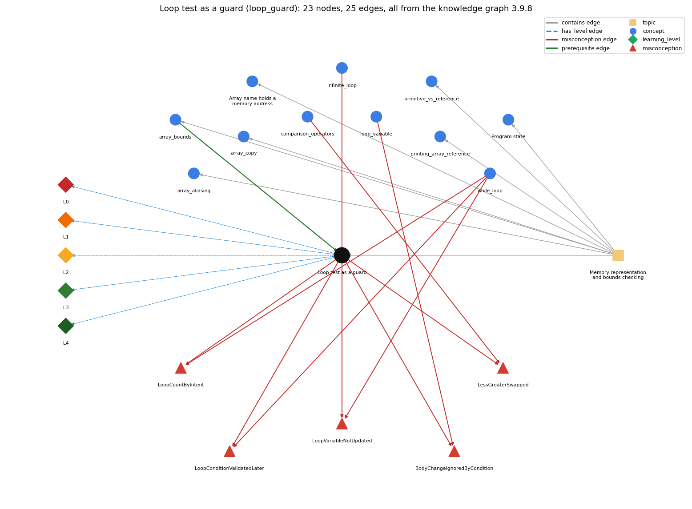

# Loop test as a guard (`loop_guard`)

putting the bounds check in the loop condition so the body never makes an out-of-bounds array access

Section 1.4 1.4 Arrays, topic 1.4.b Memory representation and bounds checking. From the knowledge graph 3.9.8 (`data/raw/chapter1_kg_updated.json`).

## Concepts associated with loop\_guard (11)

| Concept | Description | How it is associated |
| --- | --- | --- |
| **array\_aliasing** | two variables can refer to the same array | same topic (topic1.4.b) |
| **array\_bounds** | valid indices are 0 .. length-1; otherwise throws | prerequisite of it (it needs this) composition rule (R) with it same topic (topic1.4.b) |
| **array\_copy** | making a second, independent array with the same elements: create a new array and copy element by element (or Arrays.copyOf) | same topic (topic1.4.b) |
| **array\_reference** | the array variable stores the memory address (pointer) of the array; a[i] is found by adding i to that address | same topic (topic1.4.b) |
| **comparison\_operators** | == != &lt; &gt; &lt;= &gt;= | shares misconception LessGreaterSwapped |
| **infinite\_loop** | a loop whose condition never becomes false | shares misconception LoopVariableNotUpdated |
| **loop\_variable** | the counter that drives the loop | shares misconception BodyChangeIgnoredByCondition |
| **primitive\_vs\_reference** | a primitive variable holds its value; an array (or String) variable holds a reference to the object stored elsewhere | same topic (topic1.4.b) |
| **printing\_array\_reference** | printing an array variable prints a reference, not the elements | same topic (topic1.4.b) |
| **program\_state** | the information needed to know what a program will do next: the values of its variables and array entries and the next statement | same topic (topic1.4.b) |
| **while\_loop** | repeat a block while a condition holds | shares misconception LoopCountByIntent shares misconception LoopConditionValidatedLater shares misconception LoopVariableNotUpdated |

## Every edge in this view and its full label (25)

| From | Edge | To | Full edge label |
| --- | --- | --- | --- |
| **array\_bounds** | prerequisite | **loop\_guard** | Because an out-of-bounds index stops the program, the while test checks the bounds before the body uses the index. grounding: book\_passage composition rule (R) of array\_bounds with loop\_guard: Because an out-of-bounds index stops the program, the loop test checks the bounds before the body uses the index (e.g. x &gt; 0 &amp;&amp; x &lt; N-1 before a[x-1], a[x+1]). composition rule (R) of loop\_guard with array\_bounds: Because an out-of-bounds index stops the program, the guard tests the bounds before the body uses the index, and it must cover every neighbour index (x-1, x+1) the body reads. |
| **comparison\_operators** | misconception | **LessGreaterSwapped** | **wrong rule:** &lt; and &gt; mean the same thing (or a &lt; b means a is greater than b). **right rule:** a &lt; b is true when a is smaller than b; a &gt; b when a is larger. role: primary |
| **infinite\_loop** | misconception | **LoopVariableNotUpdated** | **wrong rule:** A while loop ends by itself even if nothing in the body changes the variable tested in the condition. **right rule:** If no statement in the body changes a variable in the condition, a condition that was true stays true and the loop never ends. role: context |
| **loop\_guard** | misconception | **BodyChangeIgnoredByCondition** | **wrong rule:** Changing the loop variable inside the body does not affect the loop condition; the loop still runs its planned number of times. **right rule:** The condition is tested with the current value of the variable, including changes made in the body. role: context |
| **loop\_guard** | misconception | **LessGreaterSwapped** | **wrong rule:** &lt; and &gt; mean the same thing (or a &lt; b means a is greater than b). **right rule:** a &lt; b is true when a is smaller than b; a &gt; b when a is larger. role: context |
| **loop\_guard** | misconception | **LoopConditionValidatedLater** | **wrong rule:** If a loop condition is false at first but would become true later, the loop still runs (it repeats or skips until the condition is true, then runs until it is false). **right rule:** A while loop whose condition is false at the first test runs zero times; nothing later revives it. role: context |
| **loop\_guard** | misconception | **LoopCountByIntent** | **wrong rule:** How many times a loop runs is decided by what the program is meant to do, so it may go on after its condition is false. **right rule:** The loop runs only while its condition is true when tested; it stops at the first false test. role: context |
| **loop\_guard** | misconception | **LoopVariableNotUpdated** | **wrong rule:** A while loop ends by itself even if nothing in the body changes the variable tested in the condition. **right rule:** If no statement in the body changes a variable in the condition, a condition that was true stays true and the loop never ends. role: primary |
| **loop\_variable** | misconception | **BodyChangeIgnoredByCondition** | **wrong rule:** Changing the loop variable inside the body does not affect the loop condition; the loop still runs its planned number of times. **right rule:** The condition is tested with the current value of the variable, including changes made in the body. role: primary |
| **while\_loop** | misconception | **LoopConditionValidatedLater** | **wrong rule:** If a loop condition is false at first but would become true later, the loop still runs (it repeats or skips until the condition is true, then runs until it is false). **right rule:** A while loop whose condition is false at the first test runs zero times; nothing later revives it. role: primary |
| **while\_loop** | misconception | **LoopCountByIntent** | **wrong rule:** How many times a loop runs is decided by what the program is meant to do, so it may go on after its condition is false. **right rule:** The loop runs only while its condition is true when tested; it stops at the first false test. role: primary |
| **while\_loop** | misconception | **LoopVariableNotUpdated** | **wrong rule:** A while loop ends by itself even if nothing in the body changes the variable tested in the condition. **right rule:** If no statement in the body changes a variable in the condition, a condition that was true stays true and the loop never ends. role: context |
| **loop\_guard** | has\_level | **loop\_guard@L0** | Loop test as a guard -&gt; L0 (Prestructural): the answer holds a rule that contradicts Java (7 ways). **[0] everyday\_reading** (E): Folk meaning: in English, 'while the dog is in the city, keep walking' is monitored continuously, so the walk stops the instant it leaves. Java rule: the while condition is tested only before each pass, so the guard must make every index used in the body legal at that moment. **[1] misconception** (M) &rarr; LoopVariableNotUpdated: wrong rule: A while loop ends by itself even if nothing in the body changes the variable tested in the condition. Right rule: If no statement in the body changes a variable in the condition, a condition that was true stays true and the loop never ends. **[2] inconsistent\_trace** (T) &rarr; LoopVariableNotUpdated: Points to LT: the guard is tested before every pass, and the body runs only if it is true. Inconsistent application: the trace applies the bounds test only at the first pass, or after the body has already used the out-of-range index. (here mixing in: "A while loop ends by itself even if nothing in the body changes the variable tested in the condition") **[3] misconception** (M) &rarr; BodyChangeIgnoredByCondition: wrong rule: Changing the loop variable inside the body does not affect the loop condition; the loop still runs its planned number of times. Right rule: The condition is tested with the current value of the variable, including changes made in the body. **[4] misconception** (M) &rarr; LoopCountByIntent: wrong rule: How many times a loop runs is decided by what the program is meant to do, so it may go on after its condition is false. Right rule: The loop runs only while its condition is true when tested; it stops at the first false test. **[5] misconception** (M) &rarr; LoopConditionValidatedLater: wrong rule: If a loop condition is false at first but would become true later, the loop still runs. Right rule: A while loop whose condition is false at the first test runs zero times; nothing later revives it. **[6] misconception** (M) &rarr; LessGreaterSwapped: wrong rule: &lt; and &gt; mean the same thing (or a &lt; b means a is greater than b). Right rule: a &lt; b is true when a is smaller than b; a &gt; b when a is larger. |
| **loop\_guard** | has\_level | **loop\_guard@L1** | Loop test as a guard -&gt; L1 (Unistructural): the answer states one correct rule without applying it (2 ways). **[0] names\_the\_element** (N): Identity: a loop guard is a loop-continuation test that also guards the body against an illegal statement, typically an out-of-bounds array access. **[1] states\_the\_rule** (S): Declarative: code the loop exit test so that whenever the body runs, all indices it uses are legal, e.g. while (x &gt; 0 &amp;&amp; x &lt; N-1 &amp;&amp; y &gt; 0 &amp;&amp; y &lt; N-1) before reading a[x-1][y], a[x+1][y], ... |
| **loop\_guard** | has\_level | **loop\_guard@L2** | Loop test as a guard -&gt; L2 (Multistructural): the answer applies the rules of Loop test as a guard to every part of the code, in order (3 ways). **[0] line\_by\_line\_trace** (LT): Sequencing: before each pass the guard is evaluated left to right, and &amp;&amp; stops at the first false operand; the body runs only if the whole guard is true; after the body the guard is tested again with the updated values. **[1] output\_prediction** (OP): Result: the loop ends normally, with no exception, when an index reaches the boundary; in SelfAvoidingWalk that means the dog has escaped. **[2] one\_step\_execution** (OS): State transition: one guard evaluation changes no variable; it either admits one more pass with legal indices or ends the loop. |
| **loop\_guard** | has\_level | **loop\_guard@L3** | Loop test as a guard -&gt; L3 (Relational): the answer relates the parts (2 ways). **[0] relation\_to\_neighbour** (R): Because an out-of-bounds index stops the program, the guard tests the bounds before the body uses the index, and it must cover every neighbour index (x-1, x+1) the body reads. **[1] purpose\_of\_the\_whole** (P): Plan/role: the guard-before-use plan. A single test both terminates the loop (event: reached the edge) and protects every array access in the body. |
| **loop\_guard** | has\_level | **loop\_guard@L4** | Loop test as a guard -&gt; L4 (Extended abstract): the answer reasons beyond the given code (5 ways). **[0] predict\_a\_change** (C) &rarr; LoopVariableNotUpdated: Conservation: inside the body the guard's invariant holds (0 &lt; x &lt; N-1, so x-1 and x+1 are legal indices). Weakening the guard (x &gt;= 0) or putting the array test before the bounds test in &amp;&amp; breaks it. **[1] transfer\_to\_a\_new\_program** (X): Applicability: use a guarded while loop when iteration continues until a data-dependent event and the body indexes an array with a moving position (walks, searches). For a full traversal, a for loop with i &lt; a.length is the simpler guard. **[2] diagnose\_an\_error** (D): rule broken: The guard must make every index in the body legal. Kind: run-time exception. Trigger class: the guard is missing, too weak (x &gt;= 0 &amp;&amp; x &lt; N while the body reads a[x+1]), or ordered wrongly (a[i] != 0 &amp;&amp; i &lt; n) so the access happens before the bounds test (ArrayIndexOutOfBoundsException) **[3] diagnose\_an\_error** (D): rule broken: The body must change a variable in the guard. Kind: silent logic error. Trigger class: no statement in the body updates the guarded index, so the loop never ends (infinite loop) **[4] diagnose\_an\_error** (D): rule broken: The relational operators must express the intended bound. Kind: silent logic error. Trigger class: &lt; and &gt; (or &lt; and &lt;=) are swapped, so the loop runs zero times or one pass too many |
| **topic1.4.b** | contains | **array\_aliasing** | topic topic1.4.b contains array\_aliasing |
| **topic1.4.b** | contains | **array\_bounds** | topic topic1.4.b contains array\_bounds |
| **topic1.4.b** | contains | **array\_copy** | topic topic1.4.b contains array\_copy |
| **topic1.4.b** | contains | **array\_reference** | topic topic1.4.b contains array\_reference |
| **topic1.4.b** | contains | **loop\_guard** | topic topic1.4.b contains loop\_guard |
| **topic1.4.b** | contains | **primitive\_vs\_reference** | topic topic1.4.b contains primitive\_vs\_reference |
| **topic1.4.b** | contains | **printing\_array\_reference** | topic topic1.4.b contains printing\_array\_reference |
| **topic1.4.b** | contains | **program\_state** | topic topic1.4.b contains program\_state |
