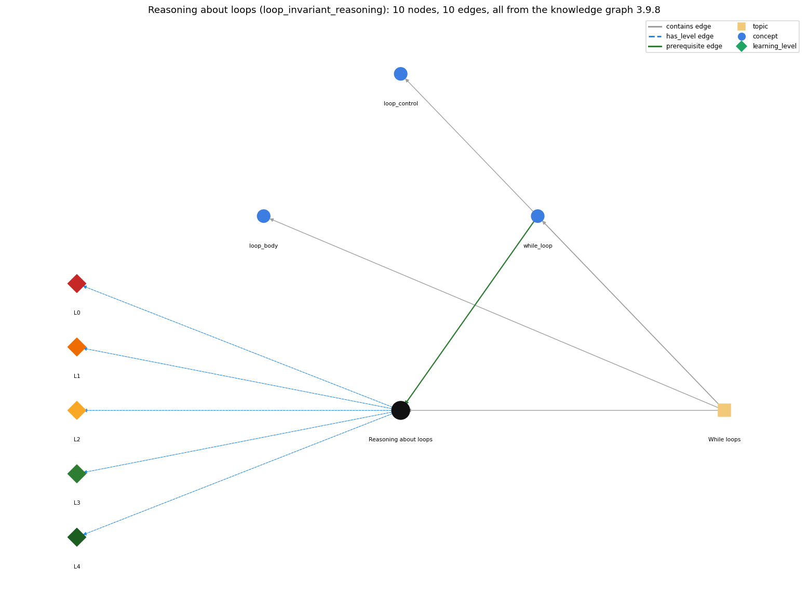

# Reasoning about loops (`loop_invariant_reasoning`)

convincing yourself a loop is correct by stating facts that hold each time through it and why it terminates

Section 1.3 1.3 Conditionals and Loops, topic 1.3.c While loops. From the knowledge graph 3.9.8 (`data/raw/chapter1_kg_updated.json`).

## Concepts associated with loop\_invariant\_reasoning (3)

| Concept | Description | How it is associated |
| --- | --- | --- |
| **loop\_body** | the block repeated each pass | same topic (topic1.3.c) |
| **loop\_control** | the three slots: init ; condition ; update | same topic (topic1.3.c) |
| **while\_loop** | repeat a block while a condition holds | prerequisite of it (it needs this) composition rule (R) with it same topic (topic1.3.c) |

## Every edge in this view and its full label (10)

| From | Edge | To | Full edge label |
| --- | --- | --- | --- |
| **while\_loop** | prerequisite | **loop\_invariant\_reasoning** | To reason about a while loop you state what stays true on every pass and why the condition eventually becomes false. grounding: book\_passage composition rule (R) of while\_loop with loop\_invariant\_reasoning: To trust a while loop, state what stays true on every pass and why the condition eventually becomes false (e.g. v is always a power of 2, v increases, so the loop terminates). composition rule (R) of loop\_invariant\_reasoning with while\_loop: The invariant is stated at the while test. The while condition supplies the extra fact available inside the body (v ≤ N/2, so 2v ≤ N), and its negation supplies the extra fact after the loop (2v &gt; N). |
| **loop\_invariant\_reasoning** | has\_level | **loop\_invariant\_reasoning@L0** | Reasoning about loops -&gt; L0 (Prestructural): the answer holds a rule that contradicts Java (1 way). **[0] everyday\_reading** (E): Folk meaning: in everyday life 'convincing yourself' means trying a few cases, so a novice thinks a loop is correct because it worked on the inputs tried. Loop reasoning requires a fact that holds before every test, a reason it survives each pass, and a reason the loop ends, so the argument covers any number of iterations. |
| **loop\_invariant\_reasoning** | has\_level | **loop\_invariant\_reasoning@L1** | Reasoning about loops -&gt; L1 (Unistructural): the answer states one correct rule without applying it (2 ways). **[0] names\_the\_element** (N): Reasoning method: arguing that a loop is correct by stating facts (invariants) that hold each time through it, plus a reason the loop terminates. **[1] states\_the\_rule** (S): For \`int v = 1; while (v &lt;= N/2) v = 2\*v;\`: (1) v is always a power of 2; (2) v is never greater than N; (3) v increases each pass, so the loop terminates; (4) after the loop, 2\*v &gt; N. So v is the largest power of 2 that is ≤ N. |
| **loop\_invariant\_reasoning** | has\_level | **loop\_invariant\_reasoning@L2** | Reasoning about loops -&gt; L2 (Multistructural): the answer applies the rules of Reasoning about loops to every part of the code, in order (3 ways). **[0] line\_by\_line\_trace** (LT): Order of the argument: show the fact holds after initialisation (before the first test); assume it holds at a test that is true, and show that one execution of the body restores it; show that a measure moves towards making the test false; at exit, combine the fact with the false test. **[1] output\_prediction** (OP): The product is a proven postcondition: after the loop, the invariant AND NOT(condition) holds. For example, v is a power of 2, v ≤ N and 2v &gt; N, so v is the largest power of 2 ≤ N (N = 13 gives 8). **[2] one\_step\_execution** (OS): One pass maps a state satisfying the invariant to another state satisfying it. \`v = 2\*v\` (when v ≤ N/2) keeps v a power of 2 and ≤ N, and strictly increases v. |
| **loop\_invariant\_reasoning** | has\_level | **loop\_invariant\_reasoning@L3** | Reasoning about loops -&gt; L3 (Relational): the answer relates the parts (2 ways). **[0] relation\_to\_neighbour** (R): The invariant is stated at the while test. The while condition supplies the extra fact available inside the body (v ≤ N/2, so 2v ≤ N), and its negation supplies the extra fact after the loop (2v &gt; N). **[1] purpose\_of\_the\_whole** (P): Purpose: to confirm that a loop computes what is intended for all inputs, not just traced ones, and that it terminates. It is essential for loops like Factors and Binary whose correctness is not obvious. |
| **loop\_invariant\_reasoning** | has\_level | **loop\_invariant\_reasoning@L4** | Reasoning about loops -&gt; L4 (Extended abstract): the answer reasons beyond the given code (5 ways). **[0] predict\_a\_change** (C): A change keeps the loop correct only if it keeps the invariant and the progress measure. Changing the test to \`v &lt;= N\` breaks 'v is never greater than N', so the result doubles. Removing the update breaks progress, and the loop runs forever. **[1] transfer\_to\_a\_new\_program** (X): Use invariant reasoning when a loop's correctness is not evident from a few traces (Factors, Binary, Newton's method) or when changing a loop's bound for performance. Use traces with print statements to check the reasoning on small cases. **[2] diagnose\_an\_error** (D): rule broken: The invariant must hold before the first test. Kind: silent logic error. Trigger class: A wrong initial value (v = 0 is not a power of 2, and the loop never grows it): the argument and the result fail. **[3] diagnose\_an\_error** (D): rule broken: Each pass must re-establish the invariant. Kind: silent logic error. Trigger class: A test or update that lets the last pass overshoot (\`while (v &lt;= N) v = 2\*v;\`): v ends greater than N. **[4] diagnose\_an\_error** (D): rule broken: Some quantity must strictly progress towards making the condition false. Kind: silent logic error. Trigger class: No progress measure (e.g. Collatz-style updates, or a missing update): the termination argument fails, and the loop may run forever. |
| **topic1.3.c** | contains | **loop\_body** | topic topic1.3.c contains loop\_body |
| **topic1.3.c** | contains | **loop\_control** | topic topic1.3.c contains loop\_control |
| **topic1.3.c** | contains | **loop\_invariant\_reasoning** | topic topic1.3.c contains loop\_invariant\_reasoning |
| **topic1.3.c** | contains | **while\_loop** | topic topic1.3.c contains while\_loop |
