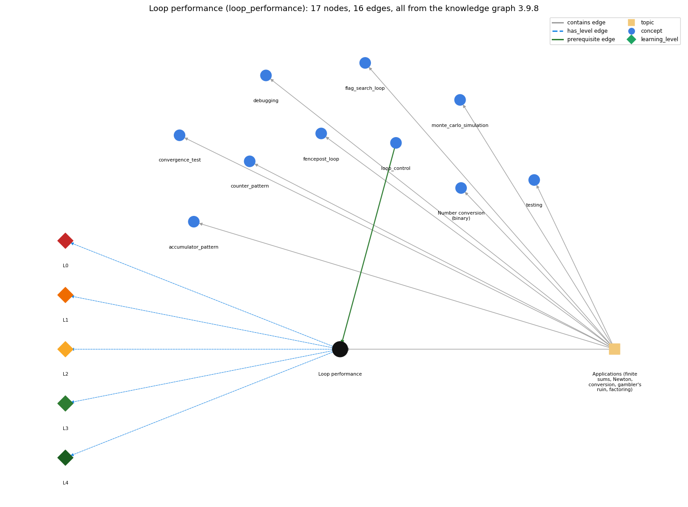

# Loop performance (`loop_performance`)

the running time of a loop program depends on how many iterations it makes

Section 1.3 1.3 Conditionals and Loops, topic 1.3.f Applications (finite sums, Newton, conversion, gambler's ruin, factoring).

## At a glance

- **Needs first:** `loop_control`
- **Leads to:** nothing
- **Learned alongside:** nothing
- **Misconceptions:** none
- **Errors:** none
- **Levels:** L0, L1, L2, L3, L4

Everything below comes from the knowledge graph 3.9.8 (`data/raw/chapter1_kg_updated.json`): 16 edges around this concept, each explained in the graph's own words.

## What it needs first (1)

A prerequisite edge means the other concept has to be understood before `loop_performance`.

### `loop_control` comes before `loop_performance`

*the three slots: init ; condition ; update*

The loop condition decides how many iterations run, so a better test (i &lt;= n/i instead of i &lt; n) makes the program much faster.

- **Grounding:** book passage
- **How `loop_performance` combines with `loop_control`:** The loop's condition and update set the iteration count. A tighter test that keeps correctness (i &lt;= n/i instead of i &lt; n) or a faster update (doubling instead of incrementing) can make the program dramatically faster with identical output.
- **How `loop_control` combines with `loop_performance`:** The continuation condition fixes the number of iterations, so a sharper bound (i &lt;= n/i instead of i &lt; n) can make a program dramatically faster.

## What it leads to (0)

These concepts need `loop_performance` first.

No concept has this one as a prerequisite.

## Learned alongside (0)

A parallel edge joins two concepts that sit side by side: neither is needed before the other.

No parallel edge touches this concept.

## Misconceptions (0)

A misconception edge states the wrong rule a student may hold about this concept, and the right rule.

The graph has no misconception edge from this concept.

## Errors (0)

An error edge states the rule that gets broken in a program, and the right rule.

The graph has no error edge from this concept.

## Levels L0 to L4 (5 of 5)

Each level edge lists the ways a student shows that level, each with its exact rule.

### L0: Prestructural / sensorimotor

L0 for Loop performance: the answer holds a rule that contradicts Java.

*Deciding question: Does every rule the answer applies to Loop performance agree with the language rule? If it reads the code with everyday meanings, applies a wrong rule, or switches rules within one trace, it is L0. A slip in an otherwise rule-correct trace is L2 with an error, not L0.*

Loop performance -&gt; L0 (Prestructural): the answer holds a rule that contradicts Java (1 way).

- **everyday reading** (folk-meaning rule): Folk meaning: 'computers are so fast it doesn't matter how many steps', so any correct loop is good enough. In fact running time grows with the number of iterations: an n-step loop over 10^18 values never finishes, while a √n-step loop finishes in seconds.

### L1: Unistructural / atom x text surface

L1 for Loop performance: the answer states one correct rule without applying it.

*Deciding question: Does the answer cover every part of the code, in order, with the values (L2)? If it covers one part or only states the rule, it is L1.*

Loop performance -&gt; L1 (Unistructural): the answer states one correct rule without applying it (2 ways).

- **names the element** (identity rule): Performance concept: the running time of a loop program is roughly (number of iterations) × (cost per iteration), and the loop condition determines the number of iterations.
- **states the rule** (declarative rule): Running time is proportional to the total number of times the innermost statements execute. Nested loops multiply their counts, so Gambler takes T × (average bets), and changing a bound from n to √n changes the feasible input from about 10^9 to about 10^18.

### L2: Multistructural / block x execution / preoperational

L2 for Loop performance: the answer applies these rules to every part of the code, in order.

*Deciding question: Is the answer many segments mapped onto lines (L2), or one segment stating the purpose of the whole (L3)? A correct output with no value-by-value justification is not levelled.*

Loop performance -&gt; L2 (Multistructural): the answer applies the rules of Loop performance to every part of the code, in order (3 ways).

- **line by line trace** (operational sequencing rule): Order of the estimate: count the passes of the outer loop; for each, count the passes of the inner loop; multiply (or sum); multiply by the cost of one pass of the innermost body.
- **output prediction** (evaluation / result rule): The result is an iteration count or time estimate. \`for (i = 2; i &lt;= n/i; i++)\` runs about √n times, against about n times for \`i &lt; n\`. Gambler 500 2500 100 makes about 100 × 10^6 bets (nearly 100 million random numbers).
- **one step execution** (state-transition rule): Each extra pass adds a constant amount of work. Adding 1 to the bound of a single loop adds one pass, while adding 1 to the bound of an outer loop adds a full run of the inner loop.

### L3: Relational / relations x function (concrete operational begins)

L3 for Loop performance: the answer relates the parts by these rules.

*Deciding question: Was the purpose deduced from the code, or only guessed from traced input/output pairs (then L2)? Does the answer stay within the given code (L3), or reason about changed code, an error class or a new program (L4)?*

Loop performance -&gt; L3 (Relational): the answer relates the parts (2 ways).

- **relation to neighbour** (composition rule (with a neighbour)): The loop's condition and update set the iteration count. A tighter test that keeps correctness (i &lt;= n/i instead of i &lt; n) or a faster update (doubling instead of incrementing) can make the program dramatically faster with identical output.
- **purpose of the whole** (plan / role rule): Purpose: to predict whether a program will finish in reasonable time for its inputs, and to choose among correct loop formulations (bounds, nesting, reuse of previous results).

### L4: Extended abstract (concrete-operational reversibility and conservation)

L4 for Loop performance: the answer reasons beyond the given code by these rules.

*Deciding question: Does the answer link the code to a broader context: a changed program, a class of inputs, an unseen problem? Re-tracing changed code value by value is L2; fixing one given failing case is L3.*

Loop performance -&gt; L4 (Extended abstract): the answer reasons beyond the given code (5 ways).

- **predict a change** (conservation rule): Changing the factoring test from \`i &lt; n\` to \`i &lt;= n/i\` keeps the output identical (by the invariant) and cuts iterations from about n to about √n. Reusing the previous term in the e^x loop keeps the sum and removes the inner loop.
- **transfer to a new program** (applicability rule): Think about loop performance whenever the iteration count grows with large inputs (factoring, prime counting, simulations, nested loops). For small fixed counts (TenHellos), clarity matters more than speed. Experiment with timings to compare formulations.
- **diagnose an error** (error rule): rule broken: Iteration count must be kept feasible for the input size. Kind: silent logic error. Trigger class: A naive bound (\`i &lt; n\` when factoring an 18-digit number, or counting primes up to 10 million by trial division): the program appears to hang.
- **diagnose an error** (error rule): rule broken: Do not recompute in an inner loop what the previous pass already computed. Kind: silent logic error. Trigger class: Recomputing each Taylor term from scratch in a nested loop: correct output but needlessly slow.
- **diagnose an error** (error rule): rule broken: Nested-loop cost is the product of the counts. Kind: silent logic error. Trigger class: Large T times long trials in a simulation (Gambler 100000 200000 100): run time explodes.

## Same topic

`loop_performance` belongs to the topic **Applications (finite sums, Newton, conversion, gambler's ruin, factoring)** (`topic1.3.f`). The topic also contains: `accumulator_pattern`, `convergence_test`, `counter_pattern`, `debugging`, `fencepost_loop`, `flag_search_loop`, `monte_carlo_simulation`, `number_conversion`, `testing`.

## Rules of the concept (14)

- **folk-meaning rule:** Folk meaning: 'computers are so fast it doesn't matter how many steps', so any correct loop is good enough. In fact running time grows with the number of iterations: an n-step loop over 10^18 values never finishes, while a √n-step loop finishes in seconds.
- **uneven-application rule:** Applies the iteration-counting rule unevenly: one loop's passes are counted while an inner loop's passes are left out, or the loop is assumed to run N times when its condition (i &lt;= n/i) stops it near √n, so the cost estimate is off by orders of magnitude.
- **identity rule:** Performance concept: the running time of a loop program is roughly (number of iterations) × (cost per iteration), and the loop condition determines the number of iterations.
- **declarative rule:** Running time is proportional to the total number of times the innermost statements execute. Nested loops multiply their counts, so Gambler takes T × (average bets), and changing a bound from n to √n changes the feasible input from about 10^9 to about 10^18.
- **operational sequencing rule:** Order of the estimate: count the passes of the outer loop; for each, count the passes of the inner loop; multiply (or sum); multiply by the cost of one pass of the innermost body.
- **evaluation / result rule:** The result is an iteration count or time estimate. \`for (i = 2; i &lt;= n/i; i++)\` runs about √n times, against about n times for \`i &lt; n\`. Gambler 500 2500 100 makes about 100 × 10^6 bets (nearly 100 million random numbers).
- **state-transition rule:** Each extra pass adds a constant amount of work. Adding 1 to the bound of a single loop adds one pass, while adding 1 to the bound of an outer loop adds a full run of the inner loop.
- **composition rule (with a neighbour):** with loop\_control: The loop's condition and update set the iteration count. A tighter test that keeps correctness (i &lt;= n/i instead of i &lt; n) or a faster update (doubling instead of incrementing) can make the program dramatically faster with identical output.
- **plan / role rule:** Purpose: to predict whether a program will finish in reasonable time for its inputs, and to choose among correct loop formulations (bounds, nesting, reuse of previous results).
- **conservation rule:** Changing the factoring test from \`i &lt; n\` to \`i &lt;= n/i\` keeps the output identical (by the invariant) and cuts iterations from about n to about √n. Reusing the previous term in the e^x loop keeps the sum and removes the inner loop.
- **error rule:** rule broken: Iteration count must be kept feasible for the input size. (silent logic error)
- **error rule:** rule broken: Do not recompute in an inner loop what the previous pass already computed. (silent logic error)
- **error rule:** rule broken: Nested-loop cost is the product of the counts. (silent logic error)
- **applicability rule:** Think about loop performance whenever the iteration count grows with large inputs (factoring, prime counting, simulations, nested loops). For small fixed counts (TenHellos), clarity matters more than speed. Experiment with timings to compare formulations.

## The whole prerequisite chain

- **Everything it builds on (15):** `arithmetic_operators`, `boolean`, `boolean_expression`, `comparison_operators`, `data_type`, `do_while_loop`, `expression`, `identifier`, `literal`, `logical_operators`, `loop_control`, `loop_variable`, `primitive_type`, `variable`, `while_loop`
- **Everything that builds on it (0):** nothing
