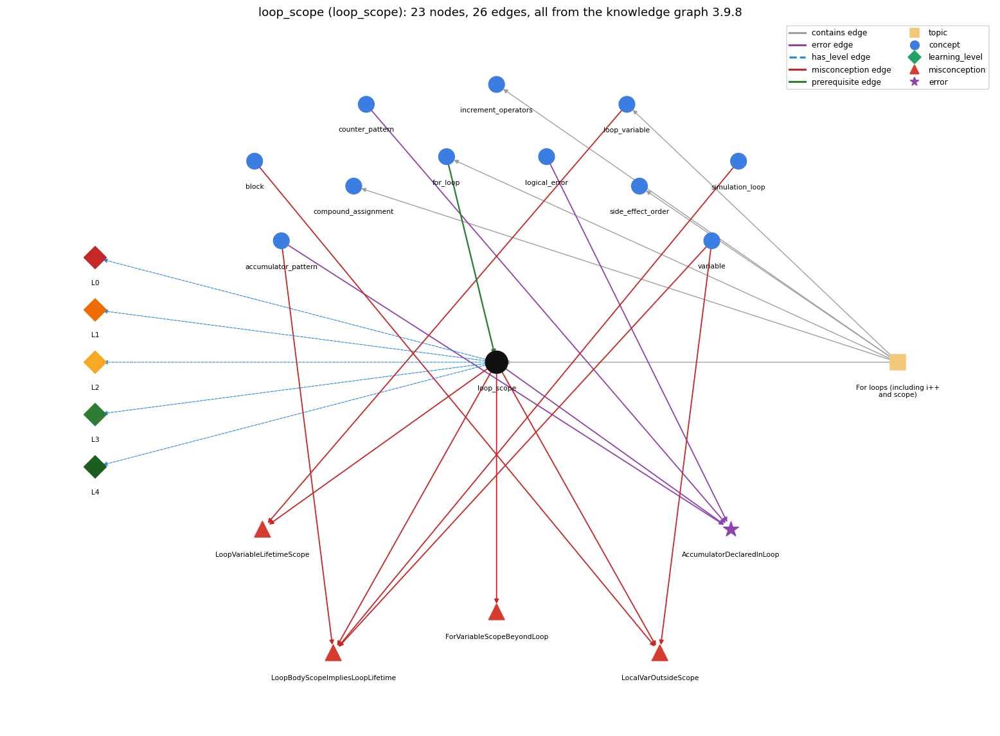

# loop_scope (`loop_scope`)

lifetime/scope of variables in/around the loop

Section 1.3 Conditionals and Loops, topic 1.3.d For loops (including i++ and scope).

## At a glance

- **Needs first:** `for_loop`
- **Leads to:** nothing
- **Learned alongside:** nothing
- **Misconceptions:** `ForVariableScopeBeyondLoop`, `LocalVarOutsideScope`, `LoopBodyScopeImpliesLoopLifetime`, `LoopVariableLifetimeScope`
- **Errors:** `AccumulatorDeclaredInLoop`
- **Levels:** L0, L1, L2, L3, L4

Everything below comes from the knowledge graph 3.9.8 (`data/raw/chapter1_kg_updated.json`): 26 edges around this concept, each explained in the graph's own words.

## What it needs first (1)

A prerequisite edge means the other concept has to be understood before `loop_scope`.

### `for_loop` comes before `loop_scope`

*a while with init/condition/update packaged together*

A variable declared in the for header exists only from its declaration to the end of the for statement's block.

- **Grounding:** book passage
- **How `loop_scope` combines with `for_loop`:** A variable declared in the for header exists only from its declaration to the end of the for statement, so for and while versions differ: in the while version the counter is still available after the loop.
- **How `for_loop` combines with `loop_scope`:** A variable declared in the for header is in scope only in the header and the body, so it cannot be used after the loop.

## What it leads to (0)

These concepts need `loop_scope` first.

No concept has this one as a prerequisite.

## Learned alongside (0)

A parallel edge joins two concepts that sit side by side: neither is needed before the other.

No parallel edge touches this concept.

## Misconceptions (4)

A misconception edge states the wrong rule a student may hold about this concept, and the right rule.

### ForVariableScopeBeyondLoop

- **Wrong rule:** i declared in the for header can still be used after the loop has ended.
- **Right rule:** i declared in the for header exists only inside the loop, so using it after the loop does not compile.
- **Role of this concept:** primary
- **Shows at level L0 as:** misconception: wrong rule: i declared in the for header can still be used after the loop has ended. Right rule: i declared in the for header exists only inside the loop, so using it after the loop does not compile.

### LocalVarOutsideScope

- **Wrong rule:** A variable declared inside a block can be used anywhere in the program, like a global.
- **Right rule:** A local variable exists only from its declaration to the end of its block.
- **Role of this concept:** primary
- **Shows at level L0 as:** misconception: wrong rule: A variable declared inside a block can be used anywhere in the program, like a global. Right rule: A local variable exists only from its declaration to the end of its block.
- **Also an edge from `block`:** A variable declared inside a block can be used anywhere in the program, like a global.
- **Also an edge from `variable`:** A variable declared inside a block can be used anywhere in the program, like a global.

### LoopBodyScopeImpliesLoopLifetime

- **Wrong rule:** A variable declared inside the loop body keeps its value from one pass to the next.
- **Right rule:** A variable declared inside the body is created anew on every pass and does not keep the previous pass's value.
- **Role of this concept:** primary
- **Shows at level L0 as:** misconception: wrong rule: a variable declared in the loop body lives across all iterations. Right rule: A variable declared inside the body is in scope only to the end of the body, so each pass declares and initializes it afresh and it does not keep the previous pass's value.
- **Shows at level L0 as:** inconsistent trace: Applies the scope rule (LT) unevenly: lets a body variable keep its value from the last pass on some passes but not others, or uses the for variable after the loop in one place but not another. (here mixing in: "a variable declared in the loop body lives across all iterations")
- **Also an edge from `accumulator_pattern`:** a variable declared in the loop body lives across all iterations
- **Also an edge from `simulation_loop`:** Declaring page inside the simulation loop still lets the surfer continue from the previous page.
- **Also an edge from `variable`:** a variable declared in the loop body lives across all iterations

### LoopVariableLifetimeScope

- **Wrong rule:** The for variable i is a new variable on every pass rather than one variable changed by the update.
- **Right rule:** The for variable i is created once by the init, and the update changes that same variable on every pass.
- **Role of this concept:** primary
- **Shows at level L0 as:** misconception: wrong rule: The for variable i is a new variable on every pass rather than one variable changed by the update. Right rule: The for variable i is created once by the init, the update changes that same variable on every pass, and i exists only until the end of the for statement.
- **Also an edge from `loop_variable`:** The for variable i is a new variable on every pass rather than one variable changed by the update.

## Errors (1)

An error edge states the rule that gets broken in a program, and the right rule.

### AccumulatorDeclaredInLoop

- **Wrong rule:** Declaring sum inside the loop body keeps a running total across passes.
- **Right rule:** The accumulator must be declared and initialised before the loop.
- **Role of this concept:** primary
- **Also an edge from `accumulator_pattern`:** Declaring sum inside the loop body keeps a running total across passes.
- **Also an edge from `counter_pattern`:** Declaring sum inside the loop body keeps a running total across passes.
- **Also an edge from `logical_error`:** Declaring sum inside the loop body keeps a running total across passes.

## Levels L0 to L4 (5 of 5)

Each level edge lists the ways a student shows that level, each with its exact rule.

### L0: Prestructural / sensorimotor

L0 for loop scope: the answer holds a rule that contradicts Java.

*Deciding question: Does every rule the answer applies to loop scope agree with the language rule? If it reads the code with everyday meanings, applies a wrong rule, or switches rules within one trace, it is L0. A slip in an otherwise rule-correct trace is L2 with an error, not L0.*

loop scope -&gt; L0 (Prestructural): the answer holds a rule that contradicts Java (6 ways).

- **everyday reading** (folk-meaning rule): Folk meaning: once a name is introduced ('let i be ...') it can be referred to for the rest of the text, and something introduced inside a repeated step keeps existing across repetitions. In Java a local variable exists only from its declaration to the end of its block, and a for header counts as part of the loop's block.
- **misconception** (wrong rule / right rule; shows `LoopBodyScopeImpliesLoopLifetime`): wrong rule: a variable declared in the loop body lives across all iterations. Right rule: A variable declared inside the body is in scope only to the end of the body, so each pass declares and initializes it afresh and it does not keep the previous pass's value.
- **misconception** (wrong rule / right rule; shows `LoopVariableLifetimeScope`): wrong rule: The for variable i is a new variable on every pass rather than one variable changed by the update. Right rule: The for variable i is created once by the init, the update changes that same variable on every pass, and i exists only until the end of the for statement.
- **misconception** (wrong rule / right rule; shows `ForVariableScopeBeyondLoop`): wrong rule: i declared in the for header can still be used after the loop has ended. Right rule: i declared in the for header exists only inside the loop, so using it after the loop does not compile.
- **misconception** (wrong rule / right rule; shows `LocalVarOutsideScope`): wrong rule: A variable declared inside a block can be used anywhere in the program, like a global. Right rule: A local variable exists only from its declaration to the end of its block.
- **inconsistent trace** (uneven-application rule; shows `LoopBodyScopeImpliesLoopLifetime`): Applies the scope rule (LT) unevenly: lets a body variable keep its value from the last pass on some passes but not others, or uses the for variable after the loop in one place but not another. (here mixing in: "a variable declared in the loop body lives across all iterations")

### L1: Unistructural / atom x text surface

L1 for loop scope: the answer states one correct rule without applying it.

*Deciding question: Does the answer cover every part of the code, in order, with the values (L2)? If it covers one part or only states the rule, it is L1.*

loop scope -&gt; L1 (Unistructural): the answer states one correct rule without applying it (2 ways).

- **names the element** (identity rule): Scope is the part of the program where a variable is defined (can be used); for loops, the header is in the same block as the body.
- **states the rule** (declarative rule): A local variable's scope is the rest of the block after its declaration; a variable declared in a for initializer is in scope in the header and the body only; redeclaring a local variable inside its scope is a compile-time error.

### L2: Multistructural / block x execution / preoperational

L2 for loop scope: the answer applies these rules to every part of the code, in order.

*Deciding question: Is the answer many segments mapped onto lines (L2), or one segment stating the purpose of the whole (L3)? A correct output with no value-by-value justification is not levelled.*

loop scope -&gt; L2 (Multistructural): the answer applies the rules of loop scope to every part of the code, in order (3 ways).

- **line by line trace** (operational sequencing rule): Each time control enters a block, its declarations run in order, creating and (if initialized) setting those variables; when the block ends they cease to exist. For a loop body this happens on every pass; for the for-header variable once, at the init.
- **output prediction** (evaluation / result rule): A variable declared inside the body starts from its initializer on every pass (int s = 0; inside the body gives s = 0 at the start of each pass); a for-header variable cannot be printed after the loop (compile error).
- **one step execution** (state-transition rule): Entering the body creates its local variables afresh; leaving it removes them; values left in variables declared before the loop persist into the next pass.

### L3: Relational / relations x function (concrete operational begins)

L3 for loop scope: the answer relates the parts by these rules.

*Deciding question: Was the purpose deduced from the code, or only guessed from traced input/output pairs (then L2)? Does the answer stay within the given code (L3), or reason about changed code, an error class or a new program (L4)?*

loop scope -&gt; L3 (Relational): the answer relates the parts (2 ways).

- **relation to neighbour** (composition rule (with a neighbour)): A variable declared in the for header exists only from its declaration to the end of the for statement, so for and while versions differ: in the while version the counter is still available after the loop.
- **purpose of the whole** (plan / role rule): Plan: keep each variable as local as possible - declare a loop index in the for header when it is not needed afterwards, and declare variables that must survive the loop (accumulators, counters, loop variables needed later) before it.

### L4: Extended abstract (concrete-operational reversibility and conservation)

L4 for loop scope: the answer reasons beyond the given code by these rules.

*Deciding question: Does the answer link the code to a broader context: a changed program, a class of inputs, an unseen problem? Re-tracing changed code value by value is L2; fixing one given failing case is L3.*

loop scope -&gt; L4 (Extended abstract): the answer reasons beyond the given code (5 ways).

- **predict a change** (conservation rule; shows `LoopBodyScopeImpliesLoopLifetime`): Moving a declaration from before the loop into the body re-initializes the variable every pass and makes it unusable after the loop; moving a for-header declaration out (int i; for (i = 0; ...)) keeps the loop's behaviour and makes i usable after it.
- **diagnose an error** (error rule): rule broken: A variable declared in the body is in scope only to the end of the body and is re-declared and re-initialized on every pass. Kind: silent logic error. Trigger class: for (...) { int sum = 0; sum += a[i]; }: sum restarts at 0 each pass, so only the last term survives; printing sum after the loop is a compile-time error (cannot find symbol) because sum is out of scope.
- **transfer to a new program** (applicability rule): Declare the index in the for header when it is used only inside the loop; declare it before the loop when its final value is needed (as in the break-based primality test) and declare running results before the loop.
- **diagnose an error** (error rule): rule broken: A for-header variable is out of scope after the loop. Kind: compile-time. Trigger class: Using i after for (int i = ...) {...}: 'cannot find symbol'.
- **diagnose an error** (error rule): rule broken: A local variable cannot be redeclared in its own scope. Kind: compile-time. Trigger class: Declaring int i inside a for (int i ...) body, or an inner for (int i ...) inside an outer for (int i ...): 'variable i is already defined'.

## Same topic

`loop_scope` belongs to the topic **For loops (including i++ and scope)** (`topic1.3.d`). The topic also contains: `compound_assignment`, `for_loop`, `increment_operators`, `loop_variable`, `side_effect_order`.

## Rules of the concept (18)

- **folk-meaning rule:** Folk meaning: once a name is introduced ('let i be ...') it can be referred to for the rest of the text, and something introduced inside a repeated step keeps existing across repetitions. In Java a local variable exists only from its declaration to the end of its block, and a for header counts as part of the loop's block.
- **wrong rule / right rule:** ForVariableScopeBeyondLoop: wrong: i declared in the for header can still be used after the loop has ended. \| right: i declared in the for header exists only inside the loop, so using it after the loop does not compile.
- **wrong rule / right rule:** LocalVarOutsideScope: wrong: A variable declared inside a block can be used anywhere in the program, like a global. \| right: A local variable exists only from its declaration to the end of its block.
- **wrong rule / right rule:** LoopBodyScopeImpliesLoopLifetime: wrong: a variable declared in the loop body lives across all iterations \| right: A variable declared inside the body is in scope only to the end of the body, so each pass declares and initializes it afresh and it does not keep the previous pass's value.
- **wrong rule / right rule:** LoopVariableLifetimeScope: wrong: The for variable i is a new variable on every pass rather than one variable changed by the update. \| right: The for variable i is created once by the init, the update changes that same variable on every pass, and i exists only until the end of the for statement.
- **uneven-application rule:** Applies the scope rule (LT) unevenly: lets a body variable keep its value from the last pass on some passes but not others, or uses the for variable after the loop in one place but not another.
- **identity rule:** Scope is the part of the program where a variable is defined (can be used); for loops, the header is in the same block as the body.
- **declarative rule:** A local variable's scope is the rest of the block after its declaration; a variable declared in a for initializer is in scope in the header and the body only; redeclaring a local variable inside its scope is a compile-time error.
- **operational sequencing rule:** Each time control enters a block, its declarations run in order, creating and (if initialized) setting those variables; when the block ends they cease to exist. For a loop body this happens on every pass; for the for-header variable once, at the init.
- **evaluation / result rule:** A variable declared inside the body starts from its initializer on every pass (int s = 0; inside the body gives s = 0 at the start of each pass); a for-header variable cannot be printed after the loop (compile error).
- **state-transition rule:** Entering the body creates its local variables afresh; leaving it removes them; values left in variables declared before the loop persist into the next pass.
- **composition rule (with a neighbour):** with for\_loop: A variable declared in the for header exists only from its declaration to the end of the for statement, so for and while versions differ: in the while version the counter is still available after the loop.
- **plan / role rule:** Plan: keep each variable as local as possible - declare a loop index in the for header when it is not needed afterwards, and declare variables that must survive the loop (accumulators, counters, loop variables needed later) before it.
- **conservation rule:** Moving a declaration from before the loop into the body re-initializes the variable every pass and makes it unusable after the loop; moving a for-header declaration out (int i; for (i = 0; ...)) keeps the loop's behaviour and makes i usable after it.
- **error rule:** rule broken: A variable declared in the body is in scope only to the end of the body and is re-declared and re-initialized on every pass. (silent logic error)
- **error rule:** rule broken: A for-header variable is out of scope after the loop. (compile-time)
- **error rule:** rule broken: A local variable cannot be redeclared in its own scope. (compile-time)
- **applicability rule:** Declare the index in the for header when it is used only inside the loop; declare it before the loop when its final value is needed (as in the break-based primality test) and declare running results before the loop.

## The whole prerequisite chain

- **Everything it builds on (16):** `arithmetic_operators`, `boolean`, `boolean_expression`, `comparison_operators`, `data_type`, `do_while_loop`, `expression`, `for_loop`, `identifier`, `literal`, `logical_operators`, `loop_control`, `loop_variable`, `primitive_type`, `variable`, `while_loop`
- **Everything that builds on it (0):** nothing
