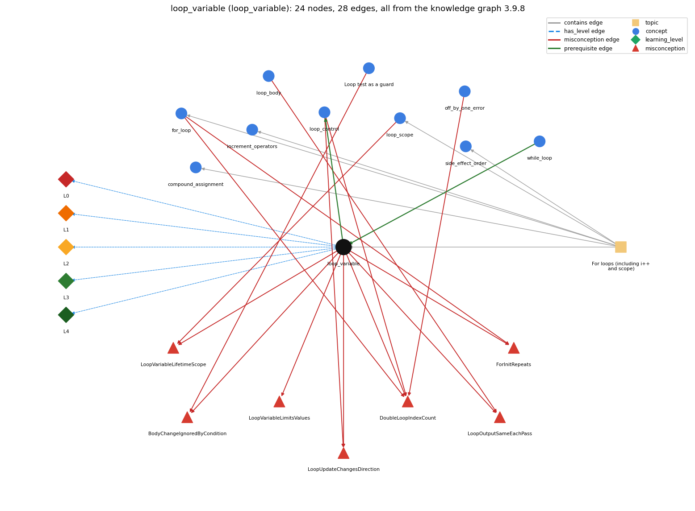

# loop_variable (`loop_variable`)

the counter that drives the loop

Section 1.3 Conditionals and Loops, topic 1.3.d For loops (including i++ and scope).

## At a glance

- **Needs first:** `while_loop`
- **Leads to:** `loop_control`
- **Learned alongside:** nothing
- **Misconceptions:** `BodyChangeIgnoredByCondition`, `DoubleLoopIndexCount`, `ForInitRepeats`, `LoopOutputSameEachPass`, `LoopUpdateChangesDirection`, `LoopVariableLifetimeScope`, `LoopVariableLimitsValues`
- **Errors:** none
- **Levels:** L0, L1, L2, L3, L4

Everything below comes from the knowledge graph 3.9.8 (`data/raw/chapter1_kg_updated.json`): 28 edges around this concept. The edge logic, the wrong and right rules and the exact rules of the ways are copied word for word from the graph.

## To work on (0)

Nothing is missing for this concept.

## What it needs first (1)

A prerequisite edge means the other concept has to be understood before `loop_variable`.

### `while_loop` comes before `loop_variable`

*repeat a block while a condition holds*

- **Edge:** `pre:while_loop->loop_variable`
- **Exact edge logic:** A loop variable is a counter that the loop initializes, tests in its condition and increments on each pass.
- **Grounding:** book\_passage
- **Composition rule (R) of `loop_variable` with `while_loop`:** In a while loop the loop variable is declared and initialized before the loop and updated inside the body, so it remains available after the loop.
- **Composition rule (R) of `while_loop` with `loop_variable`:** The while condition usually tests a loop variable that is initialized before the loop and updated in the body; if the body never changes it, the loop never ends.

## What it leads to (1)

These concepts need `loop_variable` first.

### `loop_variable` comes before `loop_control`

*the three slots: init ; condition ; update*

- **Edge:** `pre:loop_variable->loop_control`
- **Exact edge logic:** The init, condition and update all act on the loop variable: the init sets it, the condition tests it, the update changes it.
- **Grounding:** book\_passage
- **Composition rule (R) of `loop_variable` with `loop_control`:** The init, condition and update all act on the loop variable: the init sets it, the condition tests it, the update changes it.
- **Composition rule (R) of `loop_control` with `loop_variable`:** All three control parts act on the loop variable: the init sets it, the condition tests it, the update changes it.

## Learned alongside (0)

A parallel edge joins two concepts that sit side by side: neither is needed before the other.

No parallel edge touches this concept.

## Misconceptions (7)

A misconception edge states the wrong rule a student may hold about this concept, and the right rule.

### BodyChangeIgnoredByCondition

- **Edge:** `loop_variable` &rarr; `BodyChangeIgnoredByCondition` (misconception)
- **Exact edge logic (the wrong rule):** Changing the loop variable inside the body does not affect the loop condition; the loop still runs its planned number of times.
- **Twin logic (the right rule):** The condition is tested with the current value of the variable, including changes made in the body.
- **Wrong belief (on the node):** Changing the loop variable inside the body does not affect the loop condition; the loop still runs its planned number of times.
- **Correct rule (on the node):** The condition is tested with the current value of the variable, including changes made in the body.
- **Provenance:** published
- **Role of this concept:** primary
- **L0 way linked to it:** yes
- **L0 way [2] misconception, exact rule:** wrong rule: Changing the loop variable inside the body does not affect the loop condition; the loop still runs its planned number of times. Right rule: The condition is tested with the current value of the variable, including changes made in the body.
- **Edge `loop_guard` &rarr; `BodyChangeIgnoredByCondition`, exact edge logic:** Changing the loop variable inside the body does not affect the loop condition; the loop still runs its planned number of times. **Twin logic:** The condition is tested with the current value of the variable, including changes made in the body. (role: context)

### DoubleLoopIndexCount

- **Edge:** `loop_variable` &rarr; `DoubleLoopIndexCount` (misconception)
- **Exact edge logic (the wrong rule):** for (double x = 0.0; x &lt;= 1.0; x += 0.1) runs exactly 11 times.
- **Twin logic (the right rule):** Using a double as a for-loop index is legal but bad practice: the number of iterations depends on an equality test between double values, which may not give the result you expect.
- **Wrong belief (on the node):** for (double x = 0.0; x &lt;= 1.0; x += 0.1) runs exactly 11 times.
- **Correct rule (on the node):** Using a double as a for-loop index is legal but bad practice: the number of iterations depends on an equality test between double values, which may not give the result you expect.
- **Provenance:** textbook
- **Role of this concept:** context
- **L0 way linked to it:** yes
- **L0 way [7] misconception, exact rule:** wrong rule: for (double x = 0.0; x &lt;= 1.0; x += 0.1) runs exactly 11 times. Right rule: Using a double as a for-loop index is legal but bad practice: the number of iterations depends on an equality test between double values, which may not give the result you expect.
- **Edge `for_loop` &rarr; `DoubleLoopIndexCount`, exact edge logic:** for (double x = 0.0; x &lt;= 1.0; x += 0.1) runs exactly 11 times. **Twin logic:** Using a double as a for-loop index is legal but bad practice: the number of iterations depends on an equality test between double values, which may not give the result you expect. (role: primary)
- **Edge `loop_control` &rarr; `DoubleLoopIndexCount`, exact edge logic:** for (double x = 0.0; x &lt;= 1.0; x += 0.1) runs exactly 11 times. **Twin logic:** Using a double as a for-loop index is legal but bad practice: the number of iterations depends on an equality test between double values, which may not give the result you expect. (role: context)
- **Edge `off_by_one_error` &rarr; `DoubleLoopIndexCount`, exact edge logic:** for (double x = 0.0; x &lt;= 1.0; x += 0.1) runs exactly 11 times. **Twin logic:** Using a double as a for-loop index is legal but bad practice: the number of iterations depends on an equality test between double values, which may not give the result you expect. (role: context)

### ForInitRepeats

- **Edge:** `loop_variable` &rarr; `ForInitRepeats` (misconception)
- **Exact edge logic (the wrong rule):** The initialization of a for loop runs again after a pass of the body.
- **Twin logic (the right rule):** The initialization runs exactly once, before the first condition test.
- **Wrong belief (on the node):** The initialization of a for loop runs again after a pass of the body.
- **Correct rule (on the node):** The initialization runs exactly once, before the first condition test.
- **Provenance:** published
- **Role of this concept:** context
- **L0 way linked to it:** yes
- **L0 way [8] misconception, exact rule:** wrong rule: The initialization of a for loop runs again after a pass of the body. Right rule: The initialization runs exactly once, before the first condition test.
- **Edge `for_loop` &rarr; `ForInitRepeats`, exact edge logic:** The initialization of a for loop runs again after a pass of the body. **Twin logic:** The initialization runs exactly once, before the first condition test. (role: primary)

### LoopOutputSameEachPass

- **Edge:** `loop_variable` &rarr; `LoopOutputSameEachPass` (misconception)
- **Exact edge logic (the wrong rule):** A loop prints the same thing on every pass; the changing loop variable does not affect what the body does.
- **Twin logic (the right rule):** The body uses the current value of the loop variable, so its output can differ on each pass.
- **Wrong belief (on the node):** A loop prints the same thing on every pass; the changing loop variable does not affect what the body does.
- **Correct rule (on the node):** The body uses the current value of the loop variable, so its output can differ on each pass.
- **Provenance:** published
- **Role of this concept:** primary
- **L0 way linked to it:** yes
- **L0 way [3] misconception, exact rule:** wrong rule: A loop prints the same thing on every pass; the changing loop variable does not affect what the body does. Right rule: The body uses the current value of the loop variable, so its output can differ on each pass.
- **Edge `loop_body` &rarr; `LoopOutputSameEachPass`, exact edge logic:** A loop prints the same thing on every pass; the changing loop variable does not affect what the body does. **Twin logic:** The body uses the current value of the loop variable, so its output can differ on each pass. (role: context)

### LoopUpdateChangesDirection

- **Edge:** `loop_variable` &rarr; `LoopUpdateChangesDirection` (misconception)
- **Exact edge logic (the wrong rule):** The update of the loop variable can change from pass to pass (e.g. switch direction) although the code is the same.
- **Twin logic (the right rule):** The update expression is the same on every pass; the loop variable changes by the rule written in the update.
- **Wrong belief (on the node):** The update of the loop variable can change from pass to pass (e.g. switch direction) although the code is the same.
- **Correct rule (on the node):** The update expression is the same on every pass; the loop variable changes by the rule written in the update.
- **Provenance:** published
- **Role of this concept:** primary
- **L0 way linked to it:** yes
- **L0 way [1] misconception, exact rule:** wrong rule: The update of the loop variable can change from pass to pass (e.g. switch direction) although the code is the same. Right rule: The update expression is the same on every pass; the loop variable changes by the rule written in the update.
- **L0 way [5] inconsistent\_trace, exact rule:** Applies the init-test-update rule (LT, loop\_control) unevenly to the loop variable: forgets one update, applies a different step on some passes, or re-initializes it mid-loop. (here mixing in: "The update of the loop variable can change from pass to pass (e.g. switch direction) although the code is the same")
- **Edge `loop_control` &rarr; `LoopUpdateChangesDirection`, exact edge logic:** The update of the loop variable can change from pass to pass (e.g. switch direction) although the code is the same. **Twin logic:** The update expression is the same on every pass; the loop variable changes by the rule written in the update. (role: context)

### LoopVariableLifetimeScope

- **Edge:** `loop_variable` &rarr; `LoopVariableLifetimeScope` (misconception)
- **Exact edge logic (the wrong rule):** The for variable i is a new variable on every pass rather than one variable changed by the update.
- **Twin logic (the right rule):** The for variable i is created once by the init, and the update changes that same variable on every pass.
- **Wrong belief (on the node):** The for variable i is a new variable on every pass rather than one variable changed by the update.
- **Correct rule (on the node):** The for variable i is created once by the init, and the update changes that same variable on every pass.
- **Provenance:** published
- **Role of this concept:** context
- **L0 way linked to it:** yes
- **L0 way [6] misconception, exact rule:** wrong rule: The for variable i is a new variable on every pass rather than one variable changed by the update. Right rule: The for variable i is created once by the init, the update changes that same variable on every pass, and i exists only until the end of the for statement.
- **Edge `loop_scope` &rarr; `LoopVariableLifetimeScope`, exact edge logic:** The for variable i is a new variable on every pass rather than one variable changed by the update. **Twin logic:** The for variable i is created once by the init, and the update changes that same variable on every pass. (role: primary)

### LoopVariableLimitsValues

- **Edge:** `loop_variable` &rarr; `LoopVariableLimitsValues` (misconception)
- **Exact edge logic (the wrong rule):** The range of the loop variable limits the values that can be read or printed inside the loop.
- **Twin logic (the right rule):** The loop variable only counts passes; other values read or printed in the body are not bounded by it.
- **Wrong belief (on the node):** The range of the loop variable limits the values that can be read or printed inside the loop.
- **Correct rule (on the node):** The loop variable only counts passes; other values read or printed in the body are not bounded by it.
- **Provenance:** published
- **Role of this concept:** primary
- **L0 way linked to it:** yes
- **L0 way [4] misconception, exact rule:** wrong rule: The range of the loop variable limits the values that can be read or printed inside the loop. Right rule: The loop variable only counts passes; other values read or printed in the body are not bounded by it.

## Errors (0)

An error edge states the rule that gets broken in a program, and the right rule.

The graph has no error edge from this concept.

## Levels L0 to L4 (5 of 5)

Each level edge lists the ways a student shows that level, each with its exact rule.

### L0: Prestructural / sensorimotor

L0 for loop variable: the answer holds a rule that contradicts Java.

*Deciding question: Does every rule the answer applies to loop variable agree with the language rule? If it reads the code with everyday meanings, applies a wrong rule, or switches rules within one trace, it is L0. A slip in an otherwise rule-correct trace is L2 with an error, not L0.*

- **Edge:** `loop_variable` &rarr; `loop_variable@L0` (has_level)
- **Exact edge logic:** loop variable -&gt; L0 (Prestructural): the answer holds a rule that contradicts Java (9 ways).

Ways (9), each with its exact rule:

- **[0] everyday\_reading** (rule type E, folk-meaning rule): Folk meaning: in maths a variable like the i in a sum ranges over all its values at once, and 'i from 1 to 10' is a set. A Java loop variable is one storage location holding one value at a time, changed step by step by the update.
- **[1] misconception** (rule type M, wrong rule / right rule) &rarr; `LoopUpdateChangesDirection`: wrong rule: The update of the loop variable can change from pass to pass (e.g. switch direction) although the code is the same. Right rule: The update expression is the same on every pass; the loop variable changes by the rule written in the update.
- **[2] misconception** (rule type M, wrong rule / right rule) &rarr; `BodyChangeIgnoredByCondition`: wrong rule: Changing the loop variable inside the body does not affect the loop condition; the loop still runs its planned number of times. Right rule: The condition is tested with the current value of the variable, including changes made in the body.
- **[3] misconception** (rule type M, wrong rule / right rule) &rarr; `LoopOutputSameEachPass`: wrong rule: A loop prints the same thing on every pass; the changing loop variable does not affect what the body does. Right rule: The body uses the current value of the loop variable, so its output can differ on each pass.
- **[4] misconception** (rule type M, wrong rule / right rule) &rarr; `LoopVariableLimitsValues`: wrong rule: The range of the loop variable limits the values that can be read or printed inside the loop. Right rule: The loop variable only counts passes; other values read or printed in the body are not bounded by it.
- **[5] inconsistent\_trace** (rule type T, uneven-application rule) &rarr; `LoopUpdateChangesDirection`: Applies the init-test-update rule (LT, loop\_control) unevenly to the loop variable: forgets one update, applies a different step on some passes, or re-initializes it mid-loop. (here mixing in: "The update of the loop variable can change from pass to pass (e.g. switch direction) although the code is the same")
- **[6] misconception** (rule type M, wrong rule / right rule) &rarr; `LoopVariableLifetimeScope`: wrong rule: The for variable i is a new variable on every pass rather than one variable changed by the update. Right rule: The for variable i is created once by the init, the update changes that same variable on every pass, and i exists only until the end of the for statement.
- **[7] misconception** (rule type M, wrong rule / right rule) &rarr; `DoubleLoopIndexCount`: wrong rule: for (double x = 0.0; x &lt;= 1.0; x += 0.1) runs exactly 11 times. Right rule: Using a double as a for-loop index is legal but bad practice: the number of iterations depends on an equality test between double values, which may not give the result you expect.
- **[8] misconception** (rule type M, wrong rule / right rule) &rarr; `ForInitRepeats`: wrong rule: The initialization of a for loop runs again after a pass of the body. Right rule: The initialization runs exactly once, before the first condition test.

### L1: Unistructural / atom x text surface

L1 for loop variable: the answer states one correct rule without applying it.

*Deciding question: Does the answer cover every part of the code, in order, with the values (L2)? If it covers one part or only states the rule, it is L1.*

- **Edge:** `loop_variable` &rarr; `loop_variable@L1` (has_level)
- **Exact edge logic:** loop variable -&gt; L1 (Unistructural): the answer states one correct rule without applying it (2 ways).

Ways (2), each with its exact rule:

- **[0] names\_the\_element** (rule type N, identity rule): A loop variable (loop-control counter, index) is a variable that is initialized, tested and updated in order to control a loop.
- **[1] states\_the\_rule** (rule type S, declarative rule): The loop variable is set once by the initialization, tested by the continuation condition before each pass and updated (usually incremented) at the end of each pass; declared in a for header, it is not available after the loop.

### L2: Multistructural / block x execution / preoperational

L2 for loop variable: the answer applies these rules to every part of the code, in order.

*Deciding question: Is the answer many segments mapped onto lines (L2), or one segment stating the purpose of the whole (L3)? A correct output with no value-by-value justification is not levelled.*

- **Edge:** `loop_variable` &rarr; `loop_variable@L2` (has_level)
- **Exact edge logic:** loop variable -&gt; L2 (Multistructural): the answer applies the rules of loop variable to every part of the code, in order (3 ways).

Ways (3), each with its exact rule:

- **[0] line\_by\_line\_trace** (rule type LT, operational sequencing rule): Its value is set by the init, read by the test, read by the body, then changed by the update, and the cycle repeats; the body sees the value set by the previous update.
- **[1] output\_prediction** (rule type OP, evaluation / result rule): Across passes the loop variable takes a predictable sequence of values, e.g. 4, 5, ..., 10 in TenHellos, and after a while loop it holds the first value that failed the test (11).
- **[2] one\_step\_execution** (rule type OS, state-transition rule): One update changes only the loop variable (i = i + 1 turns 4 into 5); one test reads it and yields true or false; an assignment to it in the body changes what the next test sees.

### L3: Relational / relations x function (concrete operational begins)

L3 for loop variable: the answer relates the parts by these rules.

*Deciding question: Was the purpose deduced from the code, or only guessed from traced input/output pairs (then L2)? Does the answer stay within the given code (L3), or reason about changed code, an error class or a new program (L4)?*

- **Edge:** `loop_variable` &rarr; `loop_variable@L3` (has_level)
- **Exact edge logic:** loop variable -&gt; L3 (Relational): the answer relates the parts (3 ways).

Ways (3), each with its exact rule:

- **[0] relation\_to\_neighbour** (rule type R, composition rule (with a neighbour)): The init, condition and update all act on the loop variable: the init sets it, the condition tests it, the update changes it.
- **[1] relation\_to\_neighbour** (rule type R, composition rule (with a neighbour)): In a while loop the loop variable is declared and initialized before the loop and updated inside the body, so it remains available after the loop.
- **[2] purpose\_of\_the\_whole** (rule type P, plan / role rule): Role: stepper - a variable stepping through a systematic, predictable succession of values; it counts passes and often serves as an index.

### L4: Extended abstract (concrete-operational reversibility and conservation)

L4 for loop variable: the answer reasons beyond the given code by these rules.

*Deciding question: Does the answer link the code to a broader context: a changed program, a class of inputs, an unseen problem? Re-tracing changed code value by value is L2; fixing one given failing case is L3.*

- **Edge:** `loop_variable` &rarr; `loop_variable@L4` (has_level)
- **Exact edge logic:** loop variable -&gt; L4 (Extended abstract): the answer reasons beyond the given code (3 ways).

Ways (3), each with its exact rule:

- **[0] predict\_a\_change** (rule type C, conservation rule) &rarr; `LoopUpdateChangesDirection`: Shifting the start and the bound by the same amount keeps the number of passes but changes the values the body sees; assigning to the loop variable inside the body changes the pass count.
- **[1] transfer\_to\_a\_new\_program** (rule type X, applicability rule): Use a dedicated loop variable (int) when passes are counted or indexed; do not use a double loop variable, and do not reuse it for other roles inside the body.
- **[2] diagnose\_an\_error** (rule type D, error rule): rule broken: Update the loop variable only in the update part (or in one place in a while body). Kind: silent logic error. Trigger class: An extra i++ in the body (or modifying i elsewhere): passes are skipped or repeated, and the loop may overshoot an != bound and never end.

## Same topic

`loop_variable` belongs to the topic **For loops (including i++ and scope)** (`topic1.3.d`). The topic also contains: `compound_assignment`, `for_loop`, `increment_operators`, `loop_scope`, `side_effect_order`.

## Rules of the concept (20)

- **Book** (SW-1e, p. 56 (pdf 66)): "in a typical for loop, the incrementing variable is not available for use in later statements"
- **Book** (SW-1.3, ): "Many loops follow the same basic scheme: initialize an index variable to some value and then use a while loop to test an exit condition."
- **E** (folk-meaning rule): Folk meaning: in maths a variable like the i in a sum ranges over all its values at once, and 'i from 1 to 10' is a set. A Java loop variable is one storage location holding one value at a time, changed step by step by the update.
- **M** (wrong rule / right rule): LoopVariableLifetimeScope: wrong: The for variable i is a new variable on every pass rather than one variable changed by the update. \| right: The for variable i is created once by the init, the update changes that same variable on every pass, and i exists only until the end of the for statement.
- **M** (wrong rule / right rule): DoubleLoopIndexCount: wrong: for (double x = 0.0; x &lt;= 1.0; x += 0.1) runs exactly 11 times. \| right: Using a double as a for-loop index is legal but bad practice: the number of iterations depends on an equality test between double values, which may not give the result you expect.
- **M** (wrong rule / right rule): ForInitRepeats: wrong: The initialization of a for loop runs again after a pass of the body. \| right: The initialization runs exactly once, before the first condition test.
- **M** (wrong rule / right rule): LoopUpdateChangesDirection: wrong: The update of the loop variable can change from pass to pass (e.g. switch direction) although the code is the same. \| right: The update expression is the same on every pass; the loop variable changes by the rule written in the update.
- **M** (wrong rule / right rule): BodyChangeIgnoredByCondition: wrong: Changing the loop variable inside the body does not affect the loop condition; the loop still runs its planned number of times. \| right: The condition is tested with the current value of the variable, including changes made in the body.
- **M** (wrong rule / right rule): LoopOutputSameEachPass: wrong: A loop prints the same thing on every pass; the changing loop variable does not affect what the body does. \| right: The body uses the current value of the loop variable, so its output can differ on each pass.
- **M** (wrong rule / right rule): LoopVariableLimitsValues: wrong: The range of the loop variable limits the values that can be read or printed inside the loop. \| right: The loop variable only counts passes; other values read or printed in the body are not bounded by it.
- **T** (uneven-application rule): Applies the init-test-update rule (LT, loop\_control) unevenly to the loop variable: forgets one update, applies a different step on some passes, or re-initializes it mid-loop.
- **N** (identity rule): A loop variable (loop-control counter, index) is a variable that is initialized, tested and updated in order to control a loop.
- **S** (declarative rule): The loop variable is set once by the initialization, tested by the continuation condition before each pass and updated (usually incremented) at the end of each pass; declared in a for header, it is not available after the loop.
- **LT** (operational sequencing rule): Its value is set by the init, read by the test, read by the body, then changed by the update, and the cycle repeats; the body sees the value set by the previous update.
- **OP** (evaluation / result rule): Across passes the loop variable takes a predictable sequence of values, e.g. 4, 5, ..., 10 in TenHellos, and after a while loop it holds the first value that failed the test (11).
- **OS** (state-transition rule): One update changes only the loop variable (i = i + 1 turns 4 into 5); one test reads it and yields true or false; an assignment to it in the body changes what the next test sees.
- **R** (composition rule (with a neighbour)): with loop\_control: The init, condition and update all act on the loop variable: the init sets it, the condition tests it, the update changes it.
- **R** (composition rule (with a neighbour)): with while\_loop: In a while loop the loop variable is declared and initialized before the loop and updated inside the body, so it remains available after the loop.
- **P** (plan / role rule): Role: stepper - a variable stepping through a systematic, predictable succession of values; it counts passes and often serves as an index.
- **C** (conservation rule): Shifting the start and the bound by the same amount keeps the number of passes but changes the values the body sees; assigning to the loop variable inside the body changes the pass count.
- **D** (error rule): rule broken: Update the loop variable only in the update part (or in one place in a while body). (silent logic error)
- **X** (applicability rule): Use a dedicated loop variable (int) when passes are counted or indexed; do not use a double loop variable, and do not reuse it for other roles inside the body.

## How it is found in code and answers (reader block)

- **Aliases:** loop variable, index variable
- **Code patterns:** `\bfor\s*\(\s*(?:int|long|double|char)?\s*[A-Za-z_]\w*\s*=`, `\bwhile\s*\(\s*([A-Za-z_]\w*)\s*(?:[<>]=?|!=)[^)]*\)[\s\S]{0,4000}?\b\1\s*(?:\+\+|--|[+\-]=)`, `\bdo\s*\{[\s\S]{0,4000}?\b(\w+)\s*(?:\+\+|--|[+\-]=)[^}]*\}\s*while\s*\(\s*\1\b`
- **Operator symbols:** none
- **Java types:** none

## The whole prerequisite chain

- **Everything it builds on (12):** `arithmetic_operators`, `boolean`, `boolean_expression`, `comparison_operators`, `data_type`, `expression`, `identifier`, `literal`, `logical_operators`, `primitive_type`, `variable`, `while_loop`
- **Everything that builds on it (35):** `accumulator_pattern`, `array_copy`, `array_reversal`, `array_traversal`, `boolean_flag_array`, `break_statement`, `continue_statement`, `convergence_rate`, `counter_pattern`, `enhanced_for`, `fencepost_loop`, `flag_search_loop`, `for_loop`, `frequency_counting`, `function_plotting`, `increment_operators`, `infinite_loop`, `labeled_break`, `loop_body`, `loop_control`, `loop_performance`, `loop_scope`, `matrix_operations`, `monte_carlo_simulation`, `nested_loops`, `off_by_one_error`, `power_method`, `row_major_order`, `running_extreme`, `sentinel_loop`, `side_effect_order`, `simulation_loop`, `standard_audio`, `switch_statement`, `two_models`

## Every edge in this view and its exact edge logic (28)

All the edges drawn in the picture, in the order: prerequisite, parallel, misconception, error, has_level, contains.

**1. `loop_variable` &rarr; `loop_control`** (prerequisite)

- **Exact edge logic:** The init, condition and update all act on the loop variable: the init sets it, the condition tests it, the update changes it.
- **Grounding:** book\_passage
- **Composition rule (R) of `loop_variable` with `loop_control`:** The init, condition and update all act on the loop variable: the init sets it, the condition tests it, the update changes it.
- **Composition rule (R) of `loop_control` with `loop_variable`:** All three control parts act on the loop variable: the init sets it, the condition tests it, the update changes it.

**2. `while_loop` &rarr; `loop_variable`** (prerequisite)

- **Exact edge logic:** A loop variable is a counter that the loop initializes, tests in its condition and increments on each pass.
- **Grounding:** book\_passage
- **Composition rule (R) of `while_loop` with `loop_variable`:** The while condition usually tests a loop variable that is initialized before the loop and updated in the body; if the body never changes it, the loop never ends.
- **Composition rule (R) of `loop_variable` with `while_loop`:** In a while loop the loop variable is declared and initialized before the loop and updated inside the body, so it remains available after the loop.

**3. `loop_variable` &rarr; `BodyChangeIgnoredByCondition`** (misconception)

- **Exact edge logic (the wrong rule):** Changing the loop variable inside the body does not affect the loop condition; the loop still runs its planned number of times.
- **Twin logic (the right rule):** The condition is tested with the current value of the variable, including changes made in the body.
- **Role:** primary

**4. `loop_variable` &rarr; `DoubleLoopIndexCount`** (misconception)

- **Exact edge logic (the wrong rule):** for (double x = 0.0; x &lt;= 1.0; x += 0.1) runs exactly 11 times.
- **Twin logic (the right rule):** Using a double as a for-loop index is legal but bad practice: the number of iterations depends on an equality test between double values, which may not give the result you expect.
- **Role:** context

**5. `loop_variable` &rarr; `ForInitRepeats`** (misconception)

- **Exact edge logic (the wrong rule):** The initialization of a for loop runs again after a pass of the body.
- **Twin logic (the right rule):** The initialization runs exactly once, before the first condition test.
- **Role:** context

**6. `loop_variable` &rarr; `LoopOutputSameEachPass`** (misconception)

- **Exact edge logic (the wrong rule):** A loop prints the same thing on every pass; the changing loop variable does not affect what the body does.
- **Twin logic (the right rule):** The body uses the current value of the loop variable, so its output can differ on each pass.
- **Role:** primary

**7. `loop_variable` &rarr; `LoopUpdateChangesDirection`** (misconception)

- **Exact edge logic (the wrong rule):** The update of the loop variable can change from pass to pass (e.g. switch direction) although the code is the same.
- **Twin logic (the right rule):** The update expression is the same on every pass; the loop variable changes by the rule written in the update.
- **Role:** primary

**8. `loop_variable` &rarr; `LoopVariableLifetimeScope`** (misconception)

- **Exact edge logic (the wrong rule):** The for variable i is a new variable on every pass rather than one variable changed by the update.
- **Twin logic (the right rule):** The for variable i is created once by the init, and the update changes that same variable on every pass.
- **Role:** context

**9. `loop_variable` &rarr; `LoopVariableLimitsValues`** (misconception)

- **Exact edge logic (the wrong rule):** The range of the loop variable limits the values that can be read or printed inside the loop.
- **Twin logic (the right rule):** The loop variable only counts passes; other values read or printed in the body are not bounded by it.
- **Role:** primary

**10. `for_loop` &rarr; `DoubleLoopIndexCount`** (misconception)

- **Exact edge logic (the wrong rule):** for (double x = 0.0; x &lt;= 1.0; x += 0.1) runs exactly 11 times.
- **Twin logic (the right rule):** Using a double as a for-loop index is legal but bad practice: the number of iterations depends on an equality test between double values, which may not give the result you expect.
- **Role:** primary

**11. `for_loop` &rarr; `ForInitRepeats`** (misconception)

- **Exact edge logic (the wrong rule):** The initialization of a for loop runs again after a pass of the body.
- **Twin logic (the right rule):** The initialization runs exactly once, before the first condition test.
- **Role:** primary

**12. `loop_body` &rarr; `LoopOutputSameEachPass`** (misconception)

- **Exact edge logic (the wrong rule):** A loop prints the same thing on every pass; the changing loop variable does not affect what the body does.
- **Twin logic (the right rule):** The body uses the current value of the loop variable, so its output can differ on each pass.
- **Role:** context

**13. `loop_control` &rarr; `DoubleLoopIndexCount`** (misconception)

- **Exact edge logic (the wrong rule):** for (double x = 0.0; x &lt;= 1.0; x += 0.1) runs exactly 11 times.
- **Twin logic (the right rule):** Using a double as a for-loop index is legal but bad practice: the number of iterations depends on an equality test between double values, which may not give the result you expect.
- **Role:** context

**14. `loop_control` &rarr; `LoopUpdateChangesDirection`** (misconception)

- **Exact edge logic (the wrong rule):** The update of the loop variable can change from pass to pass (e.g. switch direction) although the code is the same.
- **Twin logic (the right rule):** The update expression is the same on every pass; the loop variable changes by the rule written in the update.
- **Role:** context

**15. `loop_guard` &rarr; `BodyChangeIgnoredByCondition`** (misconception)

- **Exact edge logic (the wrong rule):** Changing the loop variable inside the body does not affect the loop condition; the loop still runs its planned number of times.
- **Twin logic (the right rule):** The condition is tested with the current value of the variable, including changes made in the body.
- **Role:** context

**16. `loop_scope` &rarr; `LoopVariableLifetimeScope`** (misconception)

- **Exact edge logic (the wrong rule):** The for variable i is a new variable on every pass rather than one variable changed by the update.
- **Twin logic (the right rule):** The for variable i is created once by the init, and the update changes that same variable on every pass.
- **Role:** primary

**17. `off_by_one_error` &rarr; `DoubleLoopIndexCount`** (misconception)

- **Exact edge logic (the wrong rule):** for (double x = 0.0; x &lt;= 1.0; x += 0.1) runs exactly 11 times.
- **Twin logic (the right rule):** Using a double as a for-loop index is legal but bad practice: the number of iterations depends on an equality test between double values, which may not give the result you expect.
- **Role:** context

**18. `loop_variable` &rarr; `loop_variable@L0`** (has_level)

- **Exact edge logic:** loop variable -&gt; L0 (Prestructural): the answer holds a rule that contradicts Java (9 ways).
  - **[0] everyday\_reading** (rule type E, folk-meaning rule): Folk meaning: in maths a variable like the i in a sum ranges over all its values at once, and 'i from 1 to 10' is a set. A Java loop variable is one storage location holding one value at a time, changed step by step by the update.
  - **[1] misconception** (rule type M, wrong rule / right rule) &rarr; `LoopUpdateChangesDirection`: wrong rule: The update of the loop variable can change from pass to pass (e.g. switch direction) although the code is the same. Right rule: The update expression is the same on every pass; the loop variable changes by the rule written in the update.
  - **[2] misconception** (rule type M, wrong rule / right rule) &rarr; `BodyChangeIgnoredByCondition`: wrong rule: Changing the loop variable inside the body does not affect the loop condition; the loop still runs its planned number of times. Right rule: The condition is tested with the current value of the variable, including changes made in the body.
  - **[3] misconception** (rule type M, wrong rule / right rule) &rarr; `LoopOutputSameEachPass`: wrong rule: A loop prints the same thing on every pass; the changing loop variable does not affect what the body does. Right rule: The body uses the current value of the loop variable, so its output can differ on each pass.
  - **[4] misconception** (rule type M, wrong rule / right rule) &rarr; `LoopVariableLimitsValues`: wrong rule: The range of the loop variable limits the values that can be read or printed inside the loop. Right rule: The loop variable only counts passes; other values read or printed in the body are not bounded by it.
  - **[5] inconsistent\_trace** (rule type T, uneven-application rule) &rarr; `LoopUpdateChangesDirection`: Applies the init-test-update rule (LT, loop\_control) unevenly to the loop variable: forgets one update, applies a different step on some passes, or re-initializes it mid-loop. (here mixing in: "The update of the loop variable can change from pass to pass (e.g. switch direction) although the code is the same")
  - **[6] misconception** (rule type M, wrong rule / right rule) &rarr; `LoopVariableLifetimeScope`: wrong rule: The for variable i is a new variable on every pass rather than one variable changed by the update. Right rule: The for variable i is created once by the init, the update changes that same variable on every pass, and i exists only until the end of the for statement.
  - **[7] misconception** (rule type M, wrong rule / right rule) &rarr; `DoubleLoopIndexCount`: wrong rule: for (double x = 0.0; x &lt;= 1.0; x += 0.1) runs exactly 11 times. Right rule: Using a double as a for-loop index is legal but bad practice: the number of iterations depends on an equality test between double values, which may not give the result you expect.
  - **[8] misconception** (rule type M, wrong rule / right rule) &rarr; `ForInitRepeats`: wrong rule: The initialization of a for loop runs again after a pass of the body. Right rule: The initialization runs exactly once, before the first condition test.

**19. `loop_variable` &rarr; `loop_variable@L1`** (has_level)

- **Exact edge logic:** loop variable -&gt; L1 (Unistructural): the answer states one correct rule without applying it (2 ways).
  - **[0] names\_the\_element** (rule type N, identity rule): A loop variable (loop-control counter, index) is a variable that is initialized, tested and updated in order to control a loop.
  - **[1] states\_the\_rule** (rule type S, declarative rule): The loop variable is set once by the initialization, tested by the continuation condition before each pass and updated (usually incremented) at the end of each pass; declared in a for header, it is not available after the loop.

**20. `loop_variable` &rarr; `loop_variable@L2`** (has_level)

- **Exact edge logic:** loop variable -&gt; L2 (Multistructural): the answer applies the rules of loop variable to every part of the code, in order (3 ways).
  - **[0] line\_by\_line\_trace** (rule type LT, operational sequencing rule): Its value is set by the init, read by the test, read by the body, then changed by the update, and the cycle repeats; the body sees the value set by the previous update.
  - **[1] output\_prediction** (rule type OP, evaluation / result rule): Across passes the loop variable takes a predictable sequence of values, e.g. 4, 5, ..., 10 in TenHellos, and after a while loop it holds the first value that failed the test (11).
  - **[2] one\_step\_execution** (rule type OS, state-transition rule): One update changes only the loop variable (i = i + 1 turns 4 into 5); one test reads it and yields true or false; an assignment to it in the body changes what the next test sees.

**21. `loop_variable` &rarr; `loop_variable@L3`** (has_level)

- **Exact edge logic:** loop variable -&gt; L3 (Relational): the answer relates the parts (3 ways).
  - **[0] relation\_to\_neighbour** (rule type R, composition rule (with a neighbour)): The init, condition and update all act on the loop variable: the init sets it, the condition tests it, the update changes it.
  - **[1] relation\_to\_neighbour** (rule type R, composition rule (with a neighbour)): In a while loop the loop variable is declared and initialized before the loop and updated inside the body, so it remains available after the loop.
  - **[2] purpose\_of\_the\_whole** (rule type P, plan / role rule): Role: stepper - a variable stepping through a systematic, predictable succession of values; it counts passes and often serves as an index.

**22. `loop_variable` &rarr; `loop_variable@L4`** (has_level)

- **Exact edge logic:** loop variable -&gt; L4 (Extended abstract): the answer reasons beyond the given code (3 ways).
  - **[0] predict\_a\_change** (rule type C, conservation rule) &rarr; `LoopUpdateChangesDirection`: Shifting the start and the bound by the same amount keeps the number of passes but changes the values the body sees; assigning to the loop variable inside the body changes the pass count.
  - **[1] transfer\_to\_a\_new\_program** (rule type X, applicability rule): Use a dedicated loop variable (int) when passes are counted or indexed; do not use a double loop variable, and do not reuse it for other roles inside the body.
  - **[2] diagnose\_an\_error** (rule type D, error rule): rule broken: Update the loop variable only in the update part (or in one place in a while body). Kind: silent logic error. Trigger class: An extra i++ in the body (or modifying i elsewhere): passes are skipped or repeated, and the loop may overshoot an != bound and never end.

**23. `topic1.3.d` &rarr; `loop_variable`** (contains)

- topic `topic1.3.d` contains `loop_variable`

**24. `topic1.3.d` &rarr; `compound_assignment`** (contains)

- topic `topic1.3.d` contains `compound_assignment`

**25. `topic1.3.d` &rarr; `for_loop`** (contains)

- topic `topic1.3.d` contains `for_loop`

**26. `topic1.3.d` &rarr; `increment_operators`** (contains)

- topic `topic1.3.d` contains `increment_operators`

**27. `topic1.3.d` &rarr; `loop_scope`** (contains)

- topic `topic1.3.d` contains `loop_scope`

**28. `topic1.3.d` &rarr; `side_effect_order`** (contains)

- topic `topic1.3.d` contains `side_effect_order`
