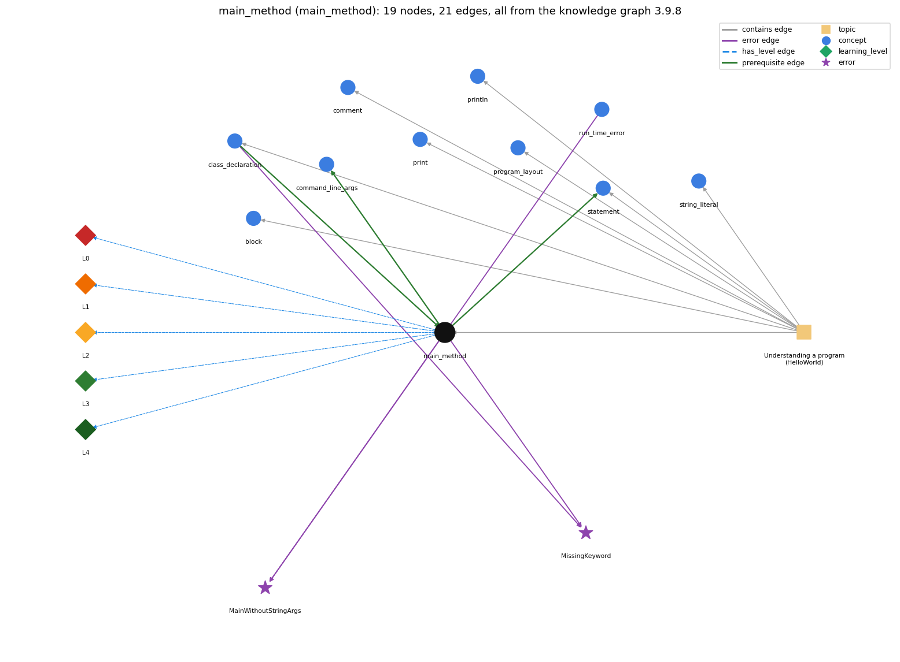

# main_method (`main_method`)

public static void main(String[] args) -- entry point

Section 1.1 Your First Program, topic 1.1.b Understanding a program (HelloWorld). From the knowledge graph 3.9.8 (`data/raw/chapter1_kg_updated.json`).

## Concepts associated with main\_method (10)

| Concept | Description | How it is associated |
| --- | --- | --- |
| **block** | { ... } grouping statements | same topic (topic1.1.b) |
| **class\_declaration** | public class Name { ... } -- the outer container | prerequisite of it (it needs this) composition rule (R) with it shares error MissingKeyword same topic (topic1.1.b) |
| **command\_line\_args** | args[] -- strings passed at launch | builds on it (needs it) composition rule (R) with it |
| **comment** | // and /\* \*/ text that the compiler ignores | same topic (topic1.1.b) |
| **print** | System.out.print -- output with no newline | same topic (topic1.1.b) |
| **println** | System.out.println -- output with a trailing newline | same topic (topic1.1.b) |
| **program\_layout** | one statement per line and indentation that shows nesting | same topic (topic1.1.b) |
| **run\_time\_error** | an error raised while the program executes (e.g. ArrayIndexOutOfBounds, NumberFormatException) | shares error MainWithoutStringArgs |
| **statement** | one step, terminated by ;, executed in sequence | builds on it (needs it) composition rule (R) with it same topic (topic1.1.b) |
| **string\_literal** | "Hello, World" -- the text being printed | same topic (topic1.1.b) |

## Every edge in this view and its full label (21)

| From | Edge | To | Full edge label |
| --- | --- | --- | --- |
| **class\_declaration** | prerequisite | **main\_method** | main is written inside the class's braces, so java Name looks inside the class Name to find main. grounding: book\_passage composition rule (R) of class\_declaration with main\_method: main must be declared inside the class's braces; java Name looks only inside class Name for main. composition rule (R) of main\_method with class\_declaration: main is declared inside the class's braces; java Name looks in class Name for main. |
| **main\_method** | prerequisite | **command\_line\_args** | The command-line arguments arrive in main's parameter args, an array of Strings. grounding: book\_passage composition rule (R) of main\_method with command\_line\_args: The command-line arguments arrive in main's parameter args, an array of Strings (args[0], args[1], ...). composition rule (R) of command\_line\_args with main\_method: The arguments arrive in main's parameter args (String[] args). |
| **main\_method** | prerequisite | **statement** | Statements are written in main's body, and running the program executes main's statements in order, one by one. grounding: book\_passage composition rule (R) of main\_method with statement: main's body holds the statements; running the program executes them in order, one by one. composition rule (R) of statement with main\_method: Statements live in main's body; running the program executes main's statements in order. |
| **class\_declaration** | error | **MissingKeyword** | **wrong rule:** Leaves out a required keyword such as static or class. **right rule:** public class Name and public static void main(String[] args) need their keywords, which are required; omitting or misspelling one is an error, usually caught by the compiler as a syntax error. role: context |
| **main\_method** | error | **MainWithoutStringArgs** | **wrong rule:** public static void main() is an acceptable entry point. **right rule:** main is written public static void main(String[] args); these keywords and the args parameter are required. role: primary |
| **main\_method** | error | **MissingKeyword** | **wrong rule:** Leaves out a required keyword such as static or class. **right rule:** public class Name and public static void main(String[] args) need their keywords, which are required; omitting or misspelling one is an error, usually caught by the compiler as a syntax error. role: primary |
| **run\_time\_error** | error | **MainWithoutStringArgs** | **wrong rule:** public static void main() is an acceptable entry point. **right rule:** main is written public static void main(String[] args); these keywords and the args parameter are required. role: context |
| **main\_method** | has\_level | **main\_method@L0** | main method -&gt; L0 (Prestructural): the answer holds a rule that contradicts Java (1 way). **[0] everyday\_reading** (E): Everyday reading: 'main' sounds like the most important part, and 'void' like empty or invalid. Java rule: main is the entry point that java Name calls; public static void main(String[] args) must be written exactly, and void only means main returns no value. |
| **main\_method** | has\_level | **main\_method@L1** | main method -&gt; L1 (Unistructural): the answer states one correct rule without applying it (2 ways). **[0] names\_the\_element** (N): main is the method that is the entry point of a Java program: public static void main(String[] args) { statements }. **[1] states\_the\_rule** (S): The header must be public static void main(String[] args); the keywords are required; its body is a sequence of statements in braces, each followed by a semicolon. |
| **main\_method** | has\_level | **main\_method@L2** | main method -&gt; L2 (Multistructural): the answer applies the rules of main method to every part of the code, in order (3 ways). **[0] line\_by\_line\_trace** (LT): When the program runs, it starts at the first statement in main and ends when it finishes the last statement, executing the statements in order, one by one. **[1] output\_prediction** (OP): main returns no value (void); the program's observable result is whatever main's statements print. **[2] one\_step\_execution** (OS): Calling main binds args to the array of command-line strings and then runs its body; when its last statement finishes, control goes back to the system. |
| **main\_method** | has\_level | **main\_method@L3** | main method -&gt; L3 (Relational): the answer relates the parts (4 ways). **[0] relation\_to\_neighbour** (R): main is declared inside the class's braces; java Name looks in class Name for main. **[1] relation\_to\_neighbour** (R): main's body holds the statements; running the program executes them in order, one by one. **[2] relation\_to\_neighbour** (R): The command-line arguments arrive in main's parameter args, an array of Strings (args[0], args[1], ...). **[3] purpose\_of\_the\_whole** (P): Purpose: the single place where a Chapter 1 program's work is written; programming at this stage means specifying a class name and the sequence of statements in its main(). |
| **main\_method** | has\_level | **main\_method@L4** | main method -&gt; L4 (Extended abstract): the answer reasons beyond the given code (4 ways). **[0] predict\_a\_change** (C): Changing the order of main's statements changes the order of output; changing public static void main(String[] args) (e.g. dropping static or args) keeps it compiling but leaves the class without a launchable entry point, or breaks compilation if misspelt. **[1] diagnose\_an\_error** (D): rule broken: main is written public static void main(String[] args). Kind: launch error. Trigger class: header written as public static void main() (or without static): it compiles, but java Name reports that no main method is found **[2] transfer\_to\_a\_new\_program** (X): Every runnable program needs exactly this main; put Chapter 1 code in it. It is not the place for code that should be reused or tested separately (that needs other methods, Section 2.1). **[3] diagnose\_an\_error** (D): rule broken: public, static, void and main must be present and correctly spelled. Kind: compile-time. Trigger class: misspelling a keyword (e.g. stati, viod) so the header cannot be parsed |
| **topic1.1.b** | contains | **block** | topic topic1.1.b contains block |
| **topic1.1.b** | contains | **class\_declaration** | topic topic1.1.b contains class\_declaration |
| **topic1.1.b** | contains | **comment** | topic topic1.1.b contains comment |
| **topic1.1.b** | contains | **main\_method** | topic topic1.1.b contains main\_method |
| **topic1.1.b** | contains | **print** | topic topic1.1.b contains print |
| **topic1.1.b** | contains | **println** | topic topic1.1.b contains println |
| **topic1.1.b** | contains | **program\_layout** | topic topic1.1.b contains program\_layout |
| **topic1.1.b** | contains | **statement** | topic topic1.1.b contains statement |
| **topic1.1.b** | contains | **string\_literal** | topic topic1.1.b contains string\_literal |
