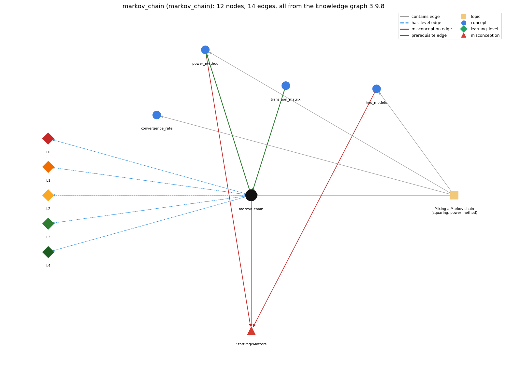

# markov_chain (`markov_chain`)

random process where the next state depends only on the current state

Section 1.6 Case Study: Random Web Surfer, topic 1.6.c Mixing a Markov chain (squaring, power method).

## At a glance

- **Needs first:** `transition_matrix`
- **Leads to:** `power_method`
- **Learned alongside:** nothing
- **Misconceptions:** `StartPageMatters`
- **Errors:** none
- **Levels:** L0, L1, L2, L3, L4

Everything below comes from the knowledge graph 3.9.8 (`data/raw/chapter1_kg_updated.json`): 14 edges around this concept, each explained in the graph's own words.

## What it needs first (1)

A prerequisite edge means the other concept has to be understood before `markov_chain`.

### `transition_matrix` comes before `markov_chain`

*a 2-D array of move probabilities (rows sum to 1)*

The transition matrix specifies the probability of each move, and the random process those probabilities define is a Markov chain.

- **Grounding:** book passage
- **How `markov_chain` combines with `transition_matrix`:** The chain is defined by the matrix: it must be square with every row a probability distribution.
- **How `transition_matrix` combines with `markov_chain`:** A matrix whose rows are probability distributions defines a Markov chain: the next page depends only on the current page's row.

## What it leads to (1)

These concepts need `markov_chain` first.

### `markov_chain` comes before `power_method`

*repeated vector-matrix multiplication to compute page ranks*

Each multiplication advances the chain's probabilities by one move.

- **Grounding:** book passage
- **How `markov_chain` combines with `power_method`:** Each vector-matrix multiplication advances the chain's probabilities by one move; repeating it approaches the stationary vector.
- **How `power_method` combines with `markov_chain`:** Each multiplication is one move of the chain; convergence is the chain's mixing.

## Learned alongside (0)

A parallel edge joins two concepts that sit side by side: neither is needed before the other.

No parallel edge touches this concept.

## Misconceptions (1)

A misconception edge states the wrong rule a student may hold about this concept, and the right rule.

### StartPageMatters

- **Wrong rule:** The page ranks depend on which page the surfer starts from.
- **Right rule:** For the random-surfer chain the long-run probabilities do not depend on the starting page.
- **Role of this concept:** primary
- **Shows at level L0 as:** misconception: wrong rule: The page ranks depend on which page the surfer starts from. Right rule: For the random-surfer chain the long-run probabilities are the same for all starting pages (basic limit theorem); that is why RandomSurfer can start at page 0.
- **Shows at level L0 as:** inconsistent trace: Applies LT (each step uses the row of the current state) unevenly: e.g. on some steps using the starting page's row instead of the current page's row. (here mixing in: "The page ranks depend on which page the surfer starts from")
- **Also an edge from `power_method`:** The page ranks depend on which page the surfer starts from.
- **Also an edge from `two_models`:** The page ranks depend on which page the surfer starts from.

## Errors (0)

An error edge states the rule that gets broken in a program, and the right rule.

The graph has no error edge from this concept.

## Levels L0 to L4 (5 of 5)

Each level edge lists the ways a student shows that level, each with its exact rule.

### L0: Prestructural / sensorimotor

L0 for markov chain: the answer holds a rule that contradicts Java.

*Deciding question: Does every rule the answer applies to markov chain agree with the language rule? If it reads the code with everyday meanings, applies a wrong rule, or switches rules within one trace, it is L0. A slip in an otherwise rule-correct trace is L2 with an error, not L0.*

markov chain -&gt; L0 (Prestructural): the answer holds a rule that contradicts Java (3 ways).

- **everyday reading** (folk-meaning rule): Everyday "chain" of events suggests the whole history matters; in a Markov chain the next state depends only on the current state, through that state's row of the transition matrix.
- **misconception** (wrong rule / right rule; shows `StartPageMatters`): wrong rule: The page ranks depend on which page the surfer starts from. Right rule: For the random-surfer chain the long-run probabilities are the same for all starting pages (basic limit theorem); that is why RandomSurfer can start at page 0.
- **inconsistent trace** (uneven-application rule; shows `StartPageMatters`): Applies LT (each step uses the row of the current state) unevenly: e.g. on some steps using the starting page's row instead of the current page's row. (here mixing in: "The page ranks depend on which page the surfer starts from")

### L1: Unistructural / atom x text surface

L1 for markov chain: the answer states one correct rule without applying it.

*Deciding question: Does the answer cover every part of the code, in order, with the values (L2)? If it covers one part or only states the rule, it is L1.*

markov chain -&gt; L1 (Unistructural): the answer states one correct rule without applying it (2 ways).

- **names the element** (identity rule): A mathematical model: a random process on states (pages) whose moves are given by a transition matrix.
- **states the rule** (declarative rule): The surfer's random process is a Markov chain; by the basic limit theorem the probability of eventually ending on any page is the same for all starting pages (mixing), though not all chains mix.

### L2: Multistructural / block x execution / preoperational

L2 for markov chain: the answer applies these rules to every part of the code, in order.

*Deciding question: Is the answer many segments mapped onto lines (L2), or one segment stating the purpose of the whole (L3)? A correct output with no value-by-value justification is not levelled.*

markov chain -&gt; L2 (Multistructural): the answer applies the rules of markov chain to every part of the code, in order (3 ways).

- **line by line trace** (operational sequencing rule): State sequence: from the current page i, choose the next page j with probability p[i][j]; repeat from j. In probability form, the t-step distribution is the (t-1)-step distribution times the matrix.
- **output prediction** (evaluation / result rule): Produces the stationary probabilities (page ranks): for tiny.txt about .27 .27 .15 .25 .07.
- **one step execution** (state-transition rule): One step moves the state from page i to a page j drawn from row i; in matrix form, one multiplication turns the distribution after t-1 moves into the distribution after t moves.

### L3: Relational / relations x function (concrete operational begins)

L3 for markov chain: the answer relates the parts by these rules.

*Deciding question: Was the purpose deduced from the code, or only guessed from traced input/output pairs (then L2)? Does the answer stay within the given code (L3), or reason about changed code, an error class or a new program (L4)?*

markov chain -&gt; L3 (Relational): the answer relates the parts (3 ways).

- **relation to neighbour** (composition rule (with a neighbour)): The chain is defined by the matrix: it must be square with every row a probability distribution.
- **relation to neighbour** (composition rule (with a neighbour)): Each vector-matrix multiplication advances the chain's probabilities by one move; repeating it approaches the stationary vector.
- **purpose of the whole** (plan / role rule): Model a memoryless random process to compute its long-run behaviour (page ranks) instead of following one surfer.

### L4: Extended abstract (concrete-operational reversibility and conservation)

L4 for markov chain: the answer reasons beyond the given code by these rules.

*Deciding question: Does the answer link the code to a broader context: a changed program, a class of inputs, an unseen problem? Re-tracing changed code value by value is L2; fixing one given failing case is L3.*

markov chain -&gt; L4 (Extended abstract): the answer reasons beyond the given code (4 ways).

- **predict a change** (conservation rule; shows `StartPageMatters`): Changing the start state keeps the limiting distribution (if the chain mixes); removing the random leap can break mixing; squaring the matrix gives two-step probabilities.
- **transfer to a new program** (applicability rule): Right model when the next state depends only on the current state with fixed probabilities (web surfing, many random processes); its limit theorem gives start-independent results only for chains that mix.
- **diagnose an error** (error rule): rule broken: Each row must be a probability distribution. Kind: silent logic error. Trigger class: A non-stochastic row (sum not 1, e.g. dangling page or bad scaling): simulation and multiplication give wrong probabilities.
- **diagnose an error** (error rule): rule broken: The chain must mix for start-independent ranks. Kind: silent logic error. Trigger class: No random leap and a spider trap: the surfer gets stuck and results depend on where it starts.

## Same topic

`markov_chain` belongs to the topic **Mixing a Markov chain (squaring, power method)** (`topic1.6.c`). The topic also contains: `convergence_rate`, `power_method`, `two_models`.

## Rules of the concept (15)

- **folk-meaning rule:** Everyday "chain" of events suggests the whole history matters; in a Markov chain the next state depends only on the current state, through that state's row of the transition matrix.
- **wrong rule / right rule:** StartPageMatters: wrong: The page ranks depend on which page the surfer starts from. \| right: For the random-surfer chain the long-run probabilities are the same for all starting pages (basic limit theorem); that is why RandomSurfer can start at page 0.
- **uneven-application rule:** Applies LT (each step uses the row of the current state) unevenly: e.g. on some steps using the starting page's row instead of the current page's row.
- **identity rule:** A mathematical model: a random process on states (pages) whose moves are given by a transition matrix.
- **declarative rule:** The surfer's random process is a Markov chain; by the basic limit theorem the probability of eventually ending on any page is the same for all starting pages (mixing), though not all chains mix.
- **operational sequencing rule:** State sequence: from the current page i, choose the next page j with probability p[i][j]; repeat from j. In probability form, the t-step distribution is the (t-1)-step distribution times the matrix.
- **evaluation / result rule:** Produces the stationary probabilities (page ranks): for tiny.txt about .27 .27 .15 .25 .07.
- **state-transition rule:** One step moves the state from page i to a page j drawn from row i; in matrix form, one multiplication turns the distribution after t-1 moves into the distribution after t moves.
- **composition rule (with a neighbour):** with transition\_matrix: The chain is defined by the matrix: it must be square with every row a probability distribution.
- **composition rule (with a neighbour):** with power\_method: Each vector-matrix multiplication advances the chain's probabilities by one move; repeating it approaches the stationary vector.
- **plan / role rule:** Model a memoryless random process to compute its long-run behaviour (page ranks) instead of following one surfer.
- **conservation rule:** Changing the start state keeps the limiting distribution (if the chain mixes); removing the random leap can break mixing; squaring the matrix gives two-step probabilities.
- **error rule:** rule broken: Each row must be a probability distribution. (silent logic error)
- **error rule:** rule broken: The chain must mix for start-independent ranks. (silent logic error)
- **applicability rule:** Right model when the next state depends only on the current state with fixed probabilities (web surfing, many random processes); its limit theorem gives start-independent results only for chains that mix.

## The whole prerequisite chain

- **Everything it builds on (12):** `array_creation`, `array_declaration`, `array_initializer`, `data_structure`, `data_type`, `indexing`, `input_graph`, `standard_input`, `stream_model`, `teleportation`, `transition_matrix`, `two_dimensional_array`
- **Everything that builds on it (3):** `convergence_rate`, `power_method`, `two_models`
