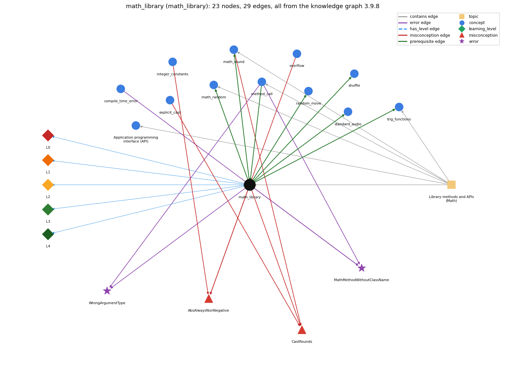

# math_library (`math_library`)

Math.abs, Math.sqrt, Math.max, Math.random, Math.round ...

Section 1.2 Built-in Types of Data, topic 1.2.g Library methods and APIs (Math). From the knowledge graph 3.9.8 (`data/raw/chapter1_kg_updated.json`).

## Concepts associated with math\_library (12)

| Concept | Description | How it is associated |
| --- | --- | --- |
| **api** | a table of library methods giving each method's signature and a short description of what it computes | same topic (topic1.2.g) |
| **compile\_time\_error** | an error javac reports before the program can run (syntax, types) | shares error MathMethodWithoutClassName |
| **explicit\_cast** | (int) x -- converts between numeric types, truncating toward zero | shares misconception CastRounds |
| **integer\_constants** | Integer.MAX\_VALUE, Integer.MIN\_VALUE and their edge cases | shares misconception AbsAlwaysNonNegative |
| **math\_random** | Math.random() and scaling to an int range | builds on it (needs it) composition rule (R) with it same topic (topic1.2.g) |
| **math\_round** | Math.round rounds to the nearest integer and returns a long | builds on it (needs it) composition rule (R) with it shares misconception CastRounds same topic (topic1.2.g) |
| **method\_call** | name(arguments) -- invokes a library method and uses its return value | prerequisite of it (it needs this) composition rule (R) with it shares error MathMethodWithoutClassName shares error WrongArgumentType same topic (topic1.2.g) |
| **overflow** | int arithmetic wraps around outside the 32-bit range | shares misconception AbsAlwaysNonNegative |
| **random\_move** | pick the next page from a cumulative-probability test | builds on it (needs it) composition rule (R) with it |
| **shuffle** | Knuth shuffle -- swap a[i] with a random a[r], r in i..n-1 | builds on it (needs it) composition rule (R) with it |
| **standard\_audio** | StdAudio: sound as an array of samples | builds on it (needs it) composition rule (R) with it |
| **trig\_functions** | Math.sin, Math.cos, Math.atan2 work in radians | builds on it (needs it) composition rule (R) with it same topic (topic1.2.g) |

## Every edge in this view and its full label (29)

| From | Edge | To | Full edge label |
| --- | --- | --- | --- |
| **math\_library** | prerequisite | **math\_random** | Math.random() is a Math library method; unlike the others it takes no argument and returns a random double in [0, 1). grounding: book\_passage composition rule (R) of math\_library with math\_random: Math.random() is the one Math method that takes no argument and is not a mathematical function: it returns a random double in [0, 1). composition rule (R) of math\_random with math\_library: Math.random() is the Math method that takes no argument and, unlike the others, is not a function of its input: it returns a random double in [0, 1). |
| **math\_library** | prerequisite | **math\_round** | Math.round is a Math library method. grounding: book\_passage composition rule (R) of math\_library with math\_round: Math.round is the Math method that rounds to the nearest integer, but it returns a long, so storing it in an int needs a cast. composition rule (R) of math\_round with math\_library: Math.round is listed in the Math API with return type long, which is what forces the cast when the result goes to an int (unlike the other Math methods, which return double). |
| **math\_library** | prerequisite | **random\_move** | The random move draws r with Math.random() and then finds the interval of row p[page] that contains r. grounding: book\_passage composition rule (R) of math\_library with random\_move: The random move draws r = Math.random() once per move and compares it with growing cumulative sums of row p[page] to find which interval contains it. composition rule (R) of random\_move with math\_library: Math.random() supplies one uniform double in [0, 1) per move; it must be called once before the j loop, not inside it. |
| **math\_library** | prerequisite | **shuffle** | The random position r between i and N-1 is computed with Math.random(), so each remaining card is equally likely to be chosen. grounding: book\_passage composition rule (R) of math\_library with shuffle: In the shuffle, r = i + (int) (Math.random() \* (N-i)) scales Math.random() to a uniformly random position between i and N-1, so each remaining card is equally likely. composition rule (R) of shuffle with math\_library: (int) (Math.random() \* (N-i)) is a uniform int in 0..N-i-1, so r = i + that value is uniform in i..N-1. |
| **math\_library** | prerequisite | **standard\_audio** | To play a tone, each sample a[i] of the sound array is computed with Math.sin at evenly spaced times. grounding: book\_passage composition rule (R) of math\_library with standard\_audio: Each sample a[i] = Math.sin(2\*Math.PI \* i \* hz / sps) is taken at evenly spaced times; the 2\*Math.PI factor is needed because Math.sin works in radians, one cycle being 2 pi. composition rule (R) of standard\_audio with math\_library: Each sample is computed with Math.sin at evenly spaced times t = i/sps. The note's frequency comes from Math.pow(2, pitch/12.0). |
| **math\_library** | prerequisite | **trig\_functions** | The trig functions are Math library methods. grounding: book\_passage composition rule (R) of math\_library with trig\_functions: The trigonometric functions are Math methods whose angles are in radians; Math.toRadians and Math.toDegrees convert. composition rule (R) of trig\_functions with math\_library: The trig functions belong to the Math API, whose note fixes the unit: angles are in radians, with toDegrees() and toRadians() for conversion. |
| **method\_call** | prerequisite | **math\_library** | Math.sqrt(x) and other Math methods are used through method calls. grounding: book\_passage composition rule (R) of method\_call with math\_library: Math methods are called through the class name, Math.sqrt(x); without the prefix the compiler looks for the method in the current class and reports cannot find symbol. composition rule (R) of math\_library with method\_call: Every Math facility is used through a method call with the Math. prefix and parentheses (the constants Math.PI and Math.E are written without parentheses). |
| **explicit\_cast** | misconception | **CastRounds** | **wrong rule:** (int) 2.7 evaluates to 3. **right rule:** A cast to int discards the fractional part (rounds toward zero, so (int) -2.7 is -2); Math.round rounds to the nearest integer. role: primary |
| **integer\_constants** | misconception | **AbsAlwaysNonNegative** | **wrong rule:** Math.abs always returns a non-negative number. **right rule:** Math.abs(Integer.MIN\_VALUE) returns Integer.MIN\_VALUE, which is negative. role: context |
| **math\_library** | misconception | **AbsAlwaysNonNegative** | **wrong rule:** Math.abs always returns a non-negative number. **right rule:** Math.abs(Integer.MIN\_VALUE) returns Integer.MIN\_VALUE, which is negative. role: primary |
| **math\_library** | misconception | **CastRounds** | **wrong rule:** (int) 2.7 evaluates to 3. **right rule:** A cast to int discards the fractional part (rounds toward zero, so (int) -2.7 is -2); Math.round rounds to the nearest integer. role: context |
| **math\_round** | misconception | **CastRounds** | **wrong rule:** (int) 2.7 evaluates to 3. **right rule:** A cast to int discards the fractional part (rounds toward zero, so (int) -2.7 is -2); Math.round rounds to the nearest integer. role: context |
| **overflow** | misconception | **AbsAlwaysNonNegative** | **wrong rule:** Math.abs always returns a non-negative number. **right rule:** Math.abs(Integer.MIN\_VALUE) returns Integer.MIN\_VALUE, which is negative. role: context |
| **compile\_time\_error** | error | **MathMethodWithoutClassName** | **wrong rule:** sqrt(x) calls the square-root method. **right rule:** Library methods are called with the class name, e.g. Math.sqrt(x). role: context |
| **math\_library** | error | **MathMethodWithoutClassName** | **wrong rule:** sqrt(x) calls the square-root method. **right rule:** Library methods are called with the class name, e.g. Math.sqrt(x). role: context |
| **math\_library** | error | **WrongArgumentType** | **wrong rule:** Calls a method with arguments of the wrong type, e.g. Math.sqrt("2"). **right rule:** Each argument must have the type the method's API lists. role: context |
| **method\_call** | error | **MathMethodWithoutClassName** | **wrong rule:** sqrt(x) calls the square-root method. **right rule:** Library methods are called with the class name, e.g. Math.sqrt(x). role: primary |
| **method\_call** | error | **WrongArgumentType** | **wrong rule:** Calls a method with arguments of the wrong type, e.g. Math.sqrt("2"). **right rule:** Each argument must have the type the method's API lists. role: primary |
| **math\_library** | has\_level | **math\_library@L0** | math library -&gt; L0 (Prestructural): the answer holds a rule that contradicts Java (3 ways). **[0] everyday\_reading** (E): Folk meaning: the calculator's function buttons, which work in degrees, round 2.7 to 3 when 'converting to a whole number', and always give a non-negative absolute value. Java rule: Math's trigonometric methods take radians, a cast to int truncates (only Math.round rounds, returning a long), and integer overflow makes Math.abs(-2147483648) negative. **[1] misconception** (M) &rarr; CastRounds: wrong rule: (int) 2.7 evaluates to 3. Right rule: A cast to int discards the fractional part (rounds toward zero, so (int) -2.7 is -2); Math.round rounds to the nearest integer. **[2] inconsistent\_trace** (T) &rarr; CastRounds: Points to LT (the argument is evaluated, then the method computes from it). Applied unevenly: within one trace the student feeds degrees to Math.sin on one call and radians on another, or rounds the result of one call and truncates another. (here mixing in: "(int) 2.7 evaluates to 3") |
| **math\_library** | has\_level | **math\_library@L1** | math library -&gt; L1 (Unistructural): the answer states one correct rule without applying it (2 ways). **[0] names\_the\_element** (N): The Math library is Java's class Math (in java.lang, no import needed) of static methods for mathematical functions (abs, max, min, sin, cos, tan, exp, log, pow, sqrt, round, random) and the constants PI and E. **[1] states\_the\_rule** (S): Per the API: double abs/max/min (also for int, long, float), double sin/cos/tan(double theta) with theta in radians, double exp, log (natural), pow(a, b), sqrt; long round(double); double random() in [0, 1); constants Math.PI and Math.E. |
| **math\_library** | has\_level | **math\_library@L2** | math library -&gt; L2 (Multistructural): the answer applies the rules of math library to every part of the code, in order (3 ways). **[0] line\_by\_line\_trace** (LT): For Math.f(arg): evaluate arg (an int argument is widened to double), call the method, use the returned double in the enclosing expression; in nested calls the innermost runs first. **[1] output\_prediction** (OP): Math.sqrt(2.0) is 1.4142135623730951, Math.sqrt(-1.0) is NaN, Math.sin(Math.PI/2) is 1.0, Math.log(Math.E) is 1.0, Math.pow(2.0, 10.0) is 1024.0, and Math.abs(-2147483648) is -2147483648. **[2] one\_step\_execution** (OS): All the listed Math methods except random() are mathematical functions: they change no variable and return the same result for the same argument; random() takes no argument and returns a different value on each call. |
| **math\_library** | has\_level | **math\_library@L3** | math library -&gt; L3 (Relational): the answer relates the parts (8 ways). **[0] relation\_to\_neighbour** (R): Every Math facility is used through a method call with the Math. prefix and parentheses (the constants Math.PI and Math.E are written without parentheses). **[1] relation\_to\_neighbour** (R): In the shuffle, r = i + (int) (Math.random() \* (N-i)) scales Math.random() to a uniformly random position between i and N-1, so each remaining card is equally likely. **[2] relation\_to\_neighbour** (R): Each sample a[i] = Math.sin(2\*Math.PI \* i \* hz / sps) is taken at evenly spaced times; the 2\*Math.PI factor is needed because Math.sin works in radians, one cycle being 2 pi. **[3] relation\_to\_neighbour** (R): Math.random() is the one Math method that takes no argument and is not a mathematical function: it returns a random double in [0, 1). **[4] relation\_to\_neighbour** (R): Math.round is the Math method that rounds to the nearest integer, but it returns a long, so storing it in an int needs a cast. **[5] relation\_to\_neighbour** (R): The trigonometric functions are Math methods whose angles are in radians; Math.toRadians and Math.toDegrees convert. **[6] relation\_to\_neighbour** (R): The random move draws r = Math.random() once per move and compares it with growing cumulative sums of row p[page] to find which interval contains it. **[7] purpose\_of\_the\_whole** (P): Used as a black box for standard numeric computations so that a program reads like the formula, e.g. Quadratic computes double d = Math.sqrt(discriminant);. |
| **math\_library** | has\_level | **math\_library@L4** | math library -&gt; L4 (Extended abstract): the answer reasons beyond the given code (5 ways). **[0] predict\_a\_change** (C) &rarr; CastRounds: Replacing Math.pow(x, 2) by x \* x keeps the value (up to rounding) and is cheaper; replacing Math.round(x) by (int) x changes results whenever the fractional part is at least .5 (and for negatives); replacing Math.sin(x)/Math.cos(x) by Math.tan(x) keeps the value. **[1] diagnose\_an\_error** (D): rule broken: Library methods are called with the class name, e.g. Math.sqrt(x). Kind: compile-time. Trigger class: Calling sqrt(x) or pow(a, b) without Math. (cannot find symbol). **[2] transfer\_to\_a\_new\_program** (X): Use Math for standard functions (roots, logs, trig, extremes, rounding, randomness); for squaring or small known integer powers multiply instead of calling Math.pow, and write known powers of ten as literals such as 1e6. **[3] diagnose\_an\_error** (D): rule broken: Each argument must have the type the method's API lists. Kind: compile-time. Trigger class: Passing a String (Math.sqrt("2")) or a boolean to a Math method; numeric arguments are widened automatically. **[4] diagnose\_an\_error** (D): rule broken: Math.sqrt and Math.log are undefined for negative arguments and return NaN. Kind: silent logic error. Trigger class: A negative argument (e.g. a negative discriminant in Quadratic, Math.log(-1)); NaN then propagates to the output. |
| **topic1.2.g** | contains | **api** | topic topic1.2.g contains api |
| **topic1.2.g** | contains | **math\_library** | topic topic1.2.g contains math\_library |
| **topic1.2.g** | contains | **math\_random** | topic topic1.2.g contains math\_random |
| **topic1.2.g** | contains | **math\_round** | topic topic1.2.g contains math\_round |
| **topic1.2.g** | contains | **method\_call** | topic topic1.2.g contains method\_call |
| **topic1.2.g** | contains | **trig\_functions** | topic topic1.2.g contains trig\_functions |
