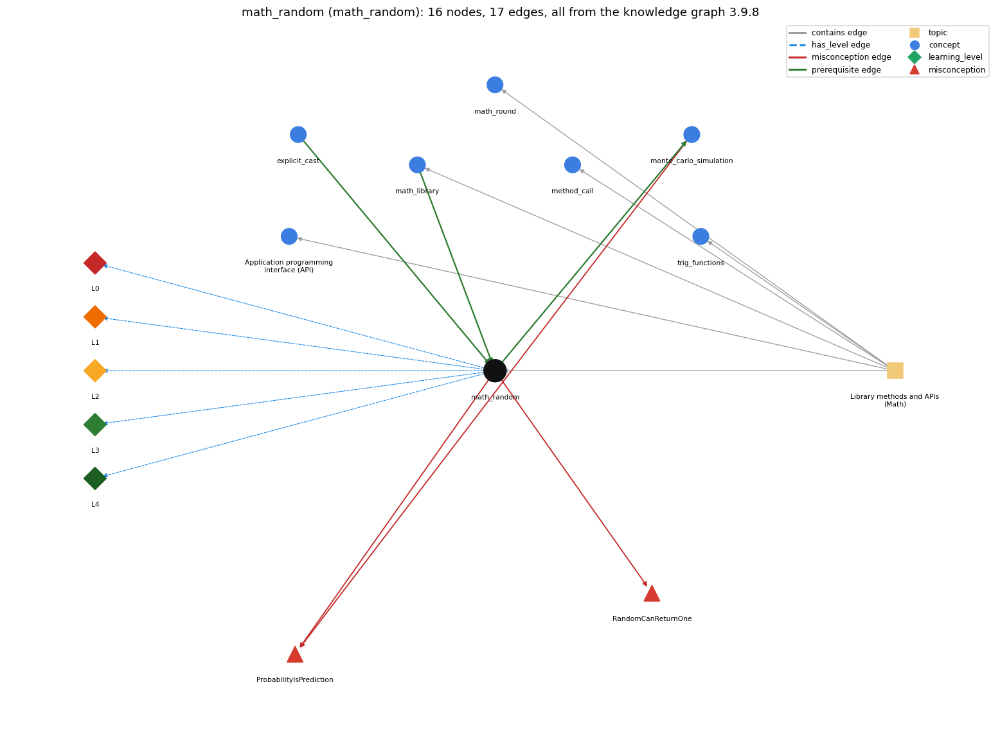

# math_random (`math_random`)

Math.random() and scaling to an int range

Section 1.2 Built-in Types of Data, topic 1.2.g Library methods and APIs (Math).

## At a glance

- **Needs first:** `explicit_cast`, `math_library`
- **Leads to:** `monte_carlo_simulation`
- **Learned alongside:** nothing
- **Misconceptions:** `ProbabilityIsPrediction`, `RandomCanReturnOne`
- **Errors:** none
- **Levels:** L0, L1, L2, L3, L4

Everything below comes from the knowledge graph 3.9.8 (`data/raw/chapter1_kg_updated.json`): 17 edges around this concept. The edge logic, the wrong and right rules and the exact rules of the ways are copied word for word from the graph.

## To work on (0)

Nothing is missing for this concept.

## What it needs first (2)

A prerequisite edge means the other concept has to be understood before `math_random`.

### `explicit_cast` comes before `math_random`

*(int) x -- converts between numeric types, truncating toward zero*

- **Edge:** `pre:explicit_cast->math_random`
- **Exact edge logic:** To turn Math.random()'s double in [0, 1) into a random int from 0 to N-1, multiply it by N and cast the result to int.
- **Grounding:** book\_passage
- **Composition rule (R) of `math_random` with `explicit_cast`:** Converting to a random int requires the cast to apply to the whole product: (int) (Math.random() \* N); (int) Math.random() \* N casts first and is always 0.
- **Composition rule (R) of `explicit_cast` with `math_random`:** To turn Math.random()'s double into a random int from 0 to N-1, the cast must enclose the product: (int) (Math.random() \* N); casting first gives 0.

### `math_library` comes before `math_random`

*Math.abs, Math.sqrt, Math.max, Math.random, Math.round ...*

- **Edge:** `pre:math_library->math_random`
- **Exact edge logic:** Math.random() is a Math library method; unlike the others it takes no argument and returns a random double in [0, 1).
- **Grounding:** book\_passage
- **Composition rule (R) of `math_random` with `math_library`:** Math.random() is the Math method that takes no argument and, unlike the others, is not a function of its input: it returns a random double in [0, 1).
- **Composition rule (R) of `math_library` with `math_random`:** Math.random() is the one Math method that takes no argument and is not a mathematical function: it returns a random double in [0, 1).

## What it leads to (1)

These concepts need `math_random` first.

### `math_random` comes before `monte_carlo_simulation`

*estimating a probability by repeating random trials*

- **Edge:** `pre:math_random->monte_carlo_simulation`
- **Exact edge logic:** Each trial uses Math.random().
- **Grounding:** book\_passage
- **Composition rule (R) of `math_random` with `monte_carlo_simulation`:** Each trial of a Monte Carlo simulation draws fresh values with Math.random(); estimates become reliable only over many trials.
- **Composition rule (R) of `monte_carlo_simulation` with `math_random`:** Each random event is driven by Math.random(), which returns a double in [0, 1). An event of probability p is simulated as \`Math.random() &lt; p\`, e.g. \`&lt; 0.5\` for a fair bet.

## Learned alongside (0)

A parallel edge joins two concepts that sit side by side: neither is needed before the other.

No parallel edge touches this concept.

## Misconceptions (2)

A misconception edge states the wrong rule a student may hold about this concept, and the right rule.

### ProbabilityIsPrediction

- **Edge:** `math_random` &rarr; `ProbabilityIsPrediction` (misconception)
- **Exact edge logic (the wrong rule):** A probability (e.g. 70%) predicts what the next single trial will do.
- **Twin logic (the right rule):** A probability describes the long-run frequency over many trials, not one outcome.
- **Wrong belief (on the node):** A probability (e.g. 70%) predicts what the next single trial will do.
- **Correct rule (on the node):** A probability describes the long-run frequency over many trials, not one outcome.
- **Provenance:** published
- **Role of this concept:** context
- **L0 way linked to it:** yes
- **L0 way [2] misconception, exact rule:** wrong rule: A probability (e.g. 70%) predicts what the next single trial will do. Right rule: A probability describes the long-run frequency over many trials, not one outcome; Math.random() &lt; 0.7 is true on about 70% of many calls, and any single call can go either way.
- **Edge `monte_carlo_simulation` &rarr; `ProbabilityIsPrediction`, exact edge logic:** A probability (e.g. 70%) predicts what the next single trial will do. **Twin logic:** A probability describes the long-run frequency over many trials, not one outcome. (role: primary)

### RandomCanReturnOne

- **Edge:** `math_random` &rarr; `RandomCanReturnOne` (misconception)
- **Exact edge logic (the wrong rule):** Math.random() can return exactly 1.0.
- **Twin logic (the right rule):** Math.random() returns a value in [0, 1): 0 is possible, 1 is not.
- **Wrong belief (on the node):** Math.random() can return exactly 1.0.
- **Correct rule (on the node):** Math.random() returns a value in [0, 1): 0 is possible, 1 is not.
- **Provenance:** derived
- **Role of this concept:** primary
- **L0 way linked to it:** yes
- **L0 way [1] misconception, exact rule:** wrong rule: Math.random() can return exactly 1.0. Right rule: Math.random() returns a value in [0, 1): 0 is possible, 1 is not; hence (int) (Math.random() \* N) is at most N-1.
- **L0 way [3] inconsistent\_trace, exact rule:** Points to LT (each call produces a fresh value, which is then scaled and cast). Applied unevenly: the student reuses one random value for two separate Math.random() calls on some lines (e.g. assumes the x and y coordinates are equal) or scales without casting on one pass. (here mixing in: "Math.random() can return exactly 1.0")

## Errors (0)

An error edge states the rule that gets broken in a program, and the right rule.

The graph has no error edge from this concept.

## Levels L0 to L4 (5 of 5)

Each level edge lists the ways a student shows that level, each with its exact rule.

### L0: Prestructural / sensorimotor

L0 for math random: the answer holds a rule that contradicts Java.

*Deciding question: Does every rule the answer applies to math random agree with the language rule? If it reads the code with everyday meanings, applies a wrong rule, or switches rules within one trace, it is L0. A slip in an otherwise rule-correct trace is L2 with an error, not L0.*

- **Edge:** `math_random` &rarr; `math_random@L0` (has_level)
- **Exact edge logic:** math random -&gt; L0 (Prestructural): the answer holds a rule that contradicts Java (4 ways).

Ways (4), each with its exact rule:

- **[0] everyday\_reading** (rule type E, folk-meaning rule): Folk meaning: 'a random number between 0 and 1' includes both ends, and a 70% chance means the event will happen next time. Java rule: Math.random() returns a double in the half-open interval [0, 1) (0 possible, 1 never), and a probability only describes long-run frequencies over many calls.
- **[1] misconception** (rule type M, wrong rule / right rule) &rarr; `RandomCanReturnOne`: wrong rule: Math.random() can return exactly 1.0. Right rule: Math.random() returns a value in [0, 1): 0 is possible, 1 is not; hence (int) (Math.random() \* N) is at most N-1.
- **[2] misconception** (rule type M, wrong rule / right rule) &rarr; `ProbabilityIsPrediction`: wrong rule: A probability (e.g. 70%) predicts what the next single trial will do. Right rule: A probability describes the long-run frequency over many trials, not one outcome; Math.random() &lt; 0.7 is true on about 70% of many calls, and any single call can go either way.
- **[3] inconsistent\_trace** (rule type T, uneven-application rule) &rarr; `RandomCanReturnOne`: Points to LT (each call produces a fresh value, which is then scaled and cast). Applied unevenly: the student reuses one random value for two separate Math.random() calls on some lines (e.g. assumes the x and y coordinates are equal) or scales without casting on one pass. (here mixing in: "Math.random() can return exactly 1.0")

### L1: Unistructural / atom x text surface

L1 for math random: the answer states one correct rule without applying it.

*Deciding question: Does the answer cover every part of the code, in order, with the values (L2)? If it covers one part or only states the rule, it is L1.*

- **Edge:** `math_random` &rarr; `math_random@L1` (has_level)
- **Exact edge logic:** math random -&gt; L1 (Unistructural): the answer states one correct rule without applying it (2 ways).

Ways (2), each with its exact rule:

- **[0] names\_the\_element** (rule type N, identity rule): Math.random() is a Math library method with no argument that returns a (pseudo-)random double uniformly distributed in [0, 1).
- **[1] states\_the\_rule** (rule type S, declarative rule): Each call returns a new double r with 0 &lt;= r &lt; 1; multiplying by N gives a value in [0, N), and casting truncates it to an int between 0 and N-1.

### L2: Multistructural / block x execution / preoperational

L2 for math random: the answer applies these rules to every part of the code, in order.

*Deciding question: Is the answer many segments mapped onto lines (L2), or one segment stating the purpose of the whole (L3)? A correct output with no value-by-value justification is not levelled.*

- **Edge:** `math_random` &rarr; `math_random@L2` (has_level)
- **Exact edge logic:** math random -&gt; L2 (Multistructural): the answer applies the rules of math random to every part of the code, in order (3 ways).

Ways (3), each with its exact rule:

- **[0] line\_by\_line\_trace** (rule type LT, operational sequencing rule): In int n = (int) (r \* N) with r = Math.random(): the call produces r, the product r \* N is computed in double (N promoted), the parenthesized cast truncates it, then n is assigned.
- **[1] output\_prediction** (rule type OP, evaluation / result rule): A double in [0, 1) that differs from call to call and run to run (e.g. RandomInt 1000 prints 548, then 141); (int) (Math.random() \* 6) + 1 is an int from 1 to 6; Math.random() &lt; 0.5 is true about half the time.
- **[2] one\_step\_execution** (rule type OS, state-transition rule): A call changes none of the program's variables, but each call advances the library's hidden generator state, so the next call returns a different value; the drawn value persists only if stored (double r = Math.random();).

### L3: Relational / relations x function (concrete operational begins)

L3 for math random: the answer relates the parts by these rules.

*Deciding question: Was the purpose deduced from the code, or only guessed from traced input/output pairs (then L2)? Does the answer stay within the given code (L3), or reason about changed code, an error class or a new program (L4)?*

- **Edge:** `math_random` &rarr; `math_random@L3` (has_level)
- **Exact edge logic:** math random -&gt; L3 (Relational): the answer relates the parts (4 ways).

Ways (4), each with its exact rule:

- **[0] relation\_to\_neighbour** (rule type R, composition rule (with a neighbour)): Math.random() is the Math method that takes no argument and, unlike the others, is not a function of its input: it returns a random double in [0, 1).
- **[1] relation\_to\_neighbour** (rule type R, composition rule (with a neighbour)): Converting to a random int requires the cast to apply to the whole product: (int) (Math.random() \* N); (int) Math.random() \* N casts first and is always 0.
- **[2] relation\_to\_neighbour** (rule type R, composition rule (with a neighbour)): Each trial of a Monte Carlo simulation draws fresh values with Math.random(); estimates become reliable only over many trials.
- **[3] purpose\_of\_the\_whole** (rule type P, plan / role rule): Plans: simulate an event of probability p with if (Math.random() &lt; p); pick a random index with (int) (Math.random() \* N); generate random points or samples (Sajaniemi role of the drawn value: most-recent holder, overwritten each trial).

### L4: Extended abstract (concrete-operational reversibility and conservation)

L4 for math random: the answer reasons beyond the given code by these rules.

*Deciding question: Does the answer link the code to a broader context: a changed program, a class of inputs, an unseen problem? Re-tracing changed code value by value is L2; fixing one given failing case is L3.*

- **Edge:** `math_random` &rarr; `math_random@L4` (has_level)
- **Exact edge logic:** math random -&gt; L4 (Extended abstract): the answer reasons beyond the given code (5 ways).

Ways (5), each with its exact rule:

- **[0] predict\_a\_change** (rule type C, conservation rule) &rarr; `RandomCanReturnOne`: Changing N in (int) (Math.random() \* N) changes the range to 0..N-1, and adding a constant shifts it; the output changes from run to run, so a program using Math.random() cannot be checked by comparing exact outputs, only by statistics over many runs.
- **[1] transfer\_to\_a\_new\_program** (rule type X, applicability rule): Use Math.random() for simulations, games, random sampling and shuffling, where 'every value equally likely' in [0, 1) is the model; it is not suitable when results must be reproducible or follow another distribution without further transformation.
- **[2] diagnose\_an\_error** (rule type D, error rule): rule broken: The scaled range of (int) (Math.random() \* N) is 0..N-1. Kind: silent logic error. Trigger class: Expecting N to be possible, or 1..N, without adding 1; or scaling by (b - a) instead of (b - a + 1) for an inclusive range a..b.
- **[3] diagnose\_an\_error** (rule type D, error rule): rule broken: A cast applies only to the value immediately after it. Kind: silent logic error. Trigger class: Writing (int) Math.random() \* N, which always gives 0.
- **[4] diagnose\_an\_error** (rule type D, error rule): rule broken: A double cannot be assigned to an int without a cast. Kind: compile-time. Trigger class: int n = Math.random() \* N;

## Same topic

`math_random` belongs to the topic **Library methods and APIs (Math)** (`topic1.2.g`). The topic also contains: `api`, `math_library`, `math_round`, `method_call`, `trig_functions`.

## Rules of the concept (18)

- **Book** (SW-1e, p. 33 (pdf 43)): "This program uses the Java method Math.random() to generate a random number r in the interval [0, 1)"
- **Book** (SW-1.2, ): "int value = (int) (r \* n);"
- **E** (folk-meaning rule): Folk meaning: 'a random number between 0 and 1' includes both ends, and a 70% chance means the event will happen next time. Java rule: Math.random() returns a double in the half-open interval [0, 1) (0 possible, 1 never), and a probability only describes long-run frequencies over many calls.
- **M** (wrong rule / right rule): ProbabilityIsPrediction: wrong: A probability (e.g. 70%) predicts what the next single trial will do. \| right: A probability describes the long-run frequency over many trials, not one outcome; Math.random() &lt; 0.7 is true on about 70% of many calls, and any single call can go either way.
- **M** (wrong rule / right rule): RandomCanReturnOne: wrong: Math.random() can return exactly 1.0. \| right: Math.random() returns a value in [0, 1): 0 is possible, 1 is not; hence (int) (Math.random() \* N) is at most N-1.
- **T** (uneven-application rule): Points to LT (each call produces a fresh value, which is then scaled and cast). Applied unevenly: the student reuses one random value for two separate Math.random() calls on some lines (e.g. assumes the x and y coordinates are equal) or scales without casting on one pass.
- **N** (identity rule): Math.random() is a Math library method with no argument that returns a (pseudo-)random double uniformly distributed in [0, 1).
- **S** (declarative rule): Each call returns a new double r with 0 &lt;= r &lt; 1; multiplying by N gives a value in [0, N), and casting truncates it to an int between 0 and N-1.
- **LT** (operational sequencing rule): In int n = (int) (r \* N) with r = Math.random(): the call produces r, the product r \* N is computed in double (N promoted), the parenthesized cast truncates it, then n is assigned.
- **OP** (evaluation / result rule): A double in [0, 1) that differs from call to call and run to run (e.g. RandomInt 1000 prints 548, then 141); (int) (Math.random() \* 6) + 1 is an int from 1 to 6; Math.random() &lt; 0.5 is true about half the time.
- **OS** (state-transition rule): A call changes none of the program's variables, but each call advances the library's hidden generator state, so the next call returns a different value; the drawn value persists only if stored (double r = Math.random();).
- **R** (composition rule (with a neighbour)): with math\_library: Math.random() is the Math method that takes no argument and, unlike the others, is not a function of its input: it returns a random double in [0, 1).
- **R** (composition rule (with a neighbour)): with explicit\_cast: Converting to a random int requires the cast to apply to the whole product: (int) (Math.random() \* N); (int) Math.random() \* N casts first and is always 0.
- **R** (composition rule (with a neighbour)): with monte\_carlo\_simulation: Each trial of a Monte Carlo simulation draws fresh values with Math.random(); estimates become reliable only over many trials.
- **P** (plan / role rule): Plans: simulate an event of probability p with if (Math.random() &lt; p); pick a random index with (int) (Math.random() \* N); generate random points or samples (Sajaniemi role of the drawn value: most-recent holder, overwritten each trial).
- **C** (conservation rule): Changing N in (int) (Math.random() \* N) changes the range to 0..N-1, and adding a constant shifts it; the output changes from run to run, so a program using Math.random() cannot be checked by comparing exact outputs, only by statistics over many runs.
- **D** (error rule): rule broken: The scaled range of (int) (Math.random() \* N) is 0..N-1. (silent logic error)
- **D** (error rule): rule broken: A cast applies only to the value immediately after it. (silent logic error)
- **D** (error rule): rule broken: A double cannot be assigned to an int without a cast. (compile-time)
- **X** (applicability rule): Use Math.random() for simulations, games, random sampling and shuffling, where 'every value equally likely' in [0, 1) is the model; it is not suitable when results must be reproducible or follow another distribution without further transformation.

## How it is found in code and answers (reader block)

- **Aliases:** math.random, random number, random
- **Code patterns:** `Math\.random\s*\(`, `StdRandom\.(?:uniform|random|bernoulli|gaussian|discrete|shuffle)\s*\(`
- **Operator symbols:** none
- **Java types:** none

## The whole prerequisite chain

- **Everything it builds on (17):** `arithmetic_operators`, `class_declaration`, `command_line_args`, `data_type`, `explicit_cast`, `expression`, `identifier`, `integer_division`, `literal`, `main_method`, `math_library`, `method_call`, `parsing`, `primitive_type`, `program_text`, `type_conversion`, `variable`
- **Everything that builds on it (1):** `monte_carlo_simulation`

## Every edge in this view and its exact edge logic (17)

All the edges drawn in the picture, in the order: prerequisite, parallel, misconception, error, has_level, contains.

**1. `explicit_cast` &rarr; `math_random`** (prerequisite)

- **Exact edge logic:** To turn Math.random()'s double in [0, 1) into a random int from 0 to N-1, multiply it by N and cast the result to int.
- **Grounding:** book\_passage
- **Composition rule (R) of `explicit_cast` with `math_random`:** To turn Math.random()'s double into a random int from 0 to N-1, the cast must enclose the product: (int) (Math.random() \* N); casting first gives 0.
- **Composition rule (R) of `math_random` with `explicit_cast`:** Converting to a random int requires the cast to apply to the whole product: (int) (Math.random() \* N); (int) Math.random() \* N casts first and is always 0.

**2. `math_library` &rarr; `math_random`** (prerequisite)

- **Exact edge logic:** Math.random() is a Math library method; unlike the others it takes no argument and returns a random double in [0, 1).
- **Grounding:** book\_passage
- **Composition rule (R) of `math_library` with `math_random`:** Math.random() is the one Math method that takes no argument and is not a mathematical function: it returns a random double in [0, 1).
- **Composition rule (R) of `math_random` with `math_library`:** Math.random() is the Math method that takes no argument and, unlike the others, is not a function of its input: it returns a random double in [0, 1).

**3. `math_random` &rarr; `monte_carlo_simulation`** (prerequisite)

- **Exact edge logic:** Each trial uses Math.random().
- **Grounding:** book\_passage
- **Composition rule (R) of `math_random` with `monte_carlo_simulation`:** Each trial of a Monte Carlo simulation draws fresh values with Math.random(); estimates become reliable only over many trials.
- **Composition rule (R) of `monte_carlo_simulation` with `math_random`:** Each random event is driven by Math.random(), which returns a double in [0, 1). An event of probability p is simulated as \`Math.random() &lt; p\`, e.g. \`&lt; 0.5\` for a fair bet.

**4. `math_random` &rarr; `ProbabilityIsPrediction`** (misconception)

- **Exact edge logic (the wrong rule):** A probability (e.g. 70%) predicts what the next single trial will do.
- **Twin logic (the right rule):** A probability describes the long-run frequency over many trials, not one outcome.
- **Role:** context

**5. `math_random` &rarr; `RandomCanReturnOne`** (misconception)

- **Exact edge logic (the wrong rule):** Math.random() can return exactly 1.0.
- **Twin logic (the right rule):** Math.random() returns a value in [0, 1): 0 is possible, 1 is not.
- **Role:** primary

**6. `monte_carlo_simulation` &rarr; `ProbabilityIsPrediction`** (misconception)

- **Exact edge logic (the wrong rule):** A probability (e.g. 70%) predicts what the next single trial will do.
- **Twin logic (the right rule):** A probability describes the long-run frequency over many trials, not one outcome.
- **Role:** primary

**7. `math_random` &rarr; `math_random@L0`** (has_level)

- **Exact edge logic:** math random -&gt; L0 (Prestructural): the answer holds a rule that contradicts Java (4 ways).
  - **[0] everyday\_reading** (rule type E, folk-meaning rule): Folk meaning: 'a random number between 0 and 1' includes both ends, and a 70% chance means the event will happen next time. Java rule: Math.random() returns a double in the half-open interval [0, 1) (0 possible, 1 never), and a probability only describes long-run frequencies over many calls.
  - **[1] misconception** (rule type M, wrong rule / right rule) &rarr; `RandomCanReturnOne`: wrong rule: Math.random() can return exactly 1.0. Right rule: Math.random() returns a value in [0, 1): 0 is possible, 1 is not; hence (int) (Math.random() \* N) is at most N-1.
  - **[2] misconception** (rule type M, wrong rule / right rule) &rarr; `ProbabilityIsPrediction`: wrong rule: A probability (e.g. 70%) predicts what the next single trial will do. Right rule: A probability describes the long-run frequency over many trials, not one outcome; Math.random() &lt; 0.7 is true on about 70% of many calls, and any single call can go either way.
  - **[3] inconsistent\_trace** (rule type T, uneven-application rule) &rarr; `RandomCanReturnOne`: Points to LT (each call produces a fresh value, which is then scaled and cast). Applied unevenly: the student reuses one random value for two separate Math.random() calls on some lines (e.g. assumes the x and y coordinates are equal) or scales without casting on one pass. (here mixing in: "Math.random() can return exactly 1.0")

**8. `math_random` &rarr; `math_random@L1`** (has_level)

- **Exact edge logic:** math random -&gt; L1 (Unistructural): the answer states one correct rule without applying it (2 ways).
  - **[0] names\_the\_element** (rule type N, identity rule): Math.random() is a Math library method with no argument that returns a (pseudo-)random double uniformly distributed in [0, 1).
  - **[1] states\_the\_rule** (rule type S, declarative rule): Each call returns a new double r with 0 &lt;= r &lt; 1; multiplying by N gives a value in [0, N), and casting truncates it to an int between 0 and N-1.

**9. `math_random` &rarr; `math_random@L2`** (has_level)

- **Exact edge logic:** math random -&gt; L2 (Multistructural): the answer applies the rules of math random to every part of the code, in order (3 ways).
  - **[0] line\_by\_line\_trace** (rule type LT, operational sequencing rule): In int n = (int) (r \* N) with r = Math.random(): the call produces r, the product r \* N is computed in double (N promoted), the parenthesized cast truncates it, then n is assigned.
  - **[1] output\_prediction** (rule type OP, evaluation / result rule): A double in [0, 1) that differs from call to call and run to run (e.g. RandomInt 1000 prints 548, then 141); (int) (Math.random() \* 6) + 1 is an int from 1 to 6; Math.random() &lt; 0.5 is true about half the time.
  - **[2] one\_step\_execution** (rule type OS, state-transition rule): A call changes none of the program's variables, but each call advances the library's hidden generator state, so the next call returns a different value; the drawn value persists only if stored (double r = Math.random();).

**10. `math_random` &rarr; `math_random@L3`** (has_level)

- **Exact edge logic:** math random -&gt; L3 (Relational): the answer relates the parts (4 ways).
  - **[0] relation\_to\_neighbour** (rule type R, composition rule (with a neighbour)): Math.random() is the Math method that takes no argument and, unlike the others, is not a function of its input: it returns a random double in [0, 1).
  - **[1] relation\_to\_neighbour** (rule type R, composition rule (with a neighbour)): Converting to a random int requires the cast to apply to the whole product: (int) (Math.random() \* N); (int) Math.random() \* N casts first and is always 0.
  - **[2] relation\_to\_neighbour** (rule type R, composition rule (with a neighbour)): Each trial of a Monte Carlo simulation draws fresh values with Math.random(); estimates become reliable only over many trials.
  - **[3] purpose\_of\_the\_whole** (rule type P, plan / role rule): Plans: simulate an event of probability p with if (Math.random() &lt; p); pick a random index with (int) (Math.random() \* N); generate random points or samples (Sajaniemi role of the drawn value: most-recent holder, overwritten each trial).

**11. `math_random` &rarr; `math_random@L4`** (has_level)

- **Exact edge logic:** math random -&gt; L4 (Extended abstract): the answer reasons beyond the given code (5 ways).
  - **[0] predict\_a\_change** (rule type C, conservation rule) &rarr; `RandomCanReturnOne`: Changing N in (int) (Math.random() \* N) changes the range to 0..N-1, and adding a constant shifts it; the output changes from run to run, so a program using Math.random() cannot be checked by comparing exact outputs, only by statistics over many runs.
  - **[1] transfer\_to\_a\_new\_program** (rule type X, applicability rule): Use Math.random() for simulations, games, random sampling and shuffling, where 'every value equally likely' in [0, 1) is the model; it is not suitable when results must be reproducible or follow another distribution without further transformation.
  - **[2] diagnose\_an\_error** (rule type D, error rule): rule broken: The scaled range of (int) (Math.random() \* N) is 0..N-1. Kind: silent logic error. Trigger class: Expecting N to be possible, or 1..N, without adding 1; or scaling by (b - a) instead of (b - a + 1) for an inclusive range a..b.
  - **[3] diagnose\_an\_error** (rule type D, error rule): rule broken: A cast applies only to the value immediately after it. Kind: silent logic error. Trigger class: Writing (int) Math.random() \* N, which always gives 0.
  - **[4] diagnose\_an\_error** (rule type D, error rule): rule broken: A double cannot be assigned to an int without a cast. Kind: compile-time. Trigger class: int n = Math.random() \* N;

**12. `topic1.2.g` &rarr; `math_random`** (contains)

- topic `topic1.2.g` contains `math_random`

**13. `topic1.2.g` &rarr; `api`** (contains)

- topic `topic1.2.g` contains `api`

**14. `topic1.2.g` &rarr; `math_library`** (contains)

- topic `topic1.2.g` contains `math_library`

**15. `topic1.2.g` &rarr; `math_round`** (contains)

- topic `topic1.2.g` contains `math_round`

**16. `topic1.2.g` &rarr; `method_call`** (contains)

- topic `topic1.2.g` contains `method_call`

**17. `topic1.2.g` &rarr; `trig_functions`** (contains)

- topic `topic1.2.g` contains `trig_functions`
