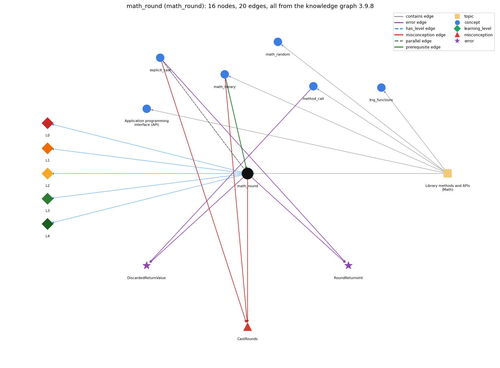

# math_round (`math_round`)

Math.round rounds to the nearest integer and returns a long

Section 1.2 Built-in Types of Data, topic 1.2.g Library methods and APIs (Math).

## At a glance

- **Needs first:** `math_library`
- **Leads to:** nothing
- **Learned alongside:** `explicit_cast`
- **Misconceptions:** `CastRounds`
- **Errors:** `DiscardedReturnValue`, `RoundReturnsInt`
- **Levels:** L0, L1, L2, L3, L4

Everything below comes from the knowledge graph 3.9.8 (`data/raw/chapter1_kg_updated.json`): 20 edges around this concept, each explained in the graph's own words.

## What it needs first (1)

A prerequisite edge means the other concept has to be understood before `math_round`.

### `math_library` comes before `math_round`

*Math.abs, Math.sqrt, Math.max, Math.random, Math.round ...*

Math.round is a Math library method.

- **Grounding:** book passage
- **How `math_round` combines with `math_library`:** Math.round is listed in the Math API with return type long, which is what forces the cast when the result goes to an int (unlike the other Math methods, which return double).
- **How `math_library` combines with `math_round`:** Math.round is the Math method that rounds to the nearest integer, but it returns a long, so storing it in an int needs a cast.

## What it leads to (0)

These concepts need `math_round` first.

No concept has this one as a prerequisite.

## Learned alongside (1)

A parallel edge joins two concepts that sit side by side: neither is needed before the other.

### `math_round` alongside `explicit_cast`

*(int) x -- converts between numeric types, truncating toward zero*

(int) 2.71828 truncates toward zero and gives 2; Math.round(2.71828) rounds to the nearest integer and gives 3, as a long that needs (int) to become an int.

- **Grounding:** book passage

## Misconceptions (1)

A misconception edge states the wrong rule a student may hold about this concept, and the right rule.

### CastRounds

- **Wrong rule:** (int) 2.7 evaluates to 3.
- **Right rule:** A cast to int discards the fractional part (rounds toward zero, so (int) -2.7 is -2); Math.round rounds to the nearest integer.
- **Role of this concept:** context
- **Shows at level L0 as:** misconception: wrong rule: (int) 2.7 evaluates to 3. Right rule: A cast to int discards the fractional part (rounds toward zero, so (int) -2.7 is -2); Math.round rounds to the nearest integer.
- **Shows at level L0 as:** inconsistent trace: Points to LT (evaluate the argument, round it, return a long that must be stored or used). Applied unevenly: the student stores the rounded value in one step but on another line assumes the call itself changed x, or treats the result as an int in one place and as a long elsewhere. (here mixing in: "(int) 2.7 evaluates to 3")
- **Also an edge from `explicit_cast`:** (int) 2.7 evaluates to 3.
- **Also an edge from `math_library`:** (int) 2.7 evaluates to 3.

## Errors (2)

An error edge states the rule that gets broken in a program, and the right rule.

### DiscardedReturnValue

- **Wrong rule:** Writes Math.round(x); on its own line expecting x to be rounded.
- **Right rule:** Math.round(x) returns a value; that value has to be stored or used (e.g. long r = Math.round(x);), because the call on its own line does nothing with it.
- **Role of this concept:** context
- **Also an edge from `method_call`:** Writes Math.round(x); on its own line expecting x to be rounded.

### RoundReturnsInt

- **Wrong rule:** Writes int n = Math.round(x); because Math.round gives an int.
- **Right rule:** Math.round(double) returns a long, so storing it in an int needs a cast: int n = (int) Math.round(x);
- **Role of this concept:** primary
- **Also an edge from `explicit_cast`:** Writes int n = Math.round(x); because Math.round gives an int.

## Levels L0 to L4 (5 of 5)

Each level edge lists the ways a student shows that level, each with its exact rule.

### L0: Prestructural / sensorimotor

L0 for math round: the answer holds a rule that contradicts Java.

*Deciding question: Does every rule the answer applies to math round agree with the language rule? If it reads the code with everyday meanings, applies a wrong rule, or switches rules within one trace, it is L0. A slip in an otherwise rule-correct trace is L2 with an error, not L0.*

math round -&gt; L0 (Prestructural): the answer holds a rule that contradicts Java (3 ways).

- **everyday reading** (folk-meaning rule): Folk meaning: 'round x' (as in school or on a calculator) changes x itself into a whole number, of the ordinary integer kind. Java rule: Math.round(x) leaves x unchanged and returns a new value, the nearest integer, of type long (ties go up, so Math.round(2.5) is 3 and Math.round(-2.5) is -2).
- **misconception** (wrong rule / right rule; shows `CastRounds`): wrong rule: (int) 2.7 evaluates to 3. Right rule: A cast to int discards the fractional part (rounds toward zero, so (int) -2.7 is -2); Math.round rounds to the nearest integer.
- **inconsistent trace** (uneven-application rule; shows `CastRounds`): Points to LT (evaluate the argument, round it, return a long that must be stored or used). Applied unevenly: the student stores the rounded value in one step but on another line assumes the call itself changed x, or treats the result as an int in one place and as a long elsewhere. (here mixing in: "(int) 2.7 evaluates to 3")

### L1: Unistructural / atom x text surface

L1 for math round: the answer states one correct rule without applying it.

*Deciding question: Does the answer cover every part of the code, in order, with the values (L2)? If it covers one part or only states the rule, it is L1.*

math round -&gt; L1 (Unistructural): the answer states one correct rule without applying it (2 ways).

- **names the element** (identity rule): Math.round is a Math library (explicit conversion) method that takes a double and returns the nearest integer as a long.
- **states the rule** (declarative rule): Signature long round(double a): round to the nearest integer; the result is long, so storing it in an int requires an explicit cast, as in (int) Math.round(x).

### L2: Multistructural / block x execution / preoperational

L2 for math round: the answer applies these rules to every part of the code, in order.

*Deciding question: Is the answer many segments mapped onto lines (L2), or one segment stating the purpose of the whole (L3)? A correct output with no value-by-value justification is not levelled.*

math round -&gt; L2 (Multistructural): the answer applies the rules of math round to every part of the code, in order (3 ways).

- **line by line trace** (operational sequencing rule): In int n = (int) Math.round(x \* 10): evaluate x \* 10, call Math.round on that double, which returns a long, apply the (int) cast, then assign to n.
- **output prediction** (evaluation / result rule): Type long: Math.round(3.14159) and Math.round(2.71828) are both 3; Math.round(Math.PI \* 20.0) is 63; (int) Math.round(2.71828) is int 3.
- **one step execution** (state-transition rule): The call changes no variable: x keeps its value; the only state change is the assignment of the returned long, e.g. long r = Math.round(x);.

### L3: Relational / relations x function (concrete operational begins)

L3 for math round: the answer relates the parts by these rules.

*Deciding question: Was the purpose deduced from the code, or only guessed from traced input/output pairs (then L2)? Does the answer stay within the given code (L3), or reason about changed code, an error class or a new program (L4)?*

math round -&gt; L3 (Relational): the answer relates the parts (3 ways).

- **relation to neighbour** (composition rule (with a neighbour)): Math.round is listed in the Math API with return type long, which is what forces the cast when the result goes to an int (unlike the other Math methods, which return double).
- **relation to neighbour** (composition rule (with a neighbour)): (int) 2.71828 truncates toward zero and gives 2; Math.round(2.71828) rounds to the nearest integer and gives 3, as a long that needs (int) to become an int.
- **purpose of the whole** (plan / role rule): Converts a computed real value to the nearest whole number for counting, display or pixel coordinates, typically as (int) Math.round(x).

### L4: Extended abstract (concrete-operational reversibility and conservation)

L4 for math round: the answer reasons beyond the given code by these rules.

*Deciding question: Does the answer link the code to a broader context: a changed program, a class of inputs, an unseen problem? Re-tracing changed code value by value is L2; fixing one given failing case is L3.*

math round -&gt; L4 (Extended abstract): the answer reasons beyond the given code (4 ways).

- **predict a change** (conservation rule; shows `CastRounds`): Replacing Math.round(x) with (int) x changes the result whenever the fractional part is .5 or more (and for negative values), because the cast truncates toward zero; adding the (int) cast keeps the value as long as it fits in the int range.
- **diagnose an error** (error rule): rule broken: Math.round(double) returns a long, so storing it in an int needs a cast: int n = (int) Math.round(x);. Kind: compile-time. Trigger class: int n = Math.round(x); with a double x (possible lossy conversion from long to int).
- **transfer to a new program** (applicability rule): Use Math.round when the nearest integer is wanted; use a cast when truncation toward zero is wanted; to round only what is printed (e.g. two decimals), use printf instead of changing the value.
- **diagnose an error** (error rule): rule broken: Math.round(x) returns a value and does not change x; the value must be stored or used. Kind: silent logic error. Trigger class: Math.round(x); written as a statement on its own, then x used as if rounded.

## Same topic

`math_round` belongs to the topic **Library methods and APIs (Math)** (`topic1.2.g`). The topic also contains: `api`, `math_library`, `math_random`, `method_call`, `trig_functions`.

## Rules of the concept (14)

- **folk-meaning rule:** Folk meaning: 'round x' (as in school or on a calculator) changes x itself into a whole number, of the ordinary integer kind. Java rule: Math.round(x) leaves x unchanged and returns a new value, the nearest integer, of type long (ties go up, so Math.round(2.5) is 3 and Math.round(-2.5) is -2).
- **wrong rule / right rule:** CastRounds: wrong: (int) 2.7 evaluates to 3. \| right: A cast to int discards the fractional part (rounds toward zero, so (int) -2.7 is -2); Math.round rounds to the nearest integer.
- **uneven-application rule:** Points to LT (evaluate the argument, round it, return a long that must be stored or used). Applied unevenly: the student stores the rounded value in one step but on another line assumes the call itself changed x, or treats the result as an int in one place and as a long elsewhere.
- **identity rule:** Math.round is a Math library (explicit conversion) method that takes a double and returns the nearest integer as a long.
- **declarative rule:** Signature long round(double a): round to the nearest integer; the result is long, so storing it in an int requires an explicit cast, as in (int) Math.round(x).
- **operational sequencing rule:** In int n = (int) Math.round(x \* 10): evaluate x \* 10, call Math.round on that double, which returns a long, apply the (int) cast, then assign to n.
- **evaluation / result rule:** Type long: Math.round(3.14159) and Math.round(2.71828) are both 3; Math.round(Math.PI \* 20.0) is 63; (int) Math.round(2.71828) is int 3.
- **state-transition rule:** The call changes no variable: x keeps its value; the only state change is the assignment of the returned long, e.g. long r = Math.round(x);.
- **composition rule (with a neighbour):** with math\_library: Math.round is listed in the Math API with return type long, which is what forces the cast when the result goes to an int (unlike the other Math methods, which return double).
- **plan / role rule:** Converts a computed real value to the nearest whole number for counting, display or pixel coordinates, typically as (int) Math.round(x).
- **conservation rule:** Replacing Math.round(x) with (int) x changes the result whenever the fractional part is .5 or more (and for negative values), because the cast truncates toward zero; adding the (int) cast keeps the value as long as it fits in the int range.
- **error rule:** rule broken: Math.round(x) returns a value and does not change x; the value must be stored or used. (silent logic error)
- **error rule:** rule broken: Math.round(double) returns a long, so storing it in an int needs a cast: int n = (int) Math.round(x); (compile-time)
- **applicability rule:** Use Math.round when the nearest integer is wanted; use a cast when truncation toward zero is wanted; to round only what is printed (e.g. two decimals), use printf instead of changing the value.

## The whole prerequisite chain

- **Everything it builds on (9):** `arithmetic_operators`, `data_type`, `expression`, `identifier`, `literal`, `math_library`, `method_call`, `primitive_type`, `variable`
- **Everything that builds on it (0):** nothing
