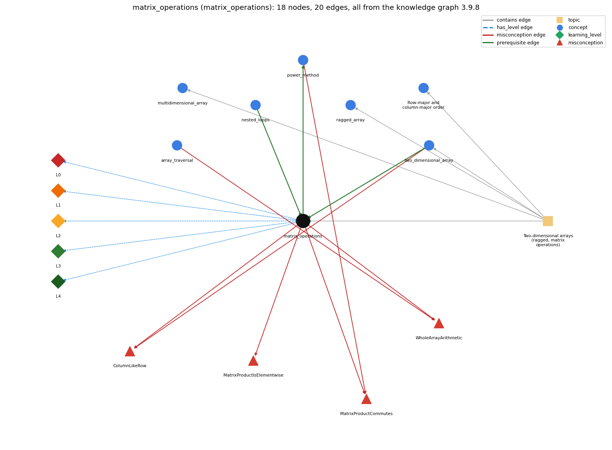

# matrix_operations (`matrix_operations`)

matrix addition and multiplication with nested loops

Section 1.4 Arrays, topic 1.4.g Two-dimensional arrays (ragged, matrix operations).

## At a glance

- **Needs first:** `nested_loops`, `two_dimensional_array`
- **Leads to:** `power_method`
- **Learned alongside:** nothing
- **Misconceptions:** `ColumnLikeRow`, `MatrixProductCommutes`, `MatrixProductIsElementwise`, `WholeArrayArithmetic`
- **Errors:** none
- **Levels:** L0, L1, L2, L3, L4

Everything below comes from the knowledge graph 3.9.8 (`data/raw/chapter1_kg_updated.json`): 20 edges around this concept, each explained in the graph's own words.

## What it needs first (2)

A prerequisite edge means the other concept has to be understood before `matrix_operations`.

### `nested_loops` comes before `matrix_operations`

*a loop inside a loop*

Matrix addition uses two nested loops over i and j, and matrix multiplication adds a third inner loop over k to compute each dot product c[i][j].

- **Grounding:** book passage
- **How `matrix_operations` combines with `nested_loops`:** Addition uses two nested loops (i, j); multiplication adds a third inner loop over k for each dot product.
- **How `nested_loops` combines with `matrix_operations`:** Matrix addition uses two nested loops over i and j; matrix multiplication adds a third, innermost loop over k for each dot product.

### `two_dimensional_array` comes before `matrix_operations`

*an array of arrays (a[i][j])*

Matrix operations index a[i][j] in nested loops.

- **Grounding:** book passage
- **How `matrix_operations` combines with `two_dimensional_array`:** Matrices are stored as 2-D arrays and read entry by entry as a[i][j].
- **How `two_dimensional_array` combines with `matrix_operations`:** Matrix operations index a[i][j] in nested loops (two for addition, three for multiplication).

## What it leads to (1)

These concepts need `matrix_operations` first.

### `matrix_operations` comes before `power_method`

*repeated vector-matrix multiplication to compute page ranks*

The power method is repeated vector-matrix multiplication.

- **Grounding:** book passage
- **How `matrix_operations` combines with `power_method`:** The power method repeats vector-matrix multiplication rather than matrix-matrix multiplication, because that is all it needs.
- **How `power_method` combines with `matrix_operations`:** Each iteration is a vector-matrix product: newRank[j] is the dot product of rank[] and column j of p[][], computed with nested for loops.

## Learned alongside (0)

A parallel edge joins two concepts that sit side by side: neither is needed before the other.

No parallel edge touches this concept.

## Misconceptions (4)

A misconception edge states the wrong rule a student may hold about this concept, and the right rule.

### ColumnLikeRow

- **Wrong rule:** Column j of a 2-D array can be picked out as a 1-D array, just like row a[i].
- **Right rule:** a[i] is row i (a 1-D array), but there is no expression for a column; loop over i and use a[i][j].
- **Role of this concept:** context
- **Shows at level L0 as:** misconception: wrong rule: Column j of a 2-D array can be picked out as a 1-D array, just like row a[i]. Right rule: There is no column expression; the product reads column j of b element by element as b[k][j] in the k loop.
- **Also an edge from `two_dimensional_array`:** Column j of a 2-D array can be picked out as a 1-D array, just like row a[i].

### MatrixProductCommutes

- **Wrong rule:** A \* B and B \* A are the same matrix.
- **Right rule:** Matrix multiplication is not commutative; changing the order may change the product.
- **Role of this concept:** primary
- **Shows at level L0 as:** misconception: wrong rule: A \* B and B \* A are the same matrix. Right rule: Matrix multiplication is not commutative; changing the order may change the product, and for non-square matrices one order may not even be defined.
- **Also an edge from `power_method`:** A \* B and B \* A are the same matrix.

### MatrixProductIsElementwise

- **Wrong rule:** c[i][j] = a[i][j] \* b[i][j] computes the matrix product.
- **Right rule:** c[i][j] is the dot product of row i of a with column j of b.
- **Role of this concept:** primary
- **Shows at level L0 as:** misconception: wrong rule: c[i][j] = a[i][j] \* b[i][j] computes the matrix product. Right rule: c[i][j] is the dot product of row i of a with column j of b: the sum over k of a[i][k]\*b[k][j].
- **Shows at level L0 as:** inconsistent trace: Points to LT: the innermost k loop finishes accumulating c[i][j] before j moves on. Inconsistent application: c[i][j] is reset inside the k loop on some passes, or a[k][i] is used instead of a[i][k]. (here mixing in: "c[i][j] = a[i][j] \* b[i][j] computes the matrix product")

### WholeArrayArithmetic

- **Wrong rule:** a = a + b adds the arrays element by element.
- **Right rule:** Java has no arithmetic on whole arrays; write a loop that adds a[i] + b[i] for each i.
- **Role of this concept:** context
- **Shows at level L0 as:** misconception: wrong rule: a = a + b adds the arrays element by element. Right rule: Java has no arithmetic on whole arrays; write nested loops that compute c[i][j] = a[i][j] + b[i][j].
- **Also an edge from `array_traversal`:** a = a + b adds the arrays element by element.

## Errors (0)

An error edge states the rule that gets broken in a program, and the right rule.

The graph has no error edge from this concept.

## Levels L0 to L4 (5 of 5)

Each level edge lists the ways a student shows that level, each with its exact rule.

### L0: Prestructural / sensorimotor

L0 for matrix operations: the answer holds a rule that contradicts Java.

*Deciding question: Does every rule the answer applies to matrix operations agree with the language rule? If it reads the code with everyday meanings, applies a wrong rule, or switches rules within one trace, it is L0. A slip in an otherwise rule-correct trace is L2 with an error, not L0.*

matrix operations -&gt; L0 (Prestructural): the answer holds a rule that contradicts Java (6 ways).

- **everyday reading** (folk-meaning rule): Folk meaning: 'multiply two tables' suggests multiplying matching entries (as addition adds them), and ordinary multiplication commutes. Rule: each product entry c[i][j] is the dot product of row i of a and column j of b, and AB generally differs from BA.
- **misconception** (wrong rule / right rule; shows `MatrixProductIsElementwise`): wrong rule: c[i][j] = a[i][j] \* b[i][j] computes the matrix product. Right rule: c[i][j] is the dot product of row i of a with column j of b: the sum over k of a[i][k]\*b[k][j].
- **misconception** (wrong rule / right rule; shows `MatrixProductCommutes`): wrong rule: A \* B and B \* A are the same matrix. Right rule: Matrix multiplication is not commutative; changing the order may change the product, and for non-square matrices one order may not even be defined.
- **inconsistent trace** (uneven-application rule; shows `MatrixProductIsElementwise`): Points to LT: the innermost k loop finishes accumulating c[i][j] before j moves on. Inconsistent application: c[i][j] is reset inside the k loop on some passes, or a[k][i] is used instead of a[i][k]. (here mixing in: "c[i][j] = a[i][j] \* b[i][j] computes the matrix product")
- **misconception** (wrong rule / right rule; shows `WholeArrayArithmetic`): wrong rule: a = a + b adds the arrays element by element. Right rule: Java has no arithmetic on whole arrays; write nested loops that compute c[i][j] = a[i][j] + b[i][j].
- **misconception** (wrong rule / right rule; shows `ColumnLikeRow`): wrong rule: Column j of a 2-D array can be picked out as a 1-D array, just like row a[i]. Right rule: There is no column expression; the product reads column j of b element by element as b[k][j] in the k loop.

### L1: Unistructural / atom x text surface

L1 for matrix operations: the answer states one correct rule without applying it.

*Deciding question: Does the answer cover every part of the code, in order, with the values (L2)? If it covers one part or only states the rule, it is L1.*

matrix operations -&gt; L1 (Unistructural): the answer states one correct rule without applying it (2 ways).

- **names the element** (identity rule): Identity: matrix addition and multiplication implemented with nested for loops over 2-D arrays.
- **states the rule** (declarative rule): Declarative: sum c[i][j] = a[i][j] + b[i][j]; product c[i][j] = sum over k of a[i][k]\*b[k][j]; the product is defined only when the columns of a equal the rows of b.

### L2: Multistructural / block x execution / preoperational

L2 for matrix operations: the answer applies these rules to every part of the code, in order.

*Deciding question: Is the answer many segments mapped onto lines (L2), or one segment stating the purpose of the whole (L3)? A correct output with no value-by-value justification is not levelled.*

matrix operations -&gt; L2 (Multistructural): the answer applies the rules of matrix operations to every part of the code, in order (3 ways).

- **line by line trace** (operational sequencing rule): Sequencing: create c (all 0.0); for each i, for each j, for k = 0..N-1 add a[i][k]\*b[k][j] into c[i][j]. The k loop completes for each (i, j) before j increases.
- **output prediction** (evaluation / result rule): Result: a new N-by-N double matrix c. In the book's example c[1][2] = .3\*.5 + .6\*.1 + .1\*.4 = .25.
- **one step execution** (state-transition rule): State transition: one innermost step adds one product a[i][k]\*b[k][j] to c[i][j]; nothing else changes.

### L3: Relational / relations x function (concrete operational begins)

L3 for matrix operations: the answer relates the parts by these rules.

*Deciding question: Was the purpose deduced from the code, or only guessed from traced input/output pairs (then L2)? Does the answer stay within the given code (L3), or reason about changed code, an error class or a new program (L4)?*

matrix operations -&gt; L3 (Relational): the answer relates the parts (4 ways).

- **relation to neighbour** (composition rule (with a neighbour)): Matrices are stored as 2-D arrays and read entry by entry as a[i][j].
- **relation to neighbour** (composition rule (with a neighbour)): Addition uses two nested loops (i, j); multiplication adds a third inner loop over k for each dot product.
- **relation to neighbour** (composition rule (with a neighbour)): The power method repeats vector-matrix multiplication rather than matrix-matrix multiplication, because that is all it needs.
- **purpose of the whole** (plan / role rule): Plan/role: c[i][j] is a gatherer (running sum) for one dot product. The whole computation implements linear-algebra operations used throughout science and engineering.

### L4: Extended abstract (concrete-operational reversibility and conservation)

L4 for matrix operations: the answer reasons beyond the given code by these rules.

*Deciding question: Does the answer link the code to a broader context: a changed program, a class of inputs, an unseen problem? Re-tracing changed code value by value is L2; fixing one given failing case is L3.*

matrix operations -&gt; L4 (Extended abstract): the answer reasons beyond the given code (5 ways).

- **predict a change** (conservation rule; shows `MatrixProductIsElementwise`): Conservation: reordering the i, j, k loops keeps the product (only the summation order changes); swapping a and b changes it. Reusing a c that is not zeroed adds the old values in.
- **transfer to a new program** (applicability rule): Applicability: use nested-loop matrix code for small and moderate matrices. When only a vector times a matrix is needed (power method), use vector-matrix multiplication, which is far cheaper than matrix-matrix.
- **diagnose an error** (error rule): rule broken: The product sums a[i][k]\*b[k][j] over k. Kind: silent logic error. Trigger class: the element-wise c[i][j] = a[i][j]\*b[i][j] is used for the product
- **diagnose an error** (error rule): rule broken: Columns of a must equal rows of b. Kind: run-time exception. Trigger class: non-square matrices with mismatched inner dimensions, or loop bounds swapped (ArrayIndexOutOfBoundsException)
- **diagnose an error** (error rule): rule broken: Arrays have no arithmetic operators. Kind: compile-time. Trigger class: c = a + b or a \* b written for 2-D arrays (bad operand types)

## Same topic

`matrix_operations` belongs to the topic **Two-dimensional arrays (ragged, matrix operations)** (`topic1.4.g`). The topic also contains: `multidimensional_array`, `ragged_array`, `row_major_order`, `two_dimensional_array`.

## Rules of the concept (20)

- **folk-meaning rule:** Folk meaning: 'multiply two tables' suggests multiplying matching entries (as addition adds them), and ordinary multiplication commutes. Rule: each product entry c[i][j] is the dot product of row i of a and column j of b, and AB generally differs from BA.
- **wrong rule / right rule:** MatrixProductCommutes: wrong: A \* B and B \* A are the same matrix. \| right: Matrix multiplication is not commutative; changing the order may change the product, and for non-square matrices one order may not even be defined.
- **wrong rule / right rule:** MatrixProductIsElementwise: wrong: c[i][j] = a[i][j] \* b[i][j] computes the matrix product. \| right: c[i][j] is the dot product of row i of a with column j of b: the sum over k of a[i][k]\*b[k][j].
- **wrong rule / right rule:** WholeArrayArithmetic: wrong: a = a + b adds the arrays element by element. \| right: Java has no arithmetic on whole arrays; write nested loops that compute c[i][j] = a[i][j] + b[i][j].
- **wrong rule / right rule:** ColumnLikeRow: wrong: Column j of a 2-D array can be picked out as a 1-D array, just like row a[i]. \| right: There is no column expression; the product reads column j of b element by element as b[k][j] in the k loop.
- **uneven-application rule:** Points to LT: the innermost k loop finishes accumulating c[i][j] before j moves on. Inconsistent application: c[i][j] is reset inside the k loop on some passes, or a[k][i] is used instead of a[i][k].
- **identity rule:** Identity: matrix addition and multiplication implemented with nested for loops over 2-D arrays.
- **declarative rule:** Declarative: sum c[i][j] = a[i][j] + b[i][j]; product c[i][j] = sum over k of a[i][k]\*b[k][j]; the product is defined only when the columns of a equal the rows of b.
- **operational sequencing rule:** Sequencing: create c (all 0.0); for each i, for each j, for k = 0..N-1 add a[i][k]\*b[k][j] into c[i][j]. The k loop completes for each (i, j) before j increases.
- **evaluation / result rule:** Result: a new N-by-N double matrix c. In the book's example c[1][2] = .3\*.5 + .6\*.1 + .1\*.4 = .25.
- **state-transition rule:** State transition: one innermost step adds one product a[i][k]\*b[k][j] to c[i][j]; nothing else changes.
- **composition rule (with a neighbour):** with two\_dimensional\_array: Matrices are stored as 2-D arrays and read entry by entry as a[i][j].
- **composition rule (with a neighbour):** with nested\_loops: Addition uses two nested loops (i, j); multiplication adds a third inner loop over k for each dot product.
- **composition rule (with a neighbour):** with power\_method: The power method repeats vector-matrix multiplication rather than matrix-matrix multiplication, because that is all it needs.
- **plan / role rule:** Plan/role: c[i][j] is a gatherer (running sum) for one dot product. The whole computation implements linear-algebra operations used throughout science and engineering.
- **conservation rule:** Conservation: reordering the i, j, k loops keeps the product (only the summation order changes); swapping a and b changes it. Reusing a c that is not zeroed adds the old values in.
- **error rule:** rule broken: The product sums a[i][k]\*b[k][j] over k. (silent logic error)
- **error rule:** rule broken: Columns of a must equal rows of b. (run-time exception)
- **error rule:** rule broken: Arrays have no arithmetic operators. (compile-time)
- **applicability rule:** Applicability: use nested-loop matrix code for small and moderate matrices. When only a vector times a matrix is needed (power method), use vector-matrix multiplication, which is far cheaper than matrix-matrix.

## The whole prerequisite chain

- **Everything it builds on (23):** `arithmetic_operators`, `array_creation`, `array_declaration`, `array_initializer`, `boolean`, `boolean_expression`, `comparison_operators`, `data_structure`, `data_type`, `do_while_loop`, `expression`, `for_loop`, `identifier`, `indexing`, `literal`, `logical_operators`, `loop_control`, `loop_variable`, `nested_loops`, `primitive_type`, `two_dimensional_array`, `variable`, `while_loop`
- **Everything that builds on it (3):** `convergence_rate`, `power_method`, `two_models`
