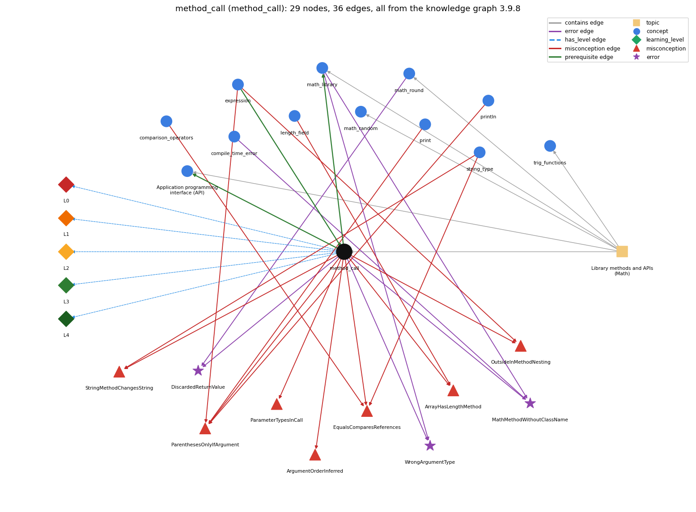

# method_call (`method_call`)

name(arguments) -- invokes a library method and uses its return value

Section 1.2 Built-in Types of Data, topic 1.2.g Library methods and APIs (Math).

## At a glance

- **Needs first:** `expression`
- **Leads to:** `api`, `math_library`
- **Learned alongside:** nothing
- **Misconceptions:** `ArgumentOrderInferred`, `ArrayHasLengthMethod`, `EqualsComparesReferences`, `OutsideInMethodNesting`, `ParameterTypesInCall`, `ParenthesesOnlyIfArgument`, `StringMethodChangesString`
- **Errors:** `DiscardedReturnValue`, `MathMethodWithoutClassName`, `WrongArgumentType`
- **Levels:** L0, L1, L2, L3, L4

Everything below comes from the knowledge graph 3.9.8 (`data/raw/chapter1_kg_updated.json`): 36 edges around this concept, each explained in the graph's own words.

## What it needs first (1)

A prerequisite edge means the other concept has to be understood before `method_call`.

### `expression` comes before `method_call`

*anything that evaluates to a value*

Method arguments may be expressions, and a method call can be used in expressions in the same way as variables and literals.

- **Grounding:** book passage
- **How `method_call` combines with `expression`:** Arguments may be arbitrary expressions of the right type, and the call itself is an expression usable inside larger ones (Math.sin(x) \* Math.cos(y)).
- **How `expression` combines with `method_call`:** A method call is an expression usable wherever a value of its return type is, and its arguments are expressions evaluated before the call.

## What it leads to (2)

These concepts need `method_call` first.

### `method_call` comes before `api`

*Application programming interface (API): a table of library methods giving each method's signature and a short description of what it computes*

An API lists, for each library method, the signature you need in order to call it: name, argument types and return type.

- **Grounding:** book passage
- **How `method_call` combines with `api`:** The call must match a signature in the API (name, number, order and types of arguments), and the API's return type tells how the value can be used.
- **How `api` combines with `method_call`:** Each call must match one API signature: same name, arguments of the listed types in the listed order, and use of the value consistent with the return type.

### `method_call` comes before `math_library`

*Math.abs, Math.sqrt, Math.max, Math.random, Math.round ...*

Math.sqrt(x) and other Math methods are used through method calls.

- **Grounding:** book passage
- **How `method_call` combines with `math_library`:** Math methods are called through the class name, Math.sqrt(x); without the prefix the compiler looks for the method in the current class and reports cannot find symbol.
- **How `math_library` combines with `method_call`:** Every Math facility is used through a method call with the Math. prefix and parentheses (the constants Math.PI and Math.E are written without parentheses).

## Learned alongside (0)

A parallel edge joins two concepts that sit side by side: neither is needed before the other.

No parallel edge touches this concept.

## Misconceptions (7)

A misconception edge states the wrong rule a student may hold about this concept, and the right rule.

### ArgumentOrderInferred

- **Wrong rule:** Java works out from the variable names which argument goes where, so Math.pow(n, 2) and Math.pow(2, n) mean the same.
- **Right rule:** Arguments are written in the order the method's signature lists them; for example, Math.pow(a, b) raises a to the bth power.
- **Role of this concept:** primary
- **Shows at level L0 as:** misconception: wrong rule: Java works out from the variable names which argument goes where, so Math.pow(n, 2) and Math.pow(2, n) mean the same. Right rule: Arguments are matched to parameters by position, in the order the signature lists them; Math.pow(a, b) raises a to the bth power.

### ArrayHasLengthMethod

- **Wrong rule:** you call length() instead of using the length field
- **Right rule:** An array's size is the field a.length, written without parentheses.
- **Role of this concept:** context
- **Shows at level L0 as:** misconception: wrong rule: You call length() instead of using the length field. Right rule: An array's size is the field a.length, written without parentheses (String has the method s.length()).
- **Also an edge from `length_field`:** The size of an array is found by calling a.length().

### EqualsComparesReferences

- **Wrong rule:** .equals() compares references, not contents
- **Right rule:** s.equals(t) checks whether the two Strings contain the same characters.
- **Role of this concept:** context
- **Shows at level L0 as:** misconception: wrong rule: .equals() compares references, not contents. Right rule: s.equals(t) checks whether the two Strings contain the same characters.
- **Also an edge from `comparison_operators`:** .equals() compares references, not contents
- **Also an edge from `string_type`:** s.equals(t) checks whether s and t are the same object.

### OutsideInMethodNesting

- **Wrong rule:** nested calls run outside-in, not arguments-first
- **Right rule:** In f(g(x)), g(x) is evaluated first and its result is passed to f.
- **Role of this concept:** primary
- **Shows at level L0 as:** misconception: wrong rule: Nested calls run outside-in, not arguments-first. Right rule: In f(g(x)), g(x) is evaluated first and its result is passed to f.
- **Also an edge from `expression`:** In f(g(x)), f runs first and then g runs.

### ParameterTypesInCall

- **Wrong rule:** A method call lists the parameter types, as in Math.pow(double a, double b).
- **Right rule:** A call passes only argument expressions, e.g. Math.pow(a, b); types appear only in the method declaration.
- **Role of this concept:** primary
- **Shows at level L0 as:** misconception: wrong rule: A method call lists the parameter types, as in Math.pow(double a, double b). Right rule: A call passes only argument expressions, e.g. Math.pow(a, b); types appear only in the signature/declaration.

### ParenthesesOnlyIfArgument

- **Wrong rule:** () are optional on a no-argument call like println
- **Right rule:** A method call always needs parentheses, so an empty line is printed with System.out.println();.
- **Role of this concept:** primary
- **Shows at level L0 as:** misconception: wrong rule: () are optional on a no-argument call like println. Right rule: A method call always needs parentheses, so an empty line is printed with System.out.println(); and a random number is Math.random().
- **Shows at level L0 as:** inconsistent trace: Points to LT (arguments are evaluated left to right, then the method runs, then its return value replaces the call). Applied unevenly: in f(g(x)) the student calls the outer method before the inner one on some lines, or keeps the argument expression unevaluated in one trace step. (here mixing in: "() are optional on a no-argument call like println")
- **Also an edge from `expression`:** () are optional on a no-argument call like println
- **Also an edge from `print`:** println with nothing to print can be written System.out.println; without the parentheses.
- **Also an edge from `println`:** println with nothing to print can be written System.out.println; without the parentheses.

### StringMethodChangesString

- **Wrong rule:** name.toUpperCase(); changes name.
- **Right rule:** Strings are immutable: String methods return a new String, which must be assigned, e.g. name = name.toUpperCase();
- **Role of this concept:** context
- **Also an edge from `string_type`:** name.toUpperCase(); changes name.

## Errors (3)

An error edge states the rule that gets broken in a program, and the right rule.

### DiscardedReturnValue

- **Wrong rule:** Writes Math.round(x); on its own line expecting x to be rounded.
- **Right rule:** Math.round(x) returns a value; that value has to be stored or used (e.g. long r = Math.round(x);), because the call on its own line does nothing with it.
- **Role of this concept:** primary
- **Also an edge from `math_round`:** Writes Math.round(x); on its own line expecting x to be rounded.

### MathMethodWithoutClassName

- **Wrong rule:** sqrt(x) calls the square-root method.
- **Right rule:** Library methods are called with the class name, e.g. Math.sqrt(x).
- **Role of this concept:** primary
- **Also an edge from `compile_time_error`:** sqrt(x) calls the square-root method.
- **Also an edge from `math_library`:** sqrt(x) calls the square-root method.

### WrongArgumentType

- **Wrong rule:** Calls a method with arguments of the wrong type, e.g. Math.sqrt("2").
- **Right rule:** Each argument must have the type the method's API lists.
- **Role of this concept:** primary
- **Also an edge from `math_library`:** Calls a method with arguments of the wrong type, e.g. Math.sqrt("2").

## Levels L0 to L4 (5 of 5)

Each level edge lists the ways a student shows that level, each with its exact rule.

### L0: Prestructural / sensorimotor

L0 for method call: the answer holds a rule that contradicts Java.

*Deciding question: Does every rule the answer applies to method call agree with the language rule? If it reads the code with everyday meanings, applies a wrong rule, or switches rules within one trace, it is L0. A slip in an otherwise rule-correct trace is L2 with an error, not L0.*

method call -&gt; L0 (Prestructural): the answer holds a rule that contradicts Java (8 ways).

- **everyday reading** (folk-meaning rule): Folk meaning: maths function notation f(x) or sqrt(x), where the name alone suffices, a constant needs no brackets, and the reader infers which argument is which from meaning. Java rule: a library method is called as ClassName.name(arguments) (Math.sqrt(x)), the parentheses are always required, and arguments are matched to parameters by position and type.
- **misconception** (wrong rule / right rule; shows `ParenthesesOnlyIfArgument`): wrong rule: () are optional on a no-argument call like println. Right rule: A method call always needs parentheses, so an empty line is printed with System.out.println(); and a random number is Math.random().
- **misconception** (wrong rule / right rule; shows `OutsideInMethodNesting`): wrong rule: Nested calls run outside-in, not arguments-first. Right rule: In f(g(x)), g(x) is evaluated first and its result is passed to f.
- **misconception** (wrong rule / right rule; shows `ArgumentOrderInferred`): wrong rule: Java works out from the variable names which argument goes where, so Math.pow(n, 2) and Math.pow(2, n) mean the same. Right rule: Arguments are matched to parameters by position, in the order the signature lists them; Math.pow(a, b) raises a to the bth power.
- **misconception** (wrong rule / right rule; shows `ParameterTypesInCall`): wrong rule: A method call lists the parameter types, as in Math.pow(double a, double b). Right rule: A call passes only argument expressions, e.g. Math.pow(a, b); types appear only in the signature/declaration.
- **inconsistent trace** (uneven-application rule; shows `ParenthesesOnlyIfArgument`): Points to LT (arguments are evaluated left to right, then the method runs, then its return value replaces the call). Applied unevenly: in f(g(x)) the student calls the outer method before the inner one on some lines, or keeps the argument expression unevaluated in one trace step. (here mixing in: "() are optional on a no-argument call like println")
- **misconception** (wrong rule / right rule; shows `ArrayHasLengthMethod`): wrong rule: You call length() instead of using the length field. Right rule: An array's size is the field a.length, written without parentheses (String has the method s.length()).
- **misconception** (wrong rule / right rule; shows `EqualsComparesReferences`): wrong rule: .equals() compares references, not contents. Right rule: s.equals(t) checks whether the two Strings contain the same characters.

### L1: Unistructural / atom x text surface

L1 for method call: the answer states one correct rule without applying it.

*Deciding question: Does the answer cover every part of the code, in order, with the values (L2)? If it covers one part or only states the rule, it is L1.*

method call -&gt; L1 (Unistructural): the answer states one correct rule without applying it (2 ways).

- **names the element** (identity rule): A method call is an expression that invokes a (library) method by its name, with arguments in parentheses, and evaluates to the value the method returns.
- **states the rule** (declarative rule): A library method is used by typing its (class-qualified) name followed by arguments of the specified types, in parentheses and separated by commas; the call can be used in expressions like a variable or literal; void methods return no value.

### L2: Multistructural / block x execution / preoperational

L2 for method call: the answer applies these rules to every part of the code, in order.

*Deciding question: Is the answer many segments mapped onto lines (L2), or one segment stating the purpose of the whole (L3)? A correct output with no value-by-value justification is not levelled.*

method call -&gt; L2 (Multistructural): the answer applies the rules of method call to every part of the code, in order (3 ways).

- **line by line trace** (operational sequencing rule): Evaluate the argument expressions from left to right (inner calls first), convert each to its parameter type if needed, transfer control to the method, and when it returns substitute the returned value for the call in the enclosing expression.
- **output prediction** (evaluation / result rule): The call's value has the method's return type: Math.sqrt(5.0\*5.0 - 4.0\*4.0) is double 3.0, Math.round(3.14159) is long 3, Integer.parseInt("123") is int 123; a void method such as println has no value.
- **one step execution** (state-transition rule): Calling a Math method changes none of the caller's variables (arguments are passed as values); the program's state changes only if the returned value is stored or used, e.g. double d = Math.sqrt(x);.

### L3: Relational / relations x function (concrete operational begins)

L3 for method call: the answer relates the parts by these rules.

*Deciding question: Was the purpose deduced from the code, or only guessed from traced input/output pairs (then L2)? Does the answer stay within the given code (L3), or reason about changed code, an error class or a new program (L4)?*

method call -&gt; L3 (Relational): the answer relates the parts (4 ways).

- **relation to neighbour** (composition rule (with a neighbour)): Arguments may be arbitrary expressions of the right type, and the call itself is an expression usable inside larger ones (Math.sin(x) \* Math.cos(y)).
- **relation to neighbour** (composition rule (with a neighbour)): Math methods are called through the class name, Math.sqrt(x); without the prefix the compiler looks for the method in the current class and reports cannot find symbol.
- **relation to neighbour** (composition rule (with a neighbour)): The call must match a signature in the API (name, number, order and types of arguments), and the API's return type tells how the value can be used.
- **purpose of the whole** (plan / role rule): Delegates a computation to existing library code used as a black box, and composes computations by passing one call's result into another, e.g. Math.exp(Math.log(10.0)).

### L4: Extended abstract (concrete-operational reversibility and conservation)

L4 for method call: the answer reasons beyond the given code by these rules.

*Deciding question: Does the answer link the code to a broader context: a changed program, a class of inputs, an unseen problem? Re-tracing changed code value by value is L2; fixing one given failing case is L3.*

method call -&gt; L4 (Extended abstract): the answer reasons beyond the given code (6 ways).

- **predict a change** (conservation rule; shows `ParenthesesOnlyIfArgument`): Changing an argument changes only the returned value, never the argument variable; swapping arguments changes the meaning (Math.pow(2, n) vs Math.pow(n, 2)); replacing a call by its value keeps behaviour for mathematical functions but not for Math.random().
- **diagnose an error** (error rule): rule broken: Each argument must have (or automatically widen to) the type the method's API lists. Kind: compile-time. Trigger class: An argument whose type cannot be converted to the parameter type, e.g. Math.sqrt("2"), or the wrong number of arguments.
- **diagnose an error** (error rule): rule broken: A value-returning call does not change its argument; its result must be stored or used. Kind: silent logic error. Trigger class: A non-void call written as a statement on its own, e.g. Math.round(x); or Math.abs(d); expecting x or d to change.
- **transfer to a new program** (applicability rule): Call a library method whenever a well-specified computation exists in an API (square roots, powers, conversions); write your own code only when no method fits; store a result in a variable rather than repeating an identical call.
- **diagnose an error** (error rule): rule broken: Library methods are called with the class name, e.g. Math.sqrt(x). Kind: compile-time. Trigger class: Calling sqrt(x), pow(a, b) etc. without the Math. prefix from another class (cannot find symbol).
- **diagnose an error** (error rule): rule broken: A call needs parentheses and passes only argument expressions. Kind: compile-time. Trigger class: Omitting () on a call (Math.random) or writing parameter types in the call (Math.pow(double a, double b)).

## Same topic

`method_call` belongs to the topic **Library methods and APIs (Math)** (`topic1.2.g`). The topic also contains: `api`, `math_library`, `math_random`, `math_round`, `trig_functions`.

## Rules of the concept (23)

- **folk-meaning rule:** Folk meaning: maths function notation f(x) or sqrt(x), where the name alone suffices, a constant needs no brackets, and the reader infers which argument is which from meaning. Java rule: a library method is called as ClassName.name(arguments) (Math.sqrt(x)), the parentheses are always required, and arguments are matched to parameters by position and type.
- **wrong rule / right rule:** ArrayHasLengthMethod: wrong: You call length() instead of using the length field. \| right: An array's size is the field a.length, written without parentheses (String has the method s.length()).
- **wrong rule / right rule:** EqualsComparesReferences: wrong: .equals() compares references, not contents. \| right: s.equals(t) checks whether the two Strings contain the same characters.
- **wrong rule / right rule:** ParenthesesOnlyIfArgument: wrong: () are optional on a no-argument call like println. \| right: A method call always needs parentheses, so an empty line is printed with System.out.println(); and a random number is Math.random().
- **wrong rule / right rule:** OutsideInMethodNesting: wrong: Nested calls run outside-in, not arguments-first. \| right: In f(g(x)), g(x) is evaluated first and its result is passed to f.
- **wrong rule / right rule:** ArgumentOrderInferred: wrong: Java works out from the variable names which argument goes where, so Math.pow(n, 2) and Math.pow(2, n) mean the same. \| right: Arguments are matched to parameters by position, in the order the signature lists them; Math.pow(a, b) raises a to the bth power.
- **wrong rule / right rule:** ParameterTypesInCall: wrong: A method call lists the parameter types, as in Math.pow(double a, double b). \| right: A call passes only argument expressions, e.g. Math.pow(a, b); types appear only in the signature/declaration.
- **uneven-application rule:** Points to LT (arguments are evaluated left to right, then the method runs, then its return value replaces the call). Applied unevenly: in f(g(x)) the student calls the outer method before the inner one on some lines, or keeps the argument expression unevaluated in one trace step.
- **identity rule:** A method call is an expression that invokes a (library) method by its name, with arguments in parentheses, and evaluates to the value the method returns.
- **declarative rule:** A library method is used by typing its (class-qualified) name followed by arguments of the specified types, in parentheses and separated by commas; the call can be used in expressions like a variable or literal; void methods return no value.
- **operational sequencing rule:** Evaluate the argument expressions from left to right (inner calls first), convert each to its parameter type if needed, transfer control to the method, and when it returns substitute the returned value for the call in the enclosing expression.
- **evaluation / result rule:** The call's value has the method's return type: Math.sqrt(5.0\*5.0 - 4.0\*4.0) is double 3.0, Math.round(3.14159) is long 3, Integer.parseInt("123") is int 123; a void method such as println has no value.
- **state-transition rule:** Calling a Math method changes none of the caller's variables (arguments are passed as values); the program's state changes only if the returned value is stored or used, e.g. double d = Math.sqrt(x);.
- **composition rule (with a neighbour):** with expression: Arguments may be arbitrary expressions of the right type, and the call itself is an expression usable inside larger ones (Math.sin(x) \* Math.cos(y)).
- **composition rule (with a neighbour):** with math\_library: Math methods are called through the class name, Math.sqrt(x); without the prefix the compiler looks for the method in the current class and reports cannot find symbol.
- **composition rule (with a neighbour):** with api: The call must match a signature in the API (name, number, order and types of arguments), and the API's return type tells how the value can be used.
- **plan / role rule:** Delegates a computation to existing library code used as a black box, and composes computations by passing one call's result into another, e.g. Math.exp(Math.log(10.0)).
- **conservation rule:** Changing an argument changes only the returned value, never the argument variable; swapping arguments changes the meaning (Math.pow(2, n) vs Math.pow(n, 2)); replacing a call by its value keeps behaviour for mathematical functions but not for Math.random().
- **error rule:** rule broken: Library methods are called with the class name, e.g. Math.sqrt(x). (compile-time)
- **error rule:** rule broken: Each argument must have (or automatically widen to) the type the method's API lists. (compile-time)
- **error rule:** rule broken: A value-returning call does not change its argument; its result must be stored or used. (silent logic error)
- **error rule:** rule broken: A call needs parentheses and passes only argument expressions. (compile-time)
- **applicability rule:** Call a library method whenever a well-specified computation exists in an API (square roots, powers, conversions); write your own code only when no method fits; store a result in a variable rather than repeating an identical call.

## The whole prerequisite chain

- **Everything it builds on (7):** `arithmetic_operators`, `data_type`, `expression`, `identifier`, `literal`, `primitive_type`, `variable`
- **Everything that builds on it (19):** `animation`, `api`, `coordinate_scaling`, `drawing_shapes`, `frequency_counting`, `function_plotting`, `math_library`, `math_random`, `math_round`, `monte_carlo_simulation`, `mouse_interaction`, `random_move`, `sampling_without_replacement`, `shuffle`, `simulation_loop`, `standard_audio`, `standard_drawing`, `trig_functions`, `two_models`
