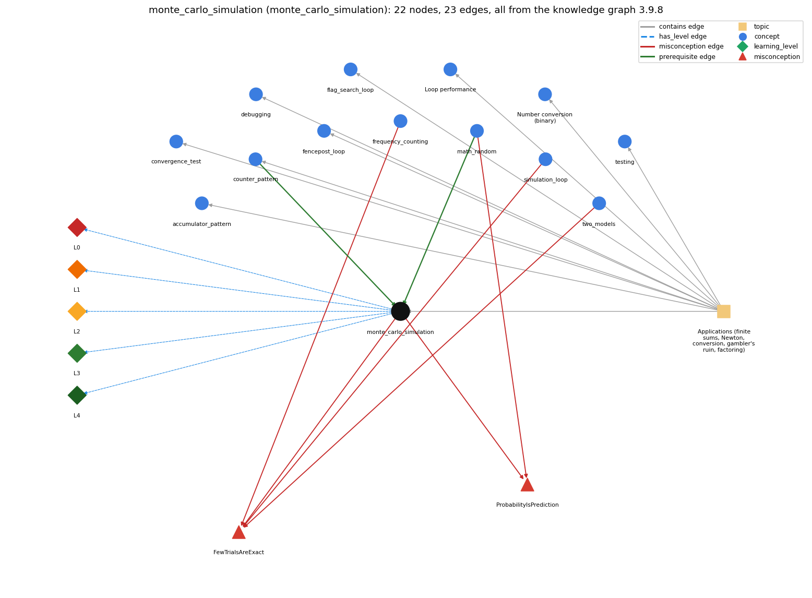

# monte_carlo_simulation (`monte_carlo_simulation`)

estimating a probability by repeating random trials

Section 1.3 Conditionals and Loops, topic 1.3.f Applications (finite sums, Newton, conversion, gambler's ruin, factoring). From the knowledge graph 3.9.8 (`data/raw/chapter1_kg_updated.json`).

## Concepts associated with monte\_carlo\_simulation (13)

| Concept | Description | How it is associated |
| --- | --- | --- |
| **accumulator\_pattern** | building up a running total/result | same topic (topic1.3.f) |
| **convergence\_test** | stopping a loop when a floating-point result is close enough | same topic (topic1.3.f) |
| **counter\_pattern** | counting occurrences across passes | prerequisite of it (it needs this) composition rule (R) with it same topic (topic1.3.f) |
| **debugging** | finding and fixing the cause of a wrong result or error by forming a hypothesis, changing the program and checking the prediction | same topic (topic1.3.f) |
| **fencepost\_loop** | n items need n - 1 separators: one item handled outside the loop | same topic (topic1.3.f) |
| **flag\_search\_loop** | a boolean flag that a loop sets once and never resets | same topic (topic1.3.f) |
| **frequency\_counting** | tally visits to estimate page rank | shares misconception FewTrialsAreExact |
| **loop\_performance** | the running time of a loop program depends on how many iterations it makes | same topic (topic1.3.f) |
| **math\_random** | Math.random() and scaling to an int range | prerequisite of it (it needs this) composition rule (R) with it shares misconception ProbabilityIsPrediction |
| **number\_conversion** | converting an integer to its binary representation by casting out powers of 2 in a loop | same topic (topic1.3.f) |
| **simulation\_loop** | take many random steps | shares misconception FewTrialsAreExact |
| **testing** | running a program on chosen inputs, including boundary and unusual ones, and comparing the output with what it should be | same topic (topic1.3.f) |
| **two\_models** | simulation vs. repeated matrix multiplication (mixing) | shares misconception FewTrialsAreExact |

## Every edge in this view and its full label (23)

| From | Edge | To | Full edge label |
| --- | --- | --- | --- |
| **counter\_pattern** | prerequisite | **monte\_carlo\_simulation** | Counting successes is the counter pattern. grounding: book\_passage composition rule (R) of counter\_pattern with monte\_carlo\_simulation: A Monte Carlo estimate is the counter divided by the number of trials (\`(double) wins / T\`). So the counter has to be initialised once, before the trial loop, and must not be reset inside it. composition rule (R) of monte\_carlo\_simulation with counter\_pattern: Successes are tallied by a counter declared before the trial loop and incremented once per successful trial. The estimate is that counter divided by T, computed as a double or as \`100\*wins/T\` for a whole-number percentage. |
| **math\_random** | prerequisite | **monte\_carlo\_simulation** | Each trial uses Math.random(). grounding: book\_passage composition rule (R) of math\_random with monte\_carlo\_simulation: Each trial of a Monte Carlo simulation draws fresh values with Math.random(); estimates become reliable only over many trials. composition rule (R) of monte\_carlo\_simulation with math\_random: Each random event is driven by Math.random(), which returns a double in [0, 1). An event of probability p is simulated as \`Math.random() &lt; p\`, e.g. \`&lt; 0.5\` for a fair bet. |
| **frequency\_counting** | misconception | **FewTrialsAreExact** | **wrong rule:** A short simulation gives the exact page ranks. **right rule:** A simulation only estimates the page ranks: RandomSurfer needs 10^n moves to get answers precise to n decimal places and many more moves for those answers to become accurate (tens of thousands of moves for two accurate places, millions for three). role: primary |
| **math\_random** | misconception | **ProbabilityIsPrediction** | **wrong rule:** A probability (e.g. 70%) predicts what the next single trial will do. **right rule:** A probability describes the long-run frequency over many trials, not one outcome. role: context |
| **monte\_carlo\_simulation** | misconception | **FewTrialsAreExact** | **wrong rule:** A short simulation gives the exact page ranks. **right rule:** A simulation only estimates the page ranks: RandomSurfer needs 10^n moves to get answers precise to n decimal places and many more moves for those answers to become accurate (tens of thousands of moves for two accurate places, millions for three). role: context |
| **monte\_carlo\_simulation** | misconception | **ProbabilityIsPrediction** | **wrong rule:** A probability (e.g. 70%) predicts what the next single trial will do. **right rule:** A probability describes the long-run frequency over many trials, not one outcome. role: primary |
| **simulation\_loop** | misconception | **FewTrialsAreExact** | **wrong rule:** A short simulation gives the exact page ranks. **right rule:** A simulation only estimates the page ranks: RandomSurfer needs 10^n moves to get answers precise to n decimal places and many more moves for those answers to become accurate (tens of thousands of moves for two accurate places, millions for three). role: context |
| **two\_models** | misconception | **FewTrialsAreExact** | **wrong rule:** A short simulation gives the exact page ranks. **right rule:** A simulation only estimates the page ranks: RandomSurfer needs 10^n moves to get answers precise to n decimal places and many more moves for those answers to become accurate (tens of thousands of moves for two accurate places, millions for three). role: context |
| **monte\_carlo\_simulation** | has\_level | **monte\_carlo\_simulation@L0** | monte carlo simulation -&gt; L0 (Prestructural): the answer holds a rule that contradicts Java (4 ways). **[0] everyday\_reading** (E): Folk meaning: in everyday speech a 70% chance or a single experiment 'tells what will happen', and 'random' means unpredictable and never repeating. A Monte Carlo program gives only an estimate (successes / trials) whose accuracy grows with the number of trials, and Math.random() is pseudo-random, not truly random. **[1] misconception** (M) &rarr; FewTrialsAreExact: wrong rule: A short simulation gives the exact page ranks (or probabilities). Right rule: A simulation only estimates: RandomSurfer needs 10^n moves for n-decimal precision and many more for accuracy (tens of thousands of moves for two places, millions for three). **[2] misconception** (M) &rarr; ProbabilityIsPrediction: wrong rule: A probability (e.g. 70%) predicts what the next single trial will do. Right rule: A probability is the long-run fraction of successes over many trials. A simulation estimates it as count / trials, and one trial can come out either way. **[3] inconsistent\_trace** (T) &rarr; FewTrialsAreExact: Applies the LT rule (run a trial, update the counters, repeat T times, divide at the end) unevenly: resets the per-trial state (cash = stake) only once rather than once per trial, or divides inside the loop, so the traced estimate mixes trials. (here mixing in: "A short simulation gives the exact page ranks") |
| **monte\_carlo\_simulation** | has\_level | **monte\_carlo\_simulation@L1** | monte carlo simulation -&gt; L1 (Unistructural): the answer states one correct rule without applying it (2 ways). **[0] names\_the\_element** (N): Simulation technique: estimating a probability or expected value by repeating many independent random trials with Math.random() and averaging the outcomes. **[1] states\_the\_rule** (S): Run T independent trials in an outer loop, each starting from fresh state; count successes (and accumulate costs). Report \`successes / T\` (and \`total / T\`) as the estimates. |
| **monte\_carlo\_simulation** | has\_level | **monte\_carlo\_simulation@L2** | monte carlo simulation -&gt; L2 (Multistructural): the answer applies the rules of monte carlo simulation to every part of the code, in order (3 ways). **[0] line\_by\_line\_trace** (LT): Order: initialise the counters once; then, for each trial, reset the trial state, run the inner random process to its end (\`while (cash &gt; 0 &amp;&amp; cash &lt; goal)\`), and update the counters; divide and print only after all T trials. **[1] output\_prediction** (OP): The output is an estimate that varies from run to run and gets close to the true value as T grows. Gambler 10 20 1000 prints about 50% wins and about 100 bets, close to the theory: stake/goal and stake × (goal − stake). **[2] one\_step\_execution** (OS): One trial resets its own state (cash = stake), consumes random numbers and changes only the summary counters: wins goes up by 0 or 1, and bets goes up by the number of bets made in that trial. |
| **monte\_carlo\_simulation** | has\_level | **monte\_carlo\_simulation@L3** | monte carlo simulation -&gt; L3 (Relational): the answer relates the parts (3 ways). **[0] relation\_to\_neighbour** (R): Each random event is driven by Math.random(), which returns a double in [0, 1). An event of probability p is simulated as \`Math.random() &lt; p\`, e.g. \`&lt; 0.5\` for a fair bet. **[1] relation\_to\_neighbour** (R): Successes are tallied by a counter declared before the trial loop and incremented once per successful trial. The estimate is that counter divided by T, computed as a double or as \`100\*wins/T\` for a whole-number percentage. **[2] purpose\_of\_the\_whole** (P): Plan: simulate-and-count (Monte Carlo). It answers questions that are hard to solve analytically, and it checks analytic results. Roles: trial index = stepper, wins = counter, bets = gatherer. |
| **monte\_carlo\_simulation** | has\_level | **monte\_carlo\_simulation@L4** | monte carlo simulation -&gt; L4 (Extended abstract): the answer reasons beyond the given code (6 ways). **[0] predict\_a\_change** (C) &rarr; FewTrialsAreExact: Increasing T keeps the expected estimate and narrows its spread (about 10^n trials per decimal digit), but raises running time in proportion to T. Changing the success test or probability changes what is estimated. Re-running with the same T gives a slightly different number. **[1] transfer\_to\_a\_new\_program** (X): Use Monte Carlo when an answer is a probability or average of a random process that is hard to analyse (gambler's ruin with a bet limit, Monty Hall, random walks, page ranks). Avoid it when an exact formula or deterministic computation exists and is cheap, or when you need more accuracy than the trial budget can give. **[2] diagnose\_an\_error** (D): rule broken: Each trial must start from fresh state. Kind: silent logic error. Trigger class: Declaring or initialising the trial state (\`int cash = stake;\`) before the outer for loop: every trial after the first starts at 0 or goal and ends immediately. **[3] diagnose\_an\_error** (D): rule broken: Estimates from few trials are unreliable. Kind: silent logic error. Trigger class: Small T (e.g. 10 trials): the printed probability can be far from the true value. **[4] diagnose\_an\_error** (D): rule broken: Integer division truncates the estimate. Kind: silent logic error. Trigger class: Computing \`wins / T\` with ints gives 0 whenever wins &lt; T. **[5] diagnose\_an\_error** (D): rule broken: Running time grows with T times the length of each trial. Kind: silent logic error. Trigger class: Large stakes or goals (\`java Gambler 100000 200000 100\`): the program seems to hang. |
| **topic1.3.f** | contains | **accumulator\_pattern** | topic topic1.3.f contains accumulator\_pattern |
| **topic1.3.f** | contains | **convergence\_test** | topic topic1.3.f contains convergence\_test |
| **topic1.3.f** | contains | **counter\_pattern** | topic topic1.3.f contains counter\_pattern |
| **topic1.3.f** | contains | **debugging** | topic topic1.3.f contains debugging |
| **topic1.3.f** | contains | **fencepost\_loop** | topic topic1.3.f contains fencepost\_loop |
| **topic1.3.f** | contains | **flag\_search\_loop** | topic topic1.3.f contains flag\_search\_loop |
| **topic1.3.f** | contains | **loop\_performance** | topic topic1.3.f contains loop\_performance |
| **topic1.3.f** | contains | **monte\_carlo\_simulation** | topic topic1.3.f contains monte\_carlo\_simulation |
| **topic1.3.f** | contains | **number\_conversion** | topic topic1.3.f contains number\_conversion |
| **topic1.3.f** | contains | **testing** | topic topic1.3.f contains testing |
