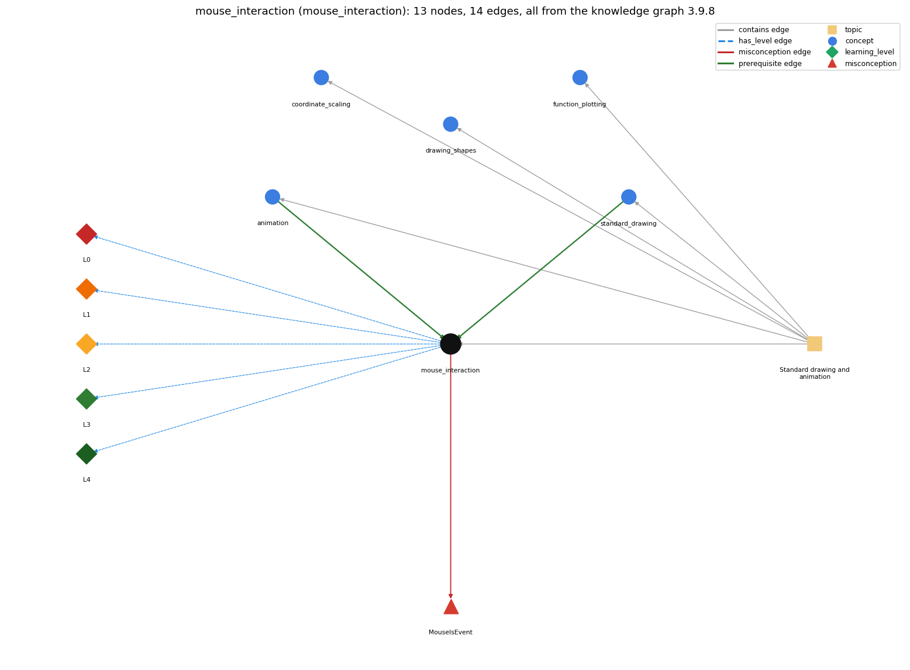

# mouse_interaction (`mouse_interaction`)

reading mouse position and clicks from StdDraw

Section 1.5 Input and Output, topic 1.5.e Standard drawing and animation. From the knowledge graph 3.9.8 (`data/raw/chapter1_kg_updated.json`).

## Concepts associated with mouse\_interaction (5)

| Concept | Description | How it is associated |
| --- | --- | --- |
| **animation** | StdDraw animation: clear, draw, show, pause in a loop | prerequisite of it (it needs this) composition rule (R) with it same topic (topic1.5.e) |
| **coordinate\_scaling** | StdDraw's unit square and setXscale/setYscale | same topic (topic1.5.e) |
| **drawing\_shapes** | outline vs filled shapes, square half-length, colour and text | same topic (topic1.5.e) |
| **function\_plotting** | sampling a function and joining the points with lines | same topic (topic1.5.e) |
| **standard\_drawing** | StdDraw -- graphical output (book-specific) | prerequisite of it (it needs this) same topic (topic1.5.e) |

## Every edge in this view and its full label (14)

| From | Edge | To | Full edge label |
| --- | --- | --- | --- |
| **animation** | prerequisite | **mouse\_interaction** | Mouse checks run inside the animation loop. grounding: questionable composition rule (R) of animation with mouse\_interaction: Mouse state is polled once per frame inside the animation loop, so it is checked about every dt milliseconds. composition rule (R) of mouse\_interaction with animation: Mouse checks run inside the frame loop. A click shorter than one frame (show(t) pause) can be missed. |
| **standard\_drawing** | prerequisite | **mouse\_interaction** | Mouse position and clicks are read through StdDraw methods such as StdDraw.mousePressed(). grounding: order\_only |
| **mouse\_interaction** | misconception | **MouseIsEvent** | **wrong rule:** StdDraw.mousePressed() waits until the user clicks. **right rule:** mousePressed() only reports whether the button is down at that moment, so it is checked repeatedly in a loop. role: primary |
| **mouse\_interaction** | has\_level | **mouse\_interaction@L0** | mouse interaction -&gt; L0 (Prestructural): the answer holds a rule that contradicts Java (3 ways). **[0] everyday\_reading** (E): In the everyday sense, 'mouse pressed' is an event the program waits for. StdDraw.mousePressed() only reports whether the button is down at the moment of the call. **[1] misconception** (M) &rarr; MouseIsEvent: wrong rule: StdDraw.mousePressed() waits until the user clicks. Right rule: mousePressed() returns immediately with true or false for that moment. To catch clicks, poll it on every frame of a loop. **[2] inconsistent\_trace** (T) &rarr; MouseIsEvent: Points to LT (each frame polls mousePressed, mouseX and mouseY once). An uneven trace treats one poll as blocking, or reuses an old position on some frames. (here mixing in: "StdDraw.mousePressed() waits until the user clicks") |
| **mouse\_interaction** | has\_level | **mouse\_interaction@L1** | mouse interaction -&gt; L1 (Unistructural): the answer states one correct rule without applying it (2 ways). **[0] names\_the\_element** (N): Mouse interaction is the StdDraw input methods mousePressed(), mouseX() and mouseY(), which report the mouse state in user coordinates. **[1] states\_the\_rule** (S): mousePressed() returns whether the button is currently pressed. mouseX() and mouseY() return the latest pointer position in the current x/y scale. |
| **mouse\_interaction** | has\_level | **mouse\_interaction@L2** | mouse interaction -&gt; L2 (Multistructural): the answer applies the rules of mouse interaction to every part of the code, in order (3 ways). **[0] line\_by\_line\_trace** (LT): Inside the animation loop: poll the mouse, update state from it, clear, draw, show(t). The mouse is sampled once per frame. **[1] output\_prediction** (OP): mousePressed() returns a boolean, and mouseX()/mouseY() return doubles in drawing coordinates (e.g. 0.5, 0.5 at the centre of the default canvas). **[2] one\_step\_execution** (OS): A poll changes no state and does not wait. It returns the current mouse state. |
| **mouse\_interaction** | has\_level | **mouse\_interaction@L3** | mouse interaction -&gt; L3 (Relational): the answer relates the parts (2 ways). **[0] relation\_to\_neighbour** (R): Mouse checks run inside the frame loop. A click shorter than one frame (show(t) pause) can be missed. **[1] purpose\_of\_the\_whole** (P): Plan: polling loop. The mouse coordinates are most-recent holders updated every frame. |
| **mouse\_interaction** | has\_level | **mouse\_interaction@L4** | mouse interaction -&gt; L4 (Extended abstract): the answer reasons beyond the given code (3 ways). **[0] predict\_a\_change** (C) &rarr; MouseIsEvent: Changing the frame pause changes how responsive the program is to clicks, but not what a click does. **[1] transfer\_to\_a\_new\_program** (X): Use mouse polling for interactive drawings and games built on StdDraw. For text dialogue, use StdIn. **[2] diagnose\_an\_error** (D): rule broken: mousePressed() does not block. Kind: silent logic error. Trigger class: Calling mousePressed() once outside a loop: it returns false before the user can click, and the click is ignored. |
| **topic1.5.e** | contains | **animation** | topic topic1.5.e contains animation |
| **topic1.5.e** | contains | **coordinate\_scaling** | topic topic1.5.e contains coordinate\_scaling |
| **topic1.5.e** | contains | **drawing\_shapes** | topic topic1.5.e contains drawing\_shapes |
| **topic1.5.e** | contains | **function\_plotting** | topic topic1.5.e contains function\_plotting |
| **topic1.5.e** | contains | **mouse\_interaction** | topic topic1.5.e contains mouse\_interaction |
| **topic1.5.e** | contains | **standard\_drawing** | topic topic1.5.e contains standard\_drawing |
