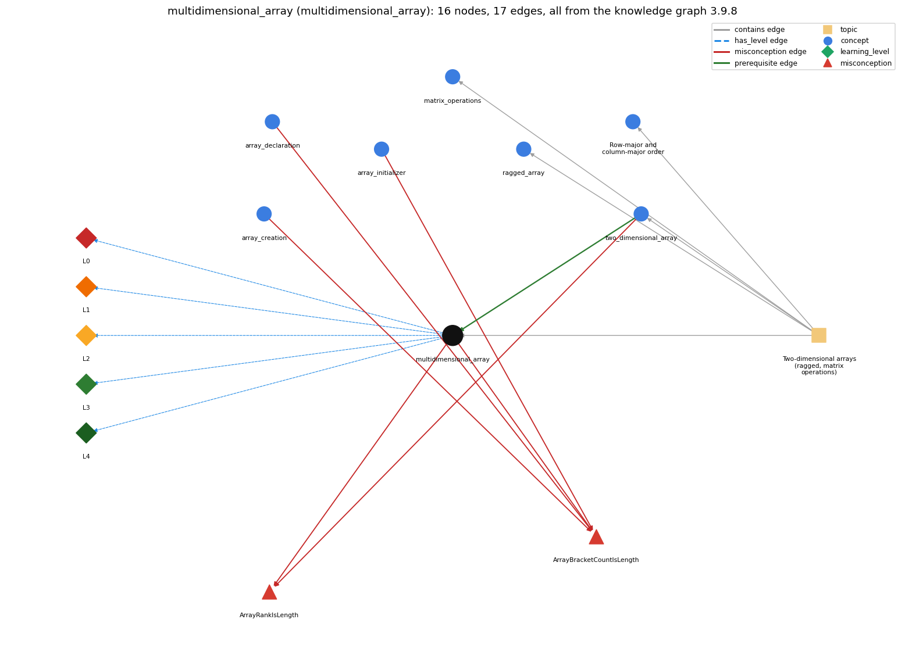

# multidimensional_array (`multidimensional_array`)

arrays with three or more indices

Section 1.4 Arrays, topic 1.4.g Two-dimensional arrays (ragged, matrix operations). From the knowledge graph 3.9.8 (`data/raw/chapter1_kg_updated.json`).

## Concepts associated with multidimensional\_array (7)

| Concept | Description | How it is associated |
| --- | --- | --- |
| **array\_creation** | new int[n] -- allocates n slots | shares misconception ArrayBracketCountIsLength |
| **array\_declaration** | int[] a; -- declares an array variable | shares misconception ArrayBracketCountIsLength |
| **array\_initializer** | {1, 2, 3} literal initialization | shares misconception ArrayBracketCountIsLength |
| **matrix\_operations** | matrix addition and multiplication with nested loops | same topic (topic1.4.g) |
| **ragged\_array** | a 2-D array whose rows have different lengths | same topic (topic1.4.g) |
| **row\_major\_order** | processing a 2-D array row by row (row-major) or column by column (column-major) | same topic (topic1.4.g) |
| **two\_dimensional\_array** | an array of arrays (a[i][j]) | prerequisite of it (it needs this) composition rule (R) with it shares misconception ArrayRankIsLength same topic (topic1.4.g) |

## Every edge in this view and its full label (17)

| From | Edge | To | Full edge label |
| --- | --- | --- | --- |
| **two\_dimensional\_array** | prerequisite | **multidimensional\_array** | Higher dimensions generalise 2-D arrays. grounding: book\_passage composition rule (R) of two\_dimensional\_array with multidimensional\_array: The same notation extends to any number of dimensions: a[i][j][k] for double[][][]. composition rule (R) of multidimensional\_array with two\_dimensional\_array: A 3-D array generalizes 2-D: a[i] is itself a 2-D array, and the same declaration, creation and indexing rules apply one level deeper. |
| **array\_creation** | misconception | **ArrayBracketCountIsLength** | **wrong rule:** The number of brackets in an array type or initializer is the array's length. **right rule:** Brackets give the number of dimensions; the length is set at creation. role: context |
| **array\_declaration** | misconception | **ArrayBracketCountIsLength** | **wrong rule:** The number of brackets in an array type or initializer is the array's length. **right rule:** Brackets give the number of dimensions; the length is set at creation. role: primary |
| **array\_initializer** | misconception | **ArrayBracketCountIsLength** | **wrong rule:** The number of brackets in an array type or initializer is the array's length. **right rule:** Brackets give the number of dimensions; the length is set at creation. role: context |
| **multidimensional\_array** | misconception | **ArrayBracketCountIsLength** | **wrong rule:** The number of brackets in an array type or initializer is the array's length. **right rule:** Brackets give the number of dimensions; the length is set at creation. role: context |
| **multidimensional\_array** | misconception | **ArrayRankIsLength** | **wrong rule:** The number of dimensions of an array is its length. **right rule:** Rank (number of dimensions) and length are different. role: context |
| **two\_dimensional\_array** | misconception | **ArrayRankIsLength** | **wrong rule:** The number of dimensions of an array is its length. **right rule:** Rank (number of dimensions) and length are different. role: primary |
| **multidimensional\_array** | has\_level | **multidimensional\_array@L0** | multidimensional array -&gt; L0 (Prestructural): the answer holds a rule that contradicts Java (4 ways). **[0] everyday\_reading** (E): Folk meaning: '3-D' suggests three elements, or one solid block. Java rule: each bracket pair adds one level of nesting, so double[][][] is an array of 2-D arrays, and its length is set at creation. **[1] misconception** (M) &rarr; ArrayRankIsLength: wrong rule: The number of dimensions of an array is its length. Right rule: Rank (number of bracket pairs) and length are different: new double[5][5][5] has rank 3 and a.length 5. **[2] inconsistent\_trace** (T) &rarr; ArrayRankIsLength: Points to LT: a[i][j][k] is evaluated left to right, each index selecting a sub-array of one lower dimension. Inconsistent application: the trace mixes up which index selects which level. (here mixing in: "The number of dimensions of an array is its length") **[3] misconception** (M) &rarr; ArrayBracketCountIsLength: wrong rule: The number of brackets in an array type or initializer is the array's length. Right rule: Brackets give the number of dimensions; the length of each level is set at creation. |
| **multidimensional\_array** | has\_level | **multidimensional\_array@L1** | multidimensional array -&gt; L1 (Unistructural): the answer states one correct rule without applying it (2 ways). **[0] names\_the\_element** (N): Identity: a multidimensional array, an array with three or more indices built as nested arrays of arrays. **[1] states\_the\_rule** (S): Declarative: double[][][] a = new double[N][N][N]; refer to an entry as a[i][j][k]. |
| **multidimensional\_array** | has\_level | **multidimensional\_array@L2** | multidimensional array -&gt; L2 (Multistructural): the answer applies the rules of multidimensional array to every part of the code, in order (3 ways). **[0] line\_by\_line\_trace** (LT): Sequencing: a[i] (a 2-D array) is evaluated, then [j] (a 1-D row), then [k] (the element); each step is bounds-checked against the length of that level. **[1] output\_prediction** (OP): Result: new double[N][N][N] holds N\*N\*N doubles, all 0.0; a.length is N, and a[i] is a double[][]. **[2] one\_step\_execution** (OS): State transition: a[i][j][k] = v changes one element; nothing else changes. |
| **multidimensional\_array** | has\_level | **multidimensional\_array@L3** | multidimensional array -&gt; L3 (Relational): the answer relates the parts (2 ways). **[0] relation\_to\_neighbour** (R): A 3-D array generalizes 2-D: a[i] is itself a 2-D array, and the same declaration, creation and indexing rules apply one level deeper. **[1] purpose\_of\_the\_whole** (P): Plan/role: model data with three or more coordinates, e.g. a 3-D lattice for self-avoiding walks or physical space. |
| **multidimensional\_array** | has\_level | **multidimensional\_array@L4** | multidimensional array -&gt; L4 (Extended abstract): the answer reasons beyond the given code (4 ways). **[0] predict\_a\_change** (C) &rarr; ArrayRankIsLength: Conservation: adding a dimension multiplies memory and creation time by the new extent (N^3 values for N per side), because creation time is proportional to the number of elements. **[1] transfer\_to\_a\_new\_program** (X): Applicability: use one when data naturally has three or more integer coordinates and N is small enough for N^3 storage. Use 2-D or 1-D arrays when fewer indices suffice. **[2] diagnose\_an\_error** (D): rule broken: The total size must be a non-negative int and fit in memory. Kind: run-time exception. Trigger class: large N in new double[N][N][N] exhausts memory (OutOfMemoryError), or a negative dimension (NegativeArraySizeException) **[3] diagnose\_an\_error** (D): rule broken: Each index must be within its own level. Kind: run-time exception. Trigger class: an index &gt;= the length of its level (ArrayIndexOutOfBoundsException) |
| **topic1.4.g** | contains | **matrix\_operations** | topic topic1.4.g contains matrix\_operations |
| **topic1.4.g** | contains | **multidimensional\_array** | topic topic1.4.g contains multidimensional\_array |
| **topic1.4.g** | contains | **ragged\_array** | topic topic1.4.g contains ragged\_array |
| **topic1.4.g** | contains | **row\_major\_order** | topic topic1.4.g contains row\_major\_order |
| **topic1.4.g** | contains | **two\_dimensional\_array** | topic topic1.4.g contains two\_dimensional\_array |
