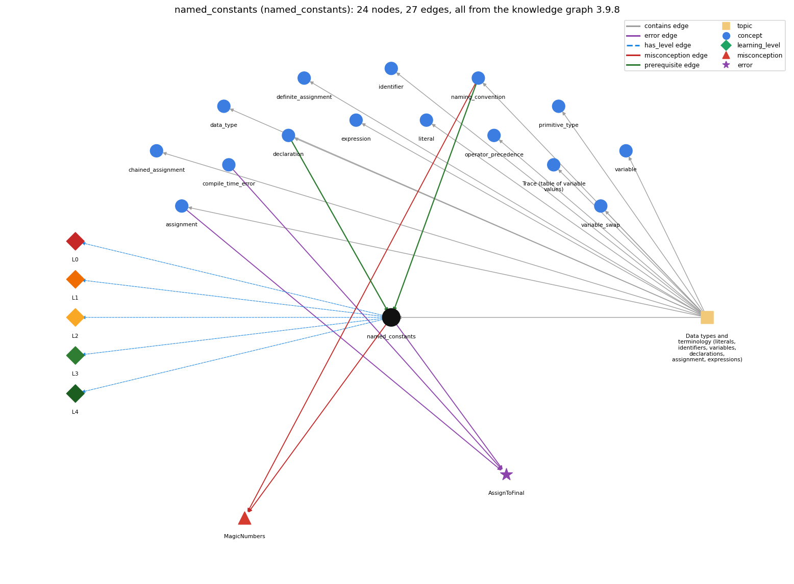

# named_constants (`named_constants`)

final constants in UPPER\_CASE instead of magic numbers

Section 1.2 Built-in Types of Data, topic 1.2.a Data types and terminology (literals, identifiers, variables, declarations, assignment, expressions).

## At a glance

- **Needs first:** `declaration`, `naming_convention`
- **Leads to:** nothing
- **Learned alongside:** nothing
- **Misconceptions:** `MagicNumbers`
- **Errors:** `AssignToFinal`
- **Levels:** L0, L1, L2, L3, L4

Everything below comes from the knowledge graph 3.9.8 (`data/raw/chapter1_kg_updated.json`): 27 edges around this concept, each explained in the graph's own words.

## What it needs first (2)

A prerequisite edge means the other concept has to be understood before `named_constants`.

### `declaration` comes before `named_constants`

*int x; -- introduces a variable name and its type*

A constant is a declaration marked final.

- **Grounding:** book passage
- **How `named_constants` combines with `declaration`:** A constant is an ordinary declaration with the final modifier, with the same type and scope rules.
- **How `declaration` combines with `named_constants`:** Adding final to a declaration makes the variable a constant that can be assigned only once.

### `naming_convention` comes before `named_constants`

*choosing meaningful names: full words, lowerCamelCase, single letters only for throwaway loop counters*

Constants have their own naming convention.

- **Grounding:** book passage
- **How `named_constants` combines with `naming_convention`:** Constants follow their own convention, ALL\_CAPS\_WITH\_UNDERSCORES, which sets them apart from lowerCamelCase variables.
- **How `naming_convention` combines with `named_constants`:** Constants are written in ALL\_CAPS with underscores, which sets them apart from lowerCamelCase variables and signals that they never change.

## What it leads to (0)

These concepts need `named_constants` first.

No concept has this one as a prerequisite.

## Learned alongside (0)

A parallel edge joins two concepts that sit side by side: neither is needed before the other.

No parallel edge touches this concept.

## Misconceptions (1)

A misconception edge states the wrong rule a student may hold about this concept, and the right rule.

### MagicNumbers

- **Wrong rule:** Writing 7 or 0.0825 directly in formulas is as clear as using a named constant.
- **Right rule:** Give fixed values a final, UPPER\_CASE name and use the name.
- **Role of this concept:** primary
- **Also an edge from `naming_convention`:** Writing 7 or 0.0825 directly in formulas is as clear as using a named constant.

## Errors (1)

An error edge states the rule that gets broken in a program, and the right rule.

### AssignToFinal

- **Wrong rule:** Assigns a new value to a variable declared final.
- **Right rule:** A final variable cannot be reassigned after it is initialized; the compiler reports an error.
- **Role of this concept:** primary
- **Also an edge from `assignment`:** Assigns a new value to a variable declared final.
- **Also an edge from `compile_time_error`:** Assigns a new value to a variable declared final.

## Levels L0 to L4 (5 of 5)

Each level edge lists the ways a student shows that level, each with its exact rule.

### L0: Prestructural / sensorimotor

L0 for named constants: the answer holds a rule that contradicts Java.

*Deciding question: Does every rule the answer applies to named constants agree with the language rule? If it reads the code with everyday meanings, applies a wrong rule, or switches rules within one trace, it is L0. A slip in an otherwise rule-correct trace is L2 with an error, not L0.*

named constants -&gt; L0 (Prestructural): the answer holds a rule that contradicts Java (1 way).

- **everyday reading** (folk-meaning rule): In everyday speech a 'constant' is just a number that stays the same in the problem, and a capitalized name looks official. In Java a value is constant only if its variable is declared final, which the compiler enforces; naming it in UPPER\_CASE alone protects nothing.

### L1: Unistructural / atom x text surface

L1 for named constants: the answer states one correct rule without applying it.

*Deciding question: Does the answer cover every part of the code, in order, with the values (L2)? If it covers one part or only states the rule, it is L1.*

named constants -&gt; L1 (Unistructural): the answer states one correct rule without applying it (2 ways).

- **names the element** (identity rule): Named constant: a variable declared final (by convention named in UPPER\_CASE) that names a fixed value.
- **states the rule** (declarative rule): final type NAME = value; cannot be reassigned after initialization (the compiler reports an error). Constant names are all uppercase with \_ between words.

### L2: Multistructural / block x execution / preoperational

L2 for named constants: the answer applies these rules to every part of the code, in order.

*Deciding question: Is the answer many segments mapped onto lines (L2), or one segment stating the purpose of the whole (L3)? A correct output with no value-by-value justification is not levelled.*

named constants -&gt; L2 (Multistructural): the answer applies the rules of named constants to every part of the code, in order (3 ways).

- **line by line trace** (operational sequencing rule): A constant is initialized once, when its declaration executes. Every later use reads that same value.
- **output prediction** (evaluation / result rule): A use of CM\_PER\_INCH evaluates to 2.54 with type double, exactly as the literal would.
- **one step execution** (state-transition rule): Only the initialization changes state; no later statement can change the constant.

### L3: Relational / relations x function (concrete operational begins)

L3 for named constants: the answer relates the parts by these rules.

*Deciding question: Was the purpose deduced from the code, or only guessed from traced input/output pairs (then L2)? Does the answer stay within the given code (L3), or reason about changed code, an error class or a new program (L4)?*

named constants -&gt; L3 (Relational): the answer relates the parts (3 ways).

- **relation to neighbour** (composition rule (with a neighbour)): A constant is an ordinary declaration with the final modifier, with the same type and scope rules.
- **relation to neighbour** (composition rule (with a neighbour)): Constants follow their own convention, ALL\_CAPS\_WITH\_UNDERSCORES, which sets them apart from lowerCamelCase variables.
- **purpose of the whole** (plan / role rule): Plan: replace magic numbers with a meaningful name (Sajaniemi role: fixed value), so the code is readable, the value is changed in one place, and accidental reassignment is prevented.

### L4: Extended abstract (concrete-operational reversibility and conservation)

L4 for named constants: the answer reasons beyond the given code by these rules.

*Deciding question: Does the answer link the code to a broader context: a changed program, a class of inputs, an unseen problem? Re-tracing changed code value by value is L2; fixing one given failing case is L3.*

named constants -&gt; L4 (Extended abstract): the answer reasons beyond the given code (4 ways).

- **predict a change** (conservation rule): Changing the constant's value in its declaration changes every use consistently. Removing final keeps behavior but loses the protection. Adding any later assignment to it breaks compilation.
- **diagnose an error** (error rule): rule broken: A final variable is assigned exactly once; it cannot be reassigned after initialization. Kind: compile-time. Trigger class: Any assignment, ++ or op= to a final variable after its initialization: 'cannot assign a value to final variable'.
- **transfer to a new program** (applicability rule): Use a named constant for a value fixed for the whole run that appears in formulas (conversion factors, physical constants, sizes, rates). Use a variable for values that are read or computed, and plain literals for self-evident values such as 0 or 1.
- **diagnose an error** (error rule): rule broken: A final variable must be assigned before it is read. Kind: compile-time. Trigger class: Declaring final double RATE; and reading it on a path that never assigns it: 'variable RATE might not have been initialized'.

## Same topic

`named_constants` belongs to the topic **Data types and terminology (literals, identifiers, variables, declarations, assignment, expressions)** (`topic1.2.a`). The topic also contains: `assignment`, `chained_assignment`, `data_type`, `declaration`, `definite_assignment`, `expression`, `identifier`, `literal`, `naming_convention`, `operator_precedence`, `primitive_type`, `program_trace`, `variable`, `variable_swap`.

## Rules of the concept (14)

- **folk-meaning rule:** In everyday speech a 'constant' is just a number that stays the same in the problem, and a capitalized name looks official. In Java a value is constant only if its variable is declared final, which the compiler enforces; naming it in UPPER\_CASE alone protects nothing.
- **uneven-application rule:** Points to LT (a final variable is assigned once and every read gives that value). Applied unevenly, a student treats a constant as updated later in the program on some reads.
- **identity rule:** Named constant: a variable declared final (by convention named in UPPER\_CASE) that names a fixed value.
- **declarative rule:** final type NAME = value; cannot be reassigned after initialization (the compiler reports an error). Constant names are all uppercase with \_ between words.
- **operational sequencing rule:** A constant is initialized once, when its declaration executes. Every later use reads that same value.
- **evaluation / result rule:** A use of CM\_PER\_INCH evaluates to 2.54 with type double, exactly as the literal would.
- **state-transition rule:** Only the initialization changes state; no later statement can change the constant.
- **composition rule (with a neighbour):** with declaration: A constant is an ordinary declaration with the final modifier, with the same type and scope rules.
- **composition rule (with a neighbour):** with naming\_convention: Constants follow their own convention, ALL\_CAPS\_WITH\_UNDERSCORES, which sets them apart from lowerCamelCase variables.
- **plan / role rule:** Plan: replace magic numbers with a meaningful name (Sajaniemi role: fixed value), so the code is readable, the value is changed in one place, and accidental reassignment is prevented.
- **conservation rule:** Changing the constant's value in its declaration changes every use consistently. Removing final keeps behavior but loses the protection. Adding any later assignment to it breaks compilation.
- **error rule:** rule broken: A final variable is assigned exactly once; it cannot be reassigned after initialization. (compile-time)
- **error rule:** rule broken: A final variable must be assigned before it is read. (compile-time)
- **applicability rule:** Use a named constant for a value fixed for the whole run that appears in formulas (conversion factors, physical constants, sizes, rates). Use a variable for values that are read or computed, and plain literals for self-evident values such as 0 or 1.

## The whole prerequisite chain

- **Everything it builds on (7):** `data_type`, `declaration`, `identifier`, `literal`, `naming_convention`, `primitive_type`, `variable`
- **Everything that builds on it (0):** nothing
