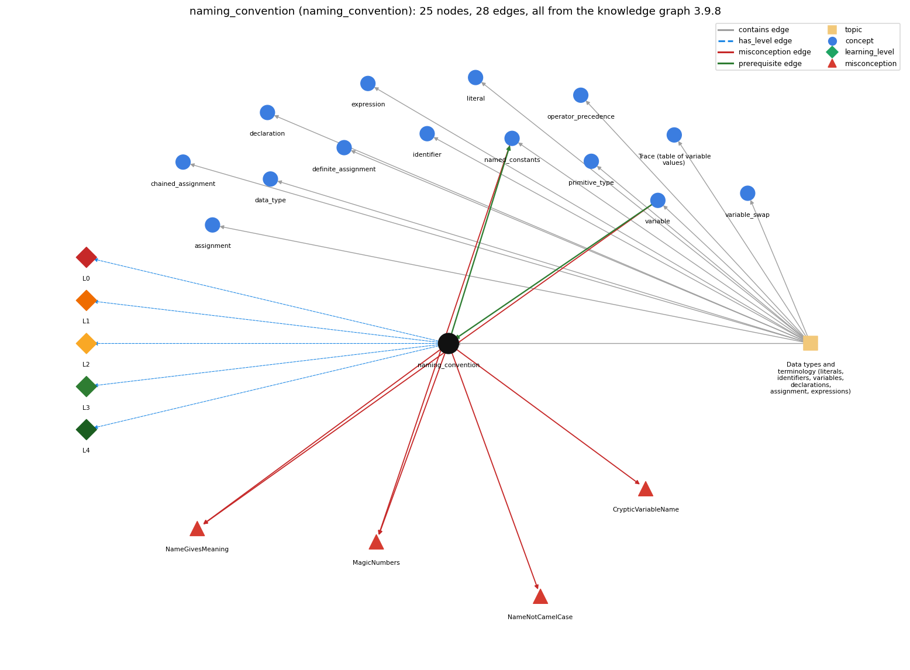

# naming_convention (`naming_convention`)

choosing meaningful names: full words, lowerCamelCase, single letters only for throwaway loop counters

Section 1.2 Built-in Types of Data, topic 1.2.a Data types and terminology (literals, identifiers, variables, declarations, assignment, expressions).

## At a glance

- **Needs first:** `variable`
- **Leads to:** `named_constants`
- **Learned alongside:** nothing
- **Misconceptions:** `CrypticVariableName`, `MagicNumbers`, `NameGivesMeaning`, `NameNotCamelCase`
- **Errors:** none
- **Levels:** L0, L1, L2, L3, L4

Everything below comes from the knowledge graph 3.9.8 (`data/raw/chapter1_kg_updated.json`): 28 edges around this concept, each explained in the graph's own words.

## What it needs first (1)

A prerequisite edge means the other concept has to be understood before `naming_convention`.

### `variable` comes before `naming_convention`

*a named, typed box that holds a value*

Each variable gets a name; the convention says the name should describe what the variable holds.

- **Grounding:** book passage
- **How `naming_convention` combines with `variable`:** Each variable's name should describe what it holds (count, sum, maxSoFar). Single letters suit only short-lived loop indices.
- **How `variable` combines with `naming_convention`:** A variable's name should describe what it holds (lowerCamelCase), but the name has no effect on its value.

## What it leads to (1)

These concepts need `naming_convention` first.

### `naming_convention` comes before `named_constants`

*final constants in UPPER\_CASE instead of magic numbers*

Constants have their own naming convention.

- **Grounding:** book passage
- **How `naming_convention` combines with `named_constants`:** Constants are written in ALL\_CAPS with underscores, which sets them apart from lowerCamelCase variables and signals that they never change.
- **How `named_constants` combines with `naming_convention`:** Constants follow their own convention, ALL\_CAPS\_WITH\_UNDERSCORES, which sets them apart from lowerCamelCase variables.

## Learned alongside (0)

A parallel edge joins two concepts that sit side by side: neither is needed before the other.

No parallel edge touches this concept.

## Misconceptions (4)

A misconception edge states the wrong rule a student may hold about this concept, and the right rule.

### CrypticVariableName

- **Wrong rule:** Uses abbreviated names such as c or s for a variable whose role is not a temporary loop counter (e.g. c for a count).
- **Right rule:** Use names that indicate what the variables mean.
- **Role of this concept:** primary

### MagicNumbers

- **Wrong rule:** Writing 7 or 0.0825 directly in formulas is as clear as using a named constant.
- **Right rule:** Give fixed values a final, UPPER\_CASE name and use the name.
- **Role of this concept:** context
- **Also an edge from `named_constants`:** Writing 7 or 0.0825 directly in formulas is as clear as using a named constant.

### NameGivesMeaning

- **Wrong rule:** Naming a variable max (or average) makes it hold the largest value (or the average) without code that computes it.
- **Right rule:** A name only labels the variable for human readers; only the statements that assign to it decide its value.
- **Role of this concept:** primary
- **Shows at level L0 as:** misconception: wrong rule: Naming a variable max (or average) makes it hold the largest value (or the average) without code that computes it. Right rule: A name only labels the variable for human readers; only the statements that assign to it decide its value.
- **Shows at level L0 as:** inconsistent trace: Points to LT (names carry no meaning at run time, so trace by values). Applied unevenly, a student traces values for most variables but assumes that largest is larger than smallest because of its name. (here mixing in: "Naming a variable max (or average) makes it hold the largest value (or the average) without code that computes it")
- **Also an edge from `variable`:** Naming a variable max (or average) makes it hold the largest value (or the average) without code that computes it.

### NameNotCamelCase

- **Wrong rule:** Writes variable names as Total, total\_count or TOTALCOUNT.
- **Right rule:** Local variable names are written in lowerCamelCase.
- **Role of this concept:** primary

## Errors (0)

An error edge states the rule that gets broken in a program, and the right rule.

The graph has no error edge from this concept.

## Levels L0 to L4 (5 of 5)

Each level edge lists the ways a student shows that level, each with its exact rule.

### L0: Prestructural / sensorimotor

L0 for naming convention: the answer holds a rule that contradicts Java.

*Deciding question: Does every rule the answer applies to naming convention agree with the language rule? If it reads the code with everyday meanings, applies a wrong rule, or switches rules within one trace, it is L0. A slip in an otherwise rule-correct trace is L2 with an error, not L0.*

naming convention -&gt; L0 (Prestructural): the answer holds a rule that contradicts Java (3 ways).

- **everyday reading** (folk-meaning rule): In everyday language a label tells you what a thing is (a jar labelled 'sugar' holds sugar), so novices expect a variable called max to hold the maximum. Java gives names no meaning: conventions exist only for human readers, and only assignments decide values.
- **misconception** (wrong rule / right rule; shows `NameGivesMeaning`): wrong rule: Naming a variable max (or average) makes it hold the largest value (or the average) without code that computes it. Right rule: A name only labels the variable for human readers; only the statements that assign to it decide its value.
- **inconsistent trace** (uneven-application rule; shows `NameGivesMeaning`): Points to LT (names carry no meaning at run time, so trace by values). Applied unevenly, a student traces values for most variables but assumes that largest is larger than smallest because of its name. (here mixing in: "Naming a variable max (or average) makes it hold the largest value (or the average) without code that computes it")

### L1: Unistructural / atom x text surface

L1 for naming convention: the answer states one correct rule without applying it.

*Deciding question: Does the answer cover every part of the code, in order, with the values (L2)? If it covers one part or only states the rule, it is L1.*

naming convention -&gt; L1 (Unistructural): the answer states one correct rule without applying it (2 ways).

- **names the element** (identity rule): Naming convention: a style rule (not a language rule) for choosing identifiers. Variables and methods use lowerCamelCase, classes UpperCamelCase, constants UPPER\_CASE\_WITH\_UNDERSCORES, and names describe meaning.
- **states the rule** (declarative rule): Variable names begin with a lowercase letter and capitalize each later word (firstName). Class names begin with a capital. Constants are all uppercase with \_ between words. Names should indicate what the variable means.

### L2: Multistructural / block x execution / preoperational

L2 for naming convention: the answer applies these rules to every part of the code, in order.

*Deciding question: Is the answer many segments mapped onto lines (L2), or one segment stating the purpose of the whole (L3)? A correct output with no value-by-value justification is not levelled.*

naming convention -&gt; L2 (Multistructural): the answer applies the rules of naming convention to every part of the code, in order (3 ways).

- **line by line trace** (operational sequencing rule): Conventions have no execution order: the compiler checks only that an identifier is legal and declared, never whether it follows convention.
- **output prediction** (evaluation / result rule): A program's output does not depend on its names: renaming total to t everywhere gives identical results.
- **one step execution** (state-transition rule): Following or breaking a convention changes no state; it only changes how readable the code is.

### L3: Relational / relations x function (concrete operational begins)

L3 for naming convention: the answer relates the parts by these rules.

*Deciding question: Was the purpose deduced from the code, or only guessed from traced input/output pairs (then L2)? Does the answer stay within the given code (L3), or reason about changed code, an error class or a new program (L4)?*

naming convention -&gt; L3 (Relational): the answer relates the parts (3 ways).

- **relation to neighbour** (composition rule (with a neighbour)): Each variable's name should describe what it holds (count, sum, maxSoFar). Single letters suit only short-lived loop indices.
- **relation to neighbour** (composition rule (with a neighbour)): Constants are written in ALL\_CAPS with underscores, which sets them apart from lowerCamelCase variables and signals that they never change.
- **purpose of the whole** (plan / role rule): Good names make each variable's role visible (sum for a gatherer, count for a counter, max for a most-wanted holder, i for a stepper), so a reader can recognize the plan without tracing.

### L4: Extended abstract (concrete-operational reversibility and conservation)

L4 for naming convention: the answer reasons beyond the given code by these rules.

*Deciding question: Does the answer link the code to a broader context: a changed program, a class of inputs, an unseen problem? Re-tracing changed code value by value is L2; fixing one given failing case is L3.*

naming convention -&gt; L4 (Extended abstract): the answer reasons beyond the given code (4 ways).

- **predict a change** (conservation rule; shows `NameGivesMeaning`): Renaming consistently keeps the program's meaning, because what it computes does not depend on names. A misleading name (max holding a minimum) still compiles and runs the same, but readers draw wrong conclusions.
- **transfer to a new program** (applicability rule): Apply the conventions to every name you write. Short names fit only tiny scopes (loop index i, coordinates x and y). No naming convention can replace the code that actually computes the value.
- **diagnose an error** (error rule): rule broken: A name does not compute or guarantee a value. Kind: silent logic error. Trigger class: Trusting a descriptive name instead of the code (e.g. assuming average holds the mean although it was never divided): wrong output that the name hides.
- **diagnose an error** (error rule): rule broken: Names that differ only in case are different identifiers. Kind: silent logic error. Trigger class: Declaring both count and Count (or total and Total) and updating one while printing the other.

## Same topic

`naming_convention` belongs to the topic **Data types and terminology (literals, identifiers, variables, declarations, assignment, expressions)** (`topic1.2.a`). The topic also contains: `assignment`, `chained_assignment`, `data_type`, `declaration`, `definite_assignment`, `expression`, `identifier`, `literal`, `named_constants`, `operator_precedence`, `primitive_type`, `program_trace`, `variable`, `variable_swap`.

## Rules of the concept (15)

- **folk-meaning rule:** In everyday language a label tells you what a thing is (a jar labelled 'sugar' holds sugar), so novices expect a variable called max to hold the maximum. Java gives names no meaning: conventions exist only for human readers, and only assignments decide values.
- **wrong rule / right rule:** NameGivesMeaning: wrong: Naming a variable max (or average) makes it hold the largest value (or the average) without code that computes it. \| right: A name only labels the variable for human readers; only the statements that assign to it decide its value.
- **uneven-application rule:** Points to LT (names carry no meaning at run time, so trace by values). Applied unevenly, a student traces values for most variables but assumes that largest is larger than smallest because of its name.
- **identity rule:** Naming convention: a style rule (not a language rule) for choosing identifiers. Variables and methods use lowerCamelCase, classes UpperCamelCase, constants UPPER\_CASE\_WITH\_UNDERSCORES, and names describe meaning.
- **declarative rule:** Variable names begin with a lowercase letter and capitalize each later word (firstName). Class names begin with a capital. Constants are all uppercase with \_ between words. Names should indicate what the variable means.
- **operational sequencing rule:** Conventions have no execution order: the compiler checks only that an identifier is legal and declared, never whether it follows convention.
- **evaluation / result rule:** A program's output does not depend on its names: renaming total to t everywhere gives identical results.
- **state-transition rule:** Following or breaking a convention changes no state; it only changes how readable the code is.
- **composition rule (with a neighbour):** with variable: Each variable's name should describe what it holds (count, sum, maxSoFar). Single letters suit only short-lived loop indices.
- **composition rule (with a neighbour):** with named\_constants: Constants are written in ALL\_CAPS with underscores, which sets them apart from lowerCamelCase variables and signals that they never change.
- **plan / role rule:** Good names make each variable's role visible (sum for a gatherer, count for a counter, max for a most-wanted holder, i for a stepper), so a reader can recognize the plan without tracing.
- **conservation rule:** Renaming consistently keeps the program's meaning, because what it computes does not depend on names. A misleading name (max holding a minimum) still compiles and runs the same, but readers draw wrong conclusions.
- **error rule:** rule broken: A name does not compute or guarantee a value. (silent logic error)
- **error rule:** rule broken: Names that differ only in case are different identifiers. (silent logic error)
- **applicability rule:** Apply the conventions to every name you write. Short names fit only tiny scopes (loop index i, coordinates x and y). No naming convention can replace the code that actually computes the value.

## The whole prerequisite chain

- **Everything it builds on (5):** `data_type`, `identifier`, `literal`, `primitive_type`, `variable`
- **Everything that builds on it (1):** `named_constants`
