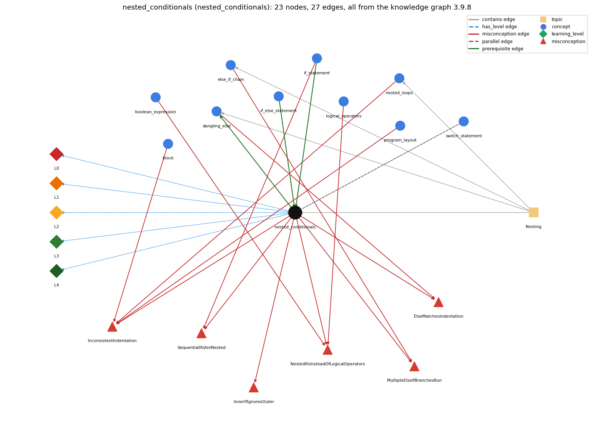

# nested_conditionals (`nested_conditionals`)

else-if chains and conditionals inside conditionals

Section 1.3 Conditionals and Loops, topic 1.3.e Nesting. From the knowledge graph 3.9.8 (`data/raw/chapter1_kg_updated.json`).

## Concepts associated with nested\_conditionals (10)

| Concept | Description | How it is associated |
| --- | --- | --- |
| **block** | { ... } grouping statements | shares misconception InconsistentIndentation |
| **boolean\_expression** | an expression that evaluates to true/false | shares misconception NestedIfsInsteadOfLogicalOperators |
| **dangling\_else** | an else belongs to the nearest unmatched if | builds on it (needs it) composition rule (R) with it shares misconception ElseMatchesIndentation same topic (topic1.3.e) |
| **else\_if\_chain** | if ... else if ... else picks exactly one branch | shares misconception MultipleElseIfBranchesRun same topic (topic1.3.e) |
| **if\_else\_statement** | choose one of two blocks | prerequisite of it (it needs this) composition rule (R) with it |
| **if\_statement** | run a block only when the condition holds | prerequisite of it (it needs this) shares misconception SequentialIfsAreNested |
| **logical\_operators** | &amp;&amp; \|\| ! | shares misconception NestedIfsInsteadOfLogicalOperators |
| **nested\_loops** | a loop inside a loop | shares misconception InconsistentIndentation same topic (topic1.3.e) |
| **program\_layout** | one statement per line and indentation that shows nesting | shares misconception InconsistentIndentation |
| **switch\_statement** | switch (x) { case v: ...; break; default: ... } | parallel concept composition rule (R) with it |

## Every edge in this view and its full label (27)

| From | Edge | To | Full edge label |
| --- | --- | --- | --- |
| **if\_else\_statement** | prerequisite | **nested\_conditionals** | Nesting puts an if or if-else inside a branch of another if-else; an else-if chain is the common case where the else branch is itself an if. grounding: book\_passage composition rule (R) of if\_else\_statement with nested\_conditionals: Either branch may itself be an if or if-else, which nests conditionals; without braces an inner else pairs with the innermost if. composition rule (R) of nested\_conditionals with if\_else\_statement: Nesting puts an if or if-else inside a branch of another if-else; when the inner statement fills the else branch it forms an else-if chain. |
| **if\_statement** | prerequisite | **nested\_conditionals** | An if statement can sit inside the body of another if; the inner one is tested only when the outer condition is true. grounding: book\_passage |
| **nested\_conditionals** | prerequisite | **dangling\_else** | The dangling else arises when ifs are nested without braces. grounding: book\_passage composition rule (R) of nested\_conditionals with dangling\_else: The dangling-else ambiguity arises when ifs are nested without braces: if &lt;e1&gt; if &lt;e2&gt; A else B attaches else to the inner if. composition rule (R) of dangling\_else with nested\_conditionals: The dangling else arises only when ifs are nested without braces; adding braces around the inner if lets the else belong to the outer if. |
| **nested\_conditionals** | parallel | **switch\_statement** | When there are more than two mutually exclusive alternatives, a chain of if-else statements works, but a switch statement provides a direct solution that evaluates one expression against many possible values. grounding: book\_passage composition rule (R) of nested\_conditionals with switch\_statement: For more than two mutually exclusive alternatives a chain of if-else statements works, but a switch tests one expression against many values directly. composition rule (R) of switch\_statement with nested\_conditionals: A switch replaces an if-else chain only when every test is \`expr == constant\` on the same expression. Range tests such as the income-bracket chain (\`income &lt; 47450\`) must stay an if-else chain. |
| **block** | misconception | **InconsistentIndentation** | **wrong rule:** Indents nested blocks inconsistently, so the visual nesting differs from the real nesting. **right rule:** Indent consistently, one level deeper for each nested block, so the layout shows the real nesting; the compiler ignores indentation. role: context |
| **boolean\_expression** | misconception | **NestedIfsInsteadOfLogicalOperators** | **wrong rule:** A condition on several values has to be written as nested if statements, one value per if. **right rule:** Several conditions combine into one boolean expression with &amp;&amp; and \|\|, e.g. if (x == 0 &amp;&amp; y == 0). role: context |
| **dangling\_else** | misconception | **ElseMatchesIndentation** | **wrong rule:** The else belongs to the if it is lined up with. **right rule:** The else belongs to the most recent unmatched if, whatever the indentation. role: primary |
| **else\_if\_chain** | misconception | **MultipleElseIfBranchesRun** | **wrong rule:** Every true branch of an else-if chain runs. **right rule:** Only the first branch whose condition is true runs. role: primary |
| **if\_statement** | misconception | **SequentialIfsAreNested** | **wrong rule:** Of two if statements one after the other, the second runs its body only if both conditions are true. **right rule:** Two ifs in sequence are independent: each tests only its own condition. role: context |
| **logical\_operators** | misconception | **NestedIfsInsteadOfLogicalOperators** | **wrong rule:** A condition on several values has to be written as nested if statements, one value per if. **right rule:** Several conditions combine into one boolean expression with &amp;&amp; and \|\|, e.g. if (x == 0 &amp;&amp; y == 0). role: primary |
| **nested\_conditionals** | misconception | **ElseMatchesIndentation** | **wrong rule:** The else belongs to the if it is lined up with. **right rule:** The else belongs to the most recent unmatched if, whatever the indentation. role: context |
| **nested\_conditionals** | misconception | **InconsistentIndentation** | **wrong rule:** Indents nested blocks inconsistently, so the visual nesting differs from the real nesting. **right rule:** Indent consistently, one level deeper for each nested block, so the layout shows the real nesting; the compiler ignores indentation. role: context |
| **nested\_conditionals** | misconception | **InnerIfIgnoresOuter** | **wrong rule:** An inner if runs its body whenever its own condition is true, even if the outer if condition is false. **right rule:** The inner if is part of the outer branch: it is reached, and its condition tested, only when the outer condition is true. role: primary |
| **nested\_conditionals** | misconception | **MultipleElseIfBranchesRun** | **wrong rule:** Every true branch of an else-if chain runs. **right rule:** Only the first branch whose condition is true runs. role: context |
| **nested\_conditionals** | misconception | **NestedIfsInsteadOfLogicalOperators** | **wrong rule:** A condition on several values has to be written as nested if statements, one value per if. **right rule:** Several conditions combine into one boolean expression with &amp;&amp; and \|\|, e.g. if (x == 0 &amp;&amp; y == 0). role: context |
| **nested\_conditionals** | misconception | **SequentialIfsAreNested** | **wrong rule:** Of two if statements one after the other, the second runs its body only if both conditions are true. **right rule:** Two ifs in sequence are independent: each tests only its own condition. role: primary |
| **nested\_loops** | misconception | **InconsistentIndentation** | **wrong rule:** Indents nested blocks inconsistently, so the visual nesting differs from the real nesting. **right rule:** Indent consistently, one level deeper for each nested block, so the layout shows the real nesting; the compiler ignores indentation. role: context |
| **program\_layout** | misconception | **InconsistentIndentation** | **wrong rule:** Indents nested blocks inconsistently, so the visual nesting differs from the real nesting. **right rule:** Indent consistently, one level deeper for each nested block, so the layout shows the real nesting; the compiler ignores indentation. role: primary |
| **nested\_conditionals** | has\_level | **nested\_conditionals@L0** | nested conditionals -&gt; L0 (Prestructural): the answer holds a rule that contradicts Java (7 ways). **[0] everyday\_reading** (E): Folk meaning: in prose, indentation and line layout show what belongs to what, and two consecutive 'if' sentences can be heard as one combined condition. The Java compiler ignores indentation: an inner if belongs to the branch that syntactically contains it, and an else pairs with the innermost unmatched if. **[1] misconception** (M) &rarr; InnerIfIgnoresOuter: wrong rule: An inner if runs its body whenever its own condition is true, even if the outer if condition is false. Right rule: The inner if is part of the outer branch: it is reached, and its condition tested, only when the outer condition is true. **[2] misconception** (M) &rarr; SequentialIfsAreNested: wrong rule: Of two if statements one after the other, the second runs its body only if both conditions are true. Right rule: Two ifs in sequence are independent: each tests only its own condition. **[3] inconsistent\_trace** (T) &rarr; InnerIfIgnoresOuter: Applies the nesting rule (LT) unevenly: on some inputs tests the inner condition even though the outer one was false, or matches an else to the if it is lined up with. (here mixing in: "An inner if runs its body whenever its own condition is true, even if the outer if condition is false") **[4] misconception** (M) &rarr; ElseMatchesIndentation: wrong rule: The else belongs to the if it is lined up with. Right rule: The else belongs to the most recent unmatched if, whatever the indentation. **[5] misconception** (M) &rarr; MultipleElseIfBranchesRun: wrong rule: Every true branch of an else-if chain runs. Right rule: Only the first branch whose condition is true runs. **[6] misconception** (M) &rarr; NestedIfsInsteadOfLogicalOperators: wrong rule: A condition on several values has to be written as nested if statements, one value per if. Right rule: Several conditions combine into one boolean expression with &amp;&amp; and \|\|, e.g. if (x == 0 &amp;&amp; y == 0). |
| **nested\_conditionals** | has\_level | **nested\_conditionals@L1** | nested conditionals -&gt; L1 (Unistructural): the answer states one correct rule without applying it (2 ways). **[0] names\_the\_element** (N): Nested conditionals are if or if-else statements placed inside a branch of another conditional; an else-if chain is the common special case. **[1] states\_the\_rule** (S): An if/if-else is a statement, so it can be the body (branch) of another conditional; without braces an else belongs to the innermost if to which it might belong, so braces should be used to resolve ambiguities. |
| **nested\_conditionals** | has\_level | **nested\_conditionals@L2** | nested conditionals -&gt; L2 (Multistructural): the answer applies the rules of nested conditionals to every part of the code, in order (3 ways). **[0] line\_by\_line\_trace** (LT): Test the outer condition; only if control enters the branch that contains the inner if is the inner condition tested; after the inner statement, control leaves the outer statement too. **[1] output\_prediction** (OP): The output is the action of the single path whose conditions all hold along the way: if (a &gt; b) { if (b &gt; c) X; else Y; } else Z; runs X when a &gt; b &gt; c, Y when a &gt; b and b &lt;= c, and Z otherwise. **[2] one\_step\_execution** (OS): One execution evaluates the conditions along one path only (outer, then possibly inner) and applies one leaf action; conditions on other paths are never evaluated. |
| **nested\_conditionals** | has\_level | **nested\_conditionals@L3** | nested conditionals -&gt; L3 (Relational): the answer relates the parts (4 ways). **[0] relation\_to\_neighbour** (R): Nesting puts an if or if-else inside a branch of another if-else; when the inner statement fills the else branch it forms an else-if chain. **[1] relation\_to\_neighbour** (R): The dangling-else ambiguity arises when ifs are nested without braces: if &lt;e1&gt; if &lt;e2&gt; A else B attaches else to the inner if. **[2] relation\_to\_neighbour** (R): For more than two mutually exclusive alternatives a chain of if-else statements works, but a switch tests one expression against many values directly. **[3] purpose\_of\_the\_whole** (P): Plan: decision tree - refine a case analysis step by step (e.g. find the smallest of three values, classify a value into ranges). |
| **nested\_conditionals** | has\_level | **nested\_conditionals@L4** | nested conditionals -&gt; L4 (Extended abstract): the answer reasons beyond the given code (3 ways). **[0] predict\_a\_change** (C) &rarr; InnerIfIgnoresOuter: Combining if (c1) { if (c2) S; } into if (c1 &amp;&amp; c2) S; preserves behaviour when there are no else parts; adding or removing braces around an inner if can move an else to a different if. Swapping some branches can keep the specification only on certain inputs. **[1] transfer\_to\_a\_new\_program** (X): Nest conditionals when a second test only makes sense once the first has succeeded or when cases form a tree; use &amp;&amp; for a simple conjunction, an else-if chain for mutually exclusive ranges, and a switch for many discrete values; one or two levels usually suffice. **[2] diagnose\_an\_error** (D): rule broken: Without braces an else pairs with the innermost if, whatever the indentation. Kind: silent logic error. Trigger class: if (a) if (b) X; else Y; written with else under the outer if: Y runs when a is true and b false, not when a is false. |
| **topic1.3.e** | contains | **dangling\_else** | topic topic1.3.e contains dangling\_else |
| **topic1.3.e** | contains | **else\_if\_chain** | topic topic1.3.e contains else\_if\_chain |
| **topic1.3.e** | contains | **nested\_conditionals** | topic topic1.3.e contains nested\_conditionals |
| **topic1.3.e** | contains | **nested\_loops** | topic topic1.3.e contains nested\_loops |
