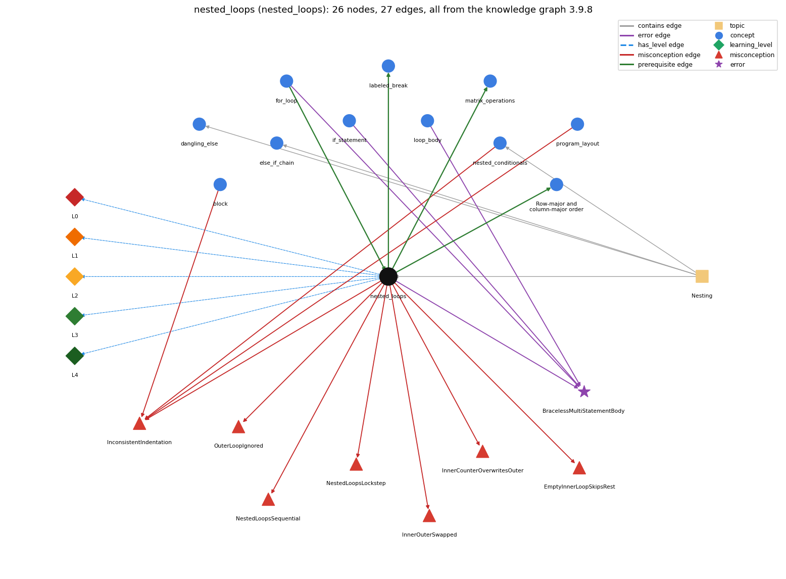

# nested_loops (`nested_loops`)

a loop inside a loop

Section 1.3 Conditionals and Loops, topic 1.3.e Nesting.

## At a glance

- **Needs first:** `for_loop`
- **Leads to:** `labeled_break`, `matrix_operations`, `row_major_order`
- **Learned alongside:** nothing
- **Misconceptions:** `EmptyInnerLoopSkipsRest`, `InconsistentIndentation`, `InnerCounterOverwritesOuter`, `InnerOuterSwapped`, `NestedLoopsLockstep`, `NestedLoopsSequential`, `OuterLoopIgnored`
- **Errors:** `BracelessMultiStatementBody`
- **Levels:** L0, L1, L2, L3, L4

Everything below comes from the knowledge graph 3.9.8 (`data/raw/chapter1_kg_updated.json`): 27 edges around this concept. The edge logic, the wrong and right rules and the exact rules of the ways are copied word for word from the graph.

## To work on (1)

- misconceptions with no L0 way linked to them: InconsistentIndentation

## What it needs first (1)

A prerequisite edge means the other concept has to be understood before `nested_loops`.

### `for_loop` comes before `nested_loops`

*a while with init/condition/update packaged together*

- **Edge:** `pre:for_loop->nested_loops`
- **Exact edge logic:** In nested loops the inner for runs its complete set of passes for every single pass of the outer for.
- **Grounding:** book\_passage
- **Composition rule (R) of `nested_loops` with `for_loop`:** Usually both loops are for loops: the inner for runs its complete set of passes for every single pass of the outer for.
- **Composition rule (R) of `for_loop` with `nested_loops`:** A for may be the body of another for: the inner for runs its complete set of passes for every single pass of the outer one.

## What it leads to (3)

These concepts need `nested_loops` first.

### `nested_loops` comes before `labeled_break`

*labeled break/continue exit or continue an outer loop*

- **Edge:** `pre:nested_loops->labeled_break`
- **Exact edge logic:** A labeled break is needed only when a loop is nested inside another and the inner loop must end the outer one.
- **Grounding:** questionable
- **Composition rule (R) of `nested_loops` with `labeled_break`:** A plain break ends only the innermost loop; a labeled break is needed when the inner loop must end the outer one too.
- **Composition rule (R) of `labeled_break` with `nested_loops`:** A label is needed only when an inner loop must end or advance an outer loop. The label goes on the outer loop header, and both loops share the outer variables, which keep the values they had at the exit.

### `nested_loops` comes before `matrix_operations`

*matrix addition and multiplication with nested loops*

- **Edge:** `pre:nested_loops->matrix_operations`
- **Exact edge logic:** Matrix addition uses two nested loops over i and j, and matrix multiplication adds a third inner loop over k to compute each dot product c[i][j].
- **Grounding:** book\_passage
- **Composition rule (R) of `nested_loops` with `matrix_operations`:** Matrix addition uses two nested loops over i and j; matrix multiplication adds a third, innermost loop over k for each dot product.
- **Composition rule (R) of `matrix_operations` with `nested_loops`:** Addition uses two nested loops (i, j); multiplication adds a third inner loop over k for each dot product.

### `nested_loops` comes before `row_major_order`

*Row-major and column-major order: processing a 2-D array row by row (row-major) or column by column (column-major)*

- **Edge:** `pre:nested_loops->row_major_order`
- **Exact edge logic:** Which loop is outside decides whether the entries are processed row by row or column by column.
- **Grounding:** book\_passage
- **Composition rule (R) of `nested_loops` with `row_major_order`:** Which loop is outside decides the visiting order: row index outside gives row-major order, column index outside gives column-major order.
- **Composition rule (R) of `row_major_order` with `nested_loops`:** Which loop is outside decides whether entries are processed row by row or column by column; the inner loop finishes for each outer value.

## Learned alongside (0)

A parallel edge joins two concepts that sit side by side: neither is needed before the other.

No parallel edge touches this concept.

## Misconceptions (7)

A misconception edge states the wrong rule a student may hold about this concept, and the right rule.

### EmptyInnerLoopSkipsRest

- **Edge:** `nested_loops` &rarr; `EmptyInnerLoopSkipsRest` (misconception)
- **Exact edge logic (the wrong rule):** If the inner loop runs zero times, the rest of that outer pass is skipped too.
- **Twin logic (the right rule):** An inner loop that runs zero times just ends; the statements after it in the outer body still run.
- **Wrong belief (on the node):** If the inner loop runs zero times, the rest of that outer pass is skipped too.
- **Correct rule (on the node):** An inner loop that runs zero times just ends; the statements after it in the outer body still run.
- **Provenance:** published
- **Role of this concept:** primary
- **L0 way linked to it:** yes
- **L0 way [6] misconception, exact rule:** wrong rule: If the inner loop runs zero times, the rest of that outer pass is skipped too. Right rule: An inner loop that runs zero times just ends; the statements after it in the outer body still run.

### InconsistentIndentation

- **Edge:** `nested_loops` &rarr; `InconsistentIndentation` (misconception)
- **Exact edge logic (the wrong rule):** Indents nested blocks inconsistently, so the visual nesting differs from the real nesting.
- **Twin logic (the right rule):** Indent consistently, one level deeper for each nested block, so the layout shows the real nesting; the compiler ignores indentation.
- **Wrong belief (on the node):** Indents nested blocks inconsistently, so the visual nesting differs from the real nesting.
- **Correct rule (on the node):** Indent consistently, one level deeper for each nested block, so the layout shows the real nesting; the compiler ignores indentation.
- **Provenance:** rule\_dictionary
- **Role of this concept:** context
- **L0 way linked to it:** no
- **Edge `block` &rarr; `InconsistentIndentation`, exact edge logic:** Indents nested blocks inconsistently, so the visual nesting differs from the real nesting. **Twin logic:** Indent consistently, one level deeper for each nested block, so the layout shows the real nesting; the compiler ignores indentation. (role: context)
- **Edge `nested_conditionals` &rarr; `InconsistentIndentation`, exact edge logic:** Indents nested blocks inconsistently, so the visual nesting differs from the real nesting. **Twin logic:** Indent consistently, one level deeper for each nested block, so the layout shows the real nesting; the compiler ignores indentation. (role: context)
- **Edge `program_layout` &rarr; `InconsistentIndentation`, exact edge logic:** Indents nested blocks inconsistently, so the visual nesting differs from the real nesting. **Twin logic:** Indent consistently, one level deeper for each nested block, so the layout shows the real nesting; the compiler ignores indentation. (role: primary)

### InnerCounterOverwritesOuter

- **Edge:** `nested_loops` &rarr; `InnerCounterOverwritesOuter` (misconception)
- **Exact edge logic (the wrong rule):** The inner loop count replaces the outer loop count, so the nested loops run as one loop.
- **Twin logic (the right rule):** The two counts multiply: the inner body runs (outer passes) x (inner passes) times.
- **Wrong belief (on the node):** The inner loop count replaces the outer loop count, so the nested loops run as one loop.
- **Correct rule (on the node):** The two counts multiply: the inner body runs (outer passes) x (inner passes) times.
- **Provenance:** published
- **Role of this concept:** primary
- **L0 way linked to it:** yes
- **L0 way [5] misconception, exact rule:** wrong rule: The inner loop count replaces the outer loop count, so the nested loops run as one loop. Right rule: The two counts multiply: the inner body runs (outer passes) x (inner passes) times.

### InnerOuterSwapped

- **Edge:** `nested_loops` &rarr; `InnerOuterSwapped` (misconception)
- **Exact edge logic (the wrong rule):** The inner loop's variable changes more slowly than the outer loop's.
- **Twin logic (the right rule):** The inner loop runs all its passes for each single pass of the outer loop.
- **Wrong belief (on the node):** The inner loop's variable changes more slowly than the outer loop's.
- **Correct rule (on the node):** The inner loop runs all its passes for each single pass of the outer loop.
- **Provenance:** published
- **Role of this concept:** primary
- **L0 way linked to it:** yes
- **L0 way [2] misconception, exact rule:** wrong rule: The inner loop's variable changes more slowly than the outer loop's. Right rule: The inner loop runs all its passes for each single pass of the outer loop.

### NestedLoopsLockstep

- **Edge:** `nested_loops` &rarr; `NestedLoopsLockstep` (misconception)
- **Exact edge logic (the wrong rule):** Nested loops run in step as one loop: both variables change together and both conditions are tested together.
- **Twin logic (the right rule):** For each pass of the outer loop the inner loop runs all its passes; the inner variable changes fastest.
- **Wrong belief (on the node):** Nested loops run in step as one loop: both variables change together and both conditions are tested together.
- **Correct rule (on the node):** For each pass of the outer loop the inner loop runs all its passes; the inner variable changes fastest.
- **Provenance:** published
- **Role of this concept:** primary
- **L0 way linked to it:** yes
- **L0 way [3] misconception, exact rule:** wrong rule: Nested loops run in step as one loop: both variables change together and both conditions are tested together. Right rule: For each pass of the outer loop the inner loop runs all its passes; the inner variable changes fastest.

### NestedLoopsSequential

- **Edge:** `nested_loops` &rarr; `NestedLoopsSequential` (misconception)
- **Exact edge logic (the wrong rule):** The outer loop runs completely, then the inner loop runs completely.
- **Twin logic (the right rule):** The inner loop runs all its passes during each single pass of the outer loop.
- **Wrong belief (on the node):** The outer loop runs completely, then the inner loop runs completely.
- **Correct rule (on the node):** The inner loop runs all its passes during each single pass of the outer loop.
- **Provenance:** published
- **Role of this concept:** primary
- **L0 way linked to it:** yes
- **L0 way [1] misconception, exact rule:** wrong rule: The outer loop runs completely, then the inner loop runs completely. Right rule: The inner loop runs all its passes during each single pass of the outer loop.
- **L0 way [7] inconsistent\_trace, exact rule:** Applies the nested-loop rule (LT) unevenly: resets the inner variable on some outer passes but not others, or advances the outer variable in the middle of the inner loop. (here mixing in: "The outer loop runs completely, then the inner loop runs completely")

### OuterLoopIgnored

- **Edge:** `nested_loops` &rarr; `OuterLoopIgnored` (misconception)
- **Exact edge logic (the wrong rule):** In nested loops only the inner loop repeats; the outer loop runs once.
- **Twin logic (the right rule):** The outer loop repeats as its own condition says, and the inner loop runs fully on each outer pass.
- **Wrong belief (on the node):** In nested loops only the inner loop repeats; the outer loop runs once.
- **Correct rule (on the node):** The outer loop repeats as its own condition says, and the inner loop runs fully on each outer pass.
- **Provenance:** published
- **Role of this concept:** primary
- **L0 way linked to it:** yes
- **L0 way [4] misconception, exact rule:** wrong rule: In nested loops only the inner loop repeats; the outer loop runs once. Right rule: The outer loop repeats as its own condition says, and the inner loop runs fully on each outer pass.

## Errors (1)

An error edge states the rule that gets broken in a program, and the right rule.

### BracelessMultiStatementBody

- **Edge:** `nested_loops` &rarr; `BracelessMultiStatementBody` (error)
- **Exact edge logic (the wrong rule):** Indenting several statements under an if or for makes them all part of its body, even without braces.
- **Twin logic (the right rule):** Without braces only the first statement belongs to the if/for; the rest run once, after it.
- **Wrong belief (on the node):** Indenting several statements under an if or for makes them all part of its body, even without braces.
- **Correct rule (on the node):** Without braces only the first statement belongs to the if/for; the rest run once, after it.
- **Provenance:** textbook
- **Role of this concept:** context
- **Edge `for_loop` &rarr; `BracelessMultiStatementBody`, exact edge logic:** Indenting several statements under an if or for makes them all part of its body, even without braces. **Twin logic:** Without braces only the first statement belongs to the if/for; the rest run once, after it. (role: context)
- **Edge `if_statement` &rarr; `BracelessMultiStatementBody`, exact edge logic:** Indenting several statements under an if or for makes them all part of its body, even without braces. **Twin logic:** Without braces only the first statement belongs to the if/for; the rest run once, after it. (role: context)
- **Edge `loop_body` &rarr; `BracelessMultiStatementBody`, exact edge logic:** Indenting several statements under an if or for makes them all part of its body, even without braces. **Twin logic:** Without braces only the first statement belongs to the if/for; the rest run once, after it. (role: primary)

## Levels L0 to L4 (5 of 5)

Each level edge lists the ways a student shows that level, each with its exact rule.

### L0: Prestructural / sensorimotor

L0 for nested loops: the answer holds a rule that contradicts Java.

*Deciding question: Does every rule the answer applies to nested loops agree with the language rule? If it reads the code with everyday meanings, applies a wrong rule, or switches rules within one trace, it is L0. A slip in an otherwise rule-correct trace is L2 with an error, not L0.*

- **Edge:** `nested_loops` &rarr; `nested_loops@L0` (has_level)
- **Exact edge logic:** nested loops -&gt; L0 (Prestructural): the answer holds a rule that contradicts Java (8 ways).

Ways (8), each with its exact rule:

- **[0] everyday\_reading** (rule type E, folk-meaning rule): Folk meaning: 'for each row and each column' sounds like doing two things side by side or one after the other. In Java the inner loop is a statement in the outer body, so it runs all its passes during each single outer pass (like the hands of a clock).
- **[1] misconception** (rule type M, wrong rule / right rule) &rarr; `NestedLoopsSequential`: wrong rule: The outer loop runs completely, then the inner loop runs completely. Right rule: The inner loop runs all its passes during each single pass of the outer loop.
- **[2] misconception** (rule type M, wrong rule / right rule) &rarr; `InnerOuterSwapped`: wrong rule: The inner loop's variable changes more slowly than the outer loop's. Right rule: The inner loop runs all its passes for each single pass of the outer loop.
- **[3] misconception** (rule type M, wrong rule / right rule) &rarr; `NestedLoopsLockstep`: wrong rule: Nested loops run in step as one loop: both variables change together and both conditions are tested together. Right rule: For each pass of the outer loop the inner loop runs all its passes; the inner variable changes fastest.
- **[4] misconception** (rule type M, wrong rule / right rule) &rarr; `OuterLoopIgnored`: wrong rule: In nested loops only the inner loop repeats; the outer loop runs once. Right rule: The outer loop repeats as its own condition says, and the inner loop runs fully on each outer pass.
- **[5] misconception** (rule type M, wrong rule / right rule) &rarr; `InnerCounterOverwritesOuter`: wrong rule: The inner loop count replaces the outer loop count, so the nested loops run as one loop. Right rule: The two counts multiply: the inner body runs (outer passes) x (inner passes) times.
- **[6] misconception** (rule type M, wrong rule / right rule) &rarr; `EmptyInnerLoopSkipsRest`: wrong rule: If the inner loop runs zero times, the rest of that outer pass is skipped too. Right rule: An inner loop that runs zero times just ends; the statements after it in the outer body still run.
- **[7] inconsistent\_trace** (rule type T, uneven-application rule) &rarr; `NestedLoopsSequential`: Applies the nested-loop rule (LT) unevenly: resets the inner variable on some outer passes but not others, or advances the outer variable in the middle of the inner loop. (here mixing in: "The outer loop runs completely, then the inner loop runs completely")

### L1: Unistructural / atom x text surface

L1 for nested loops: the answer states one correct rule without applying it.

*Deciding question: Does the answer cover every part of the code, in order, with the values (L2)? If it covers one part or only states the rule, it is L1.*

- **Edge:** `nested_loops` &rarr; `nested_loops@L1` (has_level)
- **Exact edge logic:** nested loops -&gt; L1 (Unistructural): the answer states one correct rule without applying it (2 ways).

Ways (2), each with its exact rule:

- **[0] names\_the\_element** (rule type N, identity rule): Nested loops are a loop inside the body of another loop: the outer loop and the inner loop.
- **[1] states\_the\_rule** (rule type S, declarative rule): Because loops are statements, one can be the body of another; the inner loop iterates all the way through for each iteration of the outer loop.

### L2: Multistructural / block x execution / preoperational

L2 for nested loops: the answer applies these rules to every part of the code, in order.

*Deciding question: Is the answer many segments mapped onto lines (L2), or one segment stating the purpose of the whole (L3)? A correct output with no value-by-value justification is not levelled.*

- **Edge:** `nested_loops` &rarr; `nested_loops@L2` (has_level)
- **Exact edge logic:** nested loops -&gt; L2 (Multistructural): the answer applies the rules of nested loops to every part of the code, in order (3 ways).

Ways (3), each with its exact rule:

- **[0] line\_by\_line\_trace** (rule type LT, operational sequencing rule): Outer init; outer test; [inner init; inner test; inner body; inner update; ... until the inner test fails]; rest of the outer body; outer update; outer test; ... The inner init runs again on every outer pass.
- **[1] output\_prediction** (rule type OP, evaluation / result rule): The inner body runs (outer passes) x (inner passes) times: two loops of 1..10 call printf 100 times; DivisorPattern 3 prints 3 rows of 3 entries, each row ending with its row number.
- **[2] one\_step\_execution** (rule type OS, state-transition rule): One outer pass resets the inner variable, runs the complete inner loop, executes the rest of the outer body once, and then updates the outer variable once.

### L3: Relational / relations x function (concrete operational begins)

L3 for nested loops: the answer relates the parts by these rules.

*Deciding question: Was the purpose deduced from the code, or only guessed from traced input/output pairs (then L2)? Does the answer stay within the given code (L3), or reason about changed code, an error class or a new program (L4)?*

- **Edge:** `nested_loops` &rarr; `nested_loops@L3` (has_level)
- **Exact edge logic:** nested loops -&gt; L3 (Relational): the answer relates the parts (5 ways).

Ways (5), each with its exact rule:

- **[0] relation\_to\_neighbour** (rule type R, composition rule (with a neighbour)): Usually both loops are for loops: the inner for runs its complete set of passes for every single pass of the outer for.
- **[1] relation\_to\_neighbour** (rule type R, composition rule (with a neighbour)): Matrix addition uses two nested loops over i and j; matrix multiplication adds a third, innermost loop over k for each dot product.
- **[2] relation\_to\_neighbour** (rule type R, composition rule (with a neighbour)): A plain break ends only the innermost loop; a labeled break is needed when the inner loop must end the outer one too.
- **[3] relation\_to\_neighbour** (rule type R, composition rule (with a neighbour)): Which loop is outside decides the visiting order: row index outside gives row-major order, column index outside gives column-major order.
- **[4] purpose\_of\_the\_whole** (rule type P, plan / role rule): Plan: process every pair (i, j) - two-dimensional tables, every row x column of a matrix, every pair of elements; the outer variable is a slow stepper, the inner a fast stepper.

### L4: Extended abstract (concrete-operational reversibility and conservation)

L4 for nested loops: the answer reasons beyond the given code by these rules.

*Deciding question: Does the answer link the code to a broader context: a changed program, a class of inputs, an unseen problem? Re-tracing changed code value by value is L2; fixing one given failing case is L3.*

- **Edge:** `nested_loops` &rarr; `nested_loops@L4` (has_level)
- **Exact edge logic:** nested loops -&gt; L4 (Extended abstract): the answer reasons beyond the given code (5 ways).

Ways (5), each with its exact rule:

- **[0] predict\_a\_change** (rule type C, conservation rule) &rarr; `NestedLoopsSequential`: Swapping the outer and inner loops visits the same pairs in a different order (rows vs columns), which preserves a sum but changes printed layout; moving a statement between the inner body and the outer body changes its count from (outer x inner) to outer.
- **[1] transfer\_to\_a\_new\_program** (rule type X, applicability rule): Use nested loops when the work ranges over all combinations of two indices (tables, matrices, pairs); expect running time proportional to the product of the pass counts, and prefer a single loop when the second index is a function of the first.
- **[2] diagnose\_an\_error** (rule type D, error rule): rule broken: Without braces, the body of an if, while or for is exactly one statement; indentation does not add statements to it. Kind: silent logic error. Trigger class: A braceless header followed by two or more indented statements: only the first is controlled, the others run once, after the if/loop, on every input.
- **[3] diagnose\_an\_error** (rule type D, error rule): rule broken: The inner loop needs its own loop variable. Kind: compile-time. Trigger class: Redeclaring the outer variable in the inner header (for (int i ...) { for (int i ...) }): 'variable i is already defined'.
- **[4] diagnose\_an\_error** (rule type D, error rule): rule broken: The inner loop must update its own variable. Kind: silent logic error. Trigger class: Writing for (int j = 0; j &lt; N; i++) in the inner loop: j never changes, so the inner loop is infinite (or i runs out of range).

## Same topic

`nested_loops` belongs to the topic **Nesting** (`topic1.3.e`). The topic also contains: `dangling_else`, `else_if_chain`, `nested_conditionals`.

## Rules of the concept (23)

- **Book** (SW-1e, p. 58 (pdf 68)): "We refer to the i loop as the outer loop and the j loop as the inner loop."
- **Book** (SW-1e, p. 58 (pdf 68)): "The inner loop iterates all the way through for each iteration of the outer loop."
- **Book** (SW-1.3, ): "We can use one or more of them in the body of another statement to make compound statements."
- **E** (folk-meaning rule): Folk meaning: 'for each row and each column' sounds like doing two things side by side or one after the other. In Java the inner loop is a statement in the outer body, so it runs all its passes during each single outer pass (like the hands of a clock).
- **M** (wrong rule / right rule): InnerOuterSwapped: wrong: The inner loop's variable changes more slowly than the outer loop's. \| right: The inner loop runs all its passes for each single pass of the outer loop.
- **M** (wrong rule / right rule): NestedLoopsSequential: wrong: The outer loop runs completely, then the inner loop runs completely. \| right: The inner loop runs all its passes during each single pass of the outer loop.
- **M** (wrong rule / right rule): NestedLoopsLockstep: wrong: Nested loops run in step as one loop: both variables change together and both conditions are tested together. \| right: For each pass of the outer loop the inner loop runs all its passes; the inner variable changes fastest.
- **M** (wrong rule / right rule): OuterLoopIgnored: wrong: In nested loops only the inner loop repeats; the outer loop runs once. \| right: The outer loop repeats as its own condition says, and the inner loop runs fully on each outer pass.
- **M** (wrong rule / right rule): InnerCounterOverwritesOuter: wrong: The inner loop count replaces the outer loop count, so the nested loops run as one loop. \| right: The two counts multiply: the inner body runs (outer passes) x (inner passes) times.
- **M** (wrong rule / right rule): EmptyInnerLoopSkipsRest: wrong: If the inner loop runs zero times, the rest of that outer pass is skipped too. \| right: An inner loop that runs zero times just ends; the statements after it in the outer body still run.
- **T** (uneven-application rule): Applies the nested-loop rule (LT) unevenly: resets the inner variable on some outer passes but not others, or advances the outer variable in the middle of the inner loop.
- **N** (identity rule): Nested loops are a loop inside the body of another loop: the outer loop and the inner loop.
- **S** (declarative rule): Because loops are statements, one can be the body of another; the inner loop iterates all the way through for each iteration of the outer loop.
- **LT** (operational sequencing rule): Outer init; outer test; [inner init; inner test; inner body; inner update; ... until the inner test fails]; rest of the outer body; outer update; outer test; ... The inner init runs again on every outer pass.
- **OP** (evaluation / result rule): The inner body runs (outer passes) x (inner passes) times: two loops of 1..10 call printf 100 times; DivisorPattern 3 prints 3 rows of 3 entries, each row ending with its row number.
- **OS** (state-transition rule): One outer pass resets the inner variable, runs the complete inner loop, executes the rest of the outer body once, and then updates the outer variable once.
- **R** (composition rule (with a neighbour)): with for\_loop: Usually both loops are for loops: the inner for runs its complete set of passes for every single pass of the outer for.
- **R** (composition rule (with a neighbour)): with matrix\_operations: Matrix addition uses two nested loops over i and j; matrix multiplication adds a third, innermost loop over k for each dot product.
- **R** (composition rule (with a neighbour)): with labeled\_break: A plain break ends only the innermost loop; a labeled break is needed when the inner loop must end the outer one too.
- **R** (composition rule (with a neighbour)): with row\_major\_order: Which loop is outside decides the visiting order: row index outside gives row-major order, column index outside gives column-major order.
- **P** (plan / role rule): Plan: process every pair (i, j) - two-dimensional tables, every row x column of a matrix, every pair of elements; the outer variable is a slow stepper, the inner a fast stepper.
- **C** (conservation rule): Swapping the outer and inner loops visits the same pairs in a different order (rows vs columns), which preserves a sum but changes printed layout; moving a statement between the inner body and the outer body changes its count from (outer x inner) to outer.
- **D** (error rule): rule broken: Without braces, the body of an if, while or for is exactly one statement; indentation does not add statements to it. (silent logic error)
- **D** (error rule): rule broken: The inner loop needs its own loop variable. (compile-time)
- **D** (error rule): rule broken: The inner loop must update its own variable. (silent logic error)
- **X** (applicability rule): Use nested loops when the work ranges over all combinations of two indices (tables, matrices, pairs); expect running time proportional to the product of the pass counts, and prefer a single loop when the second index is a function of the first.

## How it is found in code and answers (reader block)

- **Aliases:** nested loop, nested loops, inner loop, outer loop
- **Code patterns:** none
- **Operator symbols:** none
- **Java types:** none
- **Signal nested\_for** (scope program, decisive): `\b(?:for|while)\s*\((?:[^()]|\([^()]*\))*\)\s*\{(?:[^{}]|\{[^{}]*\})*?(?P<at>\b(?:for|while)\s*\()`
- **Signal nested\_loop\_braceless** (scope program, decisive): `\b(?:for|while)\s*\((?:[^()]|\([^()]*\))*\)\s*(?:for|while)\s*\(`

## The whole prerequisite chain

- **Everything it builds on (16):** `arithmetic_operators`, `boolean`, `boolean_expression`, `comparison_operators`, `data_type`, `do_while_loop`, `expression`, `for_loop`, `identifier`, `literal`, `logical_operators`, `loop_control`, `loop_variable`, `primitive_type`, `variable`, `while_loop`
- **Everything that builds on it (6):** `convergence_rate`, `labeled_break`, `matrix_operations`, `power_method`, `row_major_order`, `two_models`

## Every edge in this view and its exact edge logic (27)

All the edges drawn in the picture, in the order: prerequisite, parallel, misconception, error, has_level, contains.

**1. `for_loop` &rarr; `nested_loops`** (prerequisite)

- **Exact edge logic:** In nested loops the inner for runs its complete set of passes for every single pass of the outer for.
- **Grounding:** book\_passage
- **Composition rule (R) of `for_loop` with `nested_loops`:** A for may be the body of another for: the inner for runs its complete set of passes for every single pass of the outer one.
- **Composition rule (R) of `nested_loops` with `for_loop`:** Usually both loops are for loops: the inner for runs its complete set of passes for every single pass of the outer for.

**2. `nested_loops` &rarr; `labeled_break`** (prerequisite)

- **Exact edge logic:** A labeled break is needed only when a loop is nested inside another and the inner loop must end the outer one.
- **Grounding:** questionable
- **Composition rule (R) of `nested_loops` with `labeled_break`:** A plain break ends only the innermost loop; a labeled break is needed when the inner loop must end the outer one too.
- **Composition rule (R) of `labeled_break` with `nested_loops`:** A label is needed only when an inner loop must end or advance an outer loop. The label goes on the outer loop header, and both loops share the outer variables, which keep the values they had at the exit.

**3. `nested_loops` &rarr; `matrix_operations`** (prerequisite)

- **Exact edge logic:** Matrix addition uses two nested loops over i and j, and matrix multiplication adds a third inner loop over k to compute each dot product c[i][j].
- **Grounding:** book\_passage
- **Composition rule (R) of `nested_loops` with `matrix_operations`:** Matrix addition uses two nested loops over i and j; matrix multiplication adds a third, innermost loop over k for each dot product.
- **Composition rule (R) of `matrix_operations` with `nested_loops`:** Addition uses two nested loops (i, j); multiplication adds a third inner loop over k for each dot product.

**4. `nested_loops` &rarr; `row_major_order`** (prerequisite)

- **Exact edge logic:** Which loop is outside decides whether the entries are processed row by row or column by column.
- **Grounding:** book\_passage
- **Composition rule (R) of `nested_loops` with `row_major_order`:** Which loop is outside decides the visiting order: row index outside gives row-major order, column index outside gives column-major order.
- **Composition rule (R) of `row_major_order` with `nested_loops`:** Which loop is outside decides whether entries are processed row by row or column by column; the inner loop finishes for each outer value.

**5. `nested_loops` &rarr; `EmptyInnerLoopSkipsRest`** (misconception)

- **Exact edge logic (the wrong rule):** If the inner loop runs zero times, the rest of that outer pass is skipped too.
- **Twin logic (the right rule):** An inner loop that runs zero times just ends; the statements after it in the outer body still run.
- **Role:** primary

**6. `nested_loops` &rarr; `InconsistentIndentation`** (misconception)

- **Exact edge logic (the wrong rule):** Indents nested blocks inconsistently, so the visual nesting differs from the real nesting.
- **Twin logic (the right rule):** Indent consistently, one level deeper for each nested block, so the layout shows the real nesting; the compiler ignores indentation.
- **Role:** context

**7. `nested_loops` &rarr; `InnerCounterOverwritesOuter`** (misconception)

- **Exact edge logic (the wrong rule):** The inner loop count replaces the outer loop count, so the nested loops run as one loop.
- **Twin logic (the right rule):** The two counts multiply: the inner body runs (outer passes) x (inner passes) times.
- **Role:** primary

**8. `nested_loops` &rarr; `InnerOuterSwapped`** (misconception)

- **Exact edge logic (the wrong rule):** The inner loop's variable changes more slowly than the outer loop's.
- **Twin logic (the right rule):** The inner loop runs all its passes for each single pass of the outer loop.
- **Role:** primary

**9. `nested_loops` &rarr; `NestedLoopsLockstep`** (misconception)

- **Exact edge logic (the wrong rule):** Nested loops run in step as one loop: both variables change together and both conditions are tested together.
- **Twin logic (the right rule):** For each pass of the outer loop the inner loop runs all its passes; the inner variable changes fastest.
- **Role:** primary

**10. `nested_loops` &rarr; `NestedLoopsSequential`** (misconception)

- **Exact edge logic (the wrong rule):** The outer loop runs completely, then the inner loop runs completely.
- **Twin logic (the right rule):** The inner loop runs all its passes during each single pass of the outer loop.
- **Role:** primary

**11. `nested_loops` &rarr; `OuterLoopIgnored`** (misconception)

- **Exact edge logic (the wrong rule):** In nested loops only the inner loop repeats; the outer loop runs once.
- **Twin logic (the right rule):** The outer loop repeats as its own condition says, and the inner loop runs fully on each outer pass.
- **Role:** primary

**12. `block` &rarr; `InconsistentIndentation`** (misconception)

- **Exact edge logic (the wrong rule):** Indents nested blocks inconsistently, so the visual nesting differs from the real nesting.
- **Twin logic (the right rule):** Indent consistently, one level deeper for each nested block, so the layout shows the real nesting; the compiler ignores indentation.
- **Role:** context

**13. `nested_conditionals` &rarr; `InconsistentIndentation`** (misconception)

- **Exact edge logic (the wrong rule):** Indents nested blocks inconsistently, so the visual nesting differs from the real nesting.
- **Twin logic (the right rule):** Indent consistently, one level deeper for each nested block, so the layout shows the real nesting; the compiler ignores indentation.
- **Role:** context

**14. `program_layout` &rarr; `InconsistentIndentation`** (misconception)

- **Exact edge logic (the wrong rule):** Indents nested blocks inconsistently, so the visual nesting differs from the real nesting.
- **Twin logic (the right rule):** Indent consistently, one level deeper for each nested block, so the layout shows the real nesting; the compiler ignores indentation.
- **Role:** primary

**15. `nested_loops` &rarr; `BracelessMultiStatementBody`** (error)

- **Exact edge logic (the wrong rule):** Indenting several statements under an if or for makes them all part of its body, even without braces.
- **Twin logic (the right rule):** Without braces only the first statement belongs to the if/for; the rest run once, after it.
- **Role:** context

**16. `for_loop` &rarr; `BracelessMultiStatementBody`** (error)

- **Exact edge logic (the wrong rule):** Indenting several statements under an if or for makes them all part of its body, even without braces.
- **Twin logic (the right rule):** Without braces only the first statement belongs to the if/for; the rest run once, after it.
- **Role:** context

**17. `if_statement` &rarr; `BracelessMultiStatementBody`** (error)

- **Exact edge logic (the wrong rule):** Indenting several statements under an if or for makes them all part of its body, even without braces.
- **Twin logic (the right rule):** Without braces only the first statement belongs to the if/for; the rest run once, after it.
- **Role:** context

**18. `loop_body` &rarr; `BracelessMultiStatementBody`** (error)

- **Exact edge logic (the wrong rule):** Indenting several statements under an if or for makes them all part of its body, even without braces.
- **Twin logic (the right rule):** Without braces only the first statement belongs to the if/for; the rest run once, after it.
- **Role:** primary

**19. `nested_loops` &rarr; `nested_loops@L0`** (has_level)

- **Exact edge logic:** nested loops -&gt; L0 (Prestructural): the answer holds a rule that contradicts Java (8 ways).
  - **[0] everyday\_reading** (rule type E, folk-meaning rule): Folk meaning: 'for each row and each column' sounds like doing two things side by side or one after the other. In Java the inner loop is a statement in the outer body, so it runs all its passes during each single outer pass (like the hands of a clock).
  - **[1] misconception** (rule type M, wrong rule / right rule) &rarr; `NestedLoopsSequential`: wrong rule: The outer loop runs completely, then the inner loop runs completely. Right rule: The inner loop runs all its passes during each single pass of the outer loop.
  - **[2] misconception** (rule type M, wrong rule / right rule) &rarr; `InnerOuterSwapped`: wrong rule: The inner loop's variable changes more slowly than the outer loop's. Right rule: The inner loop runs all its passes for each single pass of the outer loop.
  - **[3] misconception** (rule type M, wrong rule / right rule) &rarr; `NestedLoopsLockstep`: wrong rule: Nested loops run in step as one loop: both variables change together and both conditions are tested together. Right rule: For each pass of the outer loop the inner loop runs all its passes; the inner variable changes fastest.
  - **[4] misconception** (rule type M, wrong rule / right rule) &rarr; `OuterLoopIgnored`: wrong rule: In nested loops only the inner loop repeats; the outer loop runs once. Right rule: The outer loop repeats as its own condition says, and the inner loop runs fully on each outer pass.
  - **[5] misconception** (rule type M, wrong rule / right rule) &rarr; `InnerCounterOverwritesOuter`: wrong rule: The inner loop count replaces the outer loop count, so the nested loops run as one loop. Right rule: The two counts multiply: the inner body runs (outer passes) x (inner passes) times.
  - **[6] misconception** (rule type M, wrong rule / right rule) &rarr; `EmptyInnerLoopSkipsRest`: wrong rule: If the inner loop runs zero times, the rest of that outer pass is skipped too. Right rule: An inner loop that runs zero times just ends; the statements after it in the outer body still run.
  - **[7] inconsistent\_trace** (rule type T, uneven-application rule) &rarr; `NestedLoopsSequential`: Applies the nested-loop rule (LT) unevenly: resets the inner variable on some outer passes but not others, or advances the outer variable in the middle of the inner loop. (here mixing in: "The outer loop runs completely, then the inner loop runs completely")

**20. `nested_loops` &rarr; `nested_loops@L1`** (has_level)

- **Exact edge logic:** nested loops -&gt; L1 (Unistructural): the answer states one correct rule without applying it (2 ways).
  - **[0] names\_the\_element** (rule type N, identity rule): Nested loops are a loop inside the body of another loop: the outer loop and the inner loop.
  - **[1] states\_the\_rule** (rule type S, declarative rule): Because loops are statements, one can be the body of another; the inner loop iterates all the way through for each iteration of the outer loop.

**21. `nested_loops` &rarr; `nested_loops@L2`** (has_level)

- **Exact edge logic:** nested loops -&gt; L2 (Multistructural): the answer applies the rules of nested loops to every part of the code, in order (3 ways).
  - **[0] line\_by\_line\_trace** (rule type LT, operational sequencing rule): Outer init; outer test; [inner init; inner test; inner body; inner update; ... until the inner test fails]; rest of the outer body; outer update; outer test; ... The inner init runs again on every outer pass.
  - **[1] output\_prediction** (rule type OP, evaluation / result rule): The inner body runs (outer passes) x (inner passes) times: two loops of 1..10 call printf 100 times; DivisorPattern 3 prints 3 rows of 3 entries, each row ending with its row number.
  - **[2] one\_step\_execution** (rule type OS, state-transition rule): One outer pass resets the inner variable, runs the complete inner loop, executes the rest of the outer body once, and then updates the outer variable once.

**22. `nested_loops` &rarr; `nested_loops@L3`** (has_level)

- **Exact edge logic:** nested loops -&gt; L3 (Relational): the answer relates the parts (5 ways).
  - **[0] relation\_to\_neighbour** (rule type R, composition rule (with a neighbour)): Usually both loops are for loops: the inner for runs its complete set of passes for every single pass of the outer for.
  - **[1] relation\_to\_neighbour** (rule type R, composition rule (with a neighbour)): Matrix addition uses two nested loops over i and j; matrix multiplication adds a third, innermost loop over k for each dot product.
  - **[2] relation\_to\_neighbour** (rule type R, composition rule (with a neighbour)): A plain break ends only the innermost loop; a labeled break is needed when the inner loop must end the outer one too.
  - **[3] relation\_to\_neighbour** (rule type R, composition rule (with a neighbour)): Which loop is outside decides the visiting order: row index outside gives row-major order, column index outside gives column-major order.
  - **[4] purpose\_of\_the\_whole** (rule type P, plan / role rule): Plan: process every pair (i, j) - two-dimensional tables, every row x column of a matrix, every pair of elements; the outer variable is a slow stepper, the inner a fast stepper.

**23. `nested_loops` &rarr; `nested_loops@L4`** (has_level)

- **Exact edge logic:** nested loops -&gt; L4 (Extended abstract): the answer reasons beyond the given code (5 ways).
  - **[0] predict\_a\_change** (rule type C, conservation rule) &rarr; `NestedLoopsSequential`: Swapping the outer and inner loops visits the same pairs in a different order (rows vs columns), which preserves a sum but changes printed layout; moving a statement between the inner body and the outer body changes its count from (outer x inner) to outer.
  - **[1] transfer\_to\_a\_new\_program** (rule type X, applicability rule): Use nested loops when the work ranges over all combinations of two indices (tables, matrices, pairs); expect running time proportional to the product of the pass counts, and prefer a single loop when the second index is a function of the first.
  - **[2] diagnose\_an\_error** (rule type D, error rule): rule broken: Without braces, the body of an if, while or for is exactly one statement; indentation does not add statements to it. Kind: silent logic error. Trigger class: A braceless header followed by two or more indented statements: only the first is controlled, the others run once, after the if/loop, on every input.
  - **[3] diagnose\_an\_error** (rule type D, error rule): rule broken: The inner loop needs its own loop variable. Kind: compile-time. Trigger class: Redeclaring the outer variable in the inner header (for (int i ...) { for (int i ...) }): 'variable i is already defined'.
  - **[4] diagnose\_an\_error** (rule type D, error rule): rule broken: The inner loop must update its own variable. Kind: silent logic error. Trigger class: Writing for (int j = 0; j &lt; N; i++) in the inner loop: j never changes, so the inner loop is infinite (or i runs out of range).

**24. `topic1.3.e` &rarr; `nested_loops`** (contains)

- topic `topic1.3.e` contains `nested_loops`

**25. `topic1.3.e` &rarr; `dangling_else`** (contains)

- topic `topic1.3.e` contains `dangling_else`

**26. `topic1.3.e` &rarr; `else_if_chain`** (contains)

- topic `topic1.3.e` contains `else_if_chain`

**27. `topic1.3.e` &rarr; `nested_conditionals`** (contains)

- topic `topic1.3.e` contains `nested_conditionals`
