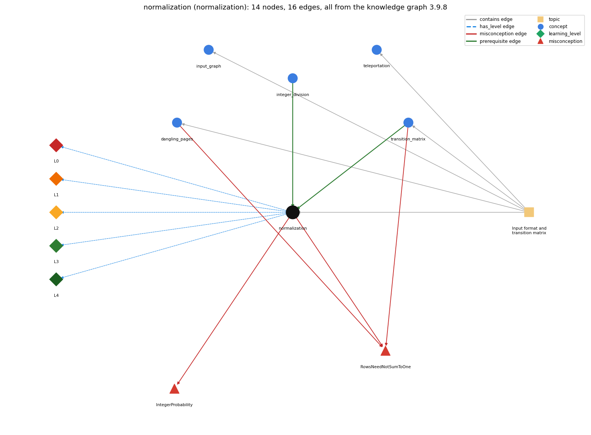

# normalization (`normalization`)

scaling a row so its probabilities sum to 1

Section 1.6 Case Study: Random Web Surfer, topic 1.6.a Input format and transition matrix. From the knowledge graph 3.9.8 (`data/raw/chapter1_kg_updated.json`).

## Concepts associated with normalization (5)

| Concept | Description | How it is associated |
| --- | --- | --- |
| **dangling\_pages** | pages with no outgoing links | shares misconception RowsNeedNotSumToOne same topic (topic1.6.a) |
| **input\_graph** | read the page links from input | same topic (topic1.6.a) |
| **integer\_division** | / on two ints truncates; % is the remainder | prerequisite of it (it needs this) composition rule (R) with it |
| **teleportation** | the 90-10 rule: follow a link or jump to a random page | same topic (topic1.6.a) |
| **transition\_matrix** | a 2-D array of move probabilities (rows sum to 1) | prerequisite of it (it needs this) composition rule (R) with it shares misconception RowsNeedNotSumToOne same topic (topic1.6.a) |

## Every edge in this view and its full label (16)

| From | Edge | To | Full edge label |
| --- | --- | --- | --- |
| **integer\_division** | prerequisite | **normalization** | Normalising must divide as doubles, because with two ints counts / total truncates to 0 whenever counts &lt; total. grounding: order\_only composition rule (R) of integer\_division with normalization: Normalizing counts must divide as doubles. With two ints, counts / total truncates to 0 whenever counts &lt; total. composition rule (R) of normalization with integer\_division: Type flow decides the result: with a double operand anywhere to the left (.90\*...) the division is floating-point; with two ints it truncates (2/5 == 0). |
| **transition\_matrix** | prerequisite | **normalization** | Each row of the transition matrix must be a probability distribution, so counts[i][j] is divided by outDegree[i] (scaled by .90, plus .10/N) to make row i sum to 1. grounding: book\_passage composition rule (R) of transition\_matrix with normalization: Dividing counts[i][j] by outDegree[i] (after scaling by .90) and adding .10/N is the normalisation that makes row i sum to 1; the double operand .90 keeps the division from being integer division. composition rule (R) of normalization with transition\_matrix: Normalisation is applied row by row: every entry of row i is divided by the same total outDegree[i], which is what makes the row a distribution the matrix requires. |
| **dangling\_pages** | misconception | **RowsNeedNotSumToOne** | **wrong rule:** A page with no outgoing links can have an all-zero row. **right rule:** Each row is a probability distribution; a page with no links is made equally likely to move to every page. role: primary |
| **normalization** | misconception | **IntegerProbability** | **wrong rule:** counts[i][j] / degree[i] gives the correct probability because the result is stored in a double. **right rule:** counts[i][j] / outDegree[i] with two int operands is integer division and gives 0 whenever counts &lt; outDegree; SW's Transition avoids it by multiplying by .90 first, and RandomSurfer casts with (double) freq[i] / T. role: primary |
| **normalization** | misconception | **RowsNeedNotSumToOne** | **wrong rule:** A page with no outgoing links can have an all-zero row. **right rule:** Each row is a probability distribution; a page with no links is made equally likely to move to every page. role: context |
| **transition\_matrix** | misconception | **RowsNeedNotSumToOne** | **wrong rule:** A page with no outgoing links can have an all-zero row. **right rule:** Each row is a probability distribution; a page with no links is made equally likely to move to every page. role: context |
| **normalization** | has\_level | **normalization@L0** | normalization -&gt; L0 (Prestructural): the answer holds a rule that contradicts Java (4 ways). **[0] everyday\_reading** (E): In maths, a/b of two whole numbers is a fraction (2/5 = 0.4); in Java, if both operands are int, / discards the fractional part (2/5 is 0), so a probability computed as counts[i][j]/outDegree[i] is 0 or 1. **[1] misconception** (M) &rarr; IntegerProbability: wrong rule: Probabilities computed with integer division stay correct. Right rule: counts[i][j]/outDegree[i] with two int operands truncates (0 whenever counts &lt; outDegree); Transition multiplies by .90 first so the division is double, and RandomSurfer casts with (double) freq[i] / T. **[2] inconsistent\_trace** (T) &rarr; IntegerProbability: Applies LT (left to right: .90\*counts, then / outDegree, then + .10/N) unevenly: e.g. dividing before the double factor on some entries (int division), or adding .10/N once per row instead of to every entry. (here mixing in: "probabilities computed with integer division stay correct") **[3] misconception** (M) &rarr; RowsNeedNotSumToOne: wrong rule: A page with no outgoing links can have an all-zero row. Right rule: Normalising requires a non-zero total; a page with no links is given 1/N in every column so its row still sums to 1. |
| **normalization** | has\_level | **normalization@L1** | normalization -&gt; L1 (Unistructural): the answer states one correct rule without applying it (2 ways). **[0] names\_the\_element** (N): A computation: scaling the non-negative weights of a row by their total so that the row becomes a discrete probability distribution summing to 1. **[1] states\_the\_rule** (S): Multiply counts[i][j] by .90/outDegree[i] and add .10/N to each entry; the resulting entries of each row sum to 1. |
| **normalization** | has\_level | **normalization@L2** | normalization -&gt; L2 (Multistructural): the answer applies the rules of normalization to every part of the code, in order (3 ways). **[0] line\_by\_line\_trace** (LT): In .90\*counts[i][j]/outDegree[i] + .10/N, \* and / evaluate left to right before +: .90\*counts[i][j] first (int promoted to double), then divided by outDegree[i], then .10/N is computed and added. **[1] output\_prediction** (OP): Produces a double in [0, 1]; for tiny.txt page 1 (counts 0 0 2 2 1, outDegree 5) the row is .02 .02 .38 .38 .20, and the row sums to 1 up to floating-point rounding. **[2] one\_step\_execution** (OS): One evaluation reads counts[i][j], outDegree[i] and N and yields one double p; nothing in counts or outDegree changes. |
| **normalization** | has\_level | **normalization@L3** | normalization -&gt; L3 (Relational): the answer relates the parts (3 ways). **[0] relation\_to\_neighbour** (R): Normalisation is applied row by row: every entry of row i is divided by the same total outDegree[i], which is what makes the row a distribution the matrix requires. **[1] relation\_to\_neighbour** (R): Type flow decides the result: with a double operand anywhere to the left (.90\*...) the division is floating-point; with two ints it truncates (2/5 == 0). **[2] purpose\_of\_the\_whole** (P): Turn raw counts into probabilities (the "divide each count by the total" plan); the same plan turns visit counts freq[i] into rank estimates freq[i]/T. |
| **normalization** | has\_level | **normalization@L4** | normalization -&gt; L4 (Extended abstract): the answer reasons beyond the given code (5 ways). **[0] predict\_a\_change** (C) &rarr; IntegerProbability: Invariant: weights sum to 1, since .90\*(sum of counts/outDegree) + N\*(.10/N) = .90 + .10. Changing .90 to .80 without changing .10 breaks it; reordering to counts[i][j]/outDegree[i]\*.90 breaks it silently via int division. **[1] transfer\_to\_a\_new\_program** (X): Use whenever counts or weights must become probabilities (matrix rows, visit frequencies); not needed when the values already form a distribution, and not possible for a zero total (dangling page) without a special case. **[2] diagnose\_an\_error** (D): rule broken: Division of two ints truncates. Kind: silent logic error. Trigger class: counts[i][j]/outDegree[i] or freq[i]/T written with two int operands: every probability with numerator &lt; denominator becomes 0. **[3] diagnose\_an\_error** (D): rule broken: Divisor (total) must be non-zero. Kind: silent logic error. Trigger class: outDegree[i] == 0 in the double expression .90\*counts[i][j]/outDegree[i]: result NaN, no exception. **[4] diagnose\_an\_error** (D): rule broken: Integer division by zero is undefined. Kind: run-time exception. Trigger class: An all-int version counts[i][j]/outDegree[i] with outDegree[i] == 0 throws ArithmeticException. |
| **topic1.6.a** | contains | **dangling\_pages** | topic topic1.6.a contains dangling\_pages |
| **topic1.6.a** | contains | **input\_graph** | topic topic1.6.a contains input\_graph |
| **topic1.6.a** | contains | **normalization** | topic topic1.6.a contains normalization |
| **topic1.6.a** | contains | **teleportation** | topic topic1.6.a contains teleportation |
| **topic1.6.a** | contains | **transition\_matrix** | topic topic1.6.a contains transition\_matrix |
