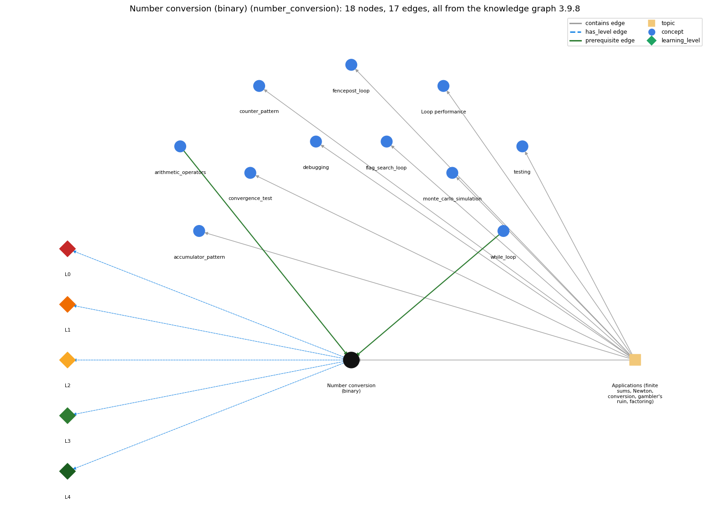

# Number conversion (binary) (`number_conversion`)

converting an integer to its binary representation by casting out powers of 2 in a loop

Section 1.3 1.3 Conditionals and Loops, topic 1.3.f Applications (finite sums, Newton, conversion, gambler's ruin, factoring). From the knowledge graph 3.9.8 (`data/raw/chapter1_kg_updated.json`).

## Concepts associated with number\_conversion (11)

| Concept | Description | How it is associated |
| --- | --- | --- |
| **accumulator\_pattern** | building up a running total/result | same topic (topic1.3.f) |
| **arithmetic\_operators** | + - \* / % | prerequisite of it (it needs this) |
| **convergence\_test** | stopping a loop when a floating-point result is close enough | same topic (topic1.3.f) |
| **counter\_pattern** | counting occurrences across passes | same topic (topic1.3.f) |
| **debugging** | finding and fixing the cause of a wrong result or error by forming a hypothesis, changing the program and checking the prediction | same topic (topic1.3.f) |
| **fencepost\_loop** | n items need n - 1 separators: one item handled outside the loop | same topic (topic1.3.f) |
| **flag\_search\_loop** | a boolean flag that a loop sets once and never resets | same topic (topic1.3.f) |
| **loop\_performance** | the running time of a loop program depends on how many iterations it makes | same topic (topic1.3.f) |
| **monte\_carlo\_simulation** | estimating a probability by repeating random trials | same topic (topic1.3.f) |
| **testing** | running a program on chosen inputs, including boundary and unusual ones, and comparing the output with what it should be | same topic (topic1.3.f) |
| **while\_loop** | repeat a block while a condition holds | prerequisite of it (it needs this) composition rule (R) with it |

## Every edge in this view and its full label (17)

| From | Edge | To | Full edge label |
| --- | --- | --- | --- |
| **arithmetic\_operators** | prerequisite | **number\_conversion** | Converting to binary works with powers of two, using / and % (or subtraction) on ints. grounding: book\_passage |
| **while\_loop** | prerequisite | **number\_conversion** | Binary conversion repeats one step in a while loop: find the largest power of 2 not above n, output a bit and subtract. grounding: book\_passage composition rule (R) of while\_loop with number\_conversion: Binary conversion uses while loops: one to find the largest power of 2 &lt;= N, and one to cast out powers of 2 in decreasing order. composition rule (R) of number\_conversion with while\_loop: Two while loops in sequence: the first's exit state (v = largest power of 2 ≤ N) is the second's starting state. The second runs once per bit and ends when integer halving takes v from 1 to 0. |
| **number\_conversion** | has\_level | **number\_conversion@L0** | Number conversion (binary) -&gt; L0 (Prestructural): the answer holds a rule that contradicts Java (1 way). **[0] everyday\_reading** (E): Folk meaning: everyday digits are decimal, so '10011' reads as ten thousand and eleven, and 'converting' sounds like changing the number. Binary conversion changes only the representation: 19 and 10011 (base 2) are the same integer, printed as a sequence of bits by casting out powers of 2. |
| **number\_conversion** | has\_level | **number\_conversion@L1** | Number conversion (binary) -&gt; L1 (Unistructural): the answer states one correct rule without applying it (2 ways). **[0] names\_the\_element** (N): Algorithm: computing the base-2 (or base-k) representation of a positive integer by casting out powers of 2 in decreasing order, or by repeated division. **[1] states\_the\_rule** (S): First find v, the largest power of 2 ≤ N (\`while (v &lt;= N/2) v = 2\*v;\`). Then, with n = N, for each v from there down to 1: if n &lt; v print 0, else print 1 and set n -= v; then v = v/2. |
| **number\_conversion** | has\_level | **number\_conversion@L2** | Number conversion (binary) -&gt; L2 (Multistructural): the answer applies the rules of Number conversion (binary) to every part of the code, in order (3 ways). **[0] line\_by\_line\_trace** (LT): Order inside each pass: test \`v &gt; 0\`; compare n &lt; v; print the bit; subtract v from n only when the bit is 1; then halve v. The first loop runs to completion before the second begins. **[1] output\_prediction** (OP): The output is the string of bits, most significant first. \`java Binary 19\` prints 10011, which is 16 + 2 + 1. **[2] one\_step\_execution** (OS): One pass prints one bit, possibly subtracts v from n (19 becomes 3 when v = 16), and halves v (16 becomes 8). |
| **number\_conversion** | has\_level | **number\_conversion@L3** | Number conversion (binary) -&gt; L3 (Relational): the answer relates the parts (2 ways). **[0] relation\_to\_neighbour** (R): Two while loops in sequence: the first's exit state (v = largest power of 2 ≤ N) is the second's starting state. The second runs once per bit and ends when integer halving takes v from 1 to 0. **[1] purpose\_of\_the\_whole** (P): Plan: representation conversion. v is a stepper (powers of 2 in decreasing order), and n is the remaining excess that shrinks to 0. The same plan gives base-k conversion, and the right-to-left variant builds the string with \`s = (n % 2) + s\`. |
| **number\_conversion** | has\_level | **number\_conversion@L4** | Number conversion (binary) -&gt; L4 (Extended abstract): the answer reasons beyond the given code (6 ways). **[0] predict\_a\_change** (C): The right-to-left method \`for (n = N; n &gt; 0; n /= 2) s = (n % 2) + s;\` produces the same string. Appending instead (\`s = s + (n % 2)\`) reverses the bits. Invariant of the casting-out loop: the bits printed so far, times 2^(number of bits still to print), plus n, equals N. **[1] transfer\_to\_a\_new\_program** (X): Use a hand-written conversion loop to learn or to support unusual bases. In practice use Integer.toBinaryString (or Integer.toString(n, k)). Conversion is needed only for display or I/O, because arithmetic works on the int itself. **[2] diagnose\_an\_error** (D): rule broken: When a 1 bit is printed, its power must be subtracted from n. Kind: silent logic error. Trigger class: Forgetting \`n -= v\`: every bit after the first prints 1 whenever n ≥ v (19 prints 11111). **[3] diagnose\_an\_error** (D): rule broken: The algorithm assumes a positive integer. Kind: silent logic error. Trigger class: N ≤ 0 (e.g. -5): the program prints 0, not a representation of N. **[4] diagnose\_an\_error** (D): rule broken: The argument must parse as an int. Kind: run-time exception. Trigger class: A non-integer or too-large argument (\`java Binary 3.5\`): Integer.parseInt throws NumberFormatException. **[5] diagnose\_an\_error** (D): rule broken: Digits above 9 need letters in bases above 10. Kind: silent logic error. Trigger class: Base-16 conversion printing remainders as numbers (\`1015\` instead of \`AF\`). |
| **topic1.3.f** | contains | **accumulator\_pattern** | topic topic1.3.f contains accumulator\_pattern |
| **topic1.3.f** | contains | **convergence\_test** | topic topic1.3.f contains convergence\_test |
| **topic1.3.f** | contains | **counter\_pattern** | topic topic1.3.f contains counter\_pattern |
| **topic1.3.f** | contains | **debugging** | topic topic1.3.f contains debugging |
| **topic1.3.f** | contains | **fencepost\_loop** | topic topic1.3.f contains fencepost\_loop |
| **topic1.3.f** | contains | **flag\_search\_loop** | topic topic1.3.f contains flag\_search\_loop |
| **topic1.3.f** | contains | **loop\_performance** | topic topic1.3.f contains loop\_performance |
| **topic1.3.f** | contains | **monte\_carlo\_simulation** | topic topic1.3.f contains monte\_carlo\_simulation |
| **topic1.3.f** | contains | **number\_conversion** | topic topic1.3.f contains number\_conversion |
| **topic1.3.f** | contains | **testing** | topic topic1.3.f contains testing |
