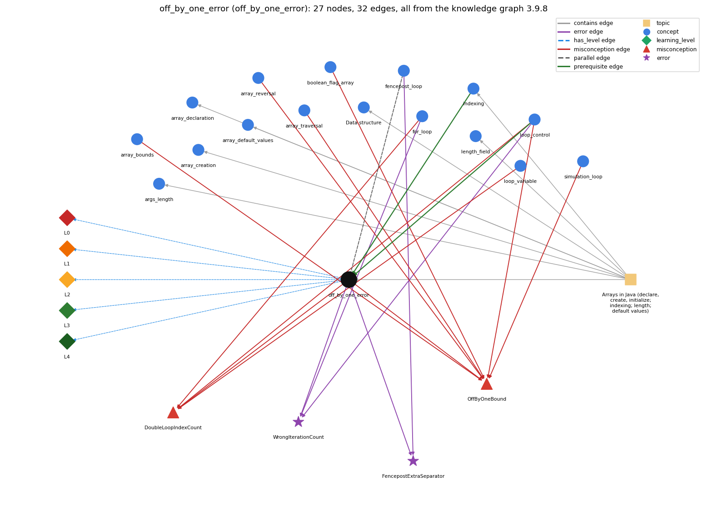

# off_by_one_error (`off_by_one_error`)

a loop or index that runs one time too many or too few (&lt; vs &lt;=, 0..n vs 1..n, length vs length-1)

Section 1.4 Arrays, topic 1.4.a Arrays in Java (declare, create, initialize; indexing; length; default values).

## At a glance

- **Needs first:** `indexing`, `loop_control`
- **Leads to:** nothing
- **Learned alongside:** `fencepost_loop`
- **Misconceptions:** `DoubleLoopIndexCount`, `OffByOneBound`
- **Errors:** `FencepostExtraSeparator`, `WrongIterationCount`
- **Levels:** L0, L1, L2, L3, L4

Everything below comes from the knowledge graph 3.9.8 (`data/raw/chapter1_kg_updated.json`): 32 edges around this concept. The edge logic, the wrong and right rules and the exact rules of the ways are copied word for word from the graph.

## To work on (1)

- misconceptions with no L0 way linked to them: DoubleLoopIndexCount

## What it needs first (2)

A prerequisite edge means the other concept has to be understood before `off_by_one_error`.

### `indexing` comes before `off_by_one_error`

*a[i] -- 0-based access*

- **Edge:** `pre:indexing->off_by_one_error`
- **Exact edge logic:** Indices start at 0, so the last element is a[N-1]; misreading this convention is the usual source of off-by-one errors.
- **Grounding:** book\_passage
- **Composition rule (R) of `off_by_one_error` with `indexing`:** Because indexing starts at 0, the last valid index is length-1, and that is the bound most often missed by one.

### `loop_control` comes before `off_by_one_error`

*the three slots: init ; condition ; update*

- **Edge:** `pre:loop_control->off_by_one_error`
- **Exact edge logic:** The initialization and the condition of a loop fix how many times it runs; one wrong bound makes it run once too many or too few.
- **Grounding:** book\_passage
- **Composition rule (R) of `off_by_one_error` with `loop_control`:** The start value and the condition together fix the number of passes; changing either by one changes the count by one.

## What it leads to (0)

These concepts need `off_by_one_error` first.

No concept has this one as a prerequisite.

## Learned alongside (1)

A parallel edge joins two concepts that sit side by side: neither is needed before the other.

### `off_by_one_error` alongside `fencepost_loop`

*n items need n - 1 separators: one item handled outside the loop*

- **Edge:** `par:off_by_one_error~fencepost_loop`
- **Exact edge logic:** An off-by-one error is a loop that runs once too many or too few; a fencepost loop is the correct plan for the case that needs one action more than the other.
- **Grounding:** book\_passage
- **Composition rule (R) of `off_by_one_error` with `fencepost_loop`:** When one action must happen once more (or less) than the other, the fencepost plan handles the extra case explicitly instead of risking an off-by-one.

## Misconceptions (2)

A misconception edge states the wrong rule a student may hold about this concept, and the right rule.

### DoubleLoopIndexCount

- **Edge:** `off_by_one_error` &rarr; `DoubleLoopIndexCount` (misconception)
- **Exact edge logic (the wrong rule):** for (double x = 0.0; x &lt;= 1.0; x += 0.1) runs exactly 11 times.
- **Twin logic (the right rule):** Using a double as a for-loop index is legal but bad practice: the number of iterations depends on an equality test between double values, which may not give the result you expect.
- **Wrong belief (on the node):** for (double x = 0.0; x &lt;= 1.0; x += 0.1) runs exactly 11 times.
- **Correct rule (on the node):** Using a double as a for-loop index is legal but bad practice: the number of iterations depends on an equality test between double values, which may not give the result you expect.
- **Provenance:** textbook
- **Role of this concept:** context
- **L0 way linked to it:** no
- **Edge `for_loop` &rarr; `DoubleLoopIndexCount`, exact edge logic:** for (double x = 0.0; x &lt;= 1.0; x += 0.1) runs exactly 11 times. **Twin logic:** Using a double as a for-loop index is legal but bad practice: the number of iterations depends on an equality test between double values, which may not give the result you expect. (role: primary)
- **Edge `loop_control` &rarr; `DoubleLoopIndexCount`, exact edge logic:** for (double x = 0.0; x &lt;= 1.0; x += 0.1) runs exactly 11 times. **Twin logic:** Using a double as a for-loop index is legal but bad practice: the number of iterations depends on an equality test between double values, which may not give the result you expect. (role: context)
- **Edge `loop_variable` &rarr; `DoubleLoopIndexCount`, exact edge logic:** for (double x = 0.0; x &lt;= 1.0; x += 0.1) runs exactly 11 times. **Twin logic:** Using a double as a for-loop index is legal but bad practice: the number of iterations depends on an equality test between double values, which may not give the result you expect. (role: context)

### OffByOneBound

- **Edge:** `off_by_one_error` &rarr; `OffByOneBound` (misconception)
- **Exact edge logic (the wrong rule):** &lt; vs &lt;= and 0..n vs 0..n-1 are interchangeable
- **Twin logic (the right rule):** for (i = 0; i &lt; n; i++) runs n times with i going up to n - 1; with &lt;= it runs n + 1 times and reaches i = n.
- **Wrong belief (on the node):** &lt; vs &lt;= and 0..n vs 0..n-1 are interchangeable
- **Correct rule (on the node):** for (i = 0; i &lt; n; i++) runs n times with i going up to n - 1; with &lt;= it runs n + 1 times and reaches i = n.
- **Provenance:** published
- **Role of this concept:** context
- **L0 way linked to it:** yes
- **L0 way [1] misconception, exact rule:** wrong rule: &lt; and &lt;= (and 0..n versus 0..n-1) are interchangeable in a loop bound. Right rule: i &lt; N runs N times from 0 and i &lt;= N runs N+1 times; with an array of length N only i &lt; N stays inside the indices 0..N-1.
- **L0 way [2] inconsistent\_trace, exact rule:** Applies the bound rule unevenly: writes i &lt; a.length in one loop and i &lt;= a.length in the next one over the same array. (here mixing in: "&lt; vs &lt;= and 0..n vs 0..n-1 are interchangeable")
- **Edge `array_bounds` &rarr; `OffByOneBound`, exact edge logic:** &lt; vs &lt;= and 0..n vs 0..n-1 are interchangeable **Twin logic:** for (i = 0; i &lt; n; i++) runs n times with i going up to n - 1; with &lt;= it runs n + 1 times and reaches i = n. (role: context)
- **Edge `array_reversal` &rarr; `OffByOneBound`, exact edge logic:** &lt; vs &lt;= and 0..n vs 0..n-1 are interchangeable **Twin logic:** for (i = 0; i &lt; n; i++) runs n times with i going up to n - 1; with &lt;= it runs n + 1 times and reaches i = n. (role: context)
- **Edge `array_traversal` &rarr; `OffByOneBound`, exact edge logic:** &lt; vs &lt;= and 0..n vs 0..n-1 are interchangeable **Twin logic:** for (i = 0; i &lt; n; i++) runs n times with i going up to n - 1; with &lt;= it runs n + 1 times and reaches i = n. (role: context)
- **Edge `boolean_flag_array` &rarr; `OffByOneBound`, exact edge logic:** &lt; vs &lt;= and 0..n vs 0..n-1 are interchangeable **Twin logic:** for (i = 0; i &lt; n; i++) runs n times with i going up to n - 1; with &lt;= it runs n + 1 times and reaches i = n. (role: context)
- **Edge `loop_control` &rarr; `OffByOneBound`, exact edge logic:** i &lt; n and i &lt;= n mean the same, so the loop runs until i equals n and the last pass can use a[n]. **Twin logic:** for (i = 0; i &lt; n; i++) runs n times with i going up to n - 1; with &lt;= it runs n + 1 times and reaches i = n. (role: primary)
- **Edge `simulation_loop` &rarr; `OffByOneBound`, exact edge logic:** t &lt; T and t &lt;= T give the same number of moves. **Twin logic:** for (t = 0; t &lt; T; t++) makes exactly T moves; with &lt;= it makes T + 1. (role: context)

## Errors (2)

An error edge states the rule that gets broken in a program, and the right rule.

### FencepostExtraSeparator

- **Edge:** `off_by_one_error` &rarr; `FencepostExtraSeparator` (error)
- **Exact edge logic (the wrong rule):** Prints item and separator together in the loop, leaving an extra separator at the end.
- **Twin logic (the right rule):** Handle one item outside the loop so n items get n - 1 separators.
- **Wrong belief (on the node):** Prints item and separator together in the loop, leaving an extra separator at the end.
- **Correct rule (on the node):** Handle one item outside the loop so n items get n - 1 separators.
- **Provenance:** textbook
- **Role of this concept:** context
- **Edge `fencepost_loop` &rarr; `FencepostExtraSeparator`, exact edge logic:** Prints item and separator together in the loop, leaving an extra separator at the end. **Twin logic:** Handle one item outside the loop so n items get n - 1 separators. (role: primary)

### WrongIterationCount

- **Edge:** `off_by_one_error` &rarr; `WrongIterationCount` (error)
- **Exact edge logic (the wrong rule):** Updates the loop counter so that the loop runs the wrong number of times.
- **Twin logic (the right rule):** The init, test and update together decide the number of passes; trace them to check the count.
- **Wrong belief (on the node):** Updates the loop counter so that the loop runs the wrong number of times.
- **Correct rule (on the node):** The init, test and update together decide the number of passes; trace them to check the count.
- **Provenance:** published
- **Role of this concept:** context
- **Edge `for_loop` &rarr; `WrongIterationCount`, exact edge logic:** Updates the loop counter so that the loop runs the wrong number of times. **Twin logic:** The init, test and update together decide the number of passes; trace them to check the count. (role: primary)
- **Edge `loop_control` &rarr; `WrongIterationCount`, exact edge logic:** Updates the loop counter so that the loop runs the wrong number of times. **Twin logic:** The init, test and update together decide the number of passes; trace them to check the count. (role: context)

## Levels L0 to L4 (5 of 5)

Each level edge lists the ways a student shows that level, each with its exact rule.

### L0: Prestructural / sensorimotor

L0 for off by one error: the answer holds a rule that contradicts Java.

*Deciding question: Does every rule the answer applies to off by one error agree with the language rule? If it reads the code with everyday meanings, applies a wrong rule, or switches rules within one trace, it is L0. A slip in an otherwise rule-correct trace is L2 with an error, not L0.*

- **Edge:** `off_by_one_error` &rarr; `off_by_one_error@L0` (has_level)
- **Exact edge logic:** off by one error -&gt; L0 (Prestructural): the answer holds a rule that contradicts Java (3 ways).

Ways (3), each with its exact rule:

- **[0] everyday\_reading** (rule type E, folk-meaning rule): Everyday counting starts at 1 and 'up to N' includes N. Java arrays start at index 0 and end at N-1, and a loop with i &lt; N runs N times while i &lt;= N runs N+1 times.
- **[1] misconception** (rule type M, wrong rule / right rule) &rarr; `OffByOneBound`: wrong rule: &lt; and &lt;= (and 0..n versus 0..n-1) are interchangeable in a loop bound. Right rule: i &lt; N runs N times from 0 and i &lt;= N runs N+1 times; with an array of length N only i &lt; N stays inside the indices 0..N-1.
- **[2] inconsistent\_trace** (rule type T, uneven-application rule) &rarr; `OffByOneBound`: Applies the bound rule unevenly: writes i &lt; a.length in one loop and i &lt;= a.length in the next one over the same array. (here mixing in: "&lt; vs &lt;= and 0..n vs 0..n-1 are interchangeable")

### L1: Unistructural / atom x text surface

L1 for off by one error: the answer states one correct rule without applying it.

*Deciding question: Does the answer cover every part of the code, in order, with the values (L2)? If it covers one part or only states the rule, it is L1.*

- **Edge:** `off_by_one_error` &rarr; `off_by_one_error@L1` (has_level)
- **Exact edge logic:** off by one error -&gt; L1 (Unistructural): the answer states one correct rule without applying it (2 ways).

Ways (2), each with its exact rule:

- **[0] names\_the\_element** (rule type N, identity rule): Off-by-one error: a loop or index that is one step too far or too short.
- **[1] states\_the\_rule** (rule type S, declarative rule): Indices run from 0 to N-1; a loop for (int i = 0; i &lt; N; i++) runs exactly N times. Misunderstanding the 0-based convention leads to off-by-one errors, which are hard to avoid and debug.

### L2: Multistructural / block x execution / preoperational

L2 for off by one error: the answer applies these rules to every part of the code, in order.

*Deciding question: Is the answer many segments mapped onto lines (L2), or one segment stating the purpose of the whole (L3)? A correct output with no value-by-value justification is not levelled.*

- **Edge:** `off_by_one_error` &rarr; `off_by_one_error@L2` (has_level)
- **Exact edge logic:** off by one error -&gt; L2 (Multistructural): the answer applies the rules of off by one error to every part of the code, in order (3 ways).

Ways (3), each with its exact rule:

- **[0] line\_by\_line\_trace** (rule type LT, operational sequencing rule): Sequencing: to check a bound, trace the first pass (the start value) and the last pass (the value that makes the condition false), not only a middle pass.
- **[1] output\_prediction** (rule type OP, evaluation / result rule): Result: for (i = 0; i &lt; 5; i++) gives i = 0..4, five passes; i &lt;= 5 gives six passes, and a[5] on an array of length 5 throws ArrayIndexOutOfBoundsException.
- **[2] one\_step\_execution** (rule type OS, state-transition rule): State transition: one extra pass reads or writes one element past the end (an exception) or adds one term too many; one missing pass leaves the last element unprocessed.

### L3: Relational / relations x function (concrete operational begins)

L3 for off by one error: the answer relates the parts by these rules.

*Deciding question: Was the purpose deduced from the code, or only guessed from traced input/output pairs (then L2)? Does the answer stay within the given code (L3), or reason about changed code, an error class or a new program (L4)?*

- **Edge:** `off_by_one_error` &rarr; `off_by_one_error@L3` (has_level)
- **Exact edge logic:** off by one error -&gt; L3 (Relational): the answer relates the parts (4 ways).

Ways (4), each with its exact rule:

- **[0] relation\_to\_neighbour** (rule type R, composition rule (with a neighbour)): Because indexing starts at 0, the last valid index is length-1, and that is the bound most often missed by one.
- **[1] relation\_to\_neighbour** (rule type R, composition rule (with a neighbour)): The start value and the condition together fix the number of passes; changing either by one changes the count by one.
- **[2] relation\_to\_neighbour** (rule type R, composition rule (with a neighbour)): When one action must happen once more (or less) than the other, the fencepost plan handles the extra case explicitly instead of risking an off-by-one.
- **[3] purpose\_of\_the\_whole** (rule type P, plan / role rule): Plan: choose the bounds from the meaning (count N things, valid indices 0..N-1) and check the first and last pass, rather than guessing.

### L4: Extended abstract (concrete-operational reversibility and conservation)

L4 for off by one error: the answer reasons beyond the given code by these rules.

*Deciding question: Does the answer link the code to a broader context: a changed program, a class of inputs, an unseen problem? Re-tracing changed code value by value is L2; fixing one given failing case is L3.*

- **Edge:** `off_by_one_error` &rarr; `off_by_one_error@L4` (has_level)
- **Exact edge logic:** off by one error -&gt; L4 (Extended abstract): the answer reasons beyond the given code (5 ways).

Ways (5), each with its exact rule:

- **[0] predict\_a\_change** (rule type C, conservation rule) &rarr; `OffByOneBound`: Conservation: changing &lt; to &lt;= adds exactly one pass; starting at 1 instead of 0 removes exactly one; both keep the loop otherwise the same.
- **[1] diagnose\_an\_error** (rule type D, error rule): rule broken: The init, test and update together decide the number of passes; trace them to check the count. Kind: see node. Trigger class: see node
- **[2] transfer\_to\_a\_new\_program** (rule type X, applicability rule): Whenever writing a loop over a range or an array, write the bound from the count (i &lt; N for N passes from 0) and check the first and last values of the index by hand.
- **[3] diagnose\_an\_error** (rule type D, error rule): rule broken: A traversal of an array of length N must use indices 0..N-1. Kind: run-time exception. Trigger class: i &lt;= a.length, a[i+1] on the last pass, or a[i-1] at i = 0 (ArrayIndexOutOfBoundsException)
- **[4] diagnose\_an\_error** (rule type D, error rule): rule broken: A loop meant to run N times must run exactly N times. Kind: silent logic error. Trigger class: the loop stops one short or goes one too far, so the last element is skipped or one term too many is added

## Same topic

`off_by_one_error` belongs to the topic **Arrays in Java (declare, create, initialize; indexing; length; default values)** (`topic1.4.a`). The topic also contains: `args_length`, `array_creation`, `array_declaration`, `array_default_values`, `data_structure`, `indexing`, `length_field`.

## Rules of the concept (16)

- **Book** (SW-1e, p. 89 (pdf 99)): "Misunderstanding this convention often leads to off-by one-errors that are notoriously difficult to avoid and debug, so be careful!"
- **Book** (TJ-2e, p. 230 (pdf 252)): "off-by-one: A common programming mistake that results in iterating one time too many, or too few."
- **E** (folk-meaning rule): Everyday counting starts at 1 and 'up to N' includes N. Java arrays start at index 0 and end at N-1, and a loop with i &lt; N runs N times while i &lt;= N runs N+1 times.
- **M** (wrong rule / right rule): OffByOneBound: wrong: &lt; and &lt;= (and 0..n versus 0..n-1) are interchangeable in a loop bound. \| right: i &lt; N runs N times from 0 and i &lt;= N runs N+1 times; with an array of length N only i &lt; N stays inside the indices 0..N-1.
- **T** (uneven-application rule): Applies the bound rule unevenly: writes i &lt; a.length in one loop and i &lt;= a.length in the next one over the same array.
- **N** (identity rule): Off-by-one error: a loop or index that is one step too far or too short.
- **S** (declarative rule): Indices run from 0 to N-1; a loop for (int i = 0; i &lt; N; i++) runs exactly N times. Misunderstanding the 0-based convention leads to off-by-one errors, which are hard to avoid and debug.
- **LT** (operational sequencing rule): Sequencing: to check a bound, trace the first pass (the start value) and the last pass (the value that makes the condition false), not only a middle pass.
- **OP** (evaluation / result rule): Result: for (i = 0; i &lt; 5; i++) gives i = 0..4, five passes; i &lt;= 5 gives six passes, and a[5] on an array of length 5 throws ArrayIndexOutOfBoundsException.
- **OS** (state-transition rule): State transition: one extra pass reads or writes one element past the end (an exception) or adds one term too many; one missing pass leaves the last element unprocessed.
- **R** (composition rule (with a neighbour)): with indexing: Because indexing starts at 0, the last valid index is length-1, and that is the bound most often missed by one.
- **R** (composition rule (with a neighbour)): with loop\_control: The start value and the condition together fix the number of passes; changing either by one changes the count by one.
- **R** (composition rule (with a neighbour)): with fencepost\_loop: When one action must happen once more (or less) than the other, the fencepost plan handles the extra case explicitly instead of risking an off-by-one.
- **P** (plan / role rule): Plan: choose the bounds from the meaning (count N things, valid indices 0..N-1) and check the first and last pass, rather than guessing.
- **C** (conservation rule): Conservation: changing &lt; to &lt;= adds exactly one pass; starting at 1 instead of 0 removes exactly one; both keep the loop otherwise the same.
- **D** (error rule): rule broken: A traversal of an array of length N must use indices 0..N-1. (run-time exception)
- **D** (error rule): rule broken: A loop meant to run N times must run exactly N times. (silent logic error)
- **X** (applicability rule): Whenever writing a loop over a range or an array, write the bound from the count (i &lt; N for N passes from 0) and check the first and last values of the index by hand.

## How it is found in code and answers (reader block)

- **Aliases:** off by one, one too many, one too few
- **Code patterns:** none
- **Operator symbols:** none
- **Java types:** none
- **Signal loop\_past\_end** (scope statement, decisive): `\bfor\s*\([^;]*;\s*\w+\s*<=\s*(?P<var>\w+)\s*\.\s*length\b`
- **Signal index\_at\_length** (scope program, decisive): `\[\s*\w+\.length\s*\]`
- **Signal one\_based\_index\_loop** (scope program, decisive): `\bfor\s*\(\s*(?:int\s+)?(\w+)\s*=\s*1\s*;\s*\1\s*<=\s*\w+\s*;[^)]*\)\s*\{?[^{}]*?\w\s*\[\s*\1\s*\]`
- **Signal length\_in\_variable\_then\_le** (scope program, decisive): `\b(\w+)\s*=\s*\w+\s*\.\s*length\s*;[\s\S]{0,4000}?\bfor\s*\([^;]*;\s*\w+\s*<=\s*\b\1\b(?!\s*[-.])`
- **Signal loop\_past\_end\_plus\_one** (scope statement, decisive): `\bfor\s*\([^;]*;\s*\w+\s*<\s*\w+\s*\.\s*length\s*\+\s*1\b`
- **Signal size\_literal\_then\_le** (scope program, decisive): `\bnew\s+\w+\s*\[\s*(\d+)\s*\][\s\S]{0,4000}?\bfor\s*\([^;]*;\s*\w+\s*<=\s*\1\b(?!\s*[-.])`

## The whole prerequisite chain

- **Everything it builds on (20):** `arithmetic_operators`, `array_creation`, `array_declaration`, `array_initializer`, `boolean`, `boolean_expression`, `comparison_operators`, `data_structure`, `data_type`, `do_while_loop`, `expression`, `identifier`, `indexing`, `literal`, `logical_operators`, `loop_control`, `loop_variable`, `primitive_type`, `variable`, `while_loop`
- **Everything that builds on it (0):** nothing

## Every edge in this view and its exact edge logic (32)

All the edges drawn in the picture, in the order: prerequisite, parallel, misconception, error, has_level, contains.

**1. `indexing` &rarr; `off_by_one_error`** (prerequisite)

- **Exact edge logic:** Indices start at 0, so the last element is a[N-1]; misreading this convention is the usual source of off-by-one errors.
- **Grounding:** book\_passage
- **Composition rule (R) of `off_by_one_error` with `indexing`:** Because indexing starts at 0, the last valid index is length-1, and that is the bound most often missed by one.

**2. `loop_control` &rarr; `off_by_one_error`** (prerequisite)

- **Exact edge logic:** The initialization and the condition of a loop fix how many times it runs; one wrong bound makes it run once too many or too few.
- **Grounding:** book\_passage
- **Composition rule (R) of `off_by_one_error` with `loop_control`:** The start value and the condition together fix the number of passes; changing either by one changes the count by one.

**3. `off_by_one_error` &harr; `fencepost_loop`** (parallel)

- **Exact edge logic:** An off-by-one error is a loop that runs once too many or too few; a fencepost loop is the correct plan for the case that needs one action more than the other.
- **Grounding:** book\_passage
- **Composition rule (R) of `off_by_one_error` with `fencepost_loop`:** When one action must happen once more (or less) than the other, the fencepost plan handles the extra case explicitly instead of risking an off-by-one.

**4. `off_by_one_error` &rarr; `DoubleLoopIndexCount`** (misconception)

- **Exact edge logic (the wrong rule):** for (double x = 0.0; x &lt;= 1.0; x += 0.1) runs exactly 11 times.
- **Twin logic (the right rule):** Using a double as a for-loop index is legal but bad practice: the number of iterations depends on an equality test between double values, which may not give the result you expect.
- **Role:** context

**5. `off_by_one_error` &rarr; `OffByOneBound`** (misconception)

- **Exact edge logic (the wrong rule):** &lt; vs &lt;= and 0..n vs 0..n-1 are interchangeable
- **Twin logic (the right rule):** for (i = 0; i &lt; n; i++) runs n times with i going up to n - 1; with &lt;= it runs n + 1 times and reaches i = n.
- **Role:** context

**6. `array_bounds` &rarr; `OffByOneBound`** (misconception)

- **Exact edge logic (the wrong rule):** &lt; vs &lt;= and 0..n vs 0..n-1 are interchangeable
- **Twin logic (the right rule):** for (i = 0; i &lt; n; i++) runs n times with i going up to n - 1; with &lt;= it runs n + 1 times and reaches i = n.
- **Role:** context

**7. `array_reversal` &rarr; `OffByOneBound`** (misconception)

- **Exact edge logic (the wrong rule):** &lt; vs &lt;= and 0..n vs 0..n-1 are interchangeable
- **Twin logic (the right rule):** for (i = 0; i &lt; n; i++) runs n times with i going up to n - 1; with &lt;= it runs n + 1 times and reaches i = n.
- **Role:** context

**8. `array_traversal` &rarr; `OffByOneBound`** (misconception)

- **Exact edge logic (the wrong rule):** &lt; vs &lt;= and 0..n vs 0..n-1 are interchangeable
- **Twin logic (the right rule):** for (i = 0; i &lt; n; i++) runs n times with i going up to n - 1; with &lt;= it runs n + 1 times and reaches i = n.
- **Role:** context

**9. `boolean_flag_array` &rarr; `OffByOneBound`** (misconception)

- **Exact edge logic (the wrong rule):** &lt; vs &lt;= and 0..n vs 0..n-1 are interchangeable
- **Twin logic (the right rule):** for (i = 0; i &lt; n; i++) runs n times with i going up to n - 1; with &lt;= it runs n + 1 times and reaches i = n.
- **Role:** context

**10. `for_loop` &rarr; `DoubleLoopIndexCount`** (misconception)

- **Exact edge logic (the wrong rule):** for (double x = 0.0; x &lt;= 1.0; x += 0.1) runs exactly 11 times.
- **Twin logic (the right rule):** Using a double as a for-loop index is legal but bad practice: the number of iterations depends on an equality test between double values, which may not give the result you expect.
- **Role:** primary

**11. `loop_control` &rarr; `DoubleLoopIndexCount`** (misconception)

- **Exact edge logic (the wrong rule):** for (double x = 0.0; x &lt;= 1.0; x += 0.1) runs exactly 11 times.
- **Twin logic (the right rule):** Using a double as a for-loop index is legal but bad practice: the number of iterations depends on an equality test between double values, which may not give the result you expect.
- **Role:** context

**12. `loop_control` &rarr; `OffByOneBound`** (misconception)

- **Exact edge logic (the wrong rule):** i &lt; n and i &lt;= n mean the same, so the loop runs until i equals n and the last pass can use a[n].
- **Twin logic (the right rule):** for (i = 0; i &lt; n; i++) runs n times with i going up to n - 1; with &lt;= it runs n + 1 times and reaches i = n.
- **Role:** primary

**13. `loop_variable` &rarr; `DoubleLoopIndexCount`** (misconception)

- **Exact edge logic (the wrong rule):** for (double x = 0.0; x &lt;= 1.0; x += 0.1) runs exactly 11 times.
- **Twin logic (the right rule):** Using a double as a for-loop index is legal but bad practice: the number of iterations depends on an equality test between double values, which may not give the result you expect.
- **Role:** context

**14. `simulation_loop` &rarr; `OffByOneBound`** (misconception)

- **Exact edge logic (the wrong rule):** t &lt; T and t &lt;= T give the same number of moves.
- **Twin logic (the right rule):** for (t = 0; t &lt; T; t++) makes exactly T moves; with &lt;= it makes T + 1.
- **Role:** context

**15. `off_by_one_error` &rarr; `FencepostExtraSeparator`** (error)

- **Exact edge logic (the wrong rule):** Prints item and separator together in the loop, leaving an extra separator at the end.
- **Twin logic (the right rule):** Handle one item outside the loop so n items get n - 1 separators.
- **Role:** context

**16. `off_by_one_error` &rarr; `WrongIterationCount`** (error)

- **Exact edge logic (the wrong rule):** Updates the loop counter so that the loop runs the wrong number of times.
- **Twin logic (the right rule):** The init, test and update together decide the number of passes; trace them to check the count.
- **Role:** context

**17. `fencepost_loop` &rarr; `FencepostExtraSeparator`** (error)

- **Exact edge logic (the wrong rule):** Prints item and separator together in the loop, leaving an extra separator at the end.
- **Twin logic (the right rule):** Handle one item outside the loop so n items get n - 1 separators.
- **Role:** primary

**18. `for_loop` &rarr; `WrongIterationCount`** (error)

- **Exact edge logic (the wrong rule):** Updates the loop counter so that the loop runs the wrong number of times.
- **Twin logic (the right rule):** The init, test and update together decide the number of passes; trace them to check the count.
- **Role:** primary

**19. `loop_control` &rarr; `WrongIterationCount`** (error)

- **Exact edge logic (the wrong rule):** Updates the loop counter so that the loop runs the wrong number of times.
- **Twin logic (the right rule):** The init, test and update together decide the number of passes; trace them to check the count.
- **Role:** context

**20. `off_by_one_error` &rarr; `off_by_one_error@L0`** (has_level)

- **Exact edge logic:** off by one error -&gt; L0 (Prestructural): the answer holds a rule that contradicts Java (3 ways).
  - **[0] everyday\_reading** (rule type E, folk-meaning rule): Everyday counting starts at 1 and 'up to N' includes N. Java arrays start at index 0 and end at N-1, and a loop with i &lt; N runs N times while i &lt;= N runs N+1 times.
  - **[1] misconception** (rule type M, wrong rule / right rule) &rarr; `OffByOneBound`: wrong rule: &lt; and &lt;= (and 0..n versus 0..n-1) are interchangeable in a loop bound. Right rule: i &lt; N runs N times from 0 and i &lt;= N runs N+1 times; with an array of length N only i &lt; N stays inside the indices 0..N-1.
  - **[2] inconsistent\_trace** (rule type T, uneven-application rule) &rarr; `OffByOneBound`: Applies the bound rule unevenly: writes i &lt; a.length in one loop and i &lt;= a.length in the next one over the same array. (here mixing in: "&lt; vs &lt;= and 0..n vs 0..n-1 are interchangeable")

**21. `off_by_one_error` &rarr; `off_by_one_error@L1`** (has_level)

- **Exact edge logic:** off by one error -&gt; L1 (Unistructural): the answer states one correct rule without applying it (2 ways).
  - **[0] names\_the\_element** (rule type N, identity rule): Off-by-one error: a loop or index that is one step too far or too short.
  - **[1] states\_the\_rule** (rule type S, declarative rule): Indices run from 0 to N-1; a loop for (int i = 0; i &lt; N; i++) runs exactly N times. Misunderstanding the 0-based convention leads to off-by-one errors, which are hard to avoid and debug.

**22. `off_by_one_error` &rarr; `off_by_one_error@L2`** (has_level)

- **Exact edge logic:** off by one error -&gt; L2 (Multistructural): the answer applies the rules of off by one error to every part of the code, in order (3 ways).
  - **[0] line\_by\_line\_trace** (rule type LT, operational sequencing rule): Sequencing: to check a bound, trace the first pass (the start value) and the last pass (the value that makes the condition false), not only a middle pass.
  - **[1] output\_prediction** (rule type OP, evaluation / result rule): Result: for (i = 0; i &lt; 5; i++) gives i = 0..4, five passes; i &lt;= 5 gives six passes, and a[5] on an array of length 5 throws ArrayIndexOutOfBoundsException.
  - **[2] one\_step\_execution** (rule type OS, state-transition rule): State transition: one extra pass reads or writes one element past the end (an exception) or adds one term too many; one missing pass leaves the last element unprocessed.

**23. `off_by_one_error` &rarr; `off_by_one_error@L3`** (has_level)

- **Exact edge logic:** off by one error -&gt; L3 (Relational): the answer relates the parts (4 ways).
  - **[0] relation\_to\_neighbour** (rule type R, composition rule (with a neighbour)): Because indexing starts at 0, the last valid index is length-1, and that is the bound most often missed by one.
  - **[1] relation\_to\_neighbour** (rule type R, composition rule (with a neighbour)): The start value and the condition together fix the number of passes; changing either by one changes the count by one.
  - **[2] relation\_to\_neighbour** (rule type R, composition rule (with a neighbour)): When one action must happen once more (or less) than the other, the fencepost plan handles the extra case explicitly instead of risking an off-by-one.
  - **[3] purpose\_of\_the\_whole** (rule type P, plan / role rule): Plan: choose the bounds from the meaning (count N things, valid indices 0..N-1) and check the first and last pass, rather than guessing.

**24. `off_by_one_error` &rarr; `off_by_one_error@L4`** (has_level)

- **Exact edge logic:** off by one error -&gt; L4 (Extended abstract): the answer reasons beyond the given code (5 ways).
  - **[0] predict\_a\_change** (rule type C, conservation rule) &rarr; `OffByOneBound`: Conservation: changing &lt; to &lt;= adds exactly one pass; starting at 1 instead of 0 removes exactly one; both keep the loop otherwise the same.
  - **[1] diagnose\_an\_error** (rule type D, error rule): rule broken: The init, test and update together decide the number of passes; trace them to check the count. Kind: see node. Trigger class: see node
  - **[2] transfer\_to\_a\_new\_program** (rule type X, applicability rule): Whenever writing a loop over a range or an array, write the bound from the count (i &lt; N for N passes from 0) and check the first and last values of the index by hand.
  - **[3] diagnose\_an\_error** (rule type D, error rule): rule broken: A traversal of an array of length N must use indices 0..N-1. Kind: run-time exception. Trigger class: i &lt;= a.length, a[i+1] on the last pass, or a[i-1] at i = 0 (ArrayIndexOutOfBoundsException)
  - **[4] diagnose\_an\_error** (rule type D, error rule): rule broken: A loop meant to run N times must run exactly N times. Kind: silent logic error. Trigger class: the loop stops one short or goes one too far, so the last element is skipped or one term too many is added

**25. `topic1.4.a` &rarr; `off_by_one_error`** (contains)

- topic `topic1.4.a` contains `off_by_one_error`

**26. `topic1.4.a` &rarr; `args_length`** (contains)

- topic `topic1.4.a` contains `args_length`

**27. `topic1.4.a` &rarr; `array_creation`** (contains)

- topic `topic1.4.a` contains `array_creation`

**28. `topic1.4.a` &rarr; `array_declaration`** (contains)

- topic `topic1.4.a` contains `array_declaration`

**29. `topic1.4.a` &rarr; `array_default_values`** (contains)

- topic `topic1.4.a` contains `array_default_values`

**30. `topic1.4.a` &rarr; `data_structure`** (contains)

- topic `topic1.4.a` contains `data_structure`

**31. `topic1.4.a` &rarr; `indexing`** (contains)

- topic `topic1.4.a` contains `indexing`

**32. `topic1.4.a` &rarr; `length_field`** (contains)

- topic `topic1.4.a` contains `length_field`
