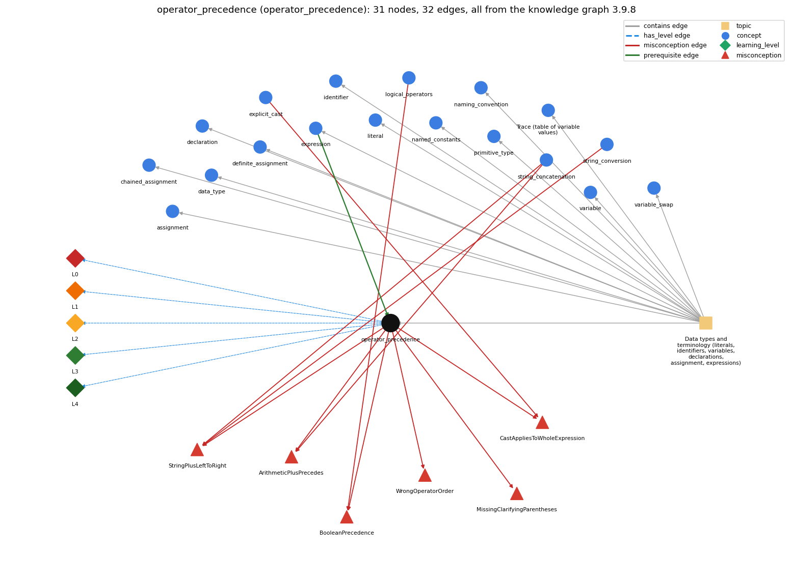

# operator_precedence (`operator_precedence`)

the order operators bind in an expression

Section 1.2 Built-in Types of Data, topic 1.2.a Data types and terminology (literals, identifiers, variables, declarations, assignment, expressions).

## At a glance

- **Needs first:** `expression`
- **Leads to:** nothing
- **Learned alongside:** nothing
- **Misconceptions:** `ArithmeticPlusPrecedes`, `BooleanPrecedence`, `CastAppliesToWholeExpression`, `MissingClarifyingParentheses`, `StringPlusLeftToRight`, `WrongOperatorOrder`
- **Errors:** none
- **Levels:** L0, L1, L2, L3, L4

Everything below comes from the knowledge graph 3.9.8 (`data/raw/chapter1_kg_updated.json`): 32 edges around this concept, each explained in the graph's own words.

## What it needs first (1)

A prerequisite edge means the other concept has to be understood before `operator_precedence`.

### `expression` comes before `operator_precedence`

*anything that evaluates to a value*

When an expression has several operators, precedence decides which operands are combined first, and equal-precedence operators go left to right.

- **Grounding:** book passage
- **How `operator_precedence` combines with `expression`:** Precedence decides the grouping of a multi-operator expression, and a parenthesized subexpression is evaluated as one unit with its own value.
- **How `expression` combines with `operator_precedence`:** With several operators, precedence and left associativity decide the grouping, and parentheses override both.

## What it leads to (0)

These concepts need `operator_precedence` first.

No concept has this one as a prerequisite.

## Learned alongside (0)

A parallel edge joins two concepts that sit side by side: neither is needed before the other.

No parallel edge touches this concept.

## Misconceptions (6)

A misconception edge states the wrong rule a student may hold about this concept, and the right rule.

### ArithmeticPlusPrecedes

- **Wrong rule:** In "s" + a + b, the numbers a and b are added first and their sum is joined to s.
- **Right rule:** Both uses of + have the same precedence and are evaluated left to right, so "s" + a + b joins a and then b as text; only "s" + (a + b) adds them first.
- **Role of this concept:** context
- **Shows at level L0 as:** misconception: wrong rule: arithmetic + binds tighter than string-concatenation +. Right rule: Both uses of + have the same precedence and are evaluated left to right, so "s" + a + b joins a and then b as text; only "s" + (a + b) adds them first.
- **Shows at level L0 as:** inconsistent trace: Points to LT (group by precedence, then left to right for operators of equal precedence). Applied unevenly, a student applies \* before + in one place but reads G \* m1 \* m2 / r \* r as dividing by r squared. (here mixing in: "arithmetic + binds tighter than string-concatenation +")
- **Also an edge from `string_concatenation`:** In "s" + a + b, the numbers a and b are added first and their sum is joined to s.

### BooleanPrecedence

- **Wrong rule:** a \|\| b &amp;&amp; c is evaluated left to right as (a \|\| b) &amp;&amp; c.
- **Right rule:** &amp;&amp; binds tighter than \|\|, so it is a \|\| (b &amp;&amp; c).
- **Role of this concept:** context
- **Shows at level L0 as:** misconception: wrong rule: a \|\| b &amp;&amp; c is evaluated left to right as (a \|\| b) &amp;&amp; c. Right rule: &amp;&amp; binds tighter than \|\|, so it is a \|\| (b &amp;&amp; c).
- **Also an edge from `logical_operators`:** a \|\| b &amp;&amp; c is evaluated left to right as (a \|\| b) &amp;&amp; c.

### CastAppliesToWholeExpression

- **Wrong rule:** (int) 2.5 / 0.15 casts the whole quotient to int.
- **Right rule:** The cast applies only to what comes right after it, here 2.5.
- **Role of this concept:** context
- **Shows at level L0 as:** misconception: wrong rule: (int) 2.5 / 0.15 casts the whole quotient to int. Right rule: The cast applies only to what comes right after it, here 2.5.
- **Also an edge from `explicit_cast`:** (int) 2.5 / 0.15 casts the whole quotient to int.

### MissingClarifyingParentheses

- **Wrong rule:** Writes compound expressions such as a + b \* c / d - e % f with no parentheses, relying on the reader to know precedence.
- **Right rule:** When writing compound expressions, be explicit and indicate with parentheses which operators should be evaluated first.
- **Role of this concept:** primary

### StringPlusLeftToRight

- **Wrong rule:** 2 + 3 + "bc" and "bc" + 2 + 3 give the same text.
- **Right rule:** + is evaluated left to right: 2 + 3 + "bc" is "5bc" but "bc" + 2 + 3 is "bc23".
- **Role of this concept:** context
- **Shows at level L0 as:** misconception: wrong rule: 2 + 3 + "bc" and "bc" + 2 + 3 give the same text. Right rule: + is evaluated left to right: 2 + 3 + "bc" is "5bc" but "bc" + 2 + 3 is "bc23".
- **Also an edge from `string_concatenation`:** 2 + 3 + "bc" and "bc" + 2 + 3 give the same text.
- **Also an edge from `string_conversion`:** 2 + 3 + "bc" and "bc" + 2 + 3 give the same text.

### WrongOperatorOrder

- **Wrong rule:** G \* m1 \* m2 / r \* r divides by r squared.
- **Right rule:** \* and / are applied left to right, so it divides by r and then multiplies by r; use / (r \* r).
- **Role of this concept:** primary
- **Shows at level L0 as:** misconception: wrong rule: G \* m1 \* m2 / r \* r divides by r squared. Right rule: \* and / are applied left to right, so it divides by r and then multiplies by r; use / (r \* r).

## Errors (0)

An error edge states the rule that gets broken in a program, and the right rule.

The graph has no error edge from this concept.

## Levels L0 to L4 (5 of 5)

Each level edge lists the ways a student shows that level, each with its exact rule.

### L0: Prestructural / sensorimotor

L0 for operator precedence: the answer holds a rule that contradicts Java.

*Deciding question: Does every rule the answer applies to operator precedence agree with the language rule? If it reads the code with everyday meanings, applies a wrong rule, or switches rules within one trace, it is L0. A slip in an otherwise rule-correct trace is L2 with an error, not L0.*

operator precedence -&gt; L0 (Prestructural): the answer holds a rule that contradicts Java (7 ways).

- **everyday reading** (folk-meaning rule): School order of operations (PEMDAS/BODMAS) covers only arithmetic, so novices read other operators left to right as in English, or treat ^ as a power. Java's precedence table also places casts above \* / %, comparisons below + -, &amp;&amp; above \|\|, and = lowest.
- **misconception** (wrong rule / right rule; shows `ArithmeticPlusPrecedes`): wrong rule: arithmetic + binds tighter than string-concatenation +. Right rule: Both uses of + have the same precedence and are evaluated left to right, so "s" + a + b joins a and then b as text; only "s" + (a + b) adds them first.
- **misconception** (wrong rule / right rule; shows `WrongOperatorOrder`): wrong rule: G \* m1 \* m2 / r \* r divides by r squared. Right rule: \* and / are applied left to right, so it divides by r and then multiplies by r; use / (r \* r).
- **inconsistent trace** (uneven-application rule; shows `ArithmeticPlusPrecedes`): Points to LT (group by precedence, then left to right for operators of equal precedence). Applied unevenly, a student applies \* before + in one place but reads G \* m1 \* m2 / r \* r as dividing by r squared. (here mixing in: "arithmetic + binds tighter than string-concatenation +")
- **misconception** (wrong rule / right rule; shows `BooleanPrecedence`): wrong rule: a \|\| b &amp;&amp; c is evaluated left to right as (a \|\| b) &amp;&amp; c. Right rule: &amp;&amp; binds tighter than \|\|, so it is a \|\| (b &amp;&amp; c).
- **misconception** (wrong rule / right rule; shows `CastAppliesToWholeExpression`): wrong rule: (int) 2.5 / 0.15 casts the whole quotient to int. Right rule: The cast applies only to what comes right after it, here 2.5.
- **misconception** (wrong rule / right rule; shows `StringPlusLeftToRight`): wrong rule: 2 + 3 + "bc" and "bc" + 2 + 3 give the same text. Right rule: + is evaluated left to right: 2 + 3 + "bc" is "5bc" but "bc" + 2 + 3 is "bc23".

### L1: Unistructural / atom x text surface

L1 for operator precedence: the answer states one correct rule without applying it.

*Deciding question: Does the answer cover every part of the code, in order, with the values (L2)? If it covers one part or only states the rule, it is L1.*

operator precedence -&gt; L1 (Unistructural): the answer states one correct rule without applying it (2 ways).

- **names the element** (identity rule): Operator precedence (order of operations): the rules that decide which operator binds its operands first, with associativity breaking ties.
- **states the rule** (declarative rule): \* / % bind before + -, and operators of equal precedence group left to right (a-b-c is (a-b)-c). Casts bind tighter than arithmetic, comparisons are below arithmetic and above &amp;&amp; and \|\|, and parentheses override everything. Operators of equal precedence are applied left to right: a-b-c is (a-b)-c, 1 + 2 + "Hello" is "3Hello" but "Hello" + 1 + 2 is "Hello12".

### L2: Multistructural / block x execution / preoperational

L2 for operator precedence: the answer applies these rules to every part of the code, in order.

*Deciding question: Is the answer many segments mapped onto lines (L2), or one segment stating the purpose of the whole (L3)? A correct output with no value-by-value justification is not levelled.*

operator precedence -&gt; L2 (Multistructural): the answer applies the rules of operator precedence to every part of the code, in order (3 ways).

- **line by line trace** (operational sequencing rule): Grouping is fixed first: innermost parentheses, then casts and unary operators, \* / %, + -, comparisons, &amp;&amp;, \|\|, and finally =. Within a level grouping goes left to right, and operands are then evaluated left to right inside that grouping.
- **output prediction** (evaluation / result rule): 1 + 2 \* 3 is 7. 3 + 5 / 2 is 5. 3 - 5 - 2 is -4. 2 + 3 + "bc" is "5bc" but "bc" + 2 + 3 is "bc23".
- **one step execution** (state-transition rule): Precedence changes no variable. It only decides which intermediate value is computed next: in minute \* 100 / 60 with minute = 59, 5900 is computed before the division.

### L3: Relational / relations x function (concrete operational begins)

L3 for operator precedence: the answer relates the parts by these rules.

*Deciding question: Was the purpose deduced from the code, or only guessed from traced input/output pairs (then L2)? Does the answer stay within the given code (L3), or reason about changed code, an error class or a new program (L4)?*

operator precedence -&gt; L3 (Relational): the answer relates the parts (2 ways).

- **relation to neighbour** (composition rule (with a neighbour)): Precedence decides the grouping of a multi-operator expression, and a parenthesized subexpression is evaluated as one unit with its own value.
- **purpose of the whole** (plan / role rule): Precedence lets compact formulas read like maths notation. Programmers add parentheses to state the intended grouping, e.g. (a + b) / 2 for an average.

### L4: Extended abstract (concrete-operational reversibility and conservation)

L4 for operator precedence: the answer reasons beyond the given code by these rules.

*Deciding question: Does the answer link the code to a broader context: a changed program, a class of inputs, an unseen problem? Re-tracing changed code value by value is L2; fixing one given failing case is L3.*

operator precedence -&gt; L4 (Extended abstract): the answer reasons beyond the given code (5 ways).

- **predict a change** (conservation rule; shows `ArithmeticPlusPrecedes`): Adding parentheses that match precedence keeps the value ((minute \* 100) / 60). Parentheses that change the grouping change it (3 - (5 - 2) is 0, not -4). Reordering equal-precedence int operations can also change it (59 / 60 \* 100 is 0).
- **transfer to a new program** (applicability rule): Rely on precedence for ordinary arithmetic. Add parentheses whenever the expression mixes levels that readers may not know (casts, &amp;&amp; with \|\|, + with Strings, chains of \* and /). Break very long formulas into named intermediate variables.
- **diagnose an error** (error rule): rule broken: \* and / have equal precedence and group left to right; + binds weaker than / . Kind: silent logic error. Trigger class: Maths formulas typed without parentheses: G \* m1 \* m2 / r \* r, (a + b / 2) for an average, or x / 2 \* pi.
- **diagnose an error** (error rule): rule broken: Comparisons yield booleans, and &lt; is not defined between a boolean and an int. Kind: compile-time. Trigger class: Chained comparisons such as a &lt; b &lt; c: 'bad operand types for binary operator &lt;'.
- **diagnose an error** (error rule): rule broken: + groups left to right, so once a String appears, later + operators concatenate. Kind: silent logic error. Trigger class: Printing "sum: " + a + b without parentheses around a + b.

## Same topic

`operator_precedence` belongs to the topic **Data types and terminology (literals, identifiers, variables, declarations, assignment, expressions)** (`topic1.2.a`). The topic also contains: `assignment`, `chained_assignment`, `data_type`, `declaration`, `definite_assignment`, `expression`, `identifier`, `literal`, `named_constants`, `naming_convention`, `primitive_type`, `program_trace`, `variable`, `variable_swap`.

## Rules of the concept (19)

- **folk-meaning rule:** School order of operations (PEMDAS/BODMAS) covers only arithmetic, so novices read other operators left to right as in English, or treat ^ as a power. Java's precedence table also places casts above \* / %, comparisons below + -, &amp;&amp; above \|\|, and = lowest.
- **wrong rule / right rule:** ArithmeticPlusPrecedes: wrong: arithmetic + binds tighter than string-concatenation + \| right: Both uses of + have the same precedence and are evaluated left to right, so "s" + a + b joins a and then b as text; only "s" + (a + b) adds them first.
- **wrong rule / right rule:** BooleanPrecedence: wrong: a \|\| b &amp;&amp; c is evaluated left to right as (a \|\| b) &amp;&amp; c. \| right: &amp;&amp; binds tighter than \|\|, so it is a \|\| (b &amp;&amp; c).
- **wrong rule / right rule:** CastAppliesToWholeExpression: wrong: (int) 2.5 / 0.15 casts the whole quotient to int. \| right: The cast applies only to what comes right after it, here 2.5.
- **wrong rule / right rule:** StringPlusLeftToRight: wrong: 2 + 3 + "bc" and "bc" + 2 + 3 give the same text. \| right: + is evaluated left to right: 2 + 3 + "bc" is "5bc" but "bc" + 2 + 3 is "bc23".
- **wrong rule / right rule:** WrongOperatorOrder: wrong: G \* m1 \* m2 / r \* r divides by r squared. \| right: \* and / are applied left to right, so it divides by r and then multiplies by r; use / (r \* r).
- **uneven-application rule:** Points to LT (group by precedence, then left to right for operators of equal precedence). Applied unevenly, a student applies \* before + in one place but reads G \* m1 \* m2 / r \* r as dividing by r squared.
- **identity rule:** Operator precedence (order of operations): the rules that decide which operator binds its operands first, with associativity breaking ties.
- **declarative rule:** \* / % bind before + -, and operators of equal precedence group left to right (a-b-c is (a-b)-c). Casts bind tighter than arithmetic, comparisons are below arithmetic and above &amp;&amp; and \|\|, and parentheses override everything. Operators of equal precedence are applied left to right: a-b-c is (a-b)-c, 1 + 2 + "Hello" is "3Hello" but "Hello" + 1 + 2 is "Hello12".
- **operational sequencing rule:** Grouping is fixed first: innermost parentheses, then casts and unary operators, \* / %, + -, comparisons, &amp;&amp;, \|\|, and finally =. Within a level grouping goes left to right, and operands are then evaluated left to right inside that grouping.
- **evaluation / result rule:** 1 + 2 \* 3 is 7. 3 + 5 / 2 is 5. 3 - 5 - 2 is -4. 2 + 3 + "bc" is "5bc" but "bc" + 2 + 3 is "bc23".
- **state-transition rule:** Precedence changes no variable. It only decides which intermediate value is computed next: in minute \* 100 / 60 with minute = 59, 5900 is computed before the division.
- **composition rule (with a neighbour):** with expression: Precedence decides the grouping of a multi-operator expression, and a parenthesized subexpression is evaluated as one unit with its own value.
- **plan / role rule:** Precedence lets compact formulas read like maths notation. Programmers add parentheses to state the intended grouping, e.g. (a + b) / 2 for an average.
- **conservation rule:** Adding parentheses that match precedence keeps the value ((minute \* 100) / 60). Parentheses that change the grouping change it (3 - (5 - 2) is 0, not -4). Reordering equal-precedence int operations can also change it (59 / 60 \* 100 is 0).
- **error rule:** rule broken: \* and / have equal precedence and group left to right; + binds weaker than / . (silent logic error)
- **error rule:** rule broken: Comparisons yield booleans, and &lt; is not defined between a boolean and an int. (compile-time)
- **error rule:** rule broken: + groups left to right, so once a String appears, later + operators concatenate. (silent logic error)
- **applicability rule:** Rely on precedence for ordinary arithmetic. Add parentheses whenever the expression mixes levels that readers may not know (casts, &amp;&amp; with \|\|, + with Strings, chains of \* and /). Break very long formulas into named intermediate variables.

## The whole prerequisite chain

- **Everything it builds on (7):** `arithmetic_operators`, `data_type`, `expression`, `identifier`, `literal`, `primitive_type`, `variable`
- **Everything that builds on it (0):** nothing
