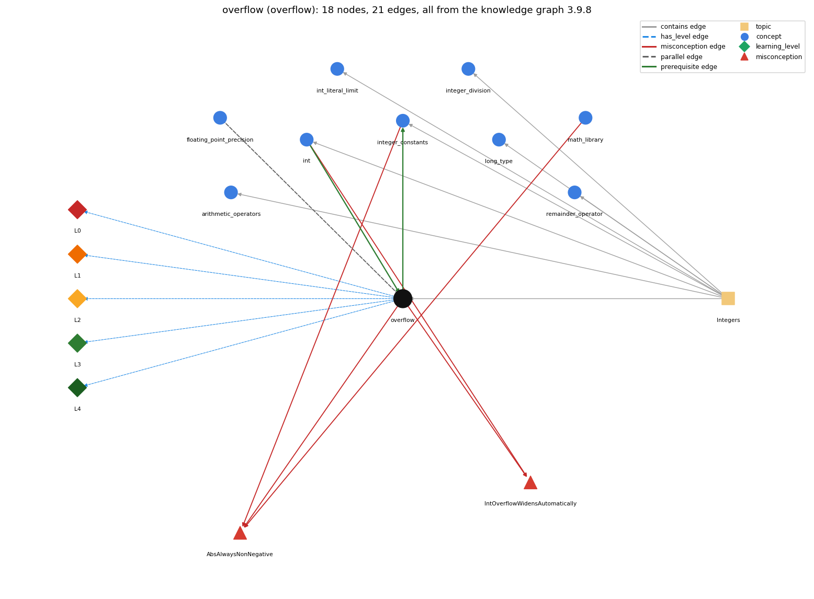

# overflow (`overflow`)

int arithmetic wraps around outside the 32-bit range

Section 1.2 Built-in Types of Data, topic 1.2.c Integers.

## At a glance

- **Needs first:** `int`
- **Leads to:** `integer_constants`
- **Learned alongside:** `floating_point_precision`
- **Misconceptions:** `AbsAlwaysNonNegative`, `IntOverflowWidensAutomatically`
- **Errors:** none
- **Levels:** L0, L1, L2, L3, L4

Everything below comes from the knowledge graph 3.9.8 (`data/raw/chapter1_kg_updated.json`): 21 edges around this concept, each explained in the graph's own words.

## What it needs first (1)

A prerequisite edge means the other concept has to be understood before `overflow`.

### `int` comes before `overflow`

*32-bit integer primitive*

Overflow happens because an int has a fixed 32-bit range.

- **Grounding:** book passage
- **How `overflow` combines with `int`:** Overflow is possible because int has a fixed 32-bit range, -2^31 to 2^31 - 1.
- **How `int` combines with `overflow`:** Because int has a fixed 32-bit range, results outside it wrap around silently.

## What it leads to (1)

These concepts need `overflow` first.

### `overflow` comes before `integer_constants`

*Integer.MAX\_VALUE, Integer.MIN\_VALUE and their edge cases*

Integer.MAX\_VALUE is used to test for overflow: an int result that would go past it wraps around to a negative value.

- **Grounding:** book passage
- **How `overflow` combines with `integer_constants`:** Integer.MAX\_VALUE and Integer.MIN\_VALUE mark the edges of the range. Testing a &gt; Integer.MAX\_VALUE - b before computing a + b avoids overflow.
- **How `integer_constants` combines with `overflow`:** Integer.MAX\_VALUE marks the overflow boundary: an int result past it wraps to a negative value, so a test such as sum &gt; Integer.MAX\_VALUE on an int is always false; an overflow guard must test before the operation (e.g. a &gt; Integer.MAX\_VALUE - b) or use long.

## Learned alongside (1)

A parallel edge joins two concepts that sit side by side: neither is needed before the other.

### `overflow` alongside `floating_point_precision`

*double values are approximations; == on doubles is unreliable*

Both come from finite representations: an int result too large for 32 bits wraps around silently (overflow), while a double keeps about 15 significant digits so most results are approximations (5.0/3.0 is 1.6666666666666667). Neither raises an error.

- **Grounding:** book passage

## Misconceptions (2)

A misconception edge states the wrong rule a student may hold about this concept, and the right rule.

### AbsAlwaysNonNegative

- **Wrong rule:** Math.abs always returns a non-negative number.
- **Right rule:** Math.abs(Integer.MIN\_VALUE) returns Integer.MIN\_VALUE, which is negative.
- **Role of this concept:** context
- **Also an edge from `integer_constants`:** Math.abs always returns a non-negative number.
- **Also an edge from `math_library`:** Math.abs always returns a non-negative number.

### IntOverflowWidensAutomatically

- **Wrong rule:** An int result that is too large is automatically stored as a bigger number.
- **Right rule:** int arithmetic is 32-bit; a result outside the range wraps around.
- **Role of this concept:** primary
- **Shows at level L0 as:** misconception: wrong rule: An int result that is too large is automatically stored as a bigger number. Right rule: int arithmetic is 32-bit; a result outside the range wraps around.
- **Shows at level L0 as:** inconsistent trace: Points to LT (each int operation wraps as soon as it leaves the range). Applied unevenly, a student wraps one step but writes a + 1 for a = Integer.MAX\_VALUE as 2147483648. (here mixing in: "An int result that is too large is automatically stored as a bigger number")
- **Also an edge from `int`:** An int result that is too large is automatically stored as a bigger number.

## Errors (0)

An error edge states the rule that gets broken in a program, and the right rule.

The graph has no error edge from this concept.

## Levels L0 to L4 (5 of 5)

Each level edge lists the ways a student shows that level, each with its exact rule.

### L0: Prestructural / sensorimotor

L0 for overflow: the answer holds a rule that contradicts Java.

*Deciding question: Does every rule the answer applies to overflow agree with the language rule? If it reads the code with everyday meanings, applies a wrong rule, or switches rules within one trace, it is L0. A slip in an otherwise rule-correct trace is L2 with an error, not L0.*

overflow -&gt; L0 (Prestructural): the answer holds a rule that contradicts Java (3 ways).

- **everyday reading** (folk-meaning rule): Everyday arithmetic assumes a bigger result just takes more digits. A Java int keeps only 32 bits, so a result that is too large wraps silently to a wrong (often negative) value.
- **misconception** (wrong rule / right rule; shows `IntOverflowWidensAutomatically`): wrong rule: An int result that is too large is automatically stored as a bigger number. Right rule: int arithmetic is 32-bit; a result outside the range wraps around.
- **inconsistent trace** (uneven-application rule; shows `IntOverflowWidensAutomatically`): Points to LT (each int operation wraps as soon as it leaves the range). Applied unevenly, a student wraps one step but writes a + 1 for a = Integer.MAX\_VALUE as 2147483648. (here mixing in: "An int result that is too large is automatically stored as a bigger number")

### L1: Unistructural / atom x text surface

L1 for overflow: the answer states one correct rule without applying it.

*Deciding question: Does the answer cover every part of the code, in order, with the values (L2)? If it covers one part or only states the rule, it is L1.*

overflow -&gt; L1 (Unistructural): the answer states one correct rule without applying it (2 ways).

- **names the element** (identity rule): Overflow: the situation where an integer result is too large or too small for its type's fixed bits and is truncated, wrapping around.
- **states the rule** (declarative rule): int and long arithmetic is done in 32-bit and 64-bit two's complement. An out-of-range result keeps only its low-order bits, and no error or exception is raised.

### L2: Multistructural / block x execution / preoperational

L2 for overflow: the answer applies these rules to every part of the code, in order.

*Deciding question: Is the answer many segments mapped onto lines (L2), or one segment stating the purpose of the whole (L3)? A correct output with no value-by-value justification is not levelled.*

overflow -&gt; L2 (Multistructural): the answer applies the rules of overflow to every part of the code, in order (3 ways).

- **line by line trace** (operational sequencing rule): Overflow happens in the single operation whose result leaves the range, before any later widening. With int a and b, long x = a \* b; overflows in 32-bit int arithmetic before the result is converted to long.
- **output prediction** (evaluation / result rule): Integer.MAX\_VALUE + 1 is -2147483648, 2 \* Integer.MAX\_VALUE is -2, and Math.abs(-2147483648) is -2147483648.
- **one step execution** (state-transition rule): The variable receives the wrapped value and nothing signals the error, so later statements carry on with it.

### L3: Relational / relations x function (concrete operational begins)

L3 for overflow: the answer relates the parts by these rules.

*Deciding question: Was the purpose deduced from the code, or only guessed from traced input/output pairs (then L2)? Does the answer stay within the given code (L3), or reason about changed code, an error class or a new program (L4)?*

overflow -&gt; L3 (Relational): the answer relates the parts (4 ways).

- **relation to neighbour** (composition rule (with a neighbour)): Overflow is possible because int has a fixed 32-bit range, -2^31 to 2^31 - 1.
- **relation to neighbour** (composition rule (with a neighbour)): Integer.MAX\_VALUE and Integer.MIN\_VALUE mark the edges of the range. Testing a &gt; Integer.MAX\_VALUE - b before computing a + b avoids overflow.
- **relation to neighbour** (composition rule (with a neighbour)): Both come from finite representations: an int result too large for 32 bits wraps around silently (overflow), while a double keeps about 15 significant digits so most results are approximations (5.0/3.0 is 1.6666666666666667). Neither raises an error.
- **purpose of the whole** (plan / role rule): Knowing about overflow lets you guard against it: use long for products, factorials and large sums, or check against MAX\_VALUE before computing.

### L4: Extended abstract (concrete-operational reversibility and conservation)

L4 for overflow: the answer reasons beyond the given code by these rules.

*Deciding question: Does the answer link the code to a broader context: a changed program, a class of inputs, an unseen problem? Re-tracing changed code value by value is L2; fixing one given failing case is L3.*

overflow -&gt; L4 (Extended abstract): the answer reasons beyond the given code (4 ways).

- **predict a change** (conservation rule; shows `IntOverflowWidensAutomatically`): Changing int to long moves the overflow point (to about 9.2e18) but does not remove it. Dividing before multiplying can avoid overflow at the cost of truncation. Casting a result that has already overflowed does not repair it.
- **transfer to a new program** (applicability rule): Think about overflow whenever values can reach the billions. Use long (or a long operand, such as 1000L) for those, BigInteger for unbounded integers, and plain int for small counts and indices.
- **diagnose an error** (error rule): rule broken: int results are limited to 32 bits, and overflow is not reported. Kind: silent logic error. Trigger class: Values that reach into the billions: factorials above 12!, large products or powers, sums of many large values, Math.abs(Integer.MIN\_VALUE).
- **diagnose an error** (error rule): rule broken: An all-int expression is computed in int even when its result is stored in a long. Kind: silent logic error. Trigger class: long total = a \* b; or long ms = days \* 24 \* 60 \* 60 \* 1000; with int operands.

## Same topic

`overflow` belongs to the topic **Integers** (`topic1.2.c`). The topic also contains: `arithmetic_operators`, `int`, `int_literal_limit`, `integer_constants`, `integer_division`, `long_type`, `remainder_operator`.

## Rules of the concept (15)

- **folk-meaning rule:** Everyday arithmetic assumes a bigger result just takes more digits. A Java int keeps only 32 bits, so a result that is too large wraps silently to a wrong (often negative) value.
- **wrong rule / right rule:** IntOverflowWidensAutomatically: wrong: An int result that is too large is automatically stored as a bigger number. \| right: int arithmetic is 32-bit; a result outside the range wraps around.
- **uneven-application rule:** Points to LT (each int operation wraps as soon as it leaves the range). Applied unevenly, a student wraps one step but writes a + 1 for a = Integer.MAX\_VALUE as 2147483648.
- **identity rule:** Overflow: the situation where an integer result is too large or too small for its type's fixed bits and is truncated, wrapping around.
- **declarative rule:** int and long arithmetic is done in 32-bit and 64-bit two's complement. An out-of-range result keeps only its low-order bits, and no error or exception is raised.
- **operational sequencing rule:** Overflow happens in the single operation whose result leaves the range, before any later widening. With int a and b, long x = a \* b; overflows in 32-bit int arithmetic before the result is converted to long.
- **evaluation / result rule:** Integer.MAX\_VALUE + 1 is -2147483648, 2 \* Integer.MAX\_VALUE is -2, and Math.abs(-2147483648) is -2147483648.
- **state-transition rule:** The variable receives the wrapped value and nothing signals the error, so later statements carry on with it.
- **composition rule (with a neighbour):** with int: Overflow is possible because int has a fixed 32-bit range, -2^31 to 2^31 - 1.
- **composition rule (with a neighbour):** with integer\_constants: Integer.MAX\_VALUE and Integer.MIN\_VALUE mark the edges of the range. Testing a &gt; Integer.MAX\_VALUE - b before computing a + b avoids overflow.
- **plan / role rule:** Knowing about overflow lets you guard against it: use long for products, factorials and large sums, or check against MAX\_VALUE before computing.
- **conservation rule:** Changing int to long moves the overflow point (to about 9.2e18) but does not remove it. Dividing before multiplying can avoid overflow at the cost of truncation. Casting a result that has already overflowed does not repair it.
- **error rule:** rule broken: int results are limited to 32 bits, and overflow is not reported. (silent logic error)
- **error rule:** rule broken: An all-int expression is computed in int even when its result is stored in a long. (silent logic error)
- **applicability rule:** Think about overflow whenever values can reach the billions. Use long (or a long operand, such as 1000L) for those, BigInteger for unbounded integers, and plain int for small counts and indices.

## The whole prerequisite chain

- **Everything it builds on (3):** `data_type`, `int`, `primitive_type`
- **Everything that builds on it (1):** `integer_constants`
