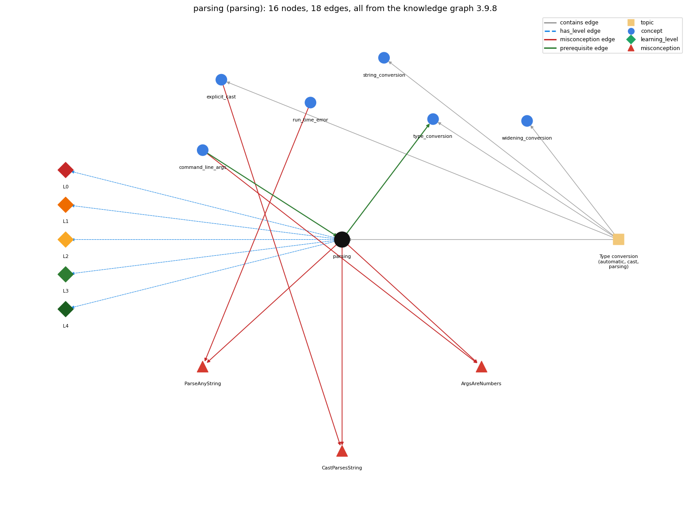

# parsing (`parsing`)

Integer.parseInt / Double.parseDouble turn text into numbers

Section 1.2 Built-in Types of Data, topic 1.2.h Type conversion (automatic, cast, parsing).

## At a glance

- **Needs first:** `command_line_args`
- **Leads to:** `type_conversion`
- **Learned alongside:** nothing
- **Misconceptions:** `ArgsAreNumbers`, `CastParsesString`, `ParseAnyString`
- **Errors:** none
- **Levels:** L0, L1, L2, L3, L4

Everything below comes from the knowledge graph 3.9.8 (`data/raw/chapter1_kg_updated.json`): 18 edges around this concept. The edge logic, the wrong and right rules and the exact rules of the ways are copied word for word from the graph.

## To work on (0)

Nothing is missing for this concept.

## What it needs first (1)

A prerequisite edge means the other concept has to be understood before `parsing`.

### `command_line_args` comes before `parsing`

*args[] -- strings passed at launch*

- **Edge:** `pre:command_line_args->parsing`
- **Exact edge logic:** args[k] is always a String, so Integer.parseInt(args[k]) is needed before it can be used as a number.
- **Grounding:** book\_passage
- **Composition rule (R) of `parsing` with `command_line_args`:** Because args[k] is always a String, a numeric argument must be passed through a parse method before it can be used in arithmetic or comparisons.
- **Composition rule (R) of `command_line_args` with `parsing`:** args[k] is always a String, so Integer.parseInt(args[k]) or Double.parseDouble(args[k]) must convert it before arithmetic.

## What it leads to (1)

These concepts need `parsing` first.

### `parsing` comes before `type_conversion`

*implicit widening and explicit (cast)*

- **Edge:** `pre:parsing->type_conversion`
- **Exact edge logic:** Integer.parseInt(s) converts the String s into an int; SW later classifies such methods as explicit type conversion.
- **Grounding:** questionable
- **Composition rule (R) of `parsing` with `type_conversion`:** SW classifies parse methods as explicit type conversion: a method takes an argument of one type and produces a result of another.
- **Composition rule (R) of `type_conversion` with `parsing`:** Parsing methods are explicit type conversion from String to a number: a method takes an argument of one type and produces a result of another.

## Learned alongside (0)

A parallel edge joins two concepts that sit side by side: neither is needed before the other.

No parallel edge touches this concept.

## Misconceptions (3)

A misconception edge states the wrong rule a student may hold about this concept, and the right rule.

### ArgsAreNumbers

- **Edge:** `parsing` &rarr; `ArgsAreNumbers` (misconception)
- **Exact edge logic (the wrong rule):** If a number is typed when the program is launched, args[0] is already an int and can be used in arithmetic.
- **Twin logic (the right rule):** args[0] is always a String, so Integer.parseInt(args[0]) is needed to get its number.
- **Wrong belief (on the node):** command-line args arrive already typed, no parsing needed
- **Correct rule (on the node):** args[0] is always a String, so Integer.parseInt(args[0]) is needed to get its number.
- **Provenance:** textbook
- **Role of this concept:** primary
- **L0 way linked to it:** yes
- **L0 way [4] misconception, exact rule:** wrong rule: Command-line args arrive already typed, so no parsing is needed. Right rule: args[0] is always a String, so Integer.parseInt(args[0]) is needed to get its number.
- **Edge `command_line_args` &rarr; `ArgsAreNumbers`, exact edge logic:** If a number is typed when the program is launched, args[0] is already an int and can be used in arithmetic. **Twin logic:** args[0] is always a String, so Integer.parseInt(args[0]) is needed to get its number. (role: context)

### CastParsesString

- **Edge:** `parsing` &rarr; `CastParsesString` (misconception)
- **Exact edge logic (the wrong rule):** (int) args[0] converts the text "34" into the number 34.
- **Twin logic (the right rule):** A String argument that represents a number must be converted with a method such as Integer.parseInt.
- **Wrong belief (on the node):** (int) args[0] converts the text "34" into the number 34.
- **Correct rule (on the node):** A String argument that represents a number must be converted with a method such as Integer.parseInt.
- **Provenance:** derived
- **Role of this concept:** primary
- **L0 way linked to it:** yes
- **L0 way [1] misconception, exact rule:** wrong rule: (int) args[0] converts the text "34" into the number 34. Right rule: A String argument that represents a number must be converted with a method such as Integer.parseInt; a cast from String to int does not compile.
- **L0 way [3] inconsistent\_trace, exact rule:** Points to LT (the method reads the whole string; it returns a number only if every character fits the format, otherwise it throws). Applied unevenly: the student parses "12" correctly but expects "12.2" to give 12 or "five" to give 5 on another call. (here mixing in: "(int) args[0] converts the text "34" into the number 34")
- **Edge `explicit_cast` &rarr; `CastParsesString`, exact edge logic:** (int) args[0] converts the text "34" into the number 34. **Twin logic:** A String argument that represents a number must be converted with a method such as Integer.parseInt. (role: context)

### ParseAnyString

- **Edge:** `parsing` &rarr; `ParseAnyString` (misconception)
- **Exact edge logic (the wrong rule):** Integer.parseInt works on any text, e.g. "five" or "12.2".
- **Twin logic (the right rule):** Integer.parseInt throws a NumberFormatException at run time when the string is not an integer written in digits.
- **Wrong belief (on the node):** Integer.parseInt works on any text, e.g. "five" or "12.2".
- **Correct rule (on the node):** Integer.parseInt throws a NumberFormatException at run time when the string is not an integer written in digits.
- **Provenance:** textbook
- **Role of this concept:** primary
- **L0 way linked to it:** yes
- **L0 way [2] misconception, exact rule:** wrong rule: Integer.parseInt works on any text, e.g. "five" or "12.2". Right rule: Integer.parseInt throws a NumberFormatException at run time when the string is not an integer written in digits.
- **Edge `run_time_error` &rarr; `ParseAnyString`, exact edge logic:** Integer.parseInt works on any text, e.g. "five" or "12.2". **Twin logic:** Integer.parseInt throws a NumberFormatException at run time when the string is not an integer written in digits. (role: context)

## Errors (0)

An error edge states the rule that gets broken in a program, and the right rule.

The graph has no error edge from this concept.

## Levels L0 to L4 (5 of 5)

Each level edge lists the ways a student shows that level, each with its exact rule.

### L0: Prestructural / sensorimotor

L0 for parsing: the answer holds a rule that contradicts Java.

*Deciding question: Does every rule the answer applies to parsing agree with the language rule? If it reads the code with everyday meanings, applies a wrong rule, or switches rules within one trace, it is L0. A slip in an otherwise rule-correct trace is L2 with an error, not L0.*

- **Edge:** `parsing` &rarr; `parsing@L0` (has_level)
- **Exact edge logic:** parsing -&gt; L0 (Prestructural): the answer holds a rule that contradicts Java (5 ways).

Ways (5), each with its exact rule:

- **[0] everyday\_reading** (rule type E, folk-meaning rule): Folk meaning: what the user typed, such as 34, already is a number, so a command-line argument can be used in arithmetic or simply cast. Java rule: command-line arguments are Strings; a String is converted to a number only by a parse method such as Integer.parseInt(args[0]) (parse = read and translate).
- **[1] misconception** (rule type M, wrong rule / right rule) &rarr; `CastParsesString`: wrong rule: (int) args[0] converts the text "34" into the number 34. Right rule: A String argument that represents a number must be converted with a method such as Integer.parseInt; a cast from String to int does not compile.
- **[2] misconception** (rule type M, wrong rule / right rule) &rarr; `ParseAnyString`: wrong rule: Integer.parseInt works on any text, e.g. "five" or "12.2". Right rule: Integer.parseInt throws a NumberFormatException at run time when the string is not an integer written in digits.
- **[3] inconsistent\_trace** (rule type T, uneven-application rule) &rarr; `CastParsesString`: Points to LT (the method reads the whole string; it returns a number only if every character fits the format, otherwise it throws). Applied unevenly: the student parses "12" correctly but expects "12.2" to give 12 or "five" to give 5 on another call. (here mixing in: "(int) args[0] converts the text "34" into the number 34")
- **[4] misconception** (rule type M, wrong rule / right rule) &rarr; `ArgsAreNumbers`: wrong rule: Command-line args arrive already typed, so no parsing is needed. Right rule: args[0] is always a String, so Integer.parseInt(args[0]) is needed to get its number.

### L1: Unistructural / atom x text surface

L1 for parsing: the answer states one correct rule without applying it.

*Deciding question: Does the answer cover every part of the code, in order, with the values (L2)? If it covers one part or only states the rule, it is L1.*

- **Edge:** `parsing` &rarr; `parsing@L1` (has_level)
- **Exact edge logic:** parsing -&gt; L1 (Unistructural): the answer states one correct rule without applying it (2 ways).

Ways (2), each with its exact rule:

- **[0] names\_the\_element** (rule type N, identity rule): Parsing is explicit type conversion from text: a library method such as Integer.parseInt or Double.parseDouble reads a String and translates it into a value of a primitive type.
- **[1] states\_the\_rule** (rule type S, declarative rule): int Integer.parseInt(String s), double Double.parseDouble(String s) and long Long.parseLong(String s) convert s to an int, double or long; if s is not a valid representation they throw NumberFormatException.

### L2: Multistructural / block x execution / preoperational

L2 for parsing: the answer applies these rules to every part of the code, in order.

*Deciding question: Is the answer many segments mapped onto lines (L2), or one segment stating the purpose of the whole (L3)? A correct output with no value-by-value justification is not levelled.*

- **Edge:** `parsing` &rarr; `parsing@L2` (has_level)
- **Exact edge logic:** parsing -&gt; L2 (Multistructural): the answer applies the rules of parsing to every part of the code, in order (3 ways).

Ways (3), each with its exact rule:

- **[0] line\_by\_line\_trace** (rule type LT, operational sequencing rule): The argument expression (e.g. args[0]) is evaluated to a String, the method scans its characters and either returns the number or throws; then the value is used, typically assigned to a typed variable.
- **[1] output\_prediction** (rule type OP, evaluation / result rule): Integer.parseInt("123") is the int 123 (same as typing the literal 123); Double.parseDouble("-3.0") is the double -3.0; Integer.parseInt("12.2") or ("five") produces no value but a NumberFormatException.
- **[2] one\_step\_execution** (rule type OS, state-transition rule): The String is left unchanged; the only state change is the assignment of the result, e.g. int N = Integer.parseInt(args[0]); sets N.

### L3: Relational / relations x function (concrete operational begins)

L3 for parsing: the answer relates the parts by these rules.

*Deciding question: Was the purpose deduced from the code, or only guessed from traced input/output pairs (then L2)? Does the answer stay within the given code (L3), or reason about changed code, an error class or a new program (L4)?*

- **Edge:** `parsing` &rarr; `parsing@L3` (has_level)
- **Exact edge logic:** parsing -&gt; L3 (Relational): the answer relates the parts (3 ways).

Ways (3), each with its exact rule:

- **[0] relation\_to\_neighbour** (rule type R, composition rule (with a neighbour)): Because args[k] is always a String, a numeric argument must be passed through a parse method before it can be used in arithmetic or comparisons.
- **[1] relation\_to\_neighbour** (rule type R, composition rule (with a neighbour)): SW classifies parse methods as explicit type conversion: a method takes an argument of one type and produces a result of another.
- **[2] purpose\_of\_the\_whole** (rule type P, plan / role rule): Input-conversion plan: at the top of main, parse each command-line argument once into a typed variable (Sajaniemi role: fixed value) and use that variable afterwards.

### L4: Extended abstract (concrete-operational reversibility and conservation)

L4 for parsing: the answer reasons beyond the given code by these rules.

*Deciding question: Does the answer link the code to a broader context: a changed program, a class of inputs, an unseen problem? Re-tracing changed code value by value is L2; fixing one given failing case is L3.*

- **Edge:** `parsing` &rarr; `parsing@L4` (has_level)
- **Exact edge logic:** parsing -&gt; L4 (Extended abstract): the answer reasons beyond the given code (5 ways).

Ways (5), each with its exact rule:

- **[0] predict\_a\_change** (rule type C, conservation rule) &rarr; `CastParsesString`: Changing Integer.parseInt to Double.parseDouble widens the accepted inputs ("2.5") and changes the variable's type to double; changing the input text from "34" to "34.0" or "thirty" turns a working run into a NumberFormatException; converting a number back to a String always succeeds.
- **[1] transfer\_to\_a\_new\_program** (rule type X, applicability rule): Use parse methods whenever numbers arrive as text (command-line arguments, tokens of a line); StdIn.readInt() already parses its token; use casts, not parse methods, between numeric types.
- **[2] diagnose\_an\_error** (rule type D, error rule): rule broken: The string passed to a parse method must be a valid number of that type. Kind: run-time exception. Trigger class: Input that is not an integer in digits for parseInt: words ("five"), decimals ("12.2"), empty strings or embedded spaces (NumberFormatException).
- **[3] diagnose\_an\_error** (rule type D, error rule): rule broken: args[k] exists only if at least k+1 arguments were typed. Kind: run-time exception. Trigger class: Running the program with too few command-line arguments, so Integer.parseInt(args[0]) fails with ArrayIndexOutOfBoundsException before parsing.
- **[4] diagnose\_an\_error** (rule type D, error rule): rule broken: A String cannot be cast to a number. Kind: compile-time. Trigger class: (int) args[0].

## Same topic

`parsing` belongs to the topic **Type conversion (automatic, cast, parsing)** (`topic1.2.h`). The topic also contains: `explicit_cast`, `string_conversion`, `type_conversion`, `widening_conversion`.

## Rules of the concept (18)

- **Book** (SW-1e, p. 31 (pdf 41)): "We have already used the Integer.parseInt() and Double.parseDouble() library methods to convert String values to int and double values, respectively."
- **Book** (OT-CmdLine, ): "If an application needs to support a numeric command-line argument, it must convert a String argument that represents a number, such as "34", to a numeric value."
- **Book** (OT-CmdLine, ): "parseInt throws a NumberFormatException if the format of args[0] isn't valid."
- **Book** (SW-1.5, ): "All of our classes have a main() method that takes a String array args[] as argument. That array is the sequence of command-line arguments that we type."
- **E** (folk-meaning rule): Folk meaning: what the user typed, such as 34, already is a number, so a command-line argument can be used in arithmetic or simply cast. Java rule: command-line arguments are Strings; a String is converted to a number only by a parse method such as Integer.parseInt(args[0]) (parse = read and translate).
- **M** (wrong rule / right rule): ArgsAreNumbers: wrong: Command-line args arrive already typed, so no parsing is needed. \| right: args[0] is always a String, so Integer.parseInt(args[0]) is needed to get its number.
- **M** (wrong rule / right rule): CastParsesString: wrong: (int) args[0] converts the text "34" into the number 34. \| right: A String argument that represents a number must be converted with a method such as Integer.parseInt; a cast from String to int does not compile.
- **M** (wrong rule / right rule): ParseAnyString: wrong: Integer.parseInt works on any text, e.g. "five" or "12.2". \| right: Integer.parseInt throws a NumberFormatException at run time when the string is not an integer written in digits.
- **T** (uneven-application rule): Points to LT (the method reads the whole string; it returns a number only if every character fits the format, otherwise it throws). Applied unevenly: the student parses "12" correctly but expects "12.2" to give 12 or "five" to give 5 on another call.
- **N** (identity rule): Parsing is explicit type conversion from text: a library method such as Integer.parseInt or Double.parseDouble reads a String and translates it into a value of a primitive type.
- **S** (declarative rule): int Integer.parseInt(String s), double Double.parseDouble(String s) and long Long.parseLong(String s) convert s to an int, double or long; if s is not a valid representation they throw NumberFormatException.
- **LT** (operational sequencing rule): The argument expression (e.g. args[0]) is evaluated to a String, the method scans its characters and either returns the number or throws; then the value is used, typically assigned to a typed variable.
- **OP** (evaluation / result rule): Integer.parseInt("123") is the int 123 (same as typing the literal 123); Double.parseDouble("-3.0") is the double -3.0; Integer.parseInt("12.2") or ("five") produces no value but a NumberFormatException.
- **OS** (state-transition rule): The String is left unchanged; the only state change is the assignment of the result, e.g. int N = Integer.parseInt(args[0]); sets N.
- **R** (composition rule (with a neighbour)): with command\_line\_args: Because args[k] is always a String, a numeric argument must be passed through a parse method before it can be used in arithmetic or comparisons.
- **R** (composition rule (with a neighbour)): with type\_conversion: SW classifies parse methods as explicit type conversion: a method takes an argument of one type and produces a result of another.
- **P** (plan / role rule): Input-conversion plan: at the top of main, parse each command-line argument once into a typed variable (Sajaniemi role: fixed value) and use that variable afterwards.
- **C** (conservation rule): Changing Integer.parseInt to Double.parseDouble widens the accepted inputs ("2.5") and changes the variable's type to double; changing the input text from "34" to "34.0" or "thirty" turns a working run into a NumberFormatException; converting a number back to a String always succeeds.
- **D** (error rule): rule broken: The string passed to a parse method must be a valid number of that type. (run-time exception)
- **D** (error rule): rule broken: args[k] exists only if at least k+1 arguments were typed. (run-time exception)
- **D** (error rule): rule broken: A String cannot be cast to a number. (compile-time)
- **X** (applicability rule): Use parse methods whenever numbers arrive as text (command-line arguments, tokens of a line); StdIn.readInt() already parses its token; use casts, not parse methods, between numeric types.

## How it is found in code and answers (reader block)

- **Aliases:** parseint, parsedouble, parse, parses
- **Code patterns:** `Integer\.parseInt\s*\(`, `Double\.parseDouble\s*\(`, `Boolean\.parseBoolean\s*\(`, `\bLong\.parseLong\s*\(`
- **Operator symbols:** none
- **Java types:** none

## The whole prerequisite chain

- **Everything it builds on (4):** `class_declaration`, `command_line_args`, `main_method`, `program_text`
- **Everything that builds on it (8):** `accumulator_pattern`, `compound_assignment`, `explicit_cast`, `math_random`, `monte_carlo_simulation`, `sentinel_loop`, `type_conversion`, `widening_conversion`

## Every edge in this view and its exact edge logic (18)

All the edges drawn in the picture, in the order: prerequisite, parallel, misconception, error, has_level, contains.

**1. `command_line_args` &rarr; `parsing`** (prerequisite)

- **Exact edge logic:** args[k] is always a String, so Integer.parseInt(args[k]) is needed before it can be used as a number.
- **Grounding:** book\_passage
- **Composition rule (R) of `command_line_args` with `parsing`:** args[k] is always a String, so Integer.parseInt(args[k]) or Double.parseDouble(args[k]) must convert it before arithmetic.
- **Composition rule (R) of `parsing` with `command_line_args`:** Because args[k] is always a String, a numeric argument must be passed through a parse method before it can be used in arithmetic or comparisons.

**2. `parsing` &rarr; `type_conversion`** (prerequisite)

- **Exact edge logic:** Integer.parseInt(s) converts the String s into an int; SW later classifies such methods as explicit type conversion.
- **Grounding:** questionable
- **Composition rule (R) of `parsing` with `type_conversion`:** SW classifies parse methods as explicit type conversion: a method takes an argument of one type and produces a result of another.
- **Composition rule (R) of `type_conversion` with `parsing`:** Parsing methods are explicit type conversion from String to a number: a method takes an argument of one type and produces a result of another.

**3. `parsing` &rarr; `ArgsAreNumbers`** (misconception)

- **Exact edge logic (the wrong rule):** If a number is typed when the program is launched, args[0] is already an int and can be used in arithmetic.
- **Twin logic (the right rule):** args[0] is always a String, so Integer.parseInt(args[0]) is needed to get its number.
- **Role:** primary

**4. `parsing` &rarr; `CastParsesString`** (misconception)

- **Exact edge logic (the wrong rule):** (int) args[0] converts the text "34" into the number 34.
- **Twin logic (the right rule):** A String argument that represents a number must be converted with a method such as Integer.parseInt.
- **Role:** primary

**5. `parsing` &rarr; `ParseAnyString`** (misconception)

- **Exact edge logic (the wrong rule):** Integer.parseInt works on any text, e.g. "five" or "12.2".
- **Twin logic (the right rule):** Integer.parseInt throws a NumberFormatException at run time when the string is not an integer written in digits.
- **Role:** primary

**6. `command_line_args` &rarr; `ArgsAreNumbers`** (misconception)

- **Exact edge logic (the wrong rule):** If a number is typed when the program is launched, args[0] is already an int and can be used in arithmetic.
- **Twin logic (the right rule):** args[0] is always a String, so Integer.parseInt(args[0]) is needed to get its number.
- **Role:** context

**7. `explicit_cast` &rarr; `CastParsesString`** (misconception)

- **Exact edge logic (the wrong rule):** (int) args[0] converts the text "34" into the number 34.
- **Twin logic (the right rule):** A String argument that represents a number must be converted with a method such as Integer.parseInt.
- **Role:** context

**8. `run_time_error` &rarr; `ParseAnyString`** (misconception)

- **Exact edge logic (the wrong rule):** Integer.parseInt works on any text, e.g. "five" or "12.2".
- **Twin logic (the right rule):** Integer.parseInt throws a NumberFormatException at run time when the string is not an integer written in digits.
- **Role:** context

**9. `parsing` &rarr; `parsing@L0`** (has_level)

- **Exact edge logic:** parsing -&gt; L0 (Prestructural): the answer holds a rule that contradicts Java (5 ways).
  - **[0] everyday\_reading** (rule type E, folk-meaning rule): Folk meaning: what the user typed, such as 34, already is a number, so a command-line argument can be used in arithmetic or simply cast. Java rule: command-line arguments are Strings; a String is converted to a number only by a parse method such as Integer.parseInt(args[0]) (parse = read and translate).
  - **[1] misconception** (rule type M, wrong rule / right rule) &rarr; `CastParsesString`: wrong rule: (int) args[0] converts the text "34" into the number 34. Right rule: A String argument that represents a number must be converted with a method such as Integer.parseInt; a cast from String to int does not compile.
  - **[2] misconception** (rule type M, wrong rule / right rule) &rarr; `ParseAnyString`: wrong rule: Integer.parseInt works on any text, e.g. "five" or "12.2". Right rule: Integer.parseInt throws a NumberFormatException at run time when the string is not an integer written in digits.
  - **[3] inconsistent\_trace** (rule type T, uneven-application rule) &rarr; `CastParsesString`: Points to LT (the method reads the whole string; it returns a number only if every character fits the format, otherwise it throws). Applied unevenly: the student parses "12" correctly but expects "12.2" to give 12 or "five" to give 5 on another call. (here mixing in: "(int) args[0] converts the text "34" into the number 34")
  - **[4] misconception** (rule type M, wrong rule / right rule) &rarr; `ArgsAreNumbers`: wrong rule: Command-line args arrive already typed, so no parsing is needed. Right rule: args[0] is always a String, so Integer.parseInt(args[0]) is needed to get its number.

**10. `parsing` &rarr; `parsing@L1`** (has_level)

- **Exact edge logic:** parsing -&gt; L1 (Unistructural): the answer states one correct rule without applying it (2 ways).
  - **[0] names\_the\_element** (rule type N, identity rule): Parsing is explicit type conversion from text: a library method such as Integer.parseInt or Double.parseDouble reads a String and translates it into a value of a primitive type.
  - **[1] states\_the\_rule** (rule type S, declarative rule): int Integer.parseInt(String s), double Double.parseDouble(String s) and long Long.parseLong(String s) convert s to an int, double or long; if s is not a valid representation they throw NumberFormatException.

**11. `parsing` &rarr; `parsing@L2`** (has_level)

- **Exact edge logic:** parsing -&gt; L2 (Multistructural): the answer applies the rules of parsing to every part of the code, in order (3 ways).
  - **[0] line\_by\_line\_trace** (rule type LT, operational sequencing rule): The argument expression (e.g. args[0]) is evaluated to a String, the method scans its characters and either returns the number or throws; then the value is used, typically assigned to a typed variable.
  - **[1] output\_prediction** (rule type OP, evaluation / result rule): Integer.parseInt("123") is the int 123 (same as typing the literal 123); Double.parseDouble("-3.0") is the double -3.0; Integer.parseInt("12.2") or ("five") produces no value but a NumberFormatException.
  - **[2] one\_step\_execution** (rule type OS, state-transition rule): The String is left unchanged; the only state change is the assignment of the result, e.g. int N = Integer.parseInt(args[0]); sets N.

**12. `parsing` &rarr; `parsing@L3`** (has_level)

- **Exact edge logic:** parsing -&gt; L3 (Relational): the answer relates the parts (3 ways).
  - **[0] relation\_to\_neighbour** (rule type R, composition rule (with a neighbour)): Because args[k] is always a String, a numeric argument must be passed through a parse method before it can be used in arithmetic or comparisons.
  - **[1] relation\_to\_neighbour** (rule type R, composition rule (with a neighbour)): SW classifies parse methods as explicit type conversion: a method takes an argument of one type and produces a result of another.
  - **[2] purpose\_of\_the\_whole** (rule type P, plan / role rule): Input-conversion plan: at the top of main, parse each command-line argument once into a typed variable (Sajaniemi role: fixed value) and use that variable afterwards.

**13. `parsing` &rarr; `parsing@L4`** (has_level)

- **Exact edge logic:** parsing -&gt; L4 (Extended abstract): the answer reasons beyond the given code (5 ways).
  - **[0] predict\_a\_change** (rule type C, conservation rule) &rarr; `CastParsesString`: Changing Integer.parseInt to Double.parseDouble widens the accepted inputs ("2.5") and changes the variable's type to double; changing the input text from "34" to "34.0" or "thirty" turns a working run into a NumberFormatException; converting a number back to a String always succeeds.
  - **[1] transfer\_to\_a\_new\_program** (rule type X, applicability rule): Use parse methods whenever numbers arrive as text (command-line arguments, tokens of a line); StdIn.readInt() already parses its token; use casts, not parse methods, between numeric types.
  - **[2] diagnose\_an\_error** (rule type D, error rule): rule broken: The string passed to a parse method must be a valid number of that type. Kind: run-time exception. Trigger class: Input that is not an integer in digits for parseInt: words ("five"), decimals ("12.2"), empty strings or embedded spaces (NumberFormatException).
  - **[3] diagnose\_an\_error** (rule type D, error rule): rule broken: args[k] exists only if at least k+1 arguments were typed. Kind: run-time exception. Trigger class: Running the program with too few command-line arguments, so Integer.parseInt(args[0]) fails with ArrayIndexOutOfBoundsException before parsing.
  - **[4] diagnose\_an\_error** (rule type D, error rule): rule broken: A String cannot be cast to a number. Kind: compile-time. Trigger class: (int) args[0].

**14. `topic1.2.h` &rarr; `parsing`** (contains)

- topic `topic1.2.h` contains `parsing`

**15. `topic1.2.h` &rarr; `explicit_cast`** (contains)

- topic `topic1.2.h` contains `explicit_cast`

**16. `topic1.2.h` &rarr; `string_conversion`** (contains)

- topic `topic1.2.h` contains `string_conversion`

**17. `topic1.2.h` &rarr; `type_conversion`** (contains)

- topic `topic1.2.h` contains `type_conversion`

**18. `topic1.2.h` &rarr; `widening_conversion`** (contains)

- topic `topic1.2.h` contains `widening_conversion`
