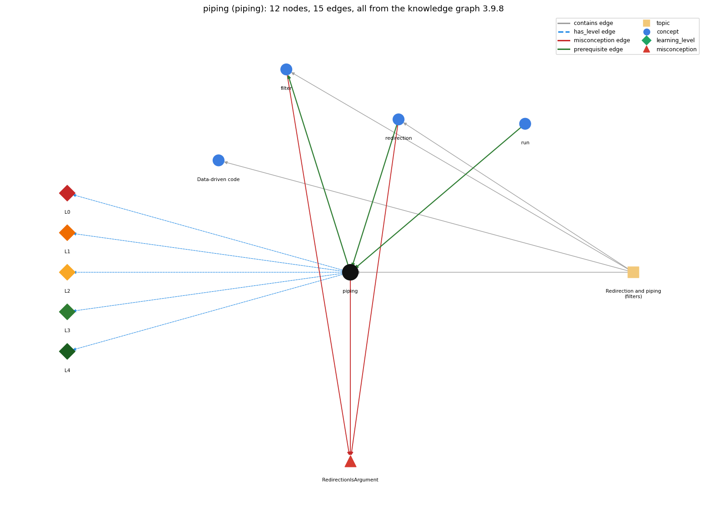

# piping (`piping`)

\| connects one program's output to another's input

Section 1.5 Input and Output, topic 1.5.d Redirection and piping (filters). From the knowledge graph 3.9.8 (`data/raw/chapter1_kg_updated.json`).

## Concepts associated with piping (4)

| Concept | Description | How it is associated |
| --- | --- | --- |
| **data\_driven\_code** | keeping data in files and writing programs that read it from standard input, so the data can change without changing the program | same topic (topic1.5.d) |
| **filter** | a program that reads standard input and writes standard output | builds on it (needs it) composition rule (R) with it shares misconception RedirectionIsArgument same topic (topic1.5.d) |
| **redirection** | &lt; / &gt; send a file in/out as standard input/output | prerequisite of it (it needs this) composition rule (R) with it shares misconception RedirectionIsArgument same topic (topic1.5.d) |
| **run** | java executes main in the JVM | prerequisite of it (it needs this) |

## Every edge in this view and its full label (15)

| From | Edge | To | Full edge label |
| --- | --- | --- | --- |
| **piping** | prerequisite | **filter** | A filter converts a standard input stream to a standard output stream, and piping is the mechanism that connects filters together. grounding: book\_passage composition rule (R) of piping with filter: Filters are the components and the pipe is the connector: \`A \| F1 \| F2\` passes the stream through each filter in turn. composition rule (R) of filter with piping: Piping connects filters: the output of one becomes the input of the next, so filters compose into pipelines (\`java RandomSeq 1000 \| more\`). |
| **redirection** | prerequisite | **piping** | A pipe A \| B connects A's standard output directly to B's standard input, with no file in between. grounding: book\_passage composition rule (R) of redirection with piping: \`A &gt; f\` followed by \`B &lt; f\` has the same effect as \`A \| B\`, except that the pipe creates no file. composition rule (R) of piping with redirection: A pipe has the same effect as \`&gt; file\` then \`&lt; file\`, but there is no intermediate file, so the data size is not limited by disk space. |
| **run** | prerequisite | **piping** | Piping joins the commands that run two programs, so one program's output becomes the other's input. grounding: book\_passage |
| **filter** | misconception | **RedirectionIsArgument** | **wrong rule:** a redirected file shows up in args[] **right rule:** With &lt; data.txt the operating system implements the standard input stream by reading from the file; the program just reads standard input and has no dependence on the source of the input stream. role: context |
| **piping** | misconception | **RedirectionIsArgument** | **wrong rule:** a redirected file shows up in args[] **right rule:** With &lt; data.txt the operating system implements the standard input stream by reading from the file; the program just reads standard input and has no dependence on the source of the input stream. role: context |
| **redirection** | misconception | **RedirectionIsArgument** | **wrong rule:** java Prog &lt; in.txt puts the name in.txt into args[0]. **right rule:** With &lt; data.txt the operating system implements the standard input stream by reading from the file; the program just reads standard input and has no dependence on the source of the input stream. role: primary |
| **piping** | has\_level | **piping@L0** | piping -&gt; L0 (Prestructural): the answer holds a rule that contradicts Java (3 ways). **[0] everyday\_reading** (E): In maths \`\|\` means 'divides', absolute value or 'or'. In a command line, \`A \| B\` connects A's standard output to B's standard input. **[1] misconception** (M) &rarr; RedirectionIsArgument: wrong rule: A redirected (piped) stream shows up in args[]. Right rule: With \`A \| B\`, B's standard input is A's output stream. It is not an argument, and B just reads standard input as if someone were typing it. **[2] inconsistent\_trace** (T) &rarr; RedirectionIsArgument: Points to LT (A's writes are added to the end of the shared stream and B's reads take from its front, interleaved by the OS). An uneven trace runs A to completion into a file first, or sends B's output back into A. (here mixing in: "a redirected file shows up in args[]") |
| **piping** | has\_level | **piping@L1** | piping -&gt; L1 (Unistructural): the answer states one correct rule without applying it (2 ways). **[0] names\_the\_element** (N): Piping is an operating-system mechanism (\`\|\`) that makes one program's standard output the next program's standard input. **[1] states\_the\_rule** (S): \`java RandomSeq 1000 \| java Average\` specifies that RandomSeq's standard output and Average's standard input are the same stream. |
| **piping** | has\_level | **piping@L2** | piping -&gt; L2 (Multistructural): the answer applies the rules of piping to every part of the code, in order (3 ways). **[0] line\_by\_line\_trace** (LT): The two programs run together. Each println in A adds a string to the end of the stream, and each read in B removes one from the beginning. The OS decides the interleaving, and the result does not depend on it. **[1] output\_prediction** (OP): Only the last program's standard output appears. \`java RandomSeq 100000 \| java Average\` prints a single line such as Average is 0.5000499417963857. **[2] one\_step\_execution** (OS): One write by A makes one more item available to B. One read by B consumes it. No file is created. |
| **piping** | has\_level | **piping@L3** | piping -&gt; L3 (Relational): the answer relates the parts (3 ways). **[0] relation\_to\_neighbour** (R): A pipe has the same effect as \`&gt; file\` then \`&lt; file\`, but there is no intermediate file, so the data size is not limited by disk space. **[1] relation\_to\_neighbour** (R): Filters are the components and the pipe is the connector: \`A \| F1 \| F2\` passes the stream through each filter in turn. **[2] purpose\_of\_the\_whole** (P): Piping composes small programs into a pipeline and removes the limit on stream size. |
| **piping** | has\_level | **piping@L4** | piping -&gt; L4 (Extended abstract): the answer reasons beyond the given code (3 ways). **[0] predict\_a\_change** (C) &rarr; RedirectionIsArgument: Replacing \`A \| B\` with \`A &gt; f; B &lt; f\` keeps the result. Changing A's output format (e.g. adding a label) breaks B's typed reads. **[1] transfer\_to\_a\_new\_program** (X): Use a pipe when one program's output is exactly the next program's input and the intermediate data need not be kept. Use redirection to a file when it must be saved or reused. **[2] diagnose\_an\_error** (D): rule broken: The upstream output must match the downstream input format. Kind: run-time exception. Trigger class: A prints labels such as \`Average is 0.5\`, and B reads them with readDouble(): NumberFormatException on the token \`Average\`. |
| **topic1.5.d** | contains | **data\_driven\_code** | topic topic1.5.d contains data\_driven\_code |
| **topic1.5.d** | contains | **filter** | topic topic1.5.d contains filter |
| **topic1.5.d** | contains | **piping** | topic topic1.5.d contains piping |
| **topic1.5.d** | contains | **redirection** | topic topic1.5.d contains redirection |
