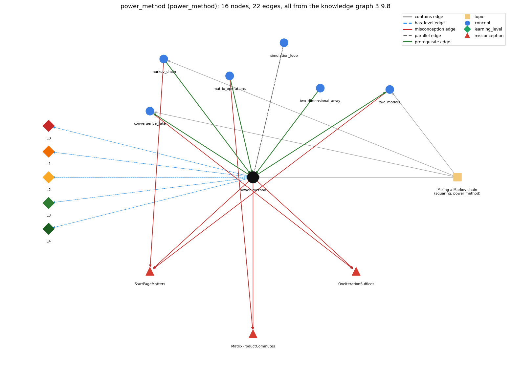

# power_method (`power_method`)

repeated vector-matrix multiplication to compute page ranks

Section 1.6 Case Study: Random Web Surfer, topic 1.6.c Mixing a Markov chain (squaring, power method).

## At a glance

- **Needs first:** `markov_chain`, `matrix_operations`, `two_dimensional_array`
- **Leads to:** `convergence_rate`, `two_models`
- **Learned alongside:** `simulation_loop`
- **Misconceptions:** `MatrixProductCommutes`, `OneIterationSuffices`, `StartPageMatters`
- **Errors:** none
- **Levels:** L0, L1, L2, L3, L4

Everything below comes from the knowledge graph 3.9.8 (`data/raw/chapter1_kg_updated.json`): 22 edges around this concept, each explained in the graph's own words.

## What it needs first (3)

A prerequisite edge means the other concept has to be understood before `power_method`.

### `markov_chain` comes before `power_method`

*random process where the next state depends only on the current state*

Each multiplication advances the chain's probabilities by one move.

- **Grounding:** book passage
- **How `power_method` combines with `markov_chain`:** Each multiplication is one move of the chain; convergence is the chain's mixing.
- **How `markov_chain` combines with `power_method`:** Each vector-matrix multiplication advances the chain's probabilities by one move; repeating it approaches the stationary vector.

### `matrix_operations` comes before `power_method`

*matrix addition and multiplication with nested loops*

The power method is repeated vector-matrix multiplication.

- **Grounding:** book passage
- **How `power_method` combines with `matrix_operations`:** Each iteration is a vector-matrix product: newRank[j] is the dot product of rank[] and column j of p[][], computed with nested for loops.
- **How `matrix_operations` combines with `power_method`:** The power method repeats vector-matrix multiplication rather than matrix-matrix multiplication, because that is all it needs.

### `two_dimensional_array` comes before `power_method`

*an array of arrays (a[i][j])*

The power method multiplies the rank vector by the transition matrix, stored as a two-dimensional array p[i][j].

- **Grounding:** book passage

## What it leads to (2)

These concepts need `power_method` first.

### `power_method` comes before `convergence_rate`

*how many iterations the power method needs*

The convergence rate counts how many power-method multiplications are needed for a given accuracy: about 20 for two decimal places and 20 more for three.

- **Grounding:** book passage
- **How `power_method` combines with `convergence_rate`:** The number of iterations T controls accuracy: about 20 for two decimals and 20 more for three on tiny.txt.
- **How `convergence_rate` combines with `power_method`:** T in Markov is the iteration count whose size the convergence rate fixes: about 20 per decimal digit for tiny.txt.

### `power_method` comes before `two_models`

*simulation vs. repeated matrix multiplication (mixing)*

The power method computes the move probabilities exactly (up to floating-point precision), in contrast to the simulation, which produces an estimate and needs more iterations to get a more accurate estimate.

- **Grounding:** book passage
- **How `power_method` combines with `two_models`:** Gives the move probabilities exactly (up to floating-point precision), whereas the simulation only estimates them.
- **How `two_models` combines with `power_method`:** The exact side of the comparison; it reaches two decimals in 20 iterations versus tens of thousands of moves.

## Learned alongside (1)

A parallel edge joins two concepts that sit side by side: neither is needed before the other.

### `power_method` alongside `simulation_loop`

*take many random steps*

The power method used in Markov is far more efficient than simulating the behavior of a random surfer.

- **Grounding:** book passage
- **How `power_method` combines with `simulation_loop`:** Computes the same ranks far more efficiently than simulating moves.
- **How `simulation_loop` combines with `power_method`:** Both compute the same page ranks; the power method gets them exactly with far fewer iterations.

## Misconceptions (3)

A misconception edge states the wrong rule a student may hold about this concept, and the right rule.

### MatrixProductCommutes

- **Wrong rule:** A \* B and B \* A are the same matrix.
- **Right rule:** Matrix multiplication is not commutative; changing the order may change the product.
- **Role of this concept:** context
- **Shows at level L0 as:** misconception: wrong rule: A \* B and B \* A are the same matrix. Right rule: Matrix multiplication is not commutative: c[i][j] is row i of the left factor dotted with column j of the right; rank \* p (row vector times matrix) is the page-rank update, p \* rank is a different vector.
- **Also an edge from `matrix_operations`:** A \* B and B \* A are the same matrix.

### OneIterationSuffices

- **Wrong rule:** One vector-matrix multiplication gives the exact page ranks.
- **Right rule:** One multiplication gives only the probabilities after one move; the vector converges with repeated multiplication (for tiny.txt about 20 multiplications give two decimal places and about 40 give three).
- **Role of this concept:** context
- **Shows at level L0 as:** misconception: wrong rule: One vector-matrix multiplication gives the exact page ranks. Right rule: One multiplication gives the probabilities after one move ([.02 .92 .02 .02 .02] from page 0); about 20 multiplications give two decimal places and 20 more give three.
- **Also an edge from `convergence_rate`:** One vector-matrix multiplication gives the exact page ranks.

### StartPageMatters

- **Wrong rule:** The page ranks depend on which page the surfer starts from.
- **Right rule:** For the random-surfer chain the long-run probabilities do not depend on the starting page.
- **Role of this concept:** context
- **Shows at level L0 as:** misconception: wrong rule: The page ranks depend on which page the surfer starts from. Right rule: The iteration converges to the same vector no matter where it starts; Markov starts from [1.0 0 0 0 0] only for convenience.
- **Shows at level L0 as:** inconsistent trace: Applies LT (compute all of newRank from the old rank, then copy) unevenly: e.g. on some passes writing rank[j] directly so later j use partly updated values, or forgetting to recreate newRank so sums accumulate. (here mixing in: "The page ranks depend on which page the surfer starts from")
- **Also an edge from `markov_chain`:** The page ranks depend on which page the surfer starts from.
- **Also an edge from `two_models`:** The page ranks depend on which page the surfer starts from.

## Errors (0)

An error edge states the rule that gets broken in a program, and the right rule.

The graph has no error edge from this concept.

## Levels L0 to L4 (5 of 5)

Each level edge lists the ways a student shows that level, each with its exact rule.

### L0: Prestructural / sensorimotor

L0 for power method: the answer holds a rule that contradicts Java.

*Deciding question: Does every rule the answer applies to power method agree with the language rule? If it reads the code with everyday meanings, applies a wrong rule, or switches rules within one trace, it is L0. A slip in an otherwise rule-correct trace is L2 with an error, not L0.*

power method -&gt; L0 (Prestructural): the answer holds a rule that contradicts Java (5 ways).

- **everyday reading** (folk-meaning rule): "Power" suggests strength or Math.pow on a number; here it means raising the transition matrix to the t-th power by multiplying a probability vector by p[][] t times.
- **misconception** (wrong rule / right rule; shows `StartPageMatters`): wrong rule: The page ranks depend on which page the surfer starts from. Right rule: The iteration converges to the same vector no matter where it starts; Markov starts from [1.0 0 0 0 0] only for convenience.
- **misconception** (wrong rule / right rule; shows `OneIterationSuffices`): wrong rule: One vector-matrix multiplication gives the exact page ranks. Right rule: One multiplication gives the probabilities after one move ([.02 .92 .02 .02 .02] from page 0); about 20 multiplications give two decimal places and 20 more give three.
- **misconception** (wrong rule / right rule; shows `MatrixProductCommutes`): wrong rule: A \* B and B \* A are the same matrix. Right rule: Matrix multiplication is not commutative: c[i][j] is row i of the left factor dotted with column j of the right; rank \* p (row vector times matrix) is the page-rank update, p \* rank is a different vector.
- **inconsistent trace** (uneven-application rule; shows `StartPageMatters`): Applies LT (compute all of newRank from the old rank, then copy) unevenly: e.g. on some passes writing rank[j] directly so later j use partly updated values, or forgetting to recreate newRank so sums accumulate. (here mixing in: "The page ranks depend on which page the surfer starts from")

### L1: Unistructural / atom x text surface

L1 for power method: the answer states one correct rule without applying it.

*Deciding question: Does the answer cover every part of the code, in order, with the values (L2)? If it covers one part or only states the rule, it is L1.*

power method -&gt; L1 (Unistructural): the answer states one correct rule without applying it (2 ways).

- **names the element** (identity rule): An iterative algorithm: repeated vector-matrix multiplication of a probability vector by the transition matrix.
- **states the rule** (declarative rule): The vector of probabilities after t steps is the vector after t-1 steps times the transition matrix; by the basic limit theorem this converges to the same vector from any start.

### L2: Multistructural / block x execution / preoperational

L2 for power method: the answer applies these rules to every part of the code, in order.

*Deciding question: Is the answer many segments mapped onto lines (L2), or one segment stating the purpose of the whole (L3)? A correct output with no value-by-value justification is not levelled.*

power method -&gt; L2 (Multistructural): the answer applies the rules of power method to every part of the code, in order (3 ways).

- **line by line trace** (operational sequencing rule): rank = [1, 0, ..., 0]; for each t: create newRank (zeros); for each j, for each k, newRank[j] += rank[k]\*p[k][j]; then copy newRank into rank. Finally print rank.
- **output prediction** (evaluation / result rule): Prints the page-rank vector after T multiplications: Markov 20 gives 0.27245 0.26515 0.14669 0.24764 0.06806 and Markov 40 gives 0.27303 0.26573 0.14618 0.24723 0.06783.
- **one step execution** (state-transition rule): One iteration replaces every rank[j] with the dot product of the old rank and column j of p; the vector still sums to 1.

### L3: Relational / relations x function (concrete operational begins)

L3 for power method: the answer relates the parts by these rules.

*Deciding question: Was the purpose deduced from the code, or only guessed from traced input/output pairs (then L2)? Does the answer stay within the given code (L3), or reason about changed code, an error class or a new program (L4)?*

power method -&gt; L3 (Relational): the answer relates the parts (6 ways).

- **relation to neighbour** (composition rule (with a neighbour)): Each iteration is a vector-matrix product: newRank[j] is the dot product of rank[] and column j of p[][], computed with nested for loops.
- **relation to neighbour** (composition rule (with a neighbour)): Each multiplication is one move of the chain; convergence is the chain's mixing.
- **relation to neighbour** (composition rule (with a neighbour)): Gives the move probabilities exactly (up to floating-point precision), whereas the simulation only estimates them.
- **relation to neighbour** (composition rule (with a neighbour)): The number of iterations T controls accuracy: about 20 for two decimals and 20 more for three on tiny.txt.
- **relation to neighbour** (composition rule (with a neighbour)): Computes the same ranks far more efficiently than simulating moves.
- **purpose of the whole** (plan / role rule): Iterative-refinement plan: repeat the same update until the vector stops changing; newRank[j] is a gatherer (dot product), rank is the state vector replaced each pass.

### L4: Extended abstract (concrete-operational reversibility and conservation)

L4 for power method: the answer reasons beyond the given code by these rules.

*Deciding question: Does the answer link the code to a broader context: a changed program, a class of inputs, an unseen problem? Re-tracing changed code value by value is L2; fixing one given failing case is L3.*

power method -&gt; L4 (Extended abstract): the answer reasons beyond the given code (6 ways).

- **predict a change** (conservation rule; shows `StartPageMatters`): Changing the start vector keeps the limit; more iterations keep the result and add digits; updating rank in place, or using p[j][k] instead of p[k][j], breaks the computation.
- **transfer to a new program** (applicability rule): Use when the transition matrix fits in memory and accurate ranks are needed: far more efficient than simulation; still too slow for the whole web, and repeated squaring is an alternative.
- **diagnose an error** (error rule): rule broken: The new vector must be computed from the old vector only. Kind: silent logic error. Trigger class: rank[j] updated in place (no newRank): later columns use already-updated ranks, so the result is not rank \* p (though it may still converge).
- **diagnose an error** (error rule): rule broken: newRank must start at zero each iteration. Kind: silent logic error. Trigger class: newRank created once outside the t loop: sums accumulate across iterations and the vector grows beyond 1.
- **diagnose an error** (error rule): rule broken: The update is rank (row) times p: use column j of p, p[k][j]. Kind: silent logic error. Trigger class: Using p[j][k] (row j) computes p \* rank instead, which does not give the page ranks.
- **diagnose an error** (error rule): rule broken: Many iterations are needed for convergence. Kind: silent logic error. Trigger class: T too small (e.g. 1 or 2): prints the 1- or 2-move probabilities, not the ranks.

## Same topic

`power_method` belongs to the topic **Mixing a Markov chain (squaring, power method)** (`topic1.6.c`). The topic also contains: `convergence_rate`, `markov_chain`, `two_models`.

## Rules of the concept (22)

- **folk-meaning rule:** "Power" suggests strength or Math.pow on a number; here it means raising the transition matrix to the t-th power by multiplying a probability vector by p[][] t times.
- **wrong rule / right rule:** MatrixProductCommutes: wrong: A \* B and B \* A are the same matrix. \| right: Matrix multiplication is not commutative: c[i][j] is row i of the left factor dotted with column j of the right; rank \* p (row vector times matrix) is the page-rank update, p \* rank is a different vector.
- **wrong rule / right rule:** OneIterationSuffices: wrong: One vector-matrix multiplication gives the exact page ranks. \| right: One multiplication gives the probabilities after one move ([.02 .92 .02 .02 .02] from page 0); about 20 multiplications give two decimal places and 20 more give three.
- **wrong rule / right rule:** StartPageMatters: wrong: The page ranks depend on which page the surfer starts from. \| right: The iteration converges to the same vector no matter where it starts; Markov starts from [1.0 0 0 0 0] only for convenience.
- **uneven-application rule:** Applies LT (compute all of newRank from the old rank, then copy) unevenly: e.g. on some passes writing rank[j] directly so later j use partly updated values, or forgetting to recreate newRank so sums accumulate.
- **identity rule:** An iterative algorithm: repeated vector-matrix multiplication of a probability vector by the transition matrix.
- **declarative rule:** The vector of probabilities after t steps is the vector after t-1 steps times the transition matrix; by the basic limit theorem this converges to the same vector from any start.
- **operational sequencing rule:** rank = [1, 0, ..., 0]; for each t: create newRank (zeros); for each j, for each k, newRank[j] += rank[k]\*p[k][j]; then copy newRank into rank. Finally print rank.
- **evaluation / result rule:** Prints the page-rank vector after T multiplications: Markov 20 gives 0.27245 0.26515 0.14669 0.24764 0.06806 and Markov 40 gives 0.27303 0.26573 0.14618 0.24723 0.06783.
- **state-transition rule:** One iteration replaces every rank[j] with the dot product of the old rank and column j of p; the vector still sums to 1.
- **composition rule (with a neighbour):** with matrix\_operations: Each iteration is a vector-matrix product: newRank[j] is the dot product of rank[] and column j of p[][], computed with nested for loops.
- **composition rule (with a neighbour):** with markov\_chain: Each multiplication is one move of the chain; convergence is the chain's mixing.
- **composition rule (with a neighbour):** with two\_models: Gives the move probabilities exactly (up to floating-point precision), whereas the simulation only estimates them.
- **composition rule (with a neighbour):** with convergence\_rate: The number of iterations T controls accuracy: about 20 for two decimals and 20 more for three on tiny.txt.
- **composition rule (with a neighbour):** with simulation\_loop: Computes the same ranks far more efficiently than simulating moves.
- **plan / role rule:** Iterative-refinement plan: repeat the same update until the vector stops changing; newRank[j] is a gatherer (dot product), rank is the state vector replaced each pass.
- **conservation rule:** Changing the start vector keeps the limit; more iterations keep the result and add digits; updating rank in place, or using p[j][k] instead of p[k][j], breaks the computation.
- **error rule:** rule broken: The new vector must be computed from the old vector only. (silent logic error)
- **error rule:** rule broken: newRank must start at zero each iteration. (silent logic error)
- **error rule:** rule broken: The update is rank (row) times p: use column j of p, p[k][j]. (silent logic error)
- **error rule:** rule broken: Many iterations are needed for convergence. (silent logic error)
- **applicability rule:** Use when the transition matrix fits in memory and accurate ranks are needed: far more efficient than simulation; still too slow for the whole web, and repeated squaring is an alternative.

## The whole prerequisite chain

- **Everything it builds on (30):** `arithmetic_operators`, `array_creation`, `array_declaration`, `array_initializer`, `boolean`, `boolean_expression`, `comparison_operators`, `data_structure`, `data_type`, `do_while_loop`, `expression`, `for_loop`, `identifier`, `indexing`, `input_graph`, `literal`, `logical_operators`, `loop_control`, `loop_variable`, `markov_chain`, `matrix_operations`, `nested_loops`, `primitive_type`, `standard_input`, `stream_model`, `teleportation`, `transition_matrix`, `two_dimensional_array`, `variable`, `while_loop`
- **Everything that builds on it (2):** `convergence_rate`, `two_models`
