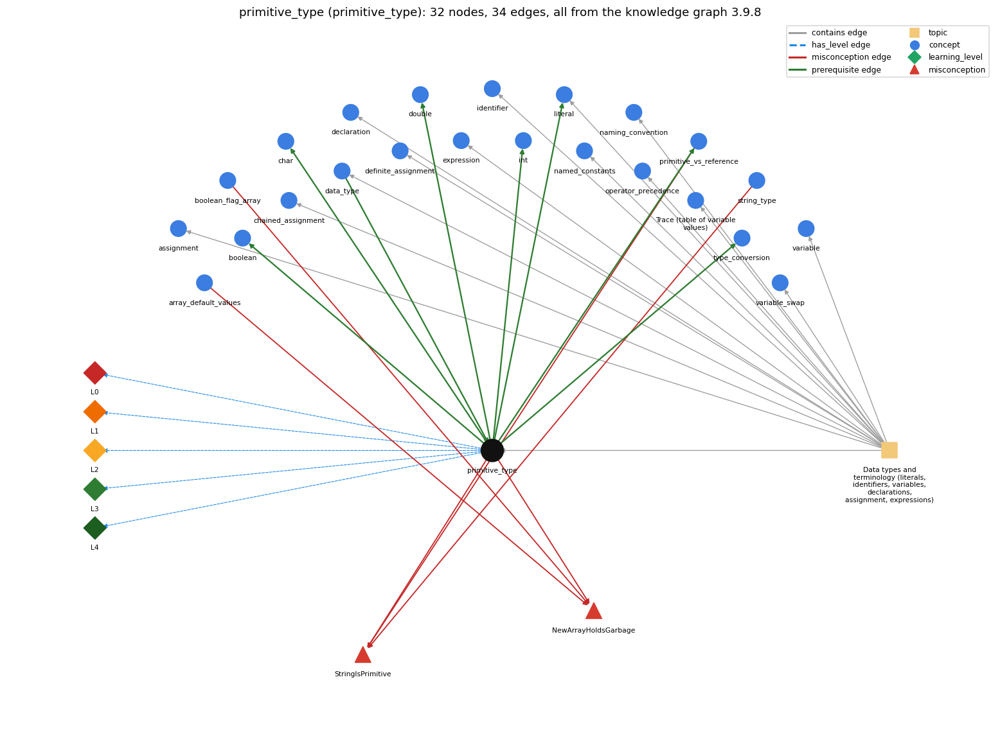

# primitive_type (`primitive_type`)

int, double, boolean, char

Section 1.2 Built-in Types of Data, topic 1.2.a Data types and terminology (literals, identifiers, variables, declarations, assignment, expressions).

## At a glance

- **Needs first:** `data_type`
- **Leads to:** `boolean`, `char`, `double`, `int`, `literal`, `primitive_vs_reference`, `type_conversion`
- **Learned alongside:** nothing
- **Misconceptions:** `NewArrayHoldsGarbage`, `StringIsPrimitive`
- **Errors:** none
- **Levels:** L0, L1, L2, L3, L4

Everything below comes from the knowledge graph 3.9.8 (`data/raw/chapter1_kg_updated.json`): 34 edges around this concept. The edge logic, the wrong and right rules and the exact rules of the ways are copied word for word from the graph.

## To work on (0)

Nothing is missing for this concept.

## What it needs first (1)

A prerequisite edge means the other concept has to be understood before `primitive_type`.

### `data_type` comes before `primitive_type`

*a set of values and the operations defined on them*

- **Edge:** `pre:data_type->primitive_type`
- **Exact edge logic:** Java has eight primitive data types (boolean, char, byte, short, int, long, float, double); each, like any data type, is a set of values and a set of operations on those values.
- **Grounding:** book\_passage
- **Composition rule (R) of `primitive_type` with `data_type`:** Each primitive type is a data type: a fixed set of values plus the operators defined for them.
- **Composition rule (R) of `data_type` with `primitive_type`:** The eight primitive types are Java's built-in data types. Each one fixes its own values and operators (boolean has &amp;&amp; \|\| !, int has + - \* / %), so which operators are legal in an expression depends on which primitive type its operands have.

## What it leads to (7)

These concepts need `primitive_type` first.

### `primitive_type` comes before `boolean`

*true/false primitive*

- **Edge:** `pre:primitive_type->boolean`
- **Exact edge logic:** boolean is one of the eight primitive types, the one used for true-false values.
- **Grounding:** book\_passage
- **Composition rule (R) of `primitive_type` with `boolean`:** boolean is the primitive with only true and false. It does not mix with numeric primitives: it cannot be cast to them, and only booleans may be used as conditions.
- **Composition rule (R) of `boolean` with `primitive_type`:** boolean is one of the eight primitive types and the only non-numeric one.

### `primitive_type` comes before `char`

*16-bit character primitive*

- **Edge:** `pre:primitive_type->char`
- **Exact edge logic:** char is one of the eight primitive types, the one used for single characters.
- **Grounding:** book\_passage
- **Composition rule (R) of `primitive_type` with `char`:** char is an integral primitive (16-bit unsigned UTF-16 code unit), so a char takes part in arithmetic as its numeric code.
- **Composition rule (R) of `char` with `primitive_type`:** char is one of the eight primitive types: the unsigned 16-bit integral one, used for single characters.

### `primitive_type` comes before `double`

*64-bit floating-point primitive*

- **Edge:** `pre:primitive_type->double`
- **Exact edge logic:** double is one of the eight primitive types, the one used for real (floating-point) numbers.
- **Grounding:** book\_passage
- **Composition rule (R) of `primitive_type` with `double`:** double is the 64-bit IEEE 754 primitive. Once a double meets an integral operand in a binary operator, the whole operation becomes floating point.
- **Composition rule (R) of `double` with `primitive_type`:** double is one of the eight primitive types and the default type of decimal literals (float would need an f suffix and is not used in the book).

### `primitive_type` comes before `int`

*32-bit integer primitive*

- **Edge:** `pre:primitive_type->int`
- **Exact edge logic:** int is one of the eight primitive types, the one used for integers.
- **Grounding:** book\_passage
- **Composition rule (R) of `primitive_type` with `int`:** int is the 32-bit signed integral primitive. Arithmetic on byte, short and char is also carried out in int.
- **Composition rule (R) of `int` with `primitive_type`:** int is the 32-bit integral primitive type, and the default type for integer literals and arithmetic.

### `primitive_type` comes before `literal`

*a constant value written in code (42, 3.14, true, 'a', "hi")*

- **Edge:** `pre:primitive_type->literal`
- **Exact edge logic:** A literal is the source-code form of a value of some type, and the way it is written fixes that type: 1234 is an int, 3.14 a double, true a boolean, 'c' a char.
- **Grounding:** book\_passage
- **Composition rule (R) of `primitive_type` with `literal`:** How a literal is written fixes its primitive type (1234 int, 3.14 double, true boolean, 'c' char), and it must fit the primitive type of the variable it initializes.
- **Composition rule (R) of `literal` with `primitive_type`:** The form of a literal selects its primitive type, and that type must be assignable to the target: int x = 3.0; does not compile even though 3.0 is a whole number.

### `primitive_type` comes before `primitive_vs_reference`

*a primitive variable holds its value; an array (or String) variable holds a reference to the object stored elsewhere*

- **Edge:** `pre:primitive_type->primitive_vs_reference`
- **Exact edge logic:** A variable of a primitive type stores the value itself in its own memory.
- **Grounding:** book\_passage
- **Composition rule (R) of `primitive_vs_reference` with `primitive_type`:** The eight primitive types are the ones whose variables hold the value itself.

### `primitive_type` comes before `type_conversion`

*implicit widening and explicit (cast)*

- **Edge:** `pre:primitive_type->type_conversion`
- **Exact edge logic:** Conversion moves a value between primitive types: int to double happens automatically, while double to int needs a cast that drops the fraction.
- **Grounding:** book\_passage
- **Composition rule (R) of `primitive_type` with `type_conversion`:** Between numeric primitive types, widening (int to double) happens automatically, while narrowing (double to int) needs a cast that drops information. boolean converts to no numeric type.
- **Composition rule (R) of `type_conversion` with `primitive_type`:** Conversions between primitive types follow their ranges: int to double happens automatically, double to int needs a cast that drops the fraction, and boolean converts to no numeric type.

## Learned alongside (0)

A parallel edge joins two concepts that sit side by side: neither is needed before the other.

No parallel edge touches this concept.

## Misconceptions (2)

A misconception edge states the wrong rule a student may hold about this concept, and the right rule.

### NewArrayHoldsGarbage

- **Edge:** `primitive_type` &rarr; `NewArrayHoldsGarbage` (misconception)
- **Exact edge logic (the wrong rule):** The slots of a new int[n] hold unpredictable values until assigned.
- **Twin logic (the right rule):** new fills every element with a default: 0 for numeric types, false for boolean, null for String and other non-primitive types.
- **Wrong belief (on the node):** The slots of a new int[n] hold unpredictable values until assigned.
- **Correct rule (on the node):** new fills every element with a default: 0 for numeric types, false for boolean, null for String and other non-primitive types.
- **Provenance:** published
- **Role of this concept:** context
- **L0 way linked to it:** yes
- **L0 way [3] misconception, exact rule:** wrong rule: The slots of a new int[n] hold unpredictable values until assigned. Right rule: new fills every element with a default: 0 for numeric types, false for boolean, null for String and other non-primitive types.
- **Edge `array_default_values` &rarr; `NewArrayHoldsGarbage`, exact edge logic:** The slots of a new int[n] hold unpredictable values until assigned. **Twin logic:** new fills every element with a default: 0 for numeric types, false for boolean, null for String and other non-primitive types. (role: primary)
- **Edge `boolean_flag_array` &rarr; `NewArrayHoldsGarbage`, exact edge logic:** The slots of a new int[n] hold unpredictable values until assigned. **Twin logic:** new fills every element with a default: 0 for numeric types, false for boolean, null for String and other non-primitive types. (role: context)

### StringIsPrimitive

- **Edge:** `primitive_type` &rarr; `StringIsPrimitive` (misconception)
- **Exact edge logic (the wrong rule):** String is a primitive type like int.
- **Twin logic (the right rule):** String is not a primitive type; it is a class whose values are objects, although Java gives it some built-in support (literals, +).
- **Wrong belief (on the node):** String is a primitive type like int.
- **Correct rule (on the node):** String is not a primitive type; it is a class whose values are objects, although Java gives it some built-in support (literals, +).
- **Provenance:** derived
- **Role of this concept:** primary
- **L0 way linked to it:** yes
- **L0 way [1] misconception, exact rule:** wrong rule: String is a primitive type like int. Right rule: String is not a primitive type; it is a class whose values are objects, although Java gives it some built-in support (literals, +).
- **L0 way [2] inconsistent\_trace, exact rule:** Points to LT (each operation is done in its type's fixed size). Applied unevenly, a student truncates and wraps int results on one line but treats another int intermediate as an unbounded real number, e.g. tracing 59 / 60 \* 100 as 98. (here mixing in: "String is a primitive type like int")
- **Edge `primitive_vs_reference` &rarr; `StringIsPrimitive`, exact edge logic:** String is a primitive type like int. **Twin logic:** String is not a primitive type; it is a class whose values are objects, although Java gives it some built-in support (literals, +). (role: context)
- **Edge `string_type` &rarr; `StringIsPrimitive`, exact edge logic:** String is a primitive type like int. **Twin logic:** String is not a primitive type; it is a class whose values are objects, although Java gives it some built-in support (literals, +). (role: context)

## Errors (0)

An error edge states the rule that gets broken in a program, and the right rule.

The graph has no error edge from this concept.

## Levels L0 to L4 (5 of 5)

Each level edge lists the ways a student shows that level, each with its exact rule.

### L0: Prestructural / sensorimotor

L0 for primitive type: the answer holds a rule that contradicts Java.

*Deciding question: Does every rule the answer applies to primitive type agree with the language rule? If it reads the code with everyday meanings, applies a wrong rule, or switches rules within one trace, it is L0. A slip in an otherwise rule-correct trace is L2 with an error, not L0.*

- **Edge:** `primitive_type` &rarr; `primitive_type@L0` (has_level)
- **Exact edge logic:** primitive type -&gt; L0 (Prestructural): the answer holds a rule that contradicts Java (4 ways).

Ways (4), each with its exact rule:

- **[0] everyday\_reading** (rule type E, folk-meaning rule): In English 'primitive' means crude or old-fashioned, which suggests these are a lesser type or that anything simple-looking (String) is primitive. In Java a primitive type is one of eight types predefined by the language and named by a keyword. It holds a plain value of fixed size, so it has no methods and no overflow checking.
- **[1] misconception** (rule type M, wrong rule / right rule) &rarr; `StringIsPrimitive`: wrong rule: String is a primitive type like int. Right rule: String is not a primitive type; it is a class whose values are objects, although Java gives it some built-in support (literals, +).
- **[2] inconsistent\_trace** (rule type T, uneven-application rule) &rarr; `StringIsPrimitive`: Points to LT (each operation is done in its type's fixed size). Applied unevenly, a student truncates and wraps int results on one line but treats another int intermediate as an unbounded real number, e.g. tracing 59 / 60 \* 100 as 98. (here mixing in: "String is a primitive type like int")
- **[3] misconception** (rule type M, wrong rule / right rule) &rarr; `NewArrayHoldsGarbage`: wrong rule: The slots of a new int[n] hold unpredictable values until assigned. Right rule: new fills every element with a default: 0 for numeric types, false for boolean, null for String and other non-primitive types.

### L1: Unistructural / atom x text surface

L1 for primitive type: the answer states one correct rule without applying it.

*Deciding question: Does the answer cover every part of the code, in order, with the values (L2)? If it covers one part or only states the rule, it is L1.*

- **Edge:** `primitive_type` &rarr; `primitive_type@L1` (has_level)
- **Exact edge logic:** primitive type -&gt; L1 (Unistructural): the answer states one correct rule without applying it (2 ways).

Ways (2), each with its exact rule:

- **[0] names\_the\_element** (rule type N, identity rule): Primitive type: one of Java's eight built-in data types (boolean, char, byte, short, int, long, float, double). Its values are simple values, not objects.
- **[1] states\_the\_rule** (rule type S, declarative rule): byte, short, int and long are 8/16/32/64-bit signed two's-complement integers. char is 16-bit unsigned. float and double are IEEE 754 32-bit and 64-bit. boolean has exactly the values true and false. The other four primitive types are byte and short (smaller integers), long (64-bit integers) and float (32-bit floating point).

### L2: Multistructural / block x execution / preoperational

L2 for primitive type: the answer applies these rules to every part of the code, in order.

*Deciding question: Is the answer many segments mapped onto lines (L2), or one segment stating the purpose of the whole (L3)? A correct output with no value-by-value justification is not levelled.*

- **Edge:** `primitive_type` &rarr; `primitive_type@L2` (has_level)
- **Exact edge logic:** primitive type -&gt; L2 (Multistructural): the answer applies the rules of primitive type to every part of the code, in order (3 ways).

Ways (3), each with its exact rule:

- **[0] line\_by\_line\_trace** (rule type LT, operational sequencing rule): In an expression over primitives, the left operand is evaluated, then the right one. Both are then promoted to a common type (at least int, or long or double if either operand has that type), and the operator is applied in that type.
- **[1] output\_prediction** (rule type OP, evaluation / result rule): The result is a primitive value whose type comes from promotion: byte, short, char and int combinations give int, any long operand gives long, and any double operand gives double (e.g. 'a' + 1 is int 98, 1 + 2L is long 3, 1 + 2.0 is double 3.0).
- **[2] one\_step\_execution** (rule type OS, state-transition rule): Assigning to a primitive variable copies the value into it. After int b = a; a = 3;, b still holds the old value because nothing is shared (unlike array references).

### L3: Relational / relations x function (concrete operational begins)

L3 for primitive type: the answer relates the parts by these rules.

*Deciding question: Was the purpose deduced from the code, or only guessed from traced input/output pairs (then L2)? Does the answer stay within the given code (L3), or reason about changed code, an error class or a new program (L4)?*

- **Edge:** `primitive_type` &rarr; `primitive_type@L3` (has_level)
- **Exact edge logic:** primitive type -&gt; L3 (Relational): the answer relates the parts (9 ways).

Ways (9), each with its exact rule:

- **[0] relation\_to\_neighbour** (rule type R, composition rule (with a neighbour)): How a literal is written fixes its primitive type (1234 int, 3.14 double, true boolean, 'c' char), and it must fit the primitive type of the variable it initializes.
- **[1] relation\_to\_neighbour** (rule type R, composition rule (with a neighbour)): Between numeric primitive types, widening (int to double) happens automatically, while narrowing (double to int) needs a cast that drops information. boolean converts to no numeric type.
- **[2] relation\_to\_neighbour** (rule type R, composition rule (with a neighbour)): Each primitive type is a data type: a fixed set of values plus the operators defined for them.
- **[3] relation\_to\_neighbour** (rule type R, composition rule (with a neighbour)): int is the 32-bit signed integral primitive. Arithmetic on byte, short and char is also carried out in int.
- **[4] relation\_to\_neighbour** (rule type R, composition rule (with a neighbour)): double is the 64-bit IEEE 754 primitive. Once a double meets an integral operand in a binary operator, the whole operation becomes floating point.
- **[5] relation\_to\_neighbour** (rule type R, composition rule (with a neighbour)): boolean is the primitive with only true and false. It does not mix with numeric primitives: it cannot be cast to them, and only booleans may be used as conditions.
- **[6] relation\_to\_neighbour** (rule type R, composition rule (with a neighbour)): char is an integral primitive (16-bit unsigned UTF-16 code unit), so a char takes part in arithmetic as its numeric code.
- **[7] relation\_to\_neighbour** (rule type R, composition rule (with a neighbour)): A variable of a primitive type stores the value itself in its own memory.
- **[8] purpose\_of\_the\_whole** (rule type P, plan / role rule): Primitive types hold the single numbers, characters and truth values that every computation is built from. You pick the one that matches the quantity: int for counts, double for measurements, boolean for conditions, char for one character.

### L4: Extended abstract (concrete-operational reversibility and conservation)

L4 for primitive type: the answer reasons beyond the given code by these rules.

*Deciding question: Does the answer link the code to a broader context: a changed program, a class of inputs, an unseen problem? Re-tracing changed code value by value is L2; fixing one given failing case is L3.*

- **Edge:** `primitive_type` &rarr; `primitive_type@L4` (has_level)
- **Exact edge logic:** primitive type -&gt; L4 (Extended abstract): the answer reasons beyond the given code (5 ways).

Ways (5), each with its exact rule:

- **[0] predict\_a\_change** (rule type C, conservation rule) &rarr; `StringIsPrimitive`: Switching one primitive type for another changes range and precision. int to long removes overflow up to about 9.2e18. int to double keeps fractions but stops being exact for very large integers. Changing a type to boolean breaks every arithmetic use.
- **[1] transfer\_to\_a\_new\_program** (rule type X, applicability rule): Use a primitive type for a single numeric, character or true/false value. Use String for text, arrays for collections, BigInteger for integers beyond long, and int cents rather than double when money must be exact.
- **[2] diagnose\_an\_error** (rule type D, error rule): rule broken: A narrowing primitive conversion needs an explicit cast. Kind: compile-time. Trigger class: Storing a double or long value in an int (or an int in a char) without a cast: 'possible lossy conversion'.
- **[3] diagnose\_an\_error** (rule type D, error rule): rule broken: Integer primitives have fixed ranges and integer operators do not report overflow. Kind: silent logic error. Trigger class: Any int or long result outside the type's range (large products, factorials): the stored value has wrapped around.
- **[4] diagnose\_an\_error** (rule type D, error rule): rule broken: Primitive type names are lowercase keywords. Kind: compile-time. Trigger class: Writing Int, Double or Boolean where int, double or boolean was meant, or string for String: 'cannot find symbol' or a type mismatch.

## Same topic

`primitive_type` belongs to the topic **Data types and terminology (literals, identifiers, variables, declarations, assignment, expressions)** (`topic1.2.a`). The topic also contains: `assignment`, `chained_assignment`, `data_type`, `declaration`, `definite_assignment`, `expression`, `identifier`, `literal`, `named_constants`, `naming_convention`, `operator_precedence`, `program_trace`, `variable`, `variable_swap`.

## Rules of the concept (22)

- **Book** (SW-1e, p. 34 (pdf 44)): "Java has eight primitive data types: boolean, char, byte, short, int, long, float, and double."
- **Book** (OT-Datatypes, ): "A primitive type is predefined by the language and is named by a reserved keyword."
- **Book** (SW-1.2, ): "A data type is a set of values and a set of operations defined on them."
- **E** (folk-meaning rule): In English 'primitive' means crude or old-fashioned, which suggests these are a lesser type or that anything simple-looking (String) is primitive. In Java a primitive type is one of eight types predefined by the language and named by a keyword. It holds a plain value of fixed size, so it has no methods and no overflow checking.
- **M** (wrong rule / right rule): NewArrayHoldsGarbage: wrong: The slots of a new int[n] hold unpredictable values until assigned. \| right: new fills every element with a default: 0 for numeric types, false for boolean, null for String and other non-primitive types.
- **M** (wrong rule / right rule): StringIsPrimitive: wrong: String is a primitive type like int. \| right: String is not a primitive type; it is a class whose values are objects, although Java gives it some built-in support (literals, +).
- **T** (uneven-application rule): Points to LT (each operation is done in its type's fixed size). Applied unevenly, a student truncates and wraps int results on one line but treats another int intermediate as an unbounded real number, e.g. tracing 59 / 60 \* 100 as 98.
- **N** (identity rule): Primitive type: one of Java's eight built-in data types (boolean, char, byte, short, int, long, float, double). Its values are simple values, not objects.
- **S** (declarative rule): byte, short, int and long are 8/16/32/64-bit signed two's-complement integers. char is 16-bit unsigned. float and double are IEEE 754 32-bit and 64-bit. boolean has exactly the values true and false. The other four primitive types are byte and short (smaller integers), long (64-bit integers) and float (32-bit floating point).
- **LT** (operational sequencing rule): In an expression over primitives, the left operand is evaluated, then the right one. Both are then promoted to a common type (at least int, or long or double if either operand has that type), and the operator is applied in that type.
- **OP** (evaluation / result rule): The result is a primitive value whose type comes from promotion: byte, short, char and int combinations give int, any long operand gives long, and any double operand gives double (e.g. 'a' + 1 is int 98, 1 + 2L is long 3, 1 + 2.0 is double 3.0).
- **OS** (state-transition rule): Assigning to a primitive variable copies the value into it. After int b = a; a = 3;, b still holds the old value because nothing is shared (unlike array references).
- **R** (composition rule (with a neighbour)): with literal: How a literal is written fixes its primitive type (1234 int, 3.14 double, true boolean, 'c' char), and it must fit the primitive type of the variable it initializes.
- **R** (composition rule (with a neighbour)): with type\_conversion: Between numeric primitive types, widening (int to double) happens automatically, while narrowing (double to int) needs a cast that drops information. boolean converts to no numeric type.
- **R** (composition rule (with a neighbour)): with data\_type: Each primitive type is a data type: a fixed set of values plus the operators defined for them.
- **R** (composition rule (with a neighbour)): with int: int is the 32-bit signed integral primitive. Arithmetic on byte, short and char is also carried out in int.
- **R** (composition rule (with a neighbour)): with double: double is the 64-bit IEEE 754 primitive. Once a double meets an integral operand in a binary operator, the whole operation becomes floating point.
- **R** (composition rule (with a neighbour)): with boolean: boolean is the primitive with only true and false. It does not mix with numeric primitives: it cannot be cast to them, and only booleans may be used as conditions.
- **R** (composition rule (with a neighbour)): with char: char is an integral primitive (16-bit unsigned UTF-16 code unit), so a char takes part in arithmetic as its numeric code.
- **P** (plan / role rule): Primitive types hold the single numbers, characters and truth values that every computation is built from. You pick the one that matches the quantity: int for counts, double for measurements, boolean for conditions, char for one character.
- **C** (conservation rule): Switching one primitive type for another changes range and precision. int to long removes overflow up to about 9.2e18. int to double keeps fractions but stops being exact for very large integers. Changing a type to boolean breaks every arithmetic use.
- **D** (error rule): rule broken: A narrowing primitive conversion needs an explicit cast. (compile-time)
- **D** (error rule): rule broken: Integer primitives have fixed ranges and integer operators do not report overflow. (silent logic error)
- **D** (error rule): rule broken: Primitive type names are lowercase keywords. (compile-time)
- **X** (applicability rule): Use a primitive type for a single numeric, character or true/false value. Use String for text, arrays for collections, BigInteger for integers beyond long, and int cents rather than double when money must be exact.

## How it is found in code and answers (reader block)

- **Aliases:** primitive, primitive type, primitives
- **Code patterns:** `\b(?:int|double|boolean|char|long|float|short|byte)\b`
- **Operator symbols:** none
- **Java types:** none

## The whole prerequisite chain

- **Everything it builds on (1):** `data_type`
- **Everything that builds on it (100):** `accumulator_pattern`, `animation`, `api`, `array_copy`, `array_exchange`, `array_reversal`, `array_traversal`, `assignment`, `boolean`, `boolean_expression`, `boolean_flag_array`, `break_statement`, `chained_assignment`, `char`, `char_arithmetic`, `comparison_operators`, `compound_assignment`, `conditional_operator`, `continue_statement`, `convergence_rate`, `convergence_test`, `coordinate_scaling`, `counter_pattern`, `dangling_else`, `de_morgan`, `debugging`, `division_by_zero`, `do_while_loop`, `double`, `drawing_shapes`, `else_if_chain`, `enhanced_for`, `exclusive_or`, `explicit_cast`, `expression`, `fencepost_loop`, `flag_search_loop`, `floating_point_precision`, `for_loop`, `frequency_counting`, `function_plotting`, `if_else_statement`, `if_statement`, `increment_operators`, `infinite_loop`, `int`, `int_literal_limit`, `integer_constants`, `labeled_break`, `literal`, `logical_operators`, `long_type`, `loop_body`, `loop_control`, `loop_invariant_reasoning`, `loop_performance`, `loop_scope`, `loop_variable`, `math_library`, `math_random`, `math_round`, `matrix_operations`, `method_call`, `monte_carlo_simulation`, `mouse_interaction`, `named_constants`, `naming_convention`, `nested_conditionals`, `nested_loops`, `number_conversion`, `off_by_one_error`, `operator_precedence`, `overflow`, `power_method`, `primitive_vs_reference`, `program_state`, `program_trace`, `random_move`, `row_major_order`, `run_time_error`, `running_extreme`, `sampling_without_replacement`, `scientific_notation`, `sentinel_loop`, `short_circuit`, `shuffle`, `side_effect_order`, `simulation_loop`, `standard_audio`, `standard_drawing`, `switch_statement`, `syntax_template`, `testing`, `trig_functions`, `two_models`, `type_conversion`, `variable`, `variable_swap`, `while_loop`, `widening_conversion`

## Every edge in this view and its exact edge logic (34)

All the edges drawn in the picture, in the order: prerequisite, parallel, misconception, error, has_level, contains.

**1. `data_type` &rarr; `primitive_type`** (prerequisite)

- **Exact edge logic:** Java has eight primitive data types (boolean, char, byte, short, int, long, float, double); each, like any data type, is a set of values and a set of operations on those values.
- **Grounding:** book\_passage
- **Composition rule (R) of `data_type` with `primitive_type`:** The eight primitive types are Java's built-in data types. Each one fixes its own values and operators (boolean has &amp;&amp; \|\| !, int has + - \* / %), so which operators are legal in an expression depends on which primitive type its operands have.
- **Composition rule (R) of `primitive_type` with `data_type`:** Each primitive type is a data type: a fixed set of values plus the operators defined for them.

**2. `primitive_type` &rarr; `boolean`** (prerequisite)

- **Exact edge logic:** boolean is one of the eight primitive types, the one used for true-false values.
- **Grounding:** book\_passage
- **Composition rule (R) of `primitive_type` with `boolean`:** boolean is the primitive with only true and false. It does not mix with numeric primitives: it cannot be cast to them, and only booleans may be used as conditions.
- **Composition rule (R) of `boolean` with `primitive_type`:** boolean is one of the eight primitive types and the only non-numeric one.

**3. `primitive_type` &rarr; `char`** (prerequisite)

- **Exact edge logic:** char is one of the eight primitive types, the one used for single characters.
- **Grounding:** book\_passage
- **Composition rule (R) of `primitive_type` with `char`:** char is an integral primitive (16-bit unsigned UTF-16 code unit), so a char takes part in arithmetic as its numeric code.
- **Composition rule (R) of `char` with `primitive_type`:** char is one of the eight primitive types: the unsigned 16-bit integral one, used for single characters.

**4. `primitive_type` &rarr; `double`** (prerequisite)

- **Exact edge logic:** double is one of the eight primitive types, the one used for real (floating-point) numbers.
- **Grounding:** book\_passage
- **Composition rule (R) of `primitive_type` with `double`:** double is the 64-bit IEEE 754 primitive. Once a double meets an integral operand in a binary operator, the whole operation becomes floating point.
- **Composition rule (R) of `double` with `primitive_type`:** double is one of the eight primitive types and the default type of decimal literals (float would need an f suffix and is not used in the book).

**5. `primitive_type` &rarr; `int`** (prerequisite)

- **Exact edge logic:** int is one of the eight primitive types, the one used for integers.
- **Grounding:** book\_passage
- **Composition rule (R) of `primitive_type` with `int`:** int is the 32-bit signed integral primitive. Arithmetic on byte, short and char is also carried out in int.
- **Composition rule (R) of `int` with `primitive_type`:** int is the 32-bit integral primitive type, and the default type for integer literals and arithmetic.

**6. `primitive_type` &rarr; `literal`** (prerequisite)

- **Exact edge logic:** A literal is the source-code form of a value of some type, and the way it is written fixes that type: 1234 is an int, 3.14 a double, true a boolean, 'c' a char.
- **Grounding:** book\_passage
- **Composition rule (R) of `primitive_type` with `literal`:** How a literal is written fixes its primitive type (1234 int, 3.14 double, true boolean, 'c' char), and it must fit the primitive type of the variable it initializes.
- **Composition rule (R) of `literal` with `primitive_type`:** The form of a literal selects its primitive type, and that type must be assignable to the target: int x = 3.0; does not compile even though 3.0 is a whole number.

**7. `primitive_type` &rarr; `primitive_vs_reference`** (prerequisite)

- **Exact edge logic:** A variable of a primitive type stores the value itself in its own memory.
- **Grounding:** book\_passage
- **Composition rule (R) of `primitive_vs_reference` with `primitive_type`:** The eight primitive types are the ones whose variables hold the value itself.

**8. `primitive_type` &rarr; `type_conversion`** (prerequisite)

- **Exact edge logic:** Conversion moves a value between primitive types: int to double happens automatically, while double to int needs a cast that drops the fraction.
- **Grounding:** book\_passage
- **Composition rule (R) of `primitive_type` with `type_conversion`:** Between numeric primitive types, widening (int to double) happens automatically, while narrowing (double to int) needs a cast that drops information. boolean converts to no numeric type.
- **Composition rule (R) of `type_conversion` with `primitive_type`:** Conversions between primitive types follow their ranges: int to double happens automatically, double to int needs a cast that drops the fraction, and boolean converts to no numeric type.

**9. `primitive_type` &rarr; `NewArrayHoldsGarbage`** (misconception)

- **Exact edge logic (the wrong rule):** The slots of a new int[n] hold unpredictable values until assigned.
- **Twin logic (the right rule):** new fills every element with a default: 0 for numeric types, false for boolean, null for String and other non-primitive types.
- **Role:** context

**10. `primitive_type` &rarr; `StringIsPrimitive`** (misconception)

- **Exact edge logic (the wrong rule):** String is a primitive type like int.
- **Twin logic (the right rule):** String is not a primitive type; it is a class whose values are objects, although Java gives it some built-in support (literals, +).
- **Role:** primary

**11. `array_default_values` &rarr; `NewArrayHoldsGarbage`** (misconception)

- **Exact edge logic (the wrong rule):** The slots of a new int[n] hold unpredictable values until assigned.
- **Twin logic (the right rule):** new fills every element with a default: 0 for numeric types, false for boolean, null for String and other non-primitive types.
- **Role:** primary

**12. `boolean_flag_array` &rarr; `NewArrayHoldsGarbage`** (misconception)

- **Exact edge logic (the wrong rule):** The slots of a new int[n] hold unpredictable values until assigned.
- **Twin logic (the right rule):** new fills every element with a default: 0 for numeric types, false for boolean, null for String and other non-primitive types.
- **Role:** context

**13. `primitive_vs_reference` &rarr; `StringIsPrimitive`** (misconception)

- **Exact edge logic (the wrong rule):** String is a primitive type like int.
- **Twin logic (the right rule):** String is not a primitive type; it is a class whose values are objects, although Java gives it some built-in support (literals, +).
- **Role:** context

**14. `string_type` &rarr; `StringIsPrimitive`** (misconception)

- **Exact edge logic (the wrong rule):** String is a primitive type like int.
- **Twin logic (the right rule):** String is not a primitive type; it is a class whose values are objects, although Java gives it some built-in support (literals, +).
- **Role:** context

**15. `primitive_type` &rarr; `primitive_type@L0`** (has_level)

- **Exact edge logic:** primitive type -&gt; L0 (Prestructural): the answer holds a rule that contradicts Java (4 ways).
  - **[0] everyday\_reading** (rule type E, folk-meaning rule): In English 'primitive' means crude or old-fashioned, which suggests these are a lesser type or that anything simple-looking (String) is primitive. In Java a primitive type is one of eight types predefined by the language and named by a keyword. It holds a plain value of fixed size, so it has no methods and no overflow checking.
  - **[1] misconception** (rule type M, wrong rule / right rule) &rarr; `StringIsPrimitive`: wrong rule: String is a primitive type like int. Right rule: String is not a primitive type; it is a class whose values are objects, although Java gives it some built-in support (literals, +).
  - **[2] inconsistent\_trace** (rule type T, uneven-application rule) &rarr; `StringIsPrimitive`: Points to LT (each operation is done in its type's fixed size). Applied unevenly, a student truncates and wraps int results on one line but treats another int intermediate as an unbounded real number, e.g. tracing 59 / 60 \* 100 as 98. (here mixing in: "String is a primitive type like int")
  - **[3] misconception** (rule type M, wrong rule / right rule) &rarr; `NewArrayHoldsGarbage`: wrong rule: The slots of a new int[n] hold unpredictable values until assigned. Right rule: new fills every element with a default: 0 for numeric types, false for boolean, null for String and other non-primitive types.

**16. `primitive_type` &rarr; `primitive_type@L1`** (has_level)

- **Exact edge logic:** primitive type -&gt; L1 (Unistructural): the answer states one correct rule without applying it (2 ways).
  - **[0] names\_the\_element** (rule type N, identity rule): Primitive type: one of Java's eight built-in data types (boolean, char, byte, short, int, long, float, double). Its values are simple values, not objects.
  - **[1] states\_the\_rule** (rule type S, declarative rule): byte, short, int and long are 8/16/32/64-bit signed two's-complement integers. char is 16-bit unsigned. float and double are IEEE 754 32-bit and 64-bit. boolean has exactly the values true and false. The other four primitive types are byte and short (smaller integers), long (64-bit integers) and float (32-bit floating point).

**17. `primitive_type` &rarr; `primitive_type@L2`** (has_level)

- **Exact edge logic:** primitive type -&gt; L2 (Multistructural): the answer applies the rules of primitive type to every part of the code, in order (3 ways).
  - **[0] line\_by\_line\_trace** (rule type LT, operational sequencing rule): In an expression over primitives, the left operand is evaluated, then the right one. Both are then promoted to a common type (at least int, or long or double if either operand has that type), and the operator is applied in that type.
  - **[1] output\_prediction** (rule type OP, evaluation / result rule): The result is a primitive value whose type comes from promotion: byte, short, char and int combinations give int, any long operand gives long, and any double operand gives double (e.g. 'a' + 1 is int 98, 1 + 2L is long 3, 1 + 2.0 is double 3.0).
  - **[2] one\_step\_execution** (rule type OS, state-transition rule): Assigning to a primitive variable copies the value into it. After int b = a; a = 3;, b still holds the old value because nothing is shared (unlike array references).

**18. `primitive_type` &rarr; `primitive_type@L3`** (has_level)

- **Exact edge logic:** primitive type -&gt; L3 (Relational): the answer relates the parts (9 ways).
  - **[0] relation\_to\_neighbour** (rule type R, composition rule (with a neighbour)): How a literal is written fixes its primitive type (1234 int, 3.14 double, true boolean, 'c' char), and it must fit the primitive type of the variable it initializes.
  - **[1] relation\_to\_neighbour** (rule type R, composition rule (with a neighbour)): Between numeric primitive types, widening (int to double) happens automatically, while narrowing (double to int) needs a cast that drops information. boolean converts to no numeric type.
  - **[2] relation\_to\_neighbour** (rule type R, composition rule (with a neighbour)): Each primitive type is a data type: a fixed set of values plus the operators defined for them.
  - **[3] relation\_to\_neighbour** (rule type R, composition rule (with a neighbour)): int is the 32-bit signed integral primitive. Arithmetic on byte, short and char is also carried out in int.
  - **[4] relation\_to\_neighbour** (rule type R, composition rule (with a neighbour)): double is the 64-bit IEEE 754 primitive. Once a double meets an integral operand in a binary operator, the whole operation becomes floating point.
  - **[5] relation\_to\_neighbour** (rule type R, composition rule (with a neighbour)): boolean is the primitive with only true and false. It does not mix with numeric primitives: it cannot be cast to them, and only booleans may be used as conditions.
  - **[6] relation\_to\_neighbour** (rule type R, composition rule (with a neighbour)): char is an integral primitive (16-bit unsigned UTF-16 code unit), so a char takes part in arithmetic as its numeric code.
  - **[7] relation\_to\_neighbour** (rule type R, composition rule (with a neighbour)): A variable of a primitive type stores the value itself in its own memory.
  - **[8] purpose\_of\_the\_whole** (rule type P, plan / role rule): Primitive types hold the single numbers, characters and truth values that every computation is built from. You pick the one that matches the quantity: int for counts, double for measurements, boolean for conditions, char for one character.

**19. `primitive_type` &rarr; `primitive_type@L4`** (has_level)

- **Exact edge logic:** primitive type -&gt; L4 (Extended abstract): the answer reasons beyond the given code (5 ways).
  - **[0] predict\_a\_change** (rule type C, conservation rule) &rarr; `StringIsPrimitive`: Switching one primitive type for another changes range and precision. int to long removes overflow up to about 9.2e18. int to double keeps fractions but stops being exact for very large integers. Changing a type to boolean breaks every arithmetic use.
  - **[1] transfer\_to\_a\_new\_program** (rule type X, applicability rule): Use a primitive type for a single numeric, character or true/false value. Use String for text, arrays for collections, BigInteger for integers beyond long, and int cents rather than double when money must be exact.
  - **[2] diagnose\_an\_error** (rule type D, error rule): rule broken: A narrowing primitive conversion needs an explicit cast. Kind: compile-time. Trigger class: Storing a double or long value in an int (or an int in a char) without a cast: 'possible lossy conversion'.
  - **[3] diagnose\_an\_error** (rule type D, error rule): rule broken: Integer primitives have fixed ranges and integer operators do not report overflow. Kind: silent logic error. Trigger class: Any int or long result outside the type's range (large products, factorials): the stored value has wrapped around.
  - **[4] diagnose\_an\_error** (rule type D, error rule): rule broken: Primitive type names are lowercase keywords. Kind: compile-time. Trigger class: Writing Int, Double or Boolean where int, double or boolean was meant, or string for String: 'cannot find symbol' or a type mismatch.

**20. `topic1.2.a` &rarr; `primitive_type`** (contains)

- topic `topic1.2.a` contains `primitive_type`

**21. `topic1.2.a` &rarr; `assignment`** (contains)

- topic `topic1.2.a` contains `assignment`

**22. `topic1.2.a` &rarr; `chained_assignment`** (contains)

- topic `topic1.2.a` contains `chained_assignment`

**23. `topic1.2.a` &rarr; `data_type`** (contains)

- topic `topic1.2.a` contains `data_type`

**24. `topic1.2.a` &rarr; `declaration`** (contains)

- topic `topic1.2.a` contains `declaration`

**25. `topic1.2.a` &rarr; `definite_assignment`** (contains)

- topic `topic1.2.a` contains `definite_assignment`

**26. `topic1.2.a` &rarr; `expression`** (contains)

- topic `topic1.2.a` contains `expression`

**27. `topic1.2.a` &rarr; `identifier`** (contains)

- topic `topic1.2.a` contains `identifier`

**28. `topic1.2.a` &rarr; `literal`** (contains)

- topic `topic1.2.a` contains `literal`

**29. `topic1.2.a` &rarr; `named_constants`** (contains)

- topic `topic1.2.a` contains `named_constants`

**30. `topic1.2.a` &rarr; `naming_convention`** (contains)

- topic `topic1.2.a` contains `naming_convention`

**31. `topic1.2.a` &rarr; `operator_precedence`** (contains)

- topic `topic1.2.a` contains `operator_precedence`

**32. `topic1.2.a` &rarr; `program_trace`** (contains)

- topic `topic1.2.a` contains `program_trace`

**33. `topic1.2.a` &rarr; `variable`** (contains)

- topic `topic1.2.a` contains `variable`

**34. `topic1.2.a` &rarr; `variable_swap`** (contains)

- topic `topic1.2.a` contains `variable_swap`
