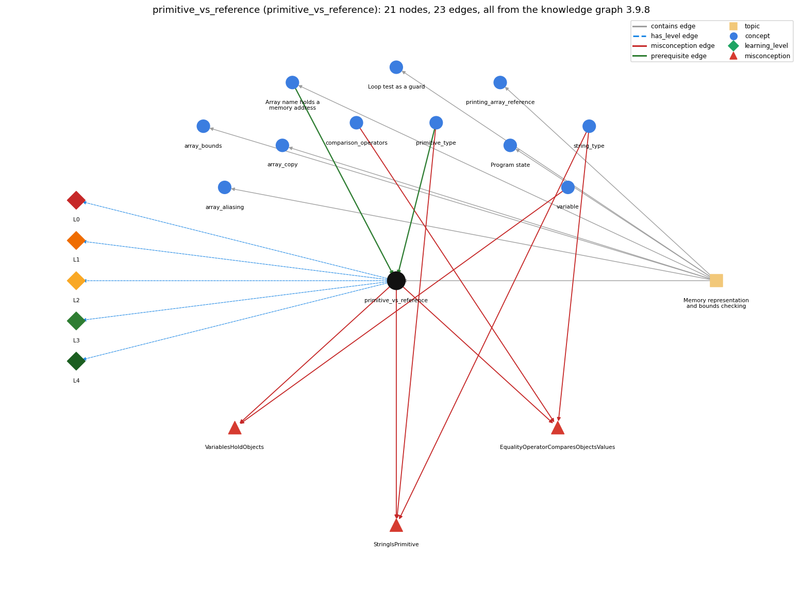

# primitive_vs_reference (`primitive_vs_reference`)

a primitive variable holds its value; an array (or String) variable holds a reference to the object stored elsewhere

Section 1.4 Arrays, topic 1.4.b Memory representation and bounds checking.

## At a glance

- **Needs first:** `array_reference`, `primitive_type`
- **Leads to:** nothing
- **Learned alongside:** nothing
- **Misconceptions:** `EqualityOperatorComparesObjectsValues`, `StringIsPrimitive`, `VariablesHoldObjects`
- **Errors:** none
- **Levels:** L0, L1, L2, L3, L4

Everything below comes from the knowledge graph 3.9.8 (`data/raw/chapter1_kg_updated.json`): 23 edges around this concept, each explained in the graph's own words.

## What it needs first (2)

A prerequisite edge means the other concept has to be understood before `primitive_vs_reference`.

### `array_reference` comes before `primitive_vs_reference`

*Array name holds a memory address: the array variable stores the memory address (pointer) of the array; a[i] is found by adding i to that address*

An array variable stores the memory address of the array, not its elements.

- **Grounding:** book passage
- **How `primitive_vs_reference` combines with `array_reference`:** An array variable is the standard example of a reference: its value is the memory address of the array.

### `primitive_type` comes before `primitive_vs_reference`

*int, double, boolean, char*

A variable of a primitive type stores the value itself in its own memory.

- **Grounding:** book passage
- **How `primitive_vs_reference` combines with `primitive_type`:** The eight primitive types are the ones whose variables hold the value itself.

## What it leads to (0)

These concepts need `primitive_vs_reference` first.

No concept has this one as a prerequisite.

## Learned alongside (0)

A parallel edge joins two concepts that sit side by side: neither is needed before the other.

No parallel edge touches this concept.

## Misconceptions (3)

A misconception edge states the wrong rule a student may hold about this concept, and the right rule.

### EqualityOperatorComparesObjectsValues

- **Wrong rule:** == compares contents (the String == bug)
- **Right rule:** s == t is true only when s and t refer to the same object; s.equals(t) compares the text.
- **Role of this concept:** context
- **Also an edge from `comparison_operators`:** s == t is true whenever the two Strings contain the same text.
- **Also an edge from `string_type`:** s == t is true whenever the two Strings contain the same text.

### StringIsPrimitive

- **Wrong rule:** String is a primitive type like int.
- **Right rule:** String is not a primitive type; it is a class whose values are objects, although Java gives it some built-in support (literals, +).
- **Role of this concept:** context
- **Shows at level L0 as:** misconception: wrong rule: String is a primitive type like int. Right rule: Java has eight primitive types; String is not one of them, and a String variable holds a reference.
- **Also an edge from `primitive_type`:** String is a primitive type like int.
- **Also an edge from `string_type`:** String is a primitive type like int.

### VariablesHoldObjects

- **Wrong rule:** a reference variable holds the whole object, not a reference
- **Right rule:** A reference variable holds only a reference to the object, which is stored separately.
- **Role of this concept:** context
- **Shows at level L0 as:** misconception: wrong rule: A reference variable holds the whole object, not a reference. Right rule: An array variable stores a reference (the memory address) to the array, not the elements.
- **Shows at level L0 as:** inconsistent trace: Applies the model unevenly: treats int x = y as copying a value (correct) but also treats b = a for arrays as copying all the elements. (here mixing in: "a reference variable holds the whole object, not a reference")
- **Also an edge from `variable`:** A String or array variable contains the whole object inside it.

## Errors (0)

An error edge states the rule that gets broken in a program, and the right rule.

The graph has no error edge from this concept.

## Levels L0 to L4 (5 of 5)

Each level edge lists the ways a student shows that level, each with its exact rule.

### L0: Prestructural / sensorimotor

L0 for primitive vs reference: the answer holds a rule that contradicts Java.

*Deciding question: Does every rule the answer applies to primitive vs reference agree with the language rule? If it reads the code with everyday meanings, applies a wrong rule, or switches rules within one trace, it is L0. A slip in an otherwise rule-correct trace is L2 with an error, not L0.*

primitive vs reference -&gt; L0 (Prestructural): the answer holds a rule that contradicts Java (4 ways).

- **everyday reading** (folk-meaning rule): Everyday thinking pictures a variable as a box that holds the thing itself. That is true for int, double, char and boolean; an array variable holds only the address of the array, which is stored elsewhere.
- **misconception** (wrong rule / right rule; shows `VariablesHoldObjects`): wrong rule: A reference variable holds the whole object, not a reference. Right rule: An array variable stores a reference (the memory address) to the array, not the elements.
- **inconsistent trace** (uneven-application rule; shows `VariablesHoldObjects`): Applies the model unevenly: treats int x = y as copying a value (correct) but also treats b = a for arrays as copying all the elements. (here mixing in: "a reference variable holds the whole object, not a reference")
- **misconception** (wrong rule / right rule; shows `StringIsPrimitive`): wrong rule: String is a primitive type like int. Right rule: Java has eight primitive types; String is not one of them, and a String variable holds a reference.

### L1: Unistructural / atom x text surface

L1 for primitive vs reference: the answer states one correct rule without applying it.

*Deciding question: Does the answer cover every part of the code, in order, with the values (L2)? If it covers one part or only states the rule, it is L1.*

primitive vs reference -&gt; L1 (Unistructural): the answer states one correct rule without applying it (2 ways).

- **names the element** (identity rule): Primitive versus reference variable: the first holds its value, the second holds the address of an object.
- **states the rule** (declarative rule): When you declare a variable of a primitive type, Java reserves memory that stores its value. An array variable stores a reference to the array: Java treats the array name as a variable whose value is the memory address of the array.

### L2: Multistructural / block x execution / preoperational

L2 for primitive vs reference: the answer applies these rules to every part of the code, in order.

*Deciding question: Is the answer many segments mapped onto lines (L2), or one segment stating the purpose of the whole (L3)? A correct output with no value-by-value justification is not levelled.*

primitive vs reference -&gt; L2 (Multistructural): the answer applies the rules of primitive vs reference to every part of the code, in order (3 ways).

- **line by line trace** (operational sequencing rule): Sequencing: x = y copies the value of y into x; b = a copies the address in a into b. In both cases the right side is evaluated first and its value stored, but the value of an array variable is an address.
- **output prediction** (evaluation / result rule): Result: after int y = x; y++, x is unchanged; after int[] b = a; b[0]++, a[0] has changed too, because a and b refer to the same array.
- **one step execution** (state-transition rule): State transition: assigning to a primitive variable changes only that variable; assigning to an element through a reference changes the array that every reference to it sees.

### L3: Relational / relations x function (concrete operational begins)

L3 for primitive vs reference: the answer relates the parts by these rules.

*Deciding question: Was the purpose deduced from the code, or only guessed from traced input/output pairs (then L2)? Does the answer stay within the given code (L3), or reason about changed code, an error class or a new program (L4)?*

primitive vs reference -&gt; L3 (Relational): the answer relates the parts (3 ways).

- **relation to neighbour** (composition rule (with a neighbour)): The eight primitive types are the ones whose variables hold the value itself.
- **relation to neighbour** (composition rule (with a neighbour)): An array variable is the standard example of a reference: its value is the memory address of the array.
- **purpose of the whole** (plan / role rule): Plan: the model predicts when an assignment shares data (arrays, Strings) and when it copies it (primitives), which decides when a copy is needed.

### L4: Extended abstract (concrete-operational reversibility and conservation)

L4 for primitive vs reference: the answer reasons beyond the given code by these rules.

*Deciding question: Does the answer link the code to a broader context: a changed program, a class of inputs, an unseen problem? Re-tracing changed code value by value is L2; fixing one given failing case is L3.*

primitive vs reference -&gt; L4 (Extended abstract): the answer reasons beyond the given code (3 ways).

- **predict a change** (conservation rule; shows `VariablesHoldObjects`): Conservation: changing a primitive copy never affects the original; changing an array through any reference affects every alias.
- **transfer to a new program** (applicability rule): Draw a memory diagram (value in a box for primitives, an arrow to the array for references) whenever code assigns or compares arrays.
- **diagnose an error** (error rule): rule broken: == on references compares addresses. Kind: silent logic error. Trigger class: two arrays with the same elements are compared with == and found unequal (or two Strings with the same text)

## Same topic

`primitive_vs_reference` belongs to the topic **Memory representation and bounds checking** (`topic1.4.b`). The topic also contains: `array_aliasing`, `array_bounds`, `array_copy`, `array_reference`, `loop_guard`, `printing_array_reference`, `program_state`.

## Rules of the concept (15)

- **folk-meaning rule:** Everyday thinking pictures a variable as a box that holds the thing itself. That is true for int, double, char and boolean; an array variable holds only the address of the array, which is stored elsewhere.
- **wrong rule / right rule:** VariablesHoldObjects: wrong: A reference variable holds the whole object, not a reference. \| right: An array variable stores a reference (the memory address) to the array, not the elements.
- **wrong rule / right rule:** StringIsPrimitive: wrong: String is a primitive type like int. \| right: Java has eight primitive types; String is not one of them, and a String variable holds a reference.
- **uneven-application rule:** Applies the model unevenly: treats int x = y as copying a value (correct) but also treats b = a for arrays as copying all the elements.
- **identity rule:** Primitive versus reference variable: the first holds its value, the second holds the address of an object.
- **declarative rule:** When you declare a variable of a primitive type, Java reserves memory that stores its value. An array variable stores a reference to the array: Java treats the array name as a variable whose value is the memory address of the array.
- **operational sequencing rule:** Sequencing: x = y copies the value of y into x; b = a copies the address in a into b. In both cases the right side is evaluated first and its value stored, but the value of an array variable is an address.
- **evaluation / result rule:** Result: after int y = x; y++, x is unchanged; after int[] b = a; b[0]++, a[0] has changed too, because a and b refer to the same array.
- **state-transition rule:** State transition: assigning to a primitive variable changes only that variable; assigning to an element through a reference changes the array that every reference to it sees.
- **composition rule (with a neighbour):** with primitive\_type: The eight primitive types are the ones whose variables hold the value itself.
- **composition rule (with a neighbour):** with array\_reference: An array variable is the standard example of a reference: its value is the memory address of the array.
- **plan / role rule:** Plan: the model predicts when an assignment shares data (arrays, Strings) and when it copies it (primitives), which decides when a copy is needed.
- **conservation rule:** Conservation: changing a primitive copy never affects the original; changing an array through any reference affects every alias.
- **error rule:** rule broken: == on references compares addresses. (silent logic error)
- **applicability rule:** Draw a memory diagram (value in a box for primitives, an arrow to the array for references) whenever code assigns or compares arrays.

## The whole prerequisite chain

- **Everything it builds on (6):** `array_creation`, `array_declaration`, `array_reference`, `data_structure`, `data_type`, `primitive_type`
- **Everything that builds on it (0):** nothing
