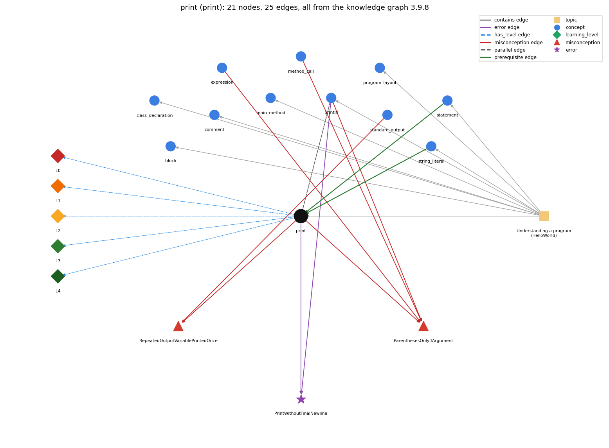

# print (`print`)

System.out.print -- output with no newline

Section 1.1 Your First Program, topic 1.1.b Understanding a program (HelloWorld). From the knowledge graph 3.9.8 (`data/raw/chapter1_kg_updated.json`).

## Concepts associated with print (11)

| Concept | Description | How it is associated |
| --- | --- | --- |
| **block** | { ... } grouping statements | same topic (topic1.1.b) |
| **class\_declaration** | public class Name { ... } -- the outer container | same topic (topic1.1.b) |
| **comment** | // and /\* \*/ text that the compiler ignores | same topic (topic1.1.b) |
| **expression** | anything that evaluates to a value | shares misconception ParenthesesOnlyIfArgument |
| **main\_method** | public static void main(String[] args) -- entry point | same topic (topic1.1.b) |
| **method\_call** | name(arguments) -- invokes a library method and uses its return value | shares misconception ParenthesesOnlyIfArgument |
| **println** | System.out.println -- output with a trailing newline | parallel concept composition rule (R) with it shares misconception ParenthesesOnlyIfArgument shares error PrintWithoutFinalNewline same topic (topic1.1.b) |
| **program\_layout** | one statement per line and indentation that shows nesting | same topic (topic1.1.b) |
| **standard\_output** | StdOut / System.out | shares misconception RepeatedOutputVariablePrintedOnce |
| **statement** | one step, terminated by ;, executed in sequence | prerequisite of it (it needs this) composition rule (R) with it same topic (topic1.1.b) |
| **string\_literal** | "Hello, World" -- the text being printed | prerequisite of it (it needs this) composition rule (R) with it same topic (topic1.1.b) |

## Every edge in this view and its full label (25)

| From | Edge | To | Full edge label |
| --- | --- | --- | --- |
| **statement** | prerequisite | **print** | System.out.print(s); is itself a statement, so it runs at its own place in the sequence of statements. grounding: book\_passage composition rule (R) of statement with print: System.out.print(s); is a statement, so its output appears exactly at its place in the sequence, with no newline. composition rule (R) of print with statement: System.out.print(s); is a statement, so its output appears at its place in the statement sequence. |
| **string\_literal** | prerequisite | **print** | print("s") outputs exactly the characters between the quotes, without the quotes. grounding: book\_passage composition rule (R) of string\_literal with print: print("s") outputs exactly the characters between the quotes, without the quotes. composition rule (R) of print with string\_literal: print("s") outputs exactly the characters between the quotes, without the quotes; spaces inside the quotes are printed. |
| **print** | parallel | **println** | print leaves the cursor on the same line after printing; println moves the cursor to the next line after printing. grounding: book\_passage composition rule (R) of print with println: print leaves the cursor on the same line; println ends the line; a line built from several prints should end with println. composition rule (R) of println with print: print leaves the cursor on the line; println ends it; several prints followed by one println make one line. |
| **expression** | misconception | **ParenthesesOnlyIfArgument** | **wrong rule:** () are optional on a no-argument call like println **right rule:** A method call always needs parentheses, so an empty line is printed with System.out.println();. role: context |
| **method\_call** | misconception | **ParenthesesOnlyIfArgument** | **wrong rule:** () are optional on a no-argument call like println **right rule:** A method call always needs parentheses, so an empty line is printed with System.out.println();. role: primary |
| **print** | misconception | **ParenthesesOnlyIfArgument** | **wrong rule:** println with nothing to print can be written System.out.println; without the parentheses. **right rule:** A method call always needs parentheses, so an empty line is printed with System.out.println();. role: context |
| **print** | misconception | **RepeatedOutputVariablePrintedOnce** | **wrong rule:** An output statement that names the same variable twice (WRITE y, x, y) prints it only once. **right rule:** Each expression in the output list is printed, so a repeated variable prints its value each time. role: primary |
| **println** | misconception | **ParenthesesOnlyIfArgument** | **wrong rule:** println with nothing to print can be written System.out.println; without the parentheses. **right rule:** A method call always needs parentheses, so an empty line is printed with System.out.println();. role: context |
| **standard\_output** | misconception | **RepeatedOutputVariablePrintedOnce** | **wrong rule:** An output statement that names the same variable twice (WRITE y, x, y) prints it only once. **right rule:** Each expression in the output list is printed, so a repeated variable prints its value each time. role: context |
| **print** | error | **PrintWithoutFinalNewline** | **wrong rule:** Ends the output with print and expects it to appear right away. **right rule:** Finish a line of print calls with println; some systems hold print output until a newline is printed. role: primary |
| **println** | error | **PrintWithoutFinalNewline** | **wrong rule:** Ends the output with print and expects it to appear right away. **right rule:** Finish a line of print calls with println; some systems hold print output until a newline is printed. role: context |
| **print** | has\_level | **print@L0** | print -&gt; L0 (Prestructural): the answer holds a rule that contradicts Java (4 ways). **[0] everyday\_reading** (E): Everyday meaning: 'print' means send to a printer, and an output command lists each distinct name once. Java rule: System.out.print(x) displays x's characters in the terminal at the current position, with no newline, every time it runs. **[1] misconception** (M) &rarr; RepeatedOutputVariablePrintedOnce: wrong rule: An output statement that names the same variable twice prints it only once. Right rule: Each expression in the output is printed, so a repeated variable prints its value each time. **[2] inconsistent\_trace** (T) &rarr; RepeatedOutputVariablePrintedOnce: Applies the print rule (LT) unevenly: inserts a line break after a print on one line but not another, or drops a repeated value. (here mixing in: "An output statement that names the same variable twice (WRITE y, x, y) prints it only once") **[3] misconception** (M) &rarr; ParenthesesOnlyIfArgument: wrong rule: () are optional on a call with no argument. Right rule: A method call always needs parentheses after the name. |
| **print** | has\_level | **print@L1** | print -&gt; L1 (Unistructural): the answer states one correct rule without applying it (2 ways). **[0] names\_the\_element** (N): System.out.print(x) is a library method call (on the PrintStream System.out) that displays x in the terminal without ending the line. **[1] states\_the\_rule** (S): print(String s) prints the string (or "null" for a null reference); print(int) etc. print the value's string form; no line terminator is written. |
| **print** | has\_level | **print@L2** | print -&gt; L2 (Multistructural): the answer applies the rules of print to every part of the code, in order (3 ways). **[0] line\_by\_line\_trace** (LT): The argument expression is evaluated first, converted to a string, then its characters are written at the current output position; the next output continues right after them. **[1] output\_prediction** (OP): Output is exactly the characters of the value (a string literal without its quotes, a number in decimal) and nothing else: print("Goodbye, "); println("cruel world"); prints Goodbye, cruel world on one line. **[2] one\_step\_execution** (OS): One call appends the value's characters to the output and leaves the cursor on the same line; it changes no variable and returns nothing (void). |
| **print** | has\_level | **print@L3** | print -&gt; L3 (Relational): the answer relates the parts (4 ways). **[0] relation\_to\_neighbour** (R): System.out.print(s); is a statement, so its output appears at its place in the statement sequence. **[1] relation\_to\_neighbour** (R): print("s") outputs exactly the characters between the quotes, without the quotes; spaces inside the quotes are printed. **[2] relation\_to\_neighbour** (R): print leaves the cursor on the same line; println ends the line; a line built from several prints should end with println. **[3] purpose\_of\_the\_whole** (P): Purpose: build one line of output from several pieces (a prompt, labels and values) before ending it with println. |
| **print** | has\_level | **print@L4** | print -&gt; L4 (Extended abstract): the answer reasons beyond the given code (4 ways). **[0] predict\_a\_change** (C) &rarr; RepeatedOutputVariablePrintedOnce: Changing print to println (or back) moves the following output to a new line (or the same line) but keeps the characters printed; swapping two print statements swaps their text. **[1] diagnose\_an\_error** (D): rule broken: Finish a line of print calls with println. Kind: silent logic error. Trigger class: the last output of the program is a print: on some systems the text is held and not shown, or the prompt appears on the same line **[2] transfer\_to\_a\_new\_program** (X): Use print when more output must follow on the same line (prompts, items in a row); use println to end a line, and printf when the number format matters. **[3] diagnose\_an\_error** (D): rule broken: A method call needs parentheses and correct case. Kind: compile-time. Trigger class: System.out.print "x"; or System.out.Print(x) |
| **topic1.1.b** | contains | **block** | topic topic1.1.b contains block |
| **topic1.1.b** | contains | **class\_declaration** | topic topic1.1.b contains class\_declaration |
| **topic1.1.b** | contains | **comment** | topic topic1.1.b contains comment |
| **topic1.1.b** | contains | **main\_method** | topic topic1.1.b contains main\_method |
| **topic1.1.b** | contains | **print** | topic topic1.1.b contains print |
| **topic1.1.b** | contains | **println** | topic topic1.1.b contains println |
| **topic1.1.b** | contains | **program\_layout** | topic topic1.1.b contains program\_layout |
| **topic1.1.b** | contains | **statement** | topic topic1.1.b contains statement |
| **topic1.1.b** | contains | **string\_literal** | topic topic1.1.b contains string\_literal |
