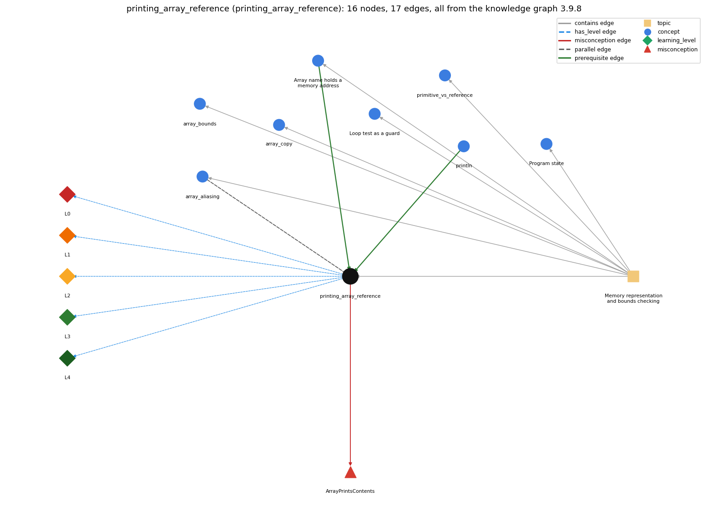

# printing_array_reference (`printing_array_reference`)

printing an array variable prints a reference, not the elements

Section 1.4 Arrays, topic 1.4.b Memory representation and bounds checking. From the knowledge graph 3.9.8 (`data/raw/chapter1_kg_updated.json`).

## Concepts associated with printing\_array\_reference (8)

| Concept | Description | How it is associated |
| --- | --- | --- |
| **array\_aliasing** | two variables can refer to the same array | parallel concept composition rule (R) with it same topic (topic1.4.b) |
| **array\_bounds** | valid indices are 0 .. length-1; otherwise throws | same topic (topic1.4.b) |
| **array\_copy** | making a second, independent array with the same elements: create a new array and copy element by element (or Arrays.copyOf) | same topic (topic1.4.b) |
| **array\_reference** | the array variable stores the memory address (pointer) of the array; a[i] is found by adding i to that address | prerequisite of it (it needs this) same topic (topic1.4.b) |
| **loop\_guard** | putting the bounds check in the loop condition so the body never makes an out-of-bounds array access | same topic (topic1.4.b) |
| **primitive\_vs\_reference** | a primitive variable holds its value; an array (or String) variable holds a reference to the object stored elsewhere | same topic (topic1.4.b) |
| **println** | System.out.println -- output with a trailing newline | prerequisite of it (it needs this) |
| **program\_state** | the information needed to know what a program will do next: the values of its variables and array entries and the next statement | same topic (topic1.4.b) |

## Every edge in this view and its full label (17)

| From | Edge | To | Full edge label |
| --- | --- | --- | --- |
| **array\_reference** | prerequisite | **printing\_array\_reference** | Printing an array variable prints the reference it holds, not the elements. grounding: book\_passage |
| **println** | prerequisite | **printing\_array\_reference** | println of an array variable prints the array's reference, not its elements. grounding: book\_passage |
| **array\_aliasing** | parallel | **printing\_array\_reference** | Both follow from the array variable holding a reference (memory address): assignment and == act on that reference, and println(a) prints it. grounding: questionable composition rule (R) of array\_aliasing with printing\_array\_reference: Assignment, == and println(a) all act on the reference value: two aliases print the same address, while two equal-content arrays print different ones. composition rule (R) of printing\_array\_reference with array\_aliasing: Two aliases print the same text, and two separately created arrays with equal contents print different text, because println shows the reference that assignment and == also act on. |
| **printing\_array\_reference** | misconception | **ArrayPrintsContents** | **wrong rule:** System.out.println(a) prints the elements of the array a. **right rule:** Printing an array variable prints its memory address (a hexadecimal integer like @f62373), not its elements. role: primary |
| **printing\_array\_reference** | has\_level | **printing\_array\_reference@L0** | printing array reference -&gt; L0 (Prestructural): the answer holds a rule that contradicts Java (3 ways). **[0] everyday\_reading** (E): Folk meaning: 'print a' should show what is in a, as when you print a list on paper. Java rule: System.out.println(a) converts the reference to text such as [I@bf3f7e0 (type code plus hexadecimal hash/address) and never reads the elements. **[1] misconception** (M) &rarr; ArrayPrintsContents: wrong rule: System.out.println(a) prints the elements of the array a. Right rule: Printing an array variable prints its memory address (a hexadecimal integer like @f62373), not its elements. **[2] inconsistent\_trace** (T) &rarr; ArrayPrintsContents: Points to LT: println(a) converts the one reference value to a String; no traversal happens. Inconsistent application: the trace prints the elements for one println(a) but an address for another. (here mixing in: "System.out.println(a) prints the elements of the array a") |
| **printing\_array\_reference** | has\_level | **printing\_array\_reference@L1** | printing array reference -&gt; L1 (Unistructural): the answer states one correct rule without applying it (2 ways). **[0] names\_the\_element** (N): Identity: printing an array variable outputs the text form of its reference ([I@..., [D@...), not a listing of the elements. **[1] states\_the\_rule** (S): Declarative: any value, including an array reference, is converted to a String when printed or concatenated; for an array this string is its type code and address. |
| **printing\_array\_reference** | has\_level | **printing\_array\_reference@L2** | printing array reference -&gt; L2 (Multistructural): the answer applies the rules of printing array reference to every part of the code, in order (3 ways). **[0] line\_by\_line\_trace** (LT): Sequencing: the argument a is evaluated to a reference, string conversion turns it into text, and println writes that text and a newline. The elements are never read. **[1] output\_prediction** (OP): Result: one line such as [I@bf3f7e0 for an int[] ([D@... for double[]); the hex part changes from run to run. Exception: println(char[]) has its own overload and prints the characters. **[2] one\_step\_execution** (OS): State transition: no variable or element changes; only one line of output is produced. |
| **printing\_array\_reference** | has\_level | **printing\_array\_reference@L3** | printing array reference -&gt; L3 (Relational): the answer relates the parts (2 ways). **[0] relation\_to\_neighbour** (R): Two aliases print the same text, and two separately created arrays with equal contents print different text, because println shows the reference that assignment and == also act on. **[1] purpose\_of\_the\_whole** (P): Plan/role: useful only as a diagnostic of identity (do two names hold the same reference?). To show the contents, traverse and print each a[i], or print Arrays.toString(a). |
| **printing\_array\_reference** | has\_level | **printing\_array\_reference@L4** | printing array reference -&gt; L4 (Extended abstract): the answer reasons beyond the given code (3 ways). **[0] predict\_a\_change** (C) &rarr; ArrayPrintsContents: Conservation: changing the elements does not change what println(a) prints (the same array keeps its reference). Replacing println(a) by a loop or Arrays.toString(a) changes the output to the elements. **[1] transfer\_to\_a\_new\_program** (X): Applicability: print a reference only when debugging whether two names share an array. For output of values use an element loop (one per line or formatted) or Arrays.toString. **[2] diagnose\_an\_error** (D): rule broken: println of an array reference prints the reference, not the elements. Kind: silent logic error. Trigger class: an array variable (not an element) is passed to print/println or concatenated, as in "a = " + a, expecting the values |
| **topic1.4.b** | contains | **array\_aliasing** | topic topic1.4.b contains array\_aliasing |
| **topic1.4.b** | contains | **array\_bounds** | topic topic1.4.b contains array\_bounds |
| **topic1.4.b** | contains | **array\_copy** | topic topic1.4.b contains array\_copy |
| **topic1.4.b** | contains | **array\_reference** | topic topic1.4.b contains array\_reference |
| **topic1.4.b** | contains | **loop\_guard** | topic topic1.4.b contains loop\_guard |
| **topic1.4.b** | contains | **primitive\_vs\_reference** | topic topic1.4.b contains primitive\_vs\_reference |
| **topic1.4.b** | contains | **printing\_array\_reference** | topic topic1.4.b contains printing\_array\_reference |
| **topic1.4.b** | contains | **program\_state** | topic topic1.4.b contains program\_state |
