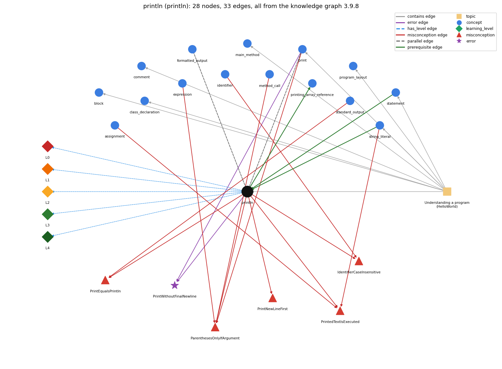

# println (`println`)

System.out.println -- output with a trailing newline

Section 1.1 Your First Program, topic 1.1.b Understanding a program (HelloWorld). From the knowledge graph 3.9.8 (`data/raw/chapter1_kg_updated.json`).

## Concepts associated with println (15)

| Concept | Description | How it is associated |
| --- | --- | --- |
| **assignment** | = stores the computed value of the right side | shares misconception PrintedTextIsExecuted |
| **block** | { ... } grouping statements | same topic (topic1.1.b) |
| **class\_declaration** | public class Name { ... } -- the outer container | same topic (topic1.1.b) |
| **comment** | // and /\* \*/ text that the compiler ignores | same topic (topic1.1.b) |
| **expression** | anything that evaluates to a value | shares misconception ParenthesesOnlyIfArgument |
| **formatted\_output** | printf with a format string such as %d, %.2f, %s | parallel concept composition rule (R) with it |
| **identifier** | a name for a variable, method or class; case-sensitive, no spaces, not a keyword | shares misconception IdentifierCaseInsensitive |
| **main\_method** | public static void main(String[] args) -- entry point | same topic (topic1.1.b) |
| **method\_call** | name(arguments) -- invokes a library method and uses its return value | shares misconception ParenthesesOnlyIfArgument |
| **print** | System.out.print -- output with no newline | parallel concept composition rule (R) with it shares misconception ParenthesesOnlyIfArgument shares error PrintWithoutFinalNewline same topic (topic1.1.b) |
| **printing\_array\_reference** | printing an array variable prints a reference, not the elements | builds on it (needs it) |
| **program\_layout** | one statement per line and indentation that shows nesting | same topic (topic1.1.b) |
| **standard\_output** | StdOut / System.out | shares misconception PrintEqualsPrintln |
| **statement** | one step, terminated by ;, executed in sequence | prerequisite of it (it needs this) composition rule (R) with it same topic (topic1.1.b) |
| **string\_literal** | "Hello, World" -- the text being printed | prerequisite of it (it needs this) composition rule (R) with it shares misconception PrintedTextIsExecuted same topic (topic1.1.b) |

## Every edge in this view and its full label (33)

| From | Edge | To | Full edge label |
| --- | --- | --- | --- |
| **println** | prerequisite | **printing\_array\_reference** | println of an array variable prints the array's reference, not its elements. grounding: book\_passage |
| **statement** | prerequisite | **println** | System.out.println(s); is itself a statement, so its line of output appears at its own place in the sequence. grounding: book\_passage composition rule (R) of statement with println: System.out.println(s); is a statement, so its line of output appears at its place in the sequence; swapping two println statements swaps the output lines. composition rule (R) of println with statement: System.out.println(s); is a statement, so its line of output appears at its own place in the sequence. |
| **string\_literal** | prerequisite | **println** | println("s") outputs exactly the characters between the quotes and then ends the line. grounding: book\_passage composition rule (R) of string\_literal with println: println("s") outputs exactly the characters between the quotes and then ends the line. composition rule (R) of println with string\_literal: println("s") outputs exactly the characters between the quotes and then ends the line. |
| **print** | parallel | **println** | print leaves the cursor on the same line after printing; println moves the cursor to the next line after printing. grounding: book\_passage composition rule (R) of print with println: print leaves the cursor on the same line; println ends the line; a line built from several prints should end with println. composition rule (R) of println with print: print leaves the cursor on the line; println ends it; several prints followed by one println make one line. |
| **println** | parallel | **formatted\_output** | println prints each number with all its digits and ends the line; printf formats each value by its conversion code and starts a new line only when \n is in the format string. grounding: book\_passage composition rule (R) of println with formatted\_output: println prints numbers with all their digits and always ends the line; printf formats each value by its conversion code and ends the line only where the format has %n or \n. composition rule (R) of formatted\_output with println: println prints a double with all its digits (about 15 places) and always ends the line. printf("%.2f\n", x) controls the digits and ends the line only because of \n. |
| **assignment** | misconception | **PrintedTextIsExecuted** | **wrong rule:** System.out.println("x is 5"); sets x to 5 (text inside the quotes is run as code). **right rule:** Characters inside double quotes are printed literally; println only displays them and changes no variable. Only an assignment such as x = 5; sets x. role: context |
| **expression** | misconception | **ParenthesesOnlyIfArgument** | **wrong rule:** () are optional on a no-argument call like println **right rule:** A method call always needs parentheses, so an empty line is printed with System.out.println();. role: context |
| **identifier** | misconception | **IdentifierCaseInsensitive** | **wrong rule:** System.out.Println and System.out.println name the same method. **right rule:** Java is case-sensitive: names of variables, methods and classes that differ only in capitalization are different names. role: primary |
| **method\_call** | misconception | **ParenthesesOnlyIfArgument** | **wrong rule:** () are optional on a no-argument call like println **right rule:** A method call always needs parentheses, so an empty line is printed with System.out.println();. role: primary |
| **print** | misconception | **ParenthesesOnlyIfArgument** | **wrong rule:** println with nothing to print can be written System.out.println; without the parentheses. **right rule:** A method call always needs parentheses, so an empty line is printed with System.out.println();. role: context |
| **println** | misconception | **IdentifierCaseInsensitive** | **wrong rule:** System.out.Println and System.out.println name the same method. **right rule:** Java is case-sensitive: names of variables, methods and classes that differ only in capitalization are different names. role: context |
| **println** | misconception | **ParenthesesOnlyIfArgument** | **wrong rule:** println with nothing to print can be written System.out.println; without the parentheses. **right rule:** A method call always needs parentheses, so an empty line is printed with System.out.println();. role: context |
| **println** | misconception | **PrintEqualsPrintln** | **wrong rule:** print and println do the same thing, so print(s1); print(s2); puts s1 and s2 on separate lines. **right rule:** println ends the line after printing and print does not, so print(s1); print(s2); puts s1 and s2 on the same line. role: primary |
| **println** | misconception | **PrintNewLineFirst** | **wrong rule:** println(s) prints a newline and then s. **right rule:** println(s) prints s and then the newline. role: primary |
| **println** | misconception | **PrintedTextIsExecuted** | **wrong rule:** System.out.println("x is 5"); sets x to 5 (text inside the quotes is run as code). **right rule:** Characters inside double quotes are printed literally; println only displays them and changes no variable. Only an assignment such as x = 5; sets x. role: primary |
| **standard\_output** | misconception | **PrintEqualsPrintln** | **wrong rule:** print and println behave the same (no newline difference) **right rule:** println ends the line after printing and print does not, so print(s1); print(s2); puts s1 and s2 on the same line. role: context |
| **string\_literal** | misconception | **PrintedTextIsExecuted** | **wrong rule:** System.out.println("x is 5"); sets x to 5 (text inside the quotes is run as code). **right rule:** Characters inside double quotes are printed literally; println only displays them and changes no variable. Only an assignment such as x = 5; sets x. role: context |
| **print** | error | **PrintWithoutFinalNewline** | **wrong rule:** Ends the output with print and expects it to appear right away. **right rule:** Finish a line of print calls with println; some systems hold print output until a newline is printed. role: primary |
| **println** | error | **PrintWithoutFinalNewline** | **wrong rule:** Ends the output with print and expects it to appear right away. **right rule:** Finish a line of print calls with println; some systems hold print output until a newline is printed. role: context |
| **println** | has\_level | **println@L0** | println -&gt; L0 (Prestructural): the answer holds a rule that contradicts Java (6 ways). **[0] everyday\_reading** (E): Everyday reading: 'println' is just 'print', and 'new line' is something you do before writing. Java rule: println(x) prints x and then ends the line; println() alone just ends the line. **[1] misconception** (M) &rarr; PrintEqualsPrintln: wrong rule: print and println behave the same. Right rule: println ends the line after printing and print does not, so print(s1); print(s2); puts s1 and s2 on the same line. **[2] misconception** (M) &rarr; PrintNewLineFirst: wrong rule: println(s) prints a newline and then s. Right rule: println(s) prints s and then the line terminator. **[3] inconsistent\_trace** (T) &rarr; PrintEqualsPrintln: Applies the println rule (print, then end line) unevenly: puts the newline before the text on one call and after it on another, or forgets that the next output starts on a new line. (here mixing in: "print and println behave the same (no newline difference)") **[4] misconception** (M) &rarr; IdentifierCaseInsensitive: wrong rule: System.out.Println and System.out.println name the same method. Right rule: Java is case-sensitive: names that differ only in capitalization are different names. **[5] misconception** (M) &rarr; ParenthesesOnlyIfArgument: wrong rule: () are optional on a no-argument call like println. Right rule: A method call always needs parentheses, so an empty line is printed with System.out.println();. |
| **println** | has\_level | **println@L1** | println -&gt; L1 (Unistructural): the answer states one correct rule without applying it (2 ways). **[0] names\_the\_element** (N): System.out.println is a library method that prints its argument followed by a line terminator ('print line'). **[1] states\_the\_rule** (S): println(String x) behaves as though it calls print(x) and then println(); println() terminates the current line by writing the line separator string. |
| **println** | has\_level | **println@L2** | println -&gt; L2 (Multistructural): the answer applies the rules of println to every part of the code, in order (3 ways). **[0] line\_by\_line\_trace** (LT): Evaluate the argument, print its characters at the current position, then write the line separator so the cursor moves to the beginning of the next line. **[1] output\_prediction** (OP): Output is the value's characters followed by a line break: println("Hello, "); println("World!"); prints two lines. **[2] one\_step\_execution** (OS): One call appends the text and a line separator to the output; the cursor ends at the start of the next line; no variable changes and nothing is returned. |
| **println** | has\_level | **println@L3** | println -&gt; L3 (Relational): the answer relates the parts (5 ways). **[0] relation\_to\_neighbour** (R): System.out.println(s); is a statement, so its line of output appears at its own place in the sequence. **[1] relation\_to\_neighbour** (R): println("s") outputs exactly the characters between the quotes and then ends the line. **[2] relation\_to\_neighbour** (R): print leaves the cursor on the line; println ends it; several prints followed by one println make one line. **[3] relation\_to\_neighbour** (R): println prints numbers with all their digits and always ends the line; printf formats each value by its conversion code and ends the line only where the format has %n or \n. **[4] purpose\_of\_the\_whole** (P): Purpose: produce one complete line of output, e.g. each result on its own line, or end a line built with print. |
| **println** | has\_level | **println@L4** | println -&gt; L4 (Extended abstract): the answer reasons beyond the given code (5 ways). **[0] predict\_a\_change** (C) &rarr; PrintEqualsPrintln: Replacing println with print joins the next output onto the same line (a typical logic error); the characters printed stay the same. **[1] transfer\_to\_a\_new\_program** (X): Use println when each output item belongs on its own line or to end a line; use print to continue a line and printf to control number formatting. **[2] diagnose\_an\_error** (D): rule broken: Finish a line of print calls with println. Kind: silent logic error. Trigger class: output ends with print, so the last line may not be shown or runs into the shell prompt **[3] diagnose\_an\_error** (D): rule broken: Method names are case-sensitive. Kind: compile-time. Trigger class: System.out.Println or system.out.println: cannot find symbol **[4] diagnose\_an\_error** (D): rule broken: Calls need parentheses. Kind: compile-time. Trigger class: System.out.println; without () |
| **topic1.1.b** | contains | **block** | topic topic1.1.b contains block |
| **topic1.1.b** | contains | **class\_declaration** | topic topic1.1.b contains class\_declaration |
| **topic1.1.b** | contains | **comment** | topic topic1.1.b contains comment |
| **topic1.1.b** | contains | **main\_method** | topic topic1.1.b contains main\_method |
| **topic1.1.b** | contains | **print** | topic topic1.1.b contains print |
| **topic1.1.b** | contains | **println** | topic topic1.1.b contains println |
| **topic1.1.b** | contains | **program\_layout** | topic topic1.1.b contains program\_layout |
| **topic1.1.b** | contains | **statement** | topic topic1.1.b contains statement |
| **topic1.1.b** | contains | **string\_literal** | topic topic1.1.b contains string\_literal |
