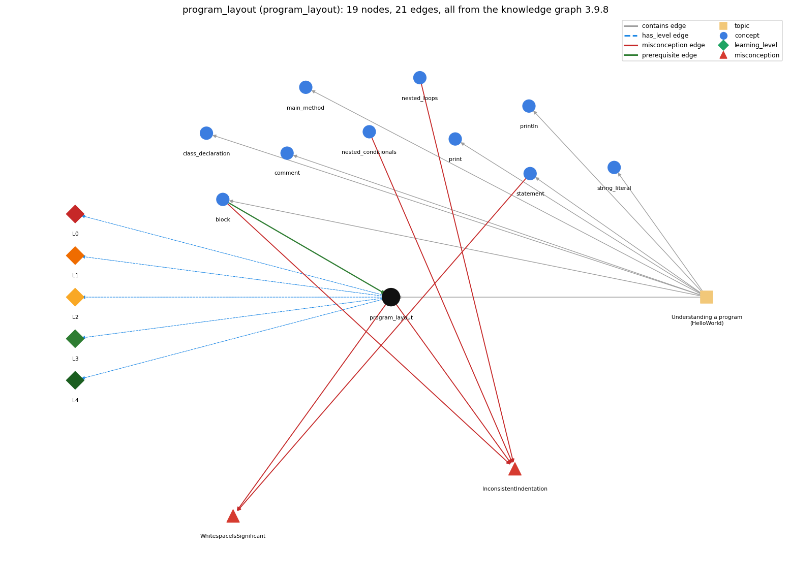

# program_layout (`program_layout`)

one statement per line and indentation that shows nesting

Section 1.1 Your First Program, topic 1.1.b Understanding a program (HelloWorld).

## At a glance

- **Needs first:** `block`
- **Leads to:** nothing
- **Learned alongside:** nothing
- **Misconceptions:** `InconsistentIndentation`, `WhitespaceIsSignificant`
- **Errors:** none
- **Levels:** L0, L1, L2, L3, L4

Everything below comes from the knowledge graph 3.9.8 (`data/raw/chapter1_kg_updated.json`): 21 edges around this concept, each explained in the graph's own words.

## What it needs first (1)

A prerequisite edge means the other concept has to be understood before `program_layout`.

### `block` comes before `program_layout`

*{ ... } grouping statements*

Indentation makes the nesting of blocks visible, so the reader can see which statements belong to which block.

- **Grounding:** book passage
- **How `program_layout` combines with `block`:** Indentation should show which statements belong to which block; braces, not indentation, decide it, so wrong indentation misleads.
- **How `block` combines with `program_layout`:** Indentation should show block nesting, but only braces define it; layout that disagrees with the braces misleads the reader, not the compiler.

## What it leads to (0)

These concepts need `program_layout` first.

No concept has this one as a prerequisite.

## Learned alongside (0)

A parallel edge joins two concepts that sit side by side: neither is needed before the other.

No parallel edge touches this concept.

## Misconceptions (2)

A misconception edge states the wrong rule a student may hold about this concept, and the right rule.

### InconsistentIndentation

- **Wrong rule:** Indents nested blocks inconsistently, so the visual nesting differs from the real nesting.
- **Right rule:** Indent consistently, one level deeper for each nested block, so the layout shows the real nesting; the compiler ignores indentation.
- **Role of this concept:** primary
- **Also an edge from `block`:** Indents nested blocks inconsistently, so the visual nesting differs from the real nesting.
- **Also an edge from `nested_conditionals`:** Indents nested blocks inconsistently, so the visual nesting differs from the real nesting.
- **Also an edge from `nested_loops`:** Indents nested blocks inconsistently, so the visual nesting differs from the real nesting.

### WhitespaceIsSignificant

- **Wrong rule:** Line breaks and indentation change what the program does, so each statement must be on its own line.
- **Right rule:** Java compilers consider all whitespace in program text (outside quotation marks) to be equivalent; layout is for human readers.
- **Role of this concept:** primary
- **Shows at level L0 as:** misconception: wrong rule: Line breaks and indentation change what the program does, so each statement must be on its own line. Right rule: Java compilers consider all whitespace in program text (outside quotation marks) to be equivalent; layout is for human readers.
- **Shows at level L0 as:** inconsistent trace: Applies the 'layout is ignored' rule unevenly: follows the braces on one trace but the indentation on another, e.g. treats a mis-indented line after a braceless if as part of the branch. (here mixing in: "Line breaks and indentation change what the program does, so each statement must be on its own line")
- **Also an edge from `statement`:** Line breaks and indentation change what the program does, so each statement must be on its own line.

## Errors (0)

An error edge states the rule that gets broken in a program, and the right rule.

The graph has no error edge from this concept.

## Levels L0 to L4 (5 of 5)

Each level edge lists the ways a student shows that level, each with its exact rule.

### L0: Prestructural / sensorimotor

L0 for program layout: the answer holds a rule that contradicts Java.

*Deciding question: Does every rule the answer applies to program layout agree with the language rule? If it reads the code with everyday meanings, applies a wrong rule, or switches rules within one trace, it is L0. A slip in an otherwise rule-correct trace is L2 with an error, not L0.*

program layout -&gt; L0 (Prestructural): the answer holds a rule that contradicts Java (3 ways).

- **everyday reading** (folk-meaning rule): Everyday reading: as in poetry or Python, line breaks and indentation carry meaning. Java rule: the compiler treats all whitespace between tokens as equivalent; layout is for human readers only (some spaces separate words, e.g. public class).
- **misconception** (wrong rule / right rule; shows `WhitespaceIsSignificant`): wrong rule: Line breaks and indentation change what the program does, so each statement must be on its own line. Right rule: Java compilers consider all whitespace in program text (outside quotation marks) to be equivalent; layout is for human readers.
- **inconsistent trace** (uneven-application rule; shows `WhitespaceIsSignificant`): Applies the 'layout is ignored' rule unevenly: follows the braces on one trace but the indentation on another, e.g. treats a mis-indented line after a braceless if as part of the branch. (here mixing in: "Line breaks and indentation change what the program does, so each statement must be on its own line")

### L1: Unistructural / atom x text surface

L1 for program layout: the answer states one correct rule without applying it.

*Deciding question: Does the answer cover every part of the code, in order, with the values (L2)? If it covers one part or only states the rule, it is L1.*

program layout -&gt; L1 (Unistructural): the answer states one correct rule without applying it (2 ways).

- **names the element** (identity rule): Program layout is the use of whitespace (one statement per line, indentation one level per nested block) to make program structure visible; it is a style convention, not syntax.
- **states the rule** (declarative rule): Whitespace is needed only to separate adjacent words; otherwise all whitespace is equivalent, so the whole HelloWorld program can be written on one line; by convention, indent consistently to show nesting.

### L2: Multistructural / block x execution / preoperational

L2 for program layout: the answer applies these rules to every part of the code, in order.

*Deciding question: Is the answer many segments mapped onto lines (L2), or one segment stating the purpose of the whole (L3)? A correct output with no value-by-value justification is not levelled.*

program layout -&gt; L2 (Multistructural): the answer applies the rules of program layout to every part of the code, in order (3 ways).

- **line by line trace** (operational sequencing rule): Layout has no execution order of its own: execution follows statements and braces, regardless of lines and indentation.
- **output prediction** (evaluation / result rule): Changing layout produces the same program output; only whitespace inside string literals appears in the output.
- **one step execution** (state-transition rule): Re-formatting changes no state and no behaviour; it only changes how readable the text is.

### L3: Relational / relations x function (concrete operational begins)

L3 for program layout: the answer relates the parts by these rules.

*Deciding question: Was the purpose deduced from the code, or only guessed from traced input/output pairs (then L2)? Does the answer stay within the given code (L3), or reason about changed code, an error class or a new program (L4)?*

program layout -&gt; L3 (Relational): the answer relates the parts (2 ways).

- **relation to neighbour** (composition rule (with a neighbour)): Indentation should show which statements belong to which block; braces, not indentation, decide it, so wrong indentation misleads.
- **purpose of the whole** (plan / role rule): Purpose: make the program's structure (or intended structure) apparent so it is easier to read and to find errors.

### L4: Extended abstract (concrete-operational reversibility and conservation)

L4 for program layout: the answer reasons beyond the given code by these rules.

*Deciding question: Does the answer link the code to a broader context: a changed program, a class of inputs, an unseen problem? Re-tracing changed code value by value is L2; fixing one given failing case is L3.*

program layout -&gt; L4 (Extended abstract): the answer reasons beyond the given code (4 ways).

- **predict a change** (conservation rule; shows `WhitespaceIsSignificant`): Re-indenting or re-wrapping lines (outside string literals) keeps behaviour; removing a needed space between words (publicclass) breaks compilation.
- **transfer to a new program** (applicability rule): Always use consistent indentation and one statement per line (an editor can auto-format); it matters most in nested code, and checking indentation helps spot syntax errors.
- **diagnose an error** (error rule): rule broken: Indentation does not create a block. Kind: silent logic error. Trigger class: a second statement indented under a braceless if or while, expected to be conditional or repeated
- **diagnose an error** (error rule): rule broken: Some spaces are required between words. Kind: compile-time. Trigger class: keywords run together, e.g. publicclassGoodbye

## Same topic

`program_layout` belongs to the topic **Understanding a program (HelloWorld)** (`topic1.1.b`). The topic also contains: `block`, `class_declaration`, `comment`, `main_method`, `print`, `println`, `statement`, `string_literal`.

## Rules of the concept (14)

- **folk-meaning rule:** Everyday reading: as in poetry or Python, line breaks and indentation carry meaning. Java rule: the compiler treats all whitespace between tokens as equivalent; layout is for human readers only (some spaces separate words, e.g. public class).
- **wrong rule / right rule:** WhitespaceIsSignificant: wrong: Line breaks and indentation change what the program does, so each statement must be on its own line. \| right: Java compilers consider all whitespace in program text (outside quotation marks) to be equivalent; layout is for human readers.
- **uneven-application rule:** Applies the 'layout is ignored' rule unevenly: follows the braces on one trace but the indentation on another, e.g. treats a mis-indented line after a braceless if as part of the branch.
- **identity rule:** Program layout is the use of whitespace (one statement per line, indentation one level per nested block) to make program structure visible; it is a style convention, not syntax.
- **declarative rule:** Whitespace is needed only to separate adjacent words; otherwise all whitespace is equivalent, so the whole HelloWorld program can be written on one line; by convention, indent consistently to show nesting.
- **operational sequencing rule:** Layout has no execution order of its own: execution follows statements and braces, regardless of lines and indentation.
- **evaluation / result rule:** Changing layout produces the same program output; only whitespace inside string literals appears in the output.
- **state-transition rule:** Re-formatting changes no state and no behaviour; it only changes how readable the text is.
- **composition rule (with a neighbour):** with block: Indentation should show which statements belong to which block; braces, not indentation, decide it, so wrong indentation misleads.
- **plan / role rule:** Purpose: make the program's structure (or intended structure) apparent so it is easier to read and to find errors.
- **conservation rule:** Re-indenting or re-wrapping lines (outside string literals) keeps behaviour; removing a needed space between words (publicclass) breaks compilation.
- **error rule:** rule broken: Indentation does not create a block (silent logic error)
- **error rule:** rule broken: Some spaces are required between words (compile-time)
- **applicability rule:** Always use consistent indentation and one statement per line (an editor can auto-format); it matters most in nested code, and checking indentation helps spot syntax errors.

## The whole prerequisite chain

- **Everything it builds on (5):** `block`, `class_declaration`, `main_method`, `program_text`, `statement`
- **Everything that builds on it (0):** nothing
