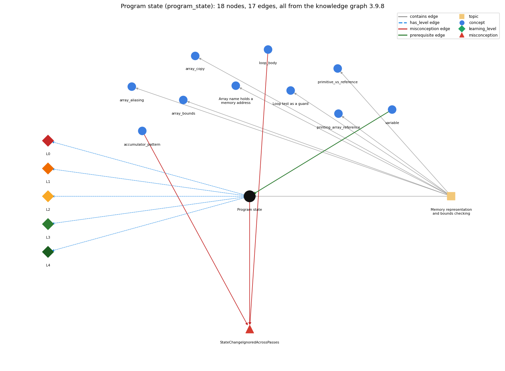

# Program state (`program_state`)

the information needed to know what a program will do next: the values of its variables and array entries and the next statement

Section 1.4 1.4 Arrays, topic 1.4.b Memory representation and bounds checking.

## At a glance

- **Needs first:** `variable`
- **Leads to:** nothing
- **Learned alongside:** nothing
- **Misconceptions:** `StateChangeIgnoredAcrossPasses`
- **Errors:** none
- **Levels:** L0, L1, L2, L3, L4

Everything below comes from the knowledge graph 3.9.8 (`data/raw/chapter1_kg_updated.json`): 17 edges around this concept, each explained in the graph's own words.

## What it needs first (1)

A prerequisite edge means the other concept has to be understood before `program_state`.

### `variable` comes before `program_state`

*a named, typed box that holds a value*

Without arrays, a program's state is the values of its variables plus the next statement to run.

- **Grounding:** book passage
- **How `program_state` combines with `variable`:** Without arrays the state is the values of the variables plus the next statement; each array element adds one more variable to the state.
- **How `variable` combines with `program_state`:** The current values of all variables make up the program's state. A trace records each variable's value after each statement.

## What it leads to (0)

These concepts need `program_state` first.

No concept has this one as a prerequisite.

## Learned alongside (0)

A parallel edge joins two concepts that sit side by side: neither is needed before the other.

No parallel edge touches this concept.

## Misconceptions (1)

A misconception edge states the wrong rule a student may hold about this concept, and the right rule.

### StateChangeIgnoredAcrossPasses

- **Wrong rule:** Values changed by one pass of a loop (other than the loop variable) do not affect later passes.
- **Right rule:** Each pass starts from the state left by the previous pass, so a change in one pass carries into the next ones.
- **Role of this concept:** context
- **Shows at level L0 as:** misconception: wrong rule: Values changed by one pass of a loop (other than the loop variable) do not affect later passes. Right rule: Each pass starts from the state left by the previous pass, so a change in one pass carries into the next ones.
- **Also an edge from `accumulator_pattern`:** Values changed by one pass of a loop (other than the loop variable) do not affect later passes.
- **Also an edge from `loop_body`:** Values changed by one pass of a loop (other than the loop variable) do not affect later passes.

## Errors (0)

An error edge states the rule that gets broken in a program, and the right rule.

The graph has no error edge from this concept.

## Levels L0 to L4 (5 of 5)

Each level edge lists the ways a student shows that level, each with its exact rule.

### L0: Prestructural / sensorimotor

L0 for Program state: the answer holds a rule that contradicts Java.

*Deciding question: Does every rule the answer applies to Program state agree with the language rule? If it reads the code with everyday meanings, applies a wrong rule, or switches rules within one trace, it is L0. A slip in an otherwise rule-correct trace is L2 with an error, not L0.*

Program state -&gt; L0 (Prestructural): the answer holds a rule that contradicts Java (2 ways).

- **everyday reading** (folk-meaning rule): Folk meaning: program statements read like maths equations, timeless relations among values. Java rule: each statement changes the state (the values of variables and array entries), and the next statement starts from the changed state.
- **misconception** (wrong rule / right rule; shows `StateChangeIgnoredAcrossPasses`): wrong rule: Values changed by one pass of a loop (other than the loop variable) do not affect later passes. Right rule: Each pass starts from the state left by the previous pass, so a change in one pass carries into the next ones.

### L1: Unistructural / atom x text surface

L1 for Program state: the answer states one correct rule without applying it.

*Deciding question: Does the answer cover every part of the code, in order, with the values (L2)? If it covers one part or only states the rule, it is L1.*

Program state -&gt; L1 (Unistructural): the answer states one correct rule without applying it (2 ways).

- **names the element** (identity rule): Identity: the state of a program is the information needed to know what it will do next: the values of its variables (and array entries) and which statement runs next.
- **states the rule** (declarative rule): Declarative: in a program without arrays, knowing the variable values and the next statement determines what the program does next; arrays add one state component per element.

### L2: Multistructural / block x execution / preoperational

L2 for Program state: the answer applies these rules to every part of the code, in order.

*Deciding question: Is the answer many segments mapped onto lines (L2), or one segment stating the purpose of the whole (L3)? A correct output with no value-by-value justification is not levelled.*

Program state -&gt; L2 (Multistructural): the answer applies the rules of Program state to every part of the code, in order (3 ways).

- **line by line trace** (operational sequencing rule): Sequencing: statements in a block execute in order, first to last, so the state seen by each statement is the result of all earlier ones.
- **output prediction** (evaluation / result rule): Result: the output from any point on is determined by the current state; equal states give the same future behaviour (apart from Math.random and input).
- **one step execution** (state-transition rule): State transition: each assignment changes exactly one variable or one array element; tracing tracks these changes.

### L3: Relational / relations x function (concrete operational begins)

L3 for Program state: the answer relates the parts by these rules.

*Deciding question: Was the purpose deduced from the code, or only guessed from traced input/output pairs (then L2)? Does the answer stay within the given code (L3), or reason about changed code, an error class or a new program (L4)?*

Program state -&gt; L3 (Relational): the answer relates the parts (2 ways).

- **relation to neighbour** (composition rule (with a neighbour)): Without arrays the state is the values of the variables plus the next statement; each array element adds one more variable to the state.
- **purpose of the whole** (plan / role rule): Plan/role: tracing (a trace table of the state after each step) is how programs are understood and debugged; with large arrays one checks invariants among state components instead.

### L4: Extended abstract (concrete-operational reversibility and conservation)

L4 for Program state: the answer reasons beyond the given code by these rules.

*Deciding question: Does the answer link the code to a broader context: a changed program, a class of inputs, an unseen problem? Re-tracing changed code value by value is L2; fixing one given failing case is L3.*

Program state -&gt; L4 (Extended abstract): the answer reasons beyond the given code (3 ways).

- **predict a change** (conservation rule): Conservation: an invariant such as 'valcnt equals the number of true entries in found[]' holds after every pass; a change that breaks it signals a bug.
- **transfer to a new program** (applicability rule): Applicability: trace the full state for small programs. When arrays make the state too large to track, reason with invariants and partial traces instead.
- **diagnose an error** (error rule): rule broken: Each pass starts from the state left by the previous one. Kind: silent logic error. Trigger class: an accumulator is not reset between outer passes (sum declared before the row loop), so later rows include earlier rows' totals

## Same topic

`program_state` belongs to the topic **Memory representation and bounds checking** (`topic1.4.b`). The topic also contains: `array_aliasing`, `array_bounds`, `array_copy`, `array_reference`, `loop_guard`, `primitive_vs_reference`, `printing_array_reference`.

## Rules of the concept (13)

- **folk-meaning rule:** Folk meaning: program statements read like maths equations, timeless relations among values. Java rule: each statement changes the state (the values of variables and array entries), and the next statement starts from the changed state.
- **wrong rule / right rule:** StateChangeIgnoredAcrossPasses: wrong: Values changed by one pass of a loop (other than the loop variable) do not affect later passes. \| right: Each pass starts from the state left by the previous pass, so a change in one pass carries into the next ones.
- **uneven-application rule:** Points to LT: statements execute one at a time, and each starts from the state the previous one left. Inconsistent application: a trace table updates a variable on some steps but carries a stale value on others.
- **identity rule:** Identity: the state of a program is the information needed to know what it will do next: the values of its variables (and array entries) and which statement runs next.
- **declarative rule:** Declarative: in a program without arrays, knowing the variable values and the next statement determines what the program does next; arrays add one state component per element.
- **operational sequencing rule:** Sequencing: statements in a block execute in order, first to last, so the state seen by each statement is the result of all earlier ones.
- **evaluation / result rule:** Result: the output from any point on is determined by the current state; equal states give the same future behaviour (apart from Math.random and input).
- **state-transition rule:** State transition: each assignment changes exactly one variable or one array element; tracing tracks these changes.
- **composition rule (with a neighbour):** with variable: Without arrays the state is the values of the variables plus the next statement; each array element adds one more variable to the state.
- **plan / role rule:** Plan/role: tracing (a trace table of the state after each step) is how programs are understood and debugged; with large arrays one checks invariants among state components instead.
- **conservation rule:** Conservation: an invariant such as 'valcnt equals the number of true entries in found[]' holds after every pass; a change that breaks it signals a bug.
- **error rule:** rule broken: Each pass starts from the state left by the previous one. (silent logic error)
- **applicability rule:** Applicability: trace the full state for small programs. When arrays make the state too large to track, reason with invariants and partial traces instead.

## The whole prerequisite chain

- **Everything it builds on (5):** `data_type`, `identifier`, `literal`, `primitive_type`, `variable`
- **Everything that builds on it (0):** nothing
