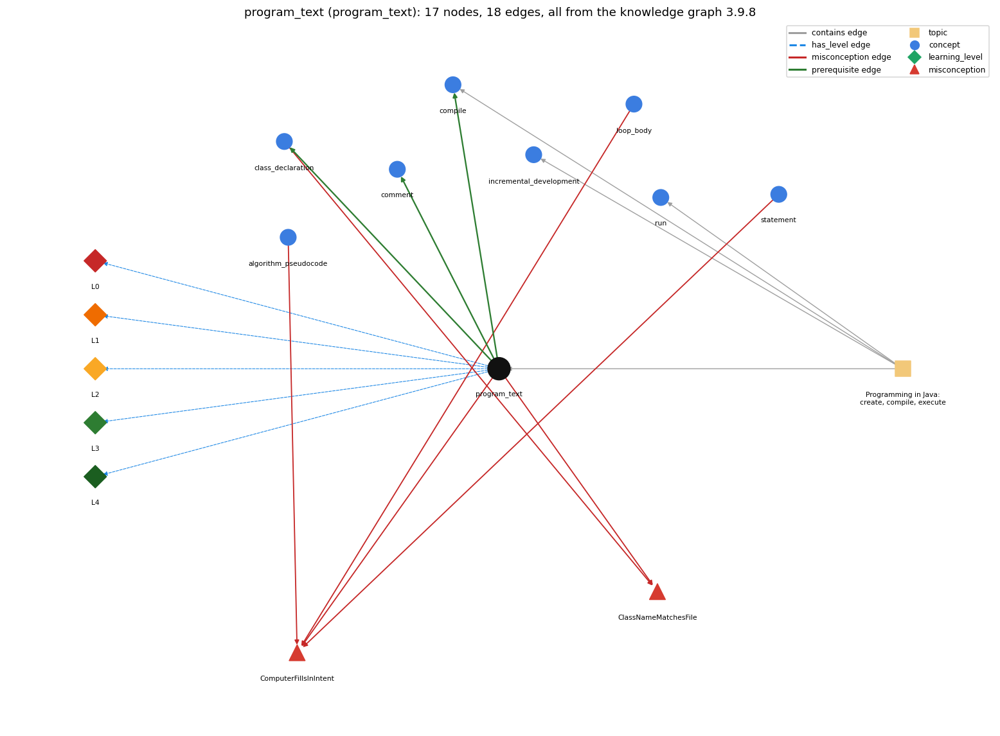

# program_text (`program_text`)

the source file; class name must match the filename

Section 1.1 Your First Program, topic 1.1.a Programming in Java: create, compile, execute.

## At a glance

- **Needs first:** nothing
- **Leads to:** `class_declaration`, `comment`, `compile`
- **Learned alongside:** nothing
- **Misconceptions:** `ClassNameMatchesFile`, `ComputerFillsInIntent`
- **Errors:** none
- **Levels:** L0, L1, L2, L3, L4

Everything below comes from the knowledge graph 3.9.8 (`data/raw/chapter1_kg_updated.json`): 18 edges around this concept. The edge logic, the wrong and right rules and the exact rules of the ways are copied word for word from the graph.

## To work on (1)

- no aliases: a student's words cannot name this concept

## What it needs first (0)

A prerequisite edge means the other concept has to be understood before `program_text`.

No prerequisite edge leads into this concept.

## What it leads to (3)

These concepts need `program_text` first.

### `program_text` comes before `class_declaration`

*public class Name { ... } -- the outer container*

- **Edge:** `pre:program_text->class_declaration`
- **Exact edge logic:** The source file Name.java holds the public class, and that class must be named Name.
- **Grounding:** book\_passage
- **Composition rule (R) of `program_text` with `class_declaration`:** The name after 'public class' constrains the file name: public class Name must be in Name.java, or javac rejects it.
- **Composition rule (R) of `class_declaration` with `program_text`:** The name after 'class' must equal the file name without .java.

### `program_text` comes before `comment`

*// and /\* \*/ text that the compiler ignores*

- **Edge:** `pre:program_text->comment`
- **Exact edge logic:** Comments are part of the program text in Name.java but are ignored when it is compiled.
- **Grounding:** book\_passage
- **Composition rule (R) of `program_text` with `comment`:** Comments are part of the program text but are discarded when it is compiled: they may appear anywhere a whitespace may appear and never change Name.class's behaviour.
- **Composition rule (R) of `comment` with `program_text`:** Comments are part of the program text in Name.java but are dropped when it is compiled, so they cannot affect Name.class's behaviour.

### `program_text` comes before `compile`

*javac turns source into bytecode*

- **Edge:** `pre:program_text->compile`
- **Exact edge logic:** javac takes the program file Name.java as input and translates it into Name.class.
- **Grounding:** book\_passage
- **Composition rule (R) of `program_text` with `compile`:** javac takes the text file Name.java as input and produces Name.class; the text must be lexically and syntactically legal for any .class to be produced.
- **Composition rule (R) of `compile` with `program_text`:** javac takes the program text Name.java as input; its file name must match the public class name.

## Learned alongside (0)

A parallel edge joins two concepts that sit side by side: neither is needed before the other.

No parallel edge touches this concept.

## Misconceptions (2)

A misconception edge states the wrong rule a student may hold about this concept, and the right rule.

### ClassNameMatchesFile

- **Edge:** `program_text` &rarr; `ClassNameMatchesFile` (misconception)
- **Exact edge logic (the wrong rule):** class name and filename are independent
- **Twin logic (the right rule):** A public class Name must be saved in a file called Name.java.
- **Wrong belief (on the node):** class name and filename are independent
- **Correct rule (on the node):** A public class Name must be saved in a file called Name.java.
- **Provenance:** textbook
- **Role of this concept:** context
- **L0 way linked to it:** yes
- **L0 way [1] misconception, exact rule:** wrong rule: The class name and the file name are independent, so public class HelloWorld can be saved as hello.java or Program.java. Right rule: A public class Name must be saved in a file called exactly Name.java (same spelling and case).
- **L0 way [2] inconsistent\_trace, exact rule:** Applies the reading rule (LT for program\_text: the compiler reads the file Name.java character by character from top to bottom, ignoring comments and whitespace between tokens) unevenly: e.g. reads the code but also the comments as if they ran, or treats the file name as irrelevant on one pass and as the program name on another. (here mixing in: "class name and filename are independent")
- **Edge `class_declaration` &rarr; `ClassNameMatchesFile`, exact edge logic:** The class can have any name; the file name does not need to match it. **Twin logic:** A public class Name must be saved in a file called Name.java. (role: primary)

### ComputerFillsInIntent

- **Edge:** `program_text` &rarr; `ComputerFillsInIntent` (misconception)
- **Exact edge logic (the wrong rule):** The computer fills in omitted steps or values that the programmer meant, e.g. REPEAT 4 [FORWARD 30] draws a square without a turn command.
- **Twin logic (the right rule):** The computer executes only what the code states; every needed step and value must be written.
- **Wrong belief (on the node):** The computer fills in omitted steps or values that the programmer meant, e.g. REPEAT 4 [FORWARD 30] draws a square without a turn command.
- **Correct rule (on the node):** The computer executes only what the code states; every needed step and value must be written.
- **Provenance:** published
- **Role of this concept:** context
- **L0 way linked to it:** yes
- **L0 way [3] misconception, exact rule:** wrong rule: The computer fills in steps or values the programmer meant but did not write. Right rule: The program text is all the computer has: it executes only what the code states, so every step and value must be written.
- **Edge `algorithm_pseudocode` &rarr; `ComputerFillsInIntent`, exact edge logic:** The computer fills in omitted steps or values that the programmer meant, e.g. REPEAT 4 [FORWARD 30] draws a square without a turn command. **Twin logic:** The computer executes only what the code states; every needed step and value must be written. (role: context)
- **Edge `loop_body` &rarr; `ComputerFillsInIntent`, exact edge logic:** The computer fills in omitted steps or values that the programmer meant, e.g. REPEAT 4 [FORWARD 30] draws a square without a turn command. **Twin logic:** The computer executes only what the code states; every needed step and value must be written. (role: context)
- **Edge `statement` &rarr; `ComputerFillsInIntent`, exact edge logic:** The computer fills in omitted steps or values that the programmer meant, e.g. REPEAT 4 [FORWARD 30] draws a square without a turn command. **Twin logic:** The computer executes only what the code states; every needed step and value must be written. (role: primary)

## Errors (0)

An error edge states the rule that gets broken in a program, and the right rule.

The graph has no error edge from this concept.

## Levels L0 to L4 (5 of 5)

Each level edge lists the ways a student shows that level, each with its exact rule.

### L0: Prestructural / sensorimotor

L0 for program text: the answer holds a rule that contradicts Java.

*Deciding question: Does every rule the answer applies to program text agree with the language rule? If it reads the code with everyday meanings, applies a wrong rule, or switches rules within one trace, it is L0. A slip in an otherwise rule-correct trace is L2 with an error, not L0.*

- **Edge:** `program_text` &rarr; `program_text@L0` (has_level)
- **Exact edge logic:** program text -&gt; L0 (Prestructural): the answer holds a rule that contradicts Java (4 ways).

Ways (4), each with its exact rule:

- **[0] everyday\_reading** (rule type E, folk-meaning rule): Everyday reading: a 'program' is a document you can save under any name, like a letter or an essay, and a misspelt word does not stop a reader from understanding it. Java rule: the file must be named exactly after its public class plus .java (HelloWorld.java for public class HelloWorld), and every character, including case and punctuation, is significant to the compiler.
- **[1] misconception** (rule type M, wrong rule / right rule) &rarr; `ClassNameMatchesFile`: wrong rule: The class name and the file name are independent, so public class HelloWorld can be saved as hello.java or Program.java. Right rule: A public class Name must be saved in a file called exactly Name.java (same spelling and case).
- **[2] inconsistent\_trace** (rule type T, uneven-application rule) &rarr; `ClassNameMatchesFile`: Applies the reading rule (LT for program\_text: the compiler reads the file Name.java character by character from top to bottom, ignoring comments and whitespace between tokens) unevenly: e.g. reads the code but also the comments as if they ran, or treats the file name as irrelevant on one pass and as the program name on another. (here mixing in: "class name and filename are independent")
- **[3] misconception** (rule type M, wrong rule / right rule) &rarr; `ComputerFillsInIntent`: wrong rule: The computer fills in steps or values the programmer meant but did not write. Right rule: The program text is all the computer has: it executes only what the code states, so every step and value must be written.

### L1: Unistructural / atom x text surface

L1 for program text: the answer states one correct rule without applying it.

*Deciding question: Does the answer cover every part of the code, in order, with the values (L2)? If it covers one part or only states the rule, it is L1.*

- **Edge:** `program_text` &rarr; `program_text@L1` (has_level)
- **Exact edge logic:** program text -&gt; L1 (Unistructural): the answer states one correct rule without applying it (2 ways).

Ways (2), each with its exact rule:

- **[0] names\_the\_element** (rule type N, identity rule): Program text (source code) is the sequence of characters typed into a text file Name.java that holds one Java program; S&amp;W call it code.
- **[1] states\_the\_rule** (rule type S, declarative rule): A Java program is a sequence of characters stored in a file with a .java extension whose name matches the name after the word class on the first line (public class HelloWorld lives in HelloWorld.java).

### L2: Multistructural / block x execution / preoperational

L2 for program text: the answer applies these rules to every part of the code, in order.

*Deciding question: Is the answer many segments mapped onto lines (L2), or one segment stating the purpose of the whole (L3)? A correct output with no value-by-value justification is not levelled.*

- **Edge:** `program_text` &rarr; `program_text@L2` (has_level)
- **Exact edge logic:** program text -&gt; L2 (Multistructural): the answer applies the rules of program text to every part of the code, in order (3 ways).

Ways (3), each with its exact rule:

- **[0] line\_by\_line\_trace** (rule type LT, operational sequencing rule): Development order: (1) edit Name.java, (2) javac Name.java translates the whole text, (3) java Name runs it. Within the text, the compiler reads tokens in order; at run time main's statements execute top to bottom.
- **[1] output\_prediction** (rule type OP, evaluation / result rule): The program text itself produces no output; its result is the file Name.class produced by javac when the text is legal, and the program's output appears only when java Name runs it.
- **[2] one\_step\_execution** (rule type OS, state-transition rule): One edit-save of the text changes only the file Name.java; the existing Name.class (and so the behaviour of java Name) does not change until javac is run again.

### L3: Relational / relations x function (concrete operational begins)

L3 for program text: the answer relates the parts by these rules.

*Deciding question: Was the purpose deduced from the code, or only guessed from traced input/output pairs (then L2)? Does the answer stay within the given code (L3), or reason about changed code, an error class or a new program (L4)?*

- **Edge:** `program_text` &rarr; `program_text@L3` (has_level)
- **Exact edge logic:** program text -&gt; L3 (Relational): the answer relates the parts (4 ways).

Ways (4), each with its exact rule:

- **[0] relation\_to\_neighbour** (rule type R, composition rule (with a neighbour)): The name after 'public class' constrains the file name: public class Name must be in Name.java, or javac rejects it.
- **[1] relation\_to\_neighbour** (rule type R, composition rule (with a neighbour)): Comments are part of the program text but are discarded when it is compiled: they may appear anywhere a whitespace may appear and never change Name.class's behaviour.
- **[2] relation\_to\_neighbour** (rule type R, composition rule (with a neighbour)): javac takes the text file Name.java as input and produces Name.class; the text must be lexically and syntactically legal for any .class to be produced.
- **[3] purpose\_of\_the\_whole** (rule type P, plan / role rule): The program text is the human-readable statement of a computation: it records exactly what the computer must do so that it can be compiled, run, read and modified (copy HelloWorld.java, rename the class, replace the statements).

### L4: Extended abstract (concrete-operational reversibility and conservation)

L4 for program text: the answer reasons beyond the given code by these rules.

*Deciding question: Does the answer link the code to a broader context: a changed program, a class of inputs, an unseen problem? Re-tracing changed code value by value is L2; fixing one given failing case is L3.*

- **Edge:** `program_text` &rarr; `program_text@L4` (has_level)
- **Exact edge logic:** program text -&gt; L4 (Extended abstract): the answer reasons beyond the given code (4 ways).

Ways (4), each with its exact rule:

- **[0] predict\_a\_change** (rule type C, conservation rule) &rarr; `ClassNameMatchesFile`: Renaming the class without renaming the file (or vice versa) breaks compilation; changing whitespace between tokens or editing comments keeps the behaviour unchanged; changing any character inside quotes changes the output.
- **[1] transfer\_to\_a\_new\_program** (rule type X, applicability rule): Use one source file per program (one public class per Name.java) and edit the text rather than the .class file; do not expect the text to carry meaning that is not written in it.
- **[2] diagnose\_an\_error** (rule type D, error rule): rule broken: public class Name must be in Name.java. Kind: compile-time. Trigger class: file name and public class name differ in spelling or case (class HelloWorld saved as Hello.java or helloworld.java)
- **[3] diagnose\_an\_error** (rule type D, error rule): rule broken: java Name runs a class, not a file name. Kind: launch error. Trigger class: typing java UseArgument.java Bob or a class name whose .class does not exist

## Same topic

`program_text` belongs to the topic **Programming in Java: create, compile, execute** (`topic1.1.a`). The topic also contains: `compile`, `incremental_development`, `run`.

## Rules of the concept (17)

- **Book** (SW-1e, p. 7 (pdf 17)): "Each Java program must reside in a file whose name matches the one after the word class on the first line, and it also must have a .java extension."
- **Book** (SW-1.1, ): "Create the program by typing it into a text editor and saving it to a file named, say, MyProgram.java."
- **E** (folk-meaning rule): Everyday reading: a 'program' is a document you can save under any name, like a letter or an essay, and a misspelt word does not stop a reader from understanding it. Java rule: the file must be named exactly after its public class plus .java (HelloWorld.java for public class HelloWorld), and every character, including case and punctuation, is significant to the compiler.
- **M** (wrong rule / right rule): ClassNameMatchesFile: wrong: The class name and the file name are independent, so public class HelloWorld can be saved as hello.java or Program.java. \| right: A public class Name must be saved in a file called exactly Name.java (same spelling and case).
- **M** (wrong rule / right rule): ComputerFillsInIntent: wrong: The computer fills in steps or values the programmer meant but did not write. \| right: The program text is all the computer has: it executes only what the code states, so every step and value must be written.
- **T** (uneven-application rule): Applies the reading rule (LT for program\_text: the compiler reads the file Name.java character by character from top to bottom, ignoring comments and whitespace between tokens) unevenly: e.g. reads the code but also the comments as if they ran, or treats the file name as irrelevant on one pass and as the program name on another.
- **N** (identity rule): Program text (source code) is the sequence of characters typed into a text file Name.java that holds one Java program; S&amp;W call it code.
- **S** (declarative rule): A Java program is a sequence of characters stored in a file with a .java extension whose name matches the name after the word class on the first line (public class HelloWorld lives in HelloWorld.java).
- **LT** (operational sequencing rule): Development order: (1) edit Name.java, (2) javac Name.java translates the whole text, (3) java Name runs it. Within the text, the compiler reads tokens in order; at run time main's statements execute top to bottom.
- **OP** (evaluation / result rule): The program text itself produces no output; its result is the file Name.class produced by javac when the text is legal, and the program's output appears only when java Name runs it.
- **OS** (state-transition rule): One edit-save of the text changes only the file Name.java; the existing Name.class (and so the behaviour of java Name) does not change until javac is run again.
- **R** (composition rule (with a neighbour)): with class\_declaration: The name after 'public class' constrains the file name: public class Name must be in Name.java, or javac rejects it.
- **R** (composition rule (with a neighbour)): with comment: Comments are part of the program text but are discarded when it is compiled: they may appear anywhere a whitespace may appear and never change Name.class's behaviour.
- **R** (composition rule (with a neighbour)): with compile: javac takes the text file Name.java as input and produces Name.class; the text must be lexically and syntactically legal for any .class to be produced.
- **P** (plan / role rule): The program text is the human-readable statement of a computation: it records exactly what the computer must do so that it can be compiled, run, read and modified (copy HelloWorld.java, rename the class, replace the statements).
- **C** (conservation rule): Renaming the class without renaming the file (or vice versa) breaks compilation; changing whitespace between tokens or editing comments keeps the behaviour unchanged; changing any character inside quotes changes the output.
- **D** (error rule): rule broken: public class Name must be in Name.java (compile-time)
- **D** (error rule): rule broken: java Name runs a class, not a file name (launch error)
- **X** (applicability rule): Use one source file per program (one public class per Name.java) and edit the text rather than the .class file; do not expect the text to carry meaning that is not written in it.

## How it is found in code and answers (reader block)

- **Aliases:** none
- **Code patterns:** `^\s*(?:public\s+)?class\s+\w+`
- **Operator symbols:** none
- **Java types:** none

## The whole prerequisite chain

- **Everything it builds on (0):** nothing
- **Everything that builds on it (45):** `accumulator_pattern`, `algorithm_pseudocode`, `args_length`, `black_box_model`, `block`, `class_declaration`, `command_line_args`, `comment`, `compile`, `compile_time_error`, `compound_assignment`, `conditional_operator`, `control_flow`, `dangling_else`, `data_driven_code`, `debugging`, `else_if_chain`, `empty_statement`, `explicit_cast`, `filter`, `flowchart`, `if_else_statement`, `if_statement`, `incremental_development`, `logical_error`, `main_method`, `math_random`, `monte_carlo_simulation`, `nested_conditionals`, `parsing`, `piping`, `print`, `printing_array_reference`, `println`, `program_layout`, `reading_error_messages`, `redirection`, `run`, `run_time_error`, `sentinel_loop`, `statement`, `switch_statement`, `testing`, `type_conversion`, `widening_conversion`

## Every edge in this view and its exact edge logic (18)

All the edges drawn in the picture, in the order: prerequisite, parallel, misconception, error, has_level, contains.

**1. `program_text` &rarr; `class_declaration`** (prerequisite)

- **Exact edge logic:** The source file Name.java holds the public class, and that class must be named Name.
- **Grounding:** book\_passage
- **Composition rule (R) of `program_text` with `class_declaration`:** The name after 'public class' constrains the file name: public class Name must be in Name.java, or javac rejects it.
- **Composition rule (R) of `class_declaration` with `program_text`:** The name after 'class' must equal the file name without .java.

**2. `program_text` &rarr; `comment`** (prerequisite)

- **Exact edge logic:** Comments are part of the program text in Name.java but are ignored when it is compiled.
- **Grounding:** book\_passage
- **Composition rule (R) of `program_text` with `comment`:** Comments are part of the program text but are discarded when it is compiled: they may appear anywhere a whitespace may appear and never change Name.class's behaviour.
- **Composition rule (R) of `comment` with `program_text`:** Comments are part of the program text in Name.java but are dropped when it is compiled, so they cannot affect Name.class's behaviour.

**3. `program_text` &rarr; `compile`** (prerequisite)

- **Exact edge logic:** javac takes the program file Name.java as input and translates it into Name.class.
- **Grounding:** book\_passage
- **Composition rule (R) of `program_text` with `compile`:** javac takes the text file Name.java as input and produces Name.class; the text must be lexically and syntactically legal for any .class to be produced.
- **Composition rule (R) of `compile` with `program_text`:** javac takes the program text Name.java as input; its file name must match the public class name.

**4. `program_text` &rarr; `ClassNameMatchesFile`** (misconception)

- **Exact edge logic (the wrong rule):** class name and filename are independent
- **Twin logic (the right rule):** A public class Name must be saved in a file called Name.java.
- **Role:** context

**5. `program_text` &rarr; `ComputerFillsInIntent`** (misconception)

- **Exact edge logic (the wrong rule):** The computer fills in omitted steps or values that the programmer meant, e.g. REPEAT 4 [FORWARD 30] draws a square without a turn command.
- **Twin logic (the right rule):** The computer executes only what the code states; every needed step and value must be written.
- **Role:** context

**6. `algorithm_pseudocode` &rarr; `ComputerFillsInIntent`** (misconception)

- **Exact edge logic (the wrong rule):** The computer fills in omitted steps or values that the programmer meant, e.g. REPEAT 4 [FORWARD 30] draws a square without a turn command.
- **Twin logic (the right rule):** The computer executes only what the code states; every needed step and value must be written.
- **Role:** context

**7. `class_declaration` &rarr; `ClassNameMatchesFile`** (misconception)

- **Exact edge logic (the wrong rule):** The class can have any name; the file name does not need to match it.
- **Twin logic (the right rule):** A public class Name must be saved in a file called Name.java.
- **Role:** primary

**8. `loop_body` &rarr; `ComputerFillsInIntent`** (misconception)

- **Exact edge logic (the wrong rule):** The computer fills in omitted steps or values that the programmer meant, e.g. REPEAT 4 [FORWARD 30] draws a square without a turn command.
- **Twin logic (the right rule):** The computer executes only what the code states; every needed step and value must be written.
- **Role:** context

**9. `statement` &rarr; `ComputerFillsInIntent`** (misconception)

- **Exact edge logic (the wrong rule):** The computer fills in omitted steps or values that the programmer meant, e.g. REPEAT 4 [FORWARD 30] draws a square without a turn command.
- **Twin logic (the right rule):** The computer executes only what the code states; every needed step and value must be written.
- **Role:** primary

**10. `program_text` &rarr; `program_text@L0`** (has_level)

- **Exact edge logic:** program text -&gt; L0 (Prestructural): the answer holds a rule that contradicts Java (4 ways).
  - **[0] everyday\_reading** (rule type E, folk-meaning rule): Everyday reading: a 'program' is a document you can save under any name, like a letter or an essay, and a misspelt word does not stop a reader from understanding it. Java rule: the file must be named exactly after its public class plus .java (HelloWorld.java for public class HelloWorld), and every character, including case and punctuation, is significant to the compiler.
  - **[1] misconception** (rule type M, wrong rule / right rule) &rarr; `ClassNameMatchesFile`: wrong rule: The class name and the file name are independent, so public class HelloWorld can be saved as hello.java or Program.java. Right rule: A public class Name must be saved in a file called exactly Name.java (same spelling and case).
  - **[2] inconsistent\_trace** (rule type T, uneven-application rule) &rarr; `ClassNameMatchesFile`: Applies the reading rule (LT for program\_text: the compiler reads the file Name.java character by character from top to bottom, ignoring comments and whitespace between tokens) unevenly: e.g. reads the code but also the comments as if they ran, or treats the file name as irrelevant on one pass and as the program name on another. (here mixing in: "class name and filename are independent")
  - **[3] misconception** (rule type M, wrong rule / right rule) &rarr; `ComputerFillsInIntent`: wrong rule: The computer fills in steps or values the programmer meant but did not write. Right rule: The program text is all the computer has: it executes only what the code states, so every step and value must be written.

**11. `program_text` &rarr; `program_text@L1`** (has_level)

- **Exact edge logic:** program text -&gt; L1 (Unistructural): the answer states one correct rule without applying it (2 ways).
  - **[0] names\_the\_element** (rule type N, identity rule): Program text (source code) is the sequence of characters typed into a text file Name.java that holds one Java program; S&amp;W call it code.
  - **[1] states\_the\_rule** (rule type S, declarative rule): A Java program is a sequence of characters stored in a file with a .java extension whose name matches the name after the word class on the first line (public class HelloWorld lives in HelloWorld.java).

**12. `program_text` &rarr; `program_text@L2`** (has_level)

- **Exact edge logic:** program text -&gt; L2 (Multistructural): the answer applies the rules of program text to every part of the code, in order (3 ways).
  - **[0] line\_by\_line\_trace** (rule type LT, operational sequencing rule): Development order: (1) edit Name.java, (2) javac Name.java translates the whole text, (3) java Name runs it. Within the text, the compiler reads tokens in order; at run time main's statements execute top to bottom.
  - **[1] output\_prediction** (rule type OP, evaluation / result rule): The program text itself produces no output; its result is the file Name.class produced by javac when the text is legal, and the program's output appears only when java Name runs it.
  - **[2] one\_step\_execution** (rule type OS, state-transition rule): One edit-save of the text changes only the file Name.java; the existing Name.class (and so the behaviour of java Name) does not change until javac is run again.

**13. `program_text` &rarr; `program_text@L3`** (has_level)

- **Exact edge logic:** program text -&gt; L3 (Relational): the answer relates the parts (4 ways).
  - **[0] relation\_to\_neighbour** (rule type R, composition rule (with a neighbour)): The name after 'public class' constrains the file name: public class Name must be in Name.java, or javac rejects it.
  - **[1] relation\_to\_neighbour** (rule type R, composition rule (with a neighbour)): Comments are part of the program text but are discarded when it is compiled: they may appear anywhere a whitespace may appear and never change Name.class's behaviour.
  - **[2] relation\_to\_neighbour** (rule type R, composition rule (with a neighbour)): javac takes the text file Name.java as input and produces Name.class; the text must be lexically and syntactically legal for any .class to be produced.
  - **[3] purpose\_of\_the\_whole** (rule type P, plan / role rule): The program text is the human-readable statement of a computation: it records exactly what the computer must do so that it can be compiled, run, read and modified (copy HelloWorld.java, rename the class, replace the statements).

**14. `program_text` &rarr; `program_text@L4`** (has_level)

- **Exact edge logic:** program text -&gt; L4 (Extended abstract): the answer reasons beyond the given code (4 ways).
  - **[0] predict\_a\_change** (rule type C, conservation rule) &rarr; `ClassNameMatchesFile`: Renaming the class without renaming the file (or vice versa) breaks compilation; changing whitespace between tokens or editing comments keeps the behaviour unchanged; changing any character inside quotes changes the output.
  - **[1] transfer\_to\_a\_new\_program** (rule type X, applicability rule): Use one source file per program (one public class per Name.java) and edit the text rather than the .class file; do not expect the text to carry meaning that is not written in it.
  - **[2] diagnose\_an\_error** (rule type D, error rule): rule broken: public class Name must be in Name.java. Kind: compile-time. Trigger class: file name and public class name differ in spelling or case (class HelloWorld saved as Hello.java or helloworld.java)
  - **[3] diagnose\_an\_error** (rule type D, error rule): rule broken: java Name runs a class, not a file name. Kind: launch error. Trigger class: typing java UseArgument.java Bob or a class name whose .class does not exist

**15. `topic1.1.a` &rarr; `program_text`** (contains)

- topic `topic1.1.a` contains `program_text`

**16. `topic1.1.a` &rarr; `compile`** (contains)

- topic `topic1.1.a` contains `compile`

**17. `topic1.1.a` &rarr; `incremental_development`** (contains)

- topic `topic1.1.a` contains `incremental_development`

**18. `topic1.1.a` &rarr; `run`** (contains)

- topic `topic1.1.a` contains `run`
