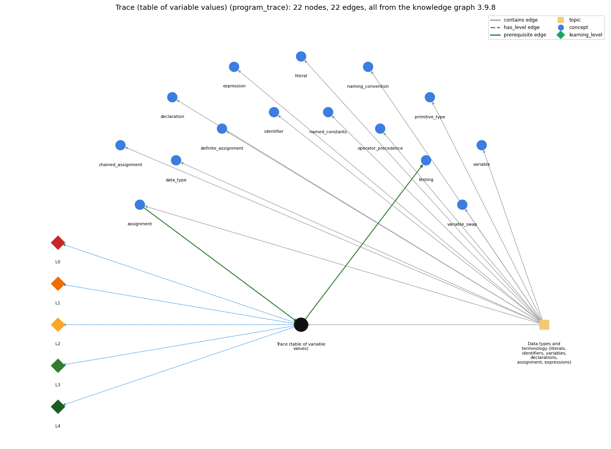

# Trace (table of variable values) (`program_trace`)

a table of the values of the variables after each statement, used to check what code does

Section 1.2 1.2 Built-in Types of Data, topic 1.2.a Data types and terminology (literals, identifiers, variables, declarations, assignment, expressions).

## At a glance

- **Needs first:** `assignment`
- **Leads to:** `testing`
- **Learned alongside:** nothing
- **Misconceptions:** none
- **Errors:** none
- **Levels:** L0, L1, L2, L3, L4

Everything below comes from the knowledge graph 3.9.8 (`data/raw/chapter1_kg_updated.json`): 22 edges around this concept. The edge logic, the wrong and right rules and the exact rules of the ways are copied word for word from the graph.

## To work on (2)

- no misconception or error edge
- no code pattern or signal: the code cannot tag this concept

## What it needs first (1)

A prerequisite edge means the other concept has to be understood before `program_trace`.

### `assignment` comes before `program_trace`

*= stores the computed value of the right side*

- **Edge:** `pre:assignment->program_trace`
- **Exact edge logic:** A trace records the value each variable holds after each assignment statement runs.
- **Grounding:** book\_passage
- **Composition rule (R) of `program_trace` with `assignment`:** Each assignment statement produces the next row of the trace, changing exactly the column of the variable on its left-hand side.
- **Composition rule (R) of `assignment` with `program_trace`:** A trace records the value of each variable after each assignment runs, one row per statement.

## What it leads to (1)

These concepts need `program_trace` first.

### `program_trace` comes before `testing`

*running a program on chosen inputs, including boundary and unusual ones, and comparing the output with what it should be*

- **Edge:** `pre:program_trace->testing`
- **Exact edge logic:** A test needs an expected result, and the expected result comes from tracing what the program should do, step by step.
- **Grounding:** book\_passage
- **Composition rule (R) of `testing` with `program_trace`:** The expected output of a test comes from a hand trace of what the program should do for that input.

## Learned alongside (0)

A parallel edge joins two concepts that sit side by side: neither is needed before the other.

No parallel edge touches this concept.

## Misconceptions (0)

A misconception edge states the wrong rule a student may hold about this concept, and the right rule.

The graph has no misconception edge from this concept.

## Errors (0)

An error edge states the rule that gets broken in a program, and the right rule.

The graph has no error edge from this concept.

## Levels L0 to L4 (5 of 5)

Each level edge lists the ways a student shows that level, each with its exact rule.

### L0: Prestructural / sensorimotor

L0 for Trace (table of variable values): the answer holds a rule that contradicts Java.

*Deciding question: Does every rule the answer applies to Trace (table of variable values) agree with the language rule? If it reads the code with everyday meanings, applies a wrong rule, or switches rules within one trace, it is L0. A slip in an otherwise rule-correct trace is L2 with an error, not L0.*

- **Edge:** `program_trace` &rarr; `program_trace@L0` (has_level)
- **Exact edge logic:** Trace (table of variable values) -&gt; L0 (Prestructural): the answer holds a rule that contradicts Java (1 way).

Ways (1), each with its exact rule:

- **[0] everyday\_reading** (rule type E, folk-meaning rule): Folk meaning: code is read like prose or a set of maths equations, all true at once, and 'tracing' means sketching it over. Java (notional machine) rule: statements execute one at a time in order and change variable values, so a trace is a table with one row per executed statement showing each variable's current value.

### L1: Unistructural / atom x text surface

L1 for Trace (table of variable values): the answer states one correct rule without applying it.

*Deciding question: Does the answer cover every part of the code, in order, with the values (L2)? If it covers one part or only states the rule, it is L1.*

- **Edge:** `program_trace` &rarr; `program_trace@L1` (has_level)
- **Exact edge logic:** Trace (table of variable values) -&gt; L1 (Unistructural): the answer states one correct rule without applying it (2 ways).

Ways (2), each with its exact rule:

- **[0] names\_the\_element** (rule type N, identity rule): A trace is a table of the values of the program's variables after each statement, used to examine what code does.
- **[1] states\_the\_rule** (rule type S, declarative rule): A trace has one column per variable and one row per executed statement, in execution order; each row shows the value of every variable after that statement, with a declared but unassigned variable shown as undefined.

### L2: Multistructural / block x execution / preoperational

L2 for Trace (table of variable values): the answer applies these rules to every part of the code, in order.

*Deciding question: Is the answer many segments mapped onto lines (L2), or one segment stating the purpose of the whole (L3)? A correct output with no value-by-value justification is not levelled.*

- **Edge:** `program_trace` &rarr; `program_trace@L2` (has_level)
- **Exact edge logic:** Trace (table of variable values) -&gt; L2 (Multistructural): the answer applies the rules of Trace (table of variable values) to every part of the code, in order (3 ways).

Ways (3), each with its exact rule:

- **[0] line\_by\_line\_trace** (rule type LT, operational sequencing rule): Follow the flow of control: take the next statement to execute (re-visiting loop bodies on each pass), evaluate it using the current row's values, and write a new row with the variables it changed; continue until the program ends.
- **[1] output\_prediction** (rule type OP, evaluation / result rule): The last row gives the final values (and any printed output follows from them): for int t = a; a = b; b = t; starting from a = 1234, b = 99, the final row is a = 99, b = 1234, t = 1234.
- **[2] one\_step\_execution** (rule type OS, state-transition rule): Each row differs from the previous one only in the variable(s) assigned by that statement; all other columns are copied unchanged.

### L3: Relational / relations x function (concrete operational begins)

L3 for Trace (table of variable values): the answer relates the parts by these rules.

*Deciding question: Was the purpose deduced from the code, or only guessed from traced input/output pairs (then L2)? Does the answer stay within the given code (L3), or reason about changed code, an error class or a new program (L4)?*

- **Edge:** `program_trace` &rarr; `program_trace@L3` (has_level)
- **Exact edge logic:** Trace (table of variable values) -&gt; L3 (Relational): the answer relates the parts (3 ways).

Ways (3), each with its exact rule:

- **[0] relation\_to\_neighbour** (rule type R, composition rule (with a neighbour)): Each assignment statement produces the next row of the trace, changing exactly the column of the variable on its left-hand side.
- **[1] relation\_to\_neighbour** (rule type R, composition rule (with a neighbour)): A test needs an expected result, and the expected result comes from tracing what the program should do, step by step.
- **[2] purpose\_of\_the\_whole** (rule type P, plan / role rule): Used to check or discover what a piece of code does (e.g. convince yourself that three statements swap a and b) and to debug; tracing a few rows often reveals the purpose of the whole.

### L4: Extended abstract (concrete-operational reversibility and conservation)

L4 for Trace (table of variable values): the answer reasons beyond the given code by these rules.

*Deciding question: Does the answer link the code to a broader context: a changed program, a class of inputs, an unseen problem? Re-tracing changed code value by value is L2; fixing one given failing case is L3.*

- **Edge:** `program_trace` &rarr; `program_trace@L4` (has_level)
- **Exact edge logic:** Trace (table of variable values) -&gt; L4 (Extended abstract): the answer reasons beyond the given code (3 ways).

Ways (3), each with its exact rule:

- **[0] predict\_a\_change** (rule type C, conservation rule): A trace shows the effect of a change: reordering the swap's statements (int t = a; b = t; a = b;) produces a different final row in which both variables hold the original a; the trace of the correct swap keeps the invariant that the old value of a is saved in t before a is overwritten.
- **[1] transfer\_to\_a\_new\_program** (rule type X, applicability rule): Trace small or unfamiliar code, loops and suspected bugs by hand; for larger programs, reason about what the parts compute (roles, invariants) or let the program print its variables, since a mental trace can hold only a few values at once.
- **[2] diagnose\_an\_error** (rule type D, error rule): rule broken: Each row must be computed from the current values, in execution order. Kind: silent logic error. Trigger class: Long traces or loops that overload working memory: stale or wrong values carried into later rows, giving a wrong predicted output.

## Same topic

`program_trace` belongs to the topic **Data types and terminology (literals, identifiers, variables, declarations, assignment, expressions)** (`topic1.2.a`). The topic also contains: `assignment`, `chained_assignment`, `data_type`, `declaration`, `definite_assignment`, `expression`, `identifier`, `literal`, `named_constants`, `naming_convention`, `operator_precedence`, `primitive_type`, `variable`, `variable_swap`.

## Rules of the concept (12)

- **Book** (SW-1e, p. 17 (pdf 27)): "study a table of the variable values after each statement (such a table is known as a trace)."
- **Book** (SW-1e, p. 78 (pdf 88)): "Even an expert programmer will tell you that the only way to understand a program like this is to trace it"
- **E** (folk-meaning rule): Folk meaning: code is read like prose or a set of maths equations, all true at once, and 'tracing' means sketching it over. Java (notional machine) rule: statements execute one at a time in order and change variable values, so a trace is a table with one row per executed statement showing each variable's current value.
- **T** (uneven-application rule): Points to LT (one row per executed statement, in execution order, computed from the previous row's values). Applied unevenly: the student uses a stale or wrong value of a variable in some rows, skips rows for repeated loop passes, or records a value change that the statement did not make.
- **N** (identity rule): A trace is a table of the values of the program's variables after each statement, used to examine what code does.
- **S** (declarative rule): A trace has one column per variable and one row per executed statement, in execution order; each row shows the value of every variable after that statement, with a declared but unassigned variable shown as undefined.
- **LT** (operational sequencing rule): Follow the flow of control: take the next statement to execute (re-visiting loop bodies on each pass), evaluate it using the current row's values, and write a new row with the variables it changed; continue until the program ends.
- **OP** (evaluation / result rule): The last row gives the final values (and any printed output follows from them): for int t = a; a = b; b = t; starting from a = 1234, b = 99, the final row is a = 99, b = 1234, t = 1234.
- **OS** (state-transition rule): Each row differs from the previous one only in the variable(s) assigned by that statement; all other columns are copied unchanged.
- **R** (composition rule (with a neighbour)): with assignment: Each assignment statement produces the next row of the trace, changing exactly the column of the variable on its left-hand side.
- **P** (plan / role rule): Used to check or discover what a piece of code does (e.g. convince yourself that three statements swap a and b) and to debug; tracing a few rows often reveals the purpose of the whole.
- **C** (conservation rule): A trace shows the effect of a change: reordering the swap's statements (int t = a; b = t; a = b;) produces a different final row in which both variables hold the original a; the trace of the correct swap keeps the invariant that the old value of a is saved in t before a is overwritten.
- **D** (error rule): rule broken: Each row must be computed from the current values, in execution order. (silent logic error)
- **X** (applicability rule): Trace small or unfamiliar code, loops and suspected bugs by hand; for larger programs, reason about what the parts compute (roles, invariants) or let the program print its variables, since a mental trace can hold only a few values at once.

## How it is found in code and answers (reader block)

- **Aliases:** trace, tracing, step by step
- **Code patterns:** none
- **Operator symbols:** none
- **Java types:** none

## The whole prerequisite chain

- **Everything it builds on (7):** `assignment`, `data_type`, `declaration`, `identifier`, `literal`, `primitive_type`, `variable`
- **Everything that builds on it (2):** `debugging`, `testing`

## Every edge in this view and its exact edge logic (22)

All the edges drawn in the picture, in the order: prerequisite, parallel, misconception, error, has_level, contains.

**1. `assignment` &rarr; `program_trace`** (prerequisite)

- **Exact edge logic:** A trace records the value each variable holds after each assignment statement runs.
- **Grounding:** book\_passage
- **Composition rule (R) of `assignment` with `program_trace`:** A trace records the value of each variable after each assignment runs, one row per statement.
- **Composition rule (R) of `program_trace` with `assignment`:** Each assignment statement produces the next row of the trace, changing exactly the column of the variable on its left-hand side.

**2. `program_trace` &rarr; `testing`** (prerequisite)

- **Exact edge logic:** A test needs an expected result, and the expected result comes from tracing what the program should do, step by step.
- **Grounding:** book\_passage
- **Composition rule (R) of `testing` with `program_trace`:** The expected output of a test comes from a hand trace of what the program should do for that input.

**3. `program_trace` &rarr; `program_trace@L0`** (has_level)

- **Exact edge logic:** Trace (table of variable values) -&gt; L0 (Prestructural): the answer holds a rule that contradicts Java (1 way).
  - **[0] everyday\_reading** (rule type E, folk-meaning rule): Folk meaning: code is read like prose or a set of maths equations, all true at once, and 'tracing' means sketching it over. Java (notional machine) rule: statements execute one at a time in order and change variable values, so a trace is a table with one row per executed statement showing each variable's current value.

**4. `program_trace` &rarr; `program_trace@L1`** (has_level)

- **Exact edge logic:** Trace (table of variable values) -&gt; L1 (Unistructural): the answer states one correct rule without applying it (2 ways).
  - **[0] names\_the\_element** (rule type N, identity rule): A trace is a table of the values of the program's variables after each statement, used to examine what code does.
  - **[1] states\_the\_rule** (rule type S, declarative rule): A trace has one column per variable and one row per executed statement, in execution order; each row shows the value of every variable after that statement, with a declared but unassigned variable shown as undefined.

**5. `program_trace` &rarr; `program_trace@L2`** (has_level)

- **Exact edge logic:** Trace (table of variable values) -&gt; L2 (Multistructural): the answer applies the rules of Trace (table of variable values) to every part of the code, in order (3 ways).
  - **[0] line\_by\_line\_trace** (rule type LT, operational sequencing rule): Follow the flow of control: take the next statement to execute (re-visiting loop bodies on each pass), evaluate it using the current row's values, and write a new row with the variables it changed; continue until the program ends.
  - **[1] output\_prediction** (rule type OP, evaluation / result rule): The last row gives the final values (and any printed output follows from them): for int t = a; a = b; b = t; starting from a = 1234, b = 99, the final row is a = 99, b = 1234, t = 1234.
  - **[2] one\_step\_execution** (rule type OS, state-transition rule): Each row differs from the previous one only in the variable(s) assigned by that statement; all other columns are copied unchanged.

**6. `program_trace` &rarr; `program_trace@L3`** (has_level)

- **Exact edge logic:** Trace (table of variable values) -&gt; L3 (Relational): the answer relates the parts (3 ways).
  - **[0] relation\_to\_neighbour** (rule type R, composition rule (with a neighbour)): Each assignment statement produces the next row of the trace, changing exactly the column of the variable on its left-hand side.
  - **[1] relation\_to\_neighbour** (rule type R, composition rule (with a neighbour)): A test needs an expected result, and the expected result comes from tracing what the program should do, step by step.
  - **[2] purpose\_of\_the\_whole** (rule type P, plan / role rule): Used to check or discover what a piece of code does (e.g. convince yourself that three statements swap a and b) and to debug; tracing a few rows often reveals the purpose of the whole.

**7. `program_trace` &rarr; `program_trace@L4`** (has_level)

- **Exact edge logic:** Trace (table of variable values) -&gt; L4 (Extended abstract): the answer reasons beyond the given code (3 ways).
  - **[0] predict\_a\_change** (rule type C, conservation rule): A trace shows the effect of a change: reordering the swap's statements (int t = a; b = t; a = b;) produces a different final row in which both variables hold the original a; the trace of the correct swap keeps the invariant that the old value of a is saved in t before a is overwritten.
  - **[1] transfer\_to\_a\_new\_program** (rule type X, applicability rule): Trace small or unfamiliar code, loops and suspected bugs by hand; for larger programs, reason about what the parts compute (roles, invariants) or let the program print its variables, since a mental trace can hold only a few values at once.
  - **[2] diagnose\_an\_error** (rule type D, error rule): rule broken: Each row must be computed from the current values, in execution order. Kind: silent logic error. Trigger class: Long traces or loops that overload working memory: stale or wrong values carried into later rows, giving a wrong predicted output.

**8. `topic1.2.a` &rarr; `program_trace`** (contains)

- topic `topic1.2.a` contains `program_trace`

**9. `topic1.2.a` &rarr; `assignment`** (contains)

- topic `topic1.2.a` contains `assignment`

**10. `topic1.2.a` &rarr; `chained_assignment`** (contains)

- topic `topic1.2.a` contains `chained_assignment`

**11. `topic1.2.a` &rarr; `data_type`** (contains)

- topic `topic1.2.a` contains `data_type`

**12. `topic1.2.a` &rarr; `declaration`** (contains)

- topic `topic1.2.a` contains `declaration`

**13. `topic1.2.a` &rarr; `definite_assignment`** (contains)

- topic `topic1.2.a` contains `definite_assignment`

**14. `topic1.2.a` &rarr; `expression`** (contains)

- topic `topic1.2.a` contains `expression`

**15. `topic1.2.a` &rarr; `identifier`** (contains)

- topic `topic1.2.a` contains `identifier`

**16. `topic1.2.a` &rarr; `literal`** (contains)

- topic `topic1.2.a` contains `literal`

**17. `topic1.2.a` &rarr; `named_constants`** (contains)

- topic `topic1.2.a` contains `named_constants`

**18. `topic1.2.a` &rarr; `naming_convention`** (contains)

- topic `topic1.2.a` contains `naming_convention`

**19. `topic1.2.a` &rarr; `operator_precedence`** (contains)

- topic `topic1.2.a` contains `operator_precedence`

**20. `topic1.2.a` &rarr; `primitive_type`** (contains)

- topic `topic1.2.a` contains `primitive_type`

**21. `topic1.2.a` &rarr; `variable`** (contains)

- topic `topic1.2.a` contains `variable`

**22. `topic1.2.a` &rarr; `variable_swap`** (contains)

- topic `topic1.2.a` contains `variable_swap`
