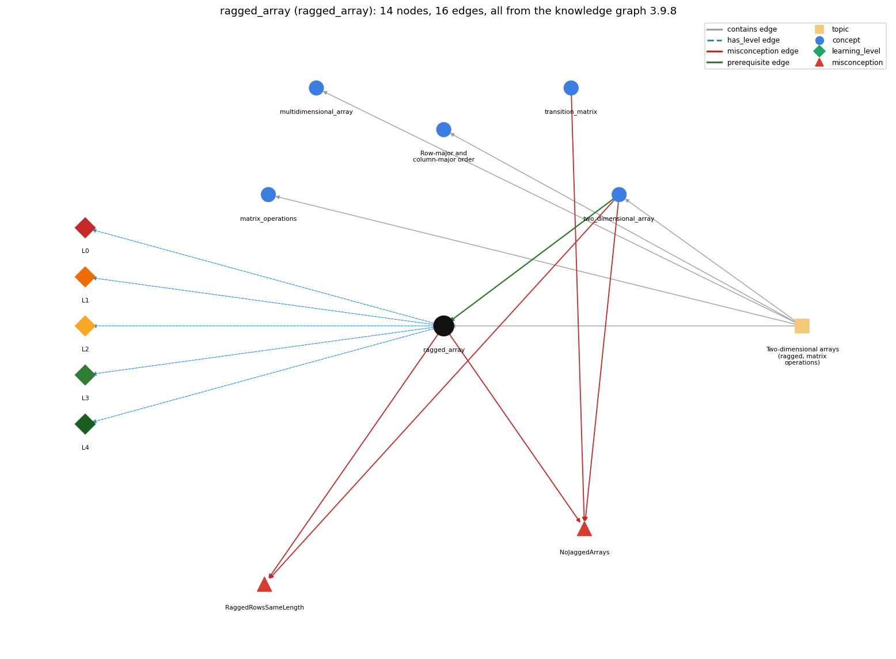

# ragged_array (`ragged_array`)

a 2-D array whose rows have different lengths

Section 1.4 Arrays, topic 1.4.g Two-dimensional arrays (ragged, matrix operations). From the knowledge graph 3.9.8 (`data/raw/chapter1_kg_updated.json`).

## Concepts associated with ragged\_array (5)

| Concept | Description | How it is associated |
| --- | --- | --- |
| **matrix\_operations** | matrix addition and multiplication with nested loops | same topic (topic1.4.g) |
| **multidimensional\_array** | arrays with three or more indices | same topic (topic1.4.g) |
| **row\_major\_order** | processing a 2-D array row by row (row-major) or column by column (column-major) | same topic (topic1.4.g) |
| **transition\_matrix** | a 2-D array of move probabilities (rows sum to 1) | shares misconception NoJaggedArrays |
| **two\_dimensional\_array** | an array of arrays (a[i][j]) | prerequisite of it (it needs this) composition rule (R) with it shares misconception RaggedRowsSameLength shares misconception NoJaggedArrays same topic (topic1.4.g) |

## Every edge in this view and its full label (16)

| From | Edge | To | Full edge label |
| --- | --- | --- | --- |
| **two\_dimensional\_array** | prerequisite | **ragged\_array** | There is no requirement that all rows in a two-dimensional array have the same length; an array with rows of nonuniform length is known as a ragged array. grounding: book\_passage composition rule (R) of two\_dimensional\_array with ragged\_array: Since each row is a separate array, rows may have different lengths; such arrays are ragged. composition rule (R) of ragged\_array with two\_dimensional\_array: Ragged arrays exist because a 2-D array is an array of arrays: each row is an independent 1-D array with its own length. |
| **ragged\_array** | misconception | **NoJaggedArrays** | **wrong rule:** multi-dimensional arrays must be rectangular **right rule:** Each row a[i] is its own array, so rows can have different lengths a[i].length. role: primary |
| **ragged\_array** | misconception | **RaggedRowsSameLength** | **wrong rule:** All rows of a 2-D array have the same length, so one N works for every row. **right rule:** Rows may differ in length; use a[i].length for row i. role: primary |
| **transition\_matrix** | misconception | **NoJaggedArrays** | **wrong rule:** Every row of the transition matrix must be stored with the same length because 2-D arrays are always rectangular. **right rule:** Each p[i] is its own row array; the surfer's matrix is square only because every page has a row of n probabilities. role: context |
| **two\_dimensional\_array** | misconception | **NoJaggedArrays** | **wrong rule:** Every row of a 2-D array must have the same length. **right rule:** Each row a[i] is its own array, so rows can have different lengths a[i].length. role: context |
| **two\_dimensional\_array** | misconception | **RaggedRowsSameLength** | **wrong rule:** All rows of a 2-D array have the same length, so one N works for every row. **right rule:** Rows may differ in length; use a[i].length for row i. role: context |
| **ragged\_array** | has\_level | **ragged\_array@L0** | ragged array -&gt; L0 (Prestructural): the answer holds a rule that contradicts Java (4 ways). **[0] everyday\_reading** (E): Folk meaning: a 'table' has the same number of columns in every row, so one width N serves all rows. Java rule: each row is a separate array, so rows may have different lengths, and code must use a[i].length for row i. **[1] misconception** (M) &rarr; RaggedRowsSameLength: wrong rule: All rows of a 2-D array have the same length, so one N works for every row. Right rule: Rows may differ in length; use a[i].length for row i. **[2] misconception** (M) &rarr; NoJaggedArrays: wrong rule: Multi-dimensional arrays must be rectangular. Right rule: Each row a[i] is its own array, so rows can have different lengths a[i].length. **[3] inconsistent\_trace** (T) &rarr; RaggedRowsSameLength: Points to LT: the inner bound a[i].length is re-evaluated for each row. Inconsistent application: the trace uses row 0's length (or N) for every row, sometimes over-running a short row and sometimes stopping early in a long one. (here mixing in: "All rows of a 2-D array have the same length, so one N works for every row") |
| **ragged\_array** | has\_level | **ragged\_array@L1** | ragged array -&gt; L1 (Unistructural): the answer states one correct rule without applying it (2 ways). **[0] names\_the\_element** (N): Identity: a ragged array is a two-dimensional array whose rows have different (nonuniform) lengths. **[1] states\_the\_rule** (S): Declarative: there is no requirement that rows have the same length. Process row i up to a[i].length: for (i &lt; a.length) for (j &lt; a[i].length). |
| **ragged\_array** | has\_level | **ragged\_array@L2** | ragged array -&gt; L2 (Multistructural): the answer applies the rules of ragged array to every part of the code, in order (3 ways). **[0] line\_by\_line\_trace** (LT): Sequencing: the outer loop runs i over 0..a.length-1; for each i the inner loop bound a[i].length is read for that row, and then j runs over 0..a[i].length-1. **[1] output\_prediction** (OP): Result: rows of different widths, e.g. a Pascal's-triangle array whose row N has N+1 entries; a[i].length differs from row to row. **[2] one\_step\_execution** (OS): State transition: creating a row with a[i] = new double[i+1] sets the length of that row only; element writes change one entry. |
| **ragged\_array** | has\_level | **ragged\_array@L3** | ragged array -&gt; L3 (Relational): the answer relates the parts (2 ways). **[0] relation\_to\_neighbour** (R): Ragged arrays exist because a 2-D array is an array of arrays: each row is an independent 1-D array with its own length. **[1] purpose\_of\_the\_whole** (P): Plan/role: store triangular or uneven data (binomial coefficients, lists of varying length) without wasting space on unused entries. |
| **ragged\_array** | has\_level | **ragged\_array@L4** | ragged array -&gt; L4 (Extended abstract): the answer reasons beyond the given code (4 ways). **[0] predict\_a\_change** (C) &rarr; RaggedRowsSameLength: Conservation: code written with a[i].length also works for rectangular arrays, but code written with a fixed N breaks on ragged ones; each later solution should still work for the earlier cases. **[1] transfer\_to\_a\_new\_program** (X): Applicability: use a ragged array when rows naturally differ in length. When all rows have equal length, a rectangular array with M and N is simpler, and the book normally uses that. **[2] diagnose\_an\_error** (D): rule broken: Each row must be processed up to its own length. Kind: run-time exception. Trigger class: the inner loop uses N or a[0].length, and a shorter row is indexed past its end (ArrayIndexOutOfBoundsException) **[3] diagnose\_an\_error** (D): rule broken: Each row must be processed up to its own length. Kind: silent logic error. Trigger class: the inner bound is shorter than a longer row, so its last entries are silently skipped |
| **topic1.4.g** | contains | **matrix\_operations** | topic topic1.4.g contains matrix\_operations |
| **topic1.4.g** | contains | **multidimensional\_array** | topic topic1.4.g contains multidimensional\_array |
| **topic1.4.g** | contains | **ragged\_array** | topic topic1.4.g contains ragged\_array |
| **topic1.4.g** | contains | **row\_major\_order** | topic topic1.4.g contains row\_major\_order |
| **topic1.4.g** | contains | **two\_dimensional\_array** | topic topic1.4.g contains two\_dimensional\_array |
