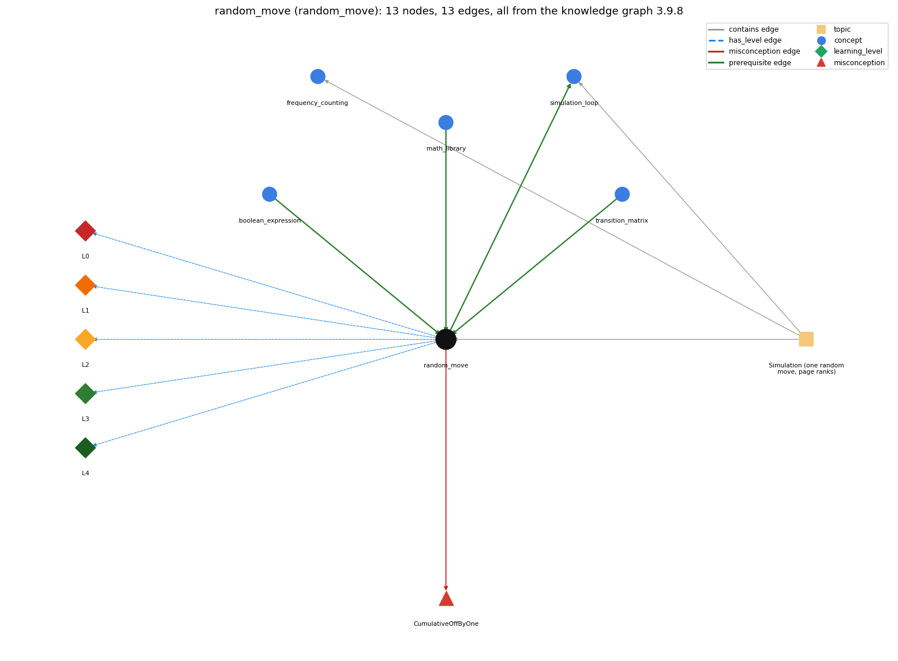

# random_move (`random_move`)

pick the next page from a cumulative-probability test

Section 1.6 Case Study: Random Web Surfer, topic 1.6.b Simulation (one random move, page ranks).

## At a glance

- **Needs first:** `boolean_expression`, `math_library`, `transition_matrix`
- **Leads to:** `simulation_loop`
- **Learned alongside:** nothing
- **Misconceptions:** `CumulativeOffByOne`
- **Errors:** none
- **Levels:** L0, L1, L2, L3, L4

Everything below comes from the knowledge graph 3.9.8 (`data/raw/chapter1_kg_updated.json`): 13 edges around this concept. The edge logic, the wrong and right rules and the exact rules of the ways are copied word for word from the graph.

## To work on (1)

- no aliases: a student's words cannot name this concept

## What it needs first (3)

A prerequisite edge means the other concept has to be understood before `random_move`.

### `boolean_expression` comes before `random_move`

*an expression that evaluates to true/false*

- **Edge:** `pre:boolean_expression->random_move`
- **Exact edge logic:** The next page is chosen by testing the condition r &lt; sum for each candidate page j in turn.
- **Grounding:** book\_passage
- **Composition rule (R) of `random_move` with `boolean_expression`:** The relational test r &lt; sum decides both the chosen page and the early break; &lt; (not &lt;=) matches the half-open interval endpoint tracked by sum.
- **Composition rule (R) of `boolean_expression` with `random_move`:** In RandomSurfer the boolean expression r &lt; sum is evaluated for each candidate page j in turn, as sum grows; the first j for which it is true is the chosen page.

### `math_library` comes before `random_move`

*Math.abs, Math.sqrt, Math.max, Math.random, Math.round ...*

- **Edge:** `pre:math_library->random_move`
- **Exact edge logic:** The random move draws r with Math.random() and then finds the interval of row p[page] that contains r.
- **Grounding:** book\_passage
- **Composition rule (R) of `random_move` with `math_library`:** Math.random() supplies one uniform double in [0, 1) per move; it must be called once before the j loop, not inside it.
- **Composition rule (R) of `math_library` with `random_move`:** The random move draws r = Math.random() once per move and compares it with growing cumulative sums of row p[page] to find which interval contains it.

### `transition_matrix` comes before `random_move`

*a 2-D array of move probabilities (rows sum to 1)*

- **Edge:** `pre:transition_matrix->random_move`
- **Exact edge logic:** Row p[i] is the probability distribution used to choose the next page when the surfer is on page i.
- **Grounding:** book\_passage
- **Composition rule (R) of `random_move` with `transition_matrix`:** Reads exactly one row p[page]; the row must sum to 1, otherwise r can exceed the final sum and no j is chosen.
- **Composition rule (R) of `transition_matrix` with `random_move`:** The random move reads one row p[page] as a 1-D array and accumulates its entries; it only works if that row sums to 1.

## What it leads to (1)

These concepts need `random_move` first.

### `random_move` comes before `simulation_loop`

*take many random steps*

- **Edge:** `pre:random_move->simulation_loop`
- **Exact edge logic:** The simulation repeats the random move T times, each move starting from the page the previous move reached.
- **Grounding:** book\_passage
- **Composition rule (R) of `random_move` with `simulation_loop`:** Each move starts from the page the previous move produced, and the simulation repeats it T times; the next row used is p[new page].
- **Composition rule (R) of `simulation_loop` with `random_move`:** The loop body is one random move; page carries state from one pass to the next, so each move uses the row of the page reached last.

## Learned alongside (0)

A parallel edge joins two concepts that sit side by side: neither is needed before the other.

No parallel edge touches this concept.

## Misconceptions (1)

A misconception edge states the wrong rule a student may hold about this concept, and the right rule.

### CumulativeOffByOne

- **Edge:** `random_move` &rarr; `CumulativeOffByOne` (misconception)
- **Exact edge logic (the wrong rule):** Whether the test is r &lt; s or r &lt;= s, or whether p[i][j] is added before or after the test, the same page is picked.
- **Twin logic (the right rule):** Add p[page][j] to sum and then test r &lt; sum: sum tracks the endpoints of the intervals defined by row p[page], so the loop finds the interval containing r, and r falls into each interval with probability precisely specified by its length.
- **Wrong belief (on the node):** the cumulative-probability boundary test is inclusive/exclusive interchangeably
- **Correct rule (on the node):** Add p[page][j] to sum and then test r &lt; sum: sum tracks the endpoints of the intervals defined by row p[page], so the loop finds the interval containing r, and r falls into each interval with probability precisely specified by its length.
- **Provenance:** derived
- **Role of this concept:** primary
- **L0 way linked to it:** yes
- **L0 way [1] misconception, exact rule:** wrong rule: The cumulative-probability boundary test is inclusive/exclusive interchangeably. Right rule: Add p[page][j] to sum first and then test r &lt; sum; sum is the right endpoint of interval j, so r lands in interval j with probability equal to its length.
- **L0 way [2] inconsistent\_trace, exact rule:** Applies LT (r drawn once; for each j: add p[page][j] to sum, then test r &lt; sum) unevenly: e.g. testing before adding on some passes, or drawing a new r for each j. (here mixing in: "the cumulative-probability boundary test is inclusive/exclusive interchangeably")

## Errors (0)

An error edge states the rule that gets broken in a program, and the right rule.

The graph has no error edge from this concept.

## Levels L0 to L4 (5 of 5)

Each level edge lists the ways a student shows that level, each with its exact rule.

### L0: Prestructural / sensorimotor

L0 for random move: the answer holds a rule that contradicts Java.

*Deciding question: Does every rule the answer applies to random move agree with the language rule? If it reads the code with everyday meanings, applies a wrong rule, or switches rules within one trace, it is L0. A slip in an otherwise rule-correct trace is L2 with an error, not L0.*

- **Edge:** `random_move` &rarr; `random_move@L0` (has_level)
- **Exact edge logic:** random move -&gt; L0 (Prestructural): the answer holds a rule that contradicts Java (3 ways).

Ways (3), each with its exact rule:

- **[0] everyday\_reading** (rule type E, folk-meaning rule): Everyday "random" means every outcome equally likely, which is what Math.random() gives; the random move must instead pick page j with the unequal probability p[page][j].
- **[1] misconception** (rule type M, wrong rule / right rule) &rarr; `CumulativeOffByOne`: wrong rule: The cumulative-probability boundary test is inclusive/exclusive interchangeably. Right rule: Add p[page][j] to sum first and then test r &lt; sum; sum is the right endpoint of interval j, so r lands in interval j with probability equal to its length.
- **[2] inconsistent\_trace** (rule type T, uneven-application rule) &rarr; `CumulativeOffByOne`: Applies LT (r drawn once; for each j: add p[page][j] to sum, then test r &lt; sum) unevenly: e.g. testing before adding on some passes, or drawing a new r for each j. (here mixing in: "the cumulative-probability boundary test is inclusive/exclusive interchangeably")

### L1: Unistructural / atom x text surface

L1 for random move: the answer states one correct rule without applying it.

*Deciding question: Does the answer cover every part of the code, in order, with the values (L2)? If it covers one part or only states the rule, it is L1.*

- **Edge:** `random_move` &rarr; `random_move@L1` (has_level)
- **Exact edge logic:** random move -&gt; L1 (Unistructural): the answer states one correct rule without applying it (2 ways).

Ways (2), each with its exact rule:

- **[0] names\_the\_element** (rule type N, identity rule): An algorithm: generating a random integer from a discrete distribution (row p[page]) by locating a uniform random number in cumulative intervals.
- **[1] states\_the\_rule** (rule type S, declarative rule): Think of row p[page] as N intervals of (0, 1) whose lengths are the probabilities; a uniform r from Math.random() falls into interval j with probability p[page][j], and the surfer moves to j.

### L2: Multistructural / block x execution / preoperational

L2 for random move: the answer applies these rules to every part of the code, in order.

*Deciding question: Is the answer many segments mapped onto lines (L2), or one segment stating the purpose of the whole (L3)? A correct output with no value-by-value justification is not levelled.*

- **Edge:** `random_move` &rarr; `random_move@L2` (has_level)
- **Exact edge logic:** random move -&gt; L2 (Multistructural): the answer applies the rules of random move to every part of the code, in order (3 ways).

Ways (3), each with its exact rule:

- **[0] line\_by\_line\_trace** (rule type LT, operational sequencing rule): r = Math.random() is drawn once; sum = 0.0; j goes 0, 1, ...; on each pass sum += p[page][j] and then if (r &lt; sum) set page = j and break, so the first interval whose right end exceeds r wins.
- **[1] output\_prediction** (rule type OP, evaluation / result rule): Returns (through page) one integer 0..N-1; at page 4 of tiny.txt sum takes 0.47, 0.49, 0.96, ... and r = .71 gives page 2.
- **[2] one\_step\_execution** (rule type OS, state-transition rule): One move changes page from its current value to j (and leaves freq and p unchanged); the locals r, sum and j live only for that move.

### L3: Relational / relations x function (concrete operational begins)

L3 for random move: the answer relates the parts by these rules.

*Deciding question: Was the purpose deduced from the code, or only guessed from traced input/output pairs (then L2)? Does the answer stay within the given code (L3), or reason about changed code, an error class or a new program (L4)?*

- **Edge:** `random_move` &rarr; `random_move@L3` (has_level)
- **Exact edge logic:** random move -&gt; L3 (Relational): the answer relates the parts (5 ways).

Ways (5), each with its exact rule:

- **[0] relation\_to\_neighbour** (rule type R, composition rule (with a neighbour)): Reads exactly one row p[page]; the row must sum to 1, otherwise r can exceed the final sum and no j is chosen.
- **[1] relation\_to\_neighbour** (rule type R, composition rule (with a neighbour)): Each move starts from the page the previous move produced, and the simulation repeats it T times; the next row used is p[new page].
- **[2] relation\_to\_neighbour** (rule type R, composition rule (with a neighbour)): The relational test r &lt; sum decides both the chosen page and the early break; &lt; (not &lt;=) matches the half-open interval endpoint tracked by sum.
- **[3] relation\_to\_neighbour** (rule type R, composition rule (with a neighbour)): Math.random() supplies one uniform double in [0, 1) per move; it must be called once before the j loop, not inside it.
- **[4] purpose\_of\_the\_whole** (rule type P, plan / role rule): Sampling plan (search the cumulative sums): sum is a gatherer, j a stepper, and page a most-recent holder of the current location; break ends the search as soon as the interval is found.

### L4: Extended abstract (concrete-operational reversibility and conservation)

L4 for random move: the answer reasons beyond the given code by these rules.

*Deciding question: Does the answer link the code to a broader context: a changed program, a class of inputs, an unseen problem? Re-tracing changed code value by value is L2; fixing one given failing case is L3.*

- **Edge:** `random_move` &rarr; `random_move@L4` (has_level)
- **Exact edge logic:** random move -&gt; L4 (Extended abstract): the answer reasons beyond the given code (5 ways).

Ways (5), each with its exact rule:

- **[0] predict\_a\_change** (rule type C, conservation rule) &rarr; `CumulativeOffByOne`: Changing the search (linear to binary) or the order of pages keeps the distribution of outcomes; replacing r &lt; sum with r &lt;= sum changes it only on a zero-probability event; moving Math.random() into the loop breaks it.
- **[1] transfer\_to\_a\_new\_program** (rule type X, applicability rule): Use to draw from any non-uniform discrete distribution (one row of probabilities); for uniform choice Math.random() scaled is enough, and for large N a binary search over the cumulative sums is faster.
- **[2] diagnose\_an\_error** (rule type D, error rule): rule broken: Add the entry to sum before testing r &lt; sum. Kind: silent logic error. Trigger class: Test placed before sum += p[page][j]: the first test is r &lt; 0.0 (always false) and every page is chosen from the previous interval, shifting probabilities by one page.
- **[3] diagnose\_an\_error** (rule type D, error rule): rule broken: Row p[page] must sum to 1. Kind: silent logic error. Trigger class: Row sum &lt; 1 (e.g. dangling page, NaN): when r exceeds the final sum the loop ends with no break and page is unchanged.
- **[4] diagnose\_an\_error** (rule type D, error rule): rule broken: break must exit the search once the interval is found. Kind: silent logic error. Trigger class: break omitted: page is reassigned on every later j, so the surfer always moves to page N-1 (or the last j with r &lt; sum).

## Same topic

`random_move` belongs to the topic **Simulation (one random move, page ranks)** (`topic1.6.b`). The topic also contains: `frequency_counting`, `simulation_loop`.

## Rules of the concept (18)

- **Book** (SW-1e, p. 166 (pdf 176)): "The key to the computation is the random move, which is specified by the transition matrix."
- **Book** (SW-1e, p. 166 (pdf 176)): "The variable sum tracks the endpoints of the intervals defined in row p[page], and the for loop finds the interval containing the random value r."
- **Book** (SW-1.6, p. 164 (pdf 174)): "each row represents a discrete probability distribution"
- **Book** (SW-1.6, p. 164 (pdf 174)): "the entry in row i and column j is the probability that the random surfer moves to page j when on page i"
- **E** (folk-meaning rule): Everyday "random" means every outcome equally likely, which is what Math.random() gives; the random move must instead pick page j with the unequal probability p[page][j].
- **M** (wrong rule / right rule): CumulativeOffByOne: wrong: The cumulative-probability boundary test is inclusive/exclusive interchangeably. \| right: Add p[page][j] to sum first and then test r &lt; sum; sum is the right endpoint of interval j, so r lands in interval j with probability equal to its length.
- **T** (uneven-application rule): Applies LT (r drawn once; for each j: add p[page][j] to sum, then test r &lt; sum) unevenly: e.g. testing before adding on some passes, or drawing a new r for each j.
- **N** (identity rule): An algorithm: generating a random integer from a discrete distribution (row p[page]) by locating a uniform random number in cumulative intervals.
- **S** (declarative rule): Think of row p[page] as N intervals of (0, 1) whose lengths are the probabilities; a uniform r from Math.random() falls into interval j with probability p[page][j], and the surfer moves to j.
- **LT** (operational sequencing rule): r = Math.random() is drawn once; sum = 0.0; j goes 0, 1, ...; on each pass sum += p[page][j] and then if (r &lt; sum) set page = j and break, so the first interval whose right end exceeds r wins.
- **OP** (evaluation / result rule): Returns (through page) one integer 0..N-1; at page 4 of tiny.txt sum takes 0.47, 0.49, 0.96, ... and r = .71 gives page 2.
- **OS** (state-transition rule): One move changes page from its current value to j (and leaves freq and p unchanged); the locals r, sum and j live only for that move.
- **R** (composition rule (with a neighbour)): with transition\_matrix: Reads exactly one row p[page]; the row must sum to 1, otherwise r can exceed the final sum and no j is chosen.
- **R** (composition rule (with a neighbour)): with simulation\_loop: Each move starts from the page the previous move produced, and the simulation repeats it T times; the next row used is p[new page].
- **R** (composition rule (with a neighbour)): with boolean\_expression: The relational test r &lt; sum decides both the chosen page and the early break; &lt; (not &lt;=) matches the half-open interval endpoint tracked by sum.
- **R** (composition rule (with a neighbour)): with math\_library: Math.random() supplies one uniform double in [0, 1) per move; it must be called once before the j loop, not inside it.
- **P** (plan / role rule): Sampling plan (search the cumulative sums): sum is a gatherer, j a stepper, and page a most-recent holder of the current location; break ends the search as soon as the interval is found.
- **C** (conservation rule): Changing the search (linear to binary) or the order of pages keeps the distribution of outcomes; replacing r &lt; sum with r &lt;= sum changes it only on a zero-probability event; moving Math.random() into the loop breaks it.
- **D** (error rule): rule broken: Add the entry to sum before testing r &lt; sum. (silent logic error)
- **D** (error rule): rule broken: Row p[page] must sum to 1. (silent logic error)
- **D** (error rule): rule broken: break must exit the search once the interval is found. (silent logic error)
- **X** (applicability rule): Use to draw from any non-uniform discrete distribution (one row of probabilities); for uniform choice Math.random() scaled is enough, and for large N a binary search over the cumulative sums is faster.

## How it is found in code and answers (reader block)

- **Aliases:** none
- **Code patterns:** `\bif\s*\(\s*\w+\s*<\s*sum\s*\)`, `StdRandom\.discrete\s*\(`
- **Operator symbols:** none
- **Java types:** none

## The whole prerequisite chain

- **Everything it builds on (24):** `arithmetic_operators`, `array_creation`, `array_declaration`, `array_initializer`, `boolean`, `boolean_expression`, `comparison_operators`, `data_structure`, `data_type`, `expression`, `identifier`, `indexing`, `input_graph`, `literal`, `logical_operators`, `math_library`, `method_call`, `primitive_type`, `standard_input`, `stream_model`, `teleportation`, `transition_matrix`, `two_dimensional_array`, `variable`
- **Everything that builds on it (3):** `frequency_counting`, `simulation_loop`, `two_models`

## Every edge in this view and its exact edge logic (13)

All the edges drawn in the picture, in the order: prerequisite, parallel, misconception, error, has_level, contains.

**1. `boolean_expression` &rarr; `random_move`** (prerequisite)

- **Exact edge logic:** The next page is chosen by testing the condition r &lt; sum for each candidate page j in turn.
- **Grounding:** book\_passage
- **Composition rule (R) of `boolean_expression` with `random_move`:** In RandomSurfer the boolean expression r &lt; sum is evaluated for each candidate page j in turn, as sum grows; the first j for which it is true is the chosen page.
- **Composition rule (R) of `random_move` with `boolean_expression`:** The relational test r &lt; sum decides both the chosen page and the early break; &lt; (not &lt;=) matches the half-open interval endpoint tracked by sum.

**2. `math_library` &rarr; `random_move`** (prerequisite)

- **Exact edge logic:** The random move draws r with Math.random() and then finds the interval of row p[page] that contains r.
- **Grounding:** book\_passage
- **Composition rule (R) of `math_library` with `random_move`:** The random move draws r = Math.random() once per move and compares it with growing cumulative sums of row p[page] to find which interval contains it.
- **Composition rule (R) of `random_move` with `math_library`:** Math.random() supplies one uniform double in [0, 1) per move; it must be called once before the j loop, not inside it.

**3. `random_move` &rarr; `simulation_loop`** (prerequisite)

- **Exact edge logic:** The simulation repeats the random move T times, each move starting from the page the previous move reached.
- **Grounding:** book\_passage
- **Composition rule (R) of `random_move` with `simulation_loop`:** Each move starts from the page the previous move produced, and the simulation repeats it T times; the next row used is p[new page].
- **Composition rule (R) of `simulation_loop` with `random_move`:** The loop body is one random move; page carries state from one pass to the next, so each move uses the row of the page reached last.

**4. `transition_matrix` &rarr; `random_move`** (prerequisite)

- **Exact edge logic:** Row p[i] is the probability distribution used to choose the next page when the surfer is on page i.
- **Grounding:** book\_passage
- **Composition rule (R) of `transition_matrix` with `random_move`:** The random move reads one row p[page] as a 1-D array and accumulates its entries; it only works if that row sums to 1.
- **Composition rule (R) of `random_move` with `transition_matrix`:** Reads exactly one row p[page]; the row must sum to 1, otherwise r can exceed the final sum and no j is chosen.

**5. `random_move` &rarr; `CumulativeOffByOne`** (misconception)

- **Exact edge logic (the wrong rule):** Whether the test is r &lt; s or r &lt;= s, or whether p[i][j] is added before or after the test, the same page is picked.
- **Twin logic (the right rule):** Add p[page][j] to sum and then test r &lt; sum: sum tracks the endpoints of the intervals defined by row p[page], so the loop finds the interval containing r, and r falls into each interval with probability precisely specified by its length.
- **Role:** primary

**6. `random_move` &rarr; `random_move@L0`** (has_level)

- **Exact edge logic:** random move -&gt; L0 (Prestructural): the answer holds a rule that contradicts Java (3 ways).
  - **[0] everyday\_reading** (rule type E, folk-meaning rule): Everyday "random" means every outcome equally likely, which is what Math.random() gives; the random move must instead pick page j with the unequal probability p[page][j].
  - **[1] misconception** (rule type M, wrong rule / right rule) &rarr; `CumulativeOffByOne`: wrong rule: The cumulative-probability boundary test is inclusive/exclusive interchangeably. Right rule: Add p[page][j] to sum first and then test r &lt; sum; sum is the right endpoint of interval j, so r lands in interval j with probability equal to its length.
  - **[2] inconsistent\_trace** (rule type T, uneven-application rule) &rarr; `CumulativeOffByOne`: Applies LT (r drawn once; for each j: add p[page][j] to sum, then test r &lt; sum) unevenly: e.g. testing before adding on some passes, or drawing a new r for each j. (here mixing in: "the cumulative-probability boundary test is inclusive/exclusive interchangeably")

**7. `random_move` &rarr; `random_move@L1`** (has_level)

- **Exact edge logic:** random move -&gt; L1 (Unistructural): the answer states one correct rule without applying it (2 ways).
  - **[0] names\_the\_element** (rule type N, identity rule): An algorithm: generating a random integer from a discrete distribution (row p[page]) by locating a uniform random number in cumulative intervals.
  - **[1] states\_the\_rule** (rule type S, declarative rule): Think of row p[page] as N intervals of (0, 1) whose lengths are the probabilities; a uniform r from Math.random() falls into interval j with probability p[page][j], and the surfer moves to j.

**8. `random_move` &rarr; `random_move@L2`** (has_level)

- **Exact edge logic:** random move -&gt; L2 (Multistructural): the answer applies the rules of random move to every part of the code, in order (3 ways).
  - **[0] line\_by\_line\_trace** (rule type LT, operational sequencing rule): r = Math.random() is drawn once; sum = 0.0; j goes 0, 1, ...; on each pass sum += p[page][j] and then if (r &lt; sum) set page = j and break, so the first interval whose right end exceeds r wins.
  - **[1] output\_prediction** (rule type OP, evaluation / result rule): Returns (through page) one integer 0..N-1; at page 4 of tiny.txt sum takes 0.47, 0.49, 0.96, ... and r = .71 gives page 2.
  - **[2] one\_step\_execution** (rule type OS, state-transition rule): One move changes page from its current value to j (and leaves freq and p unchanged); the locals r, sum and j live only for that move.

**9. `random_move` &rarr; `random_move@L3`** (has_level)

- **Exact edge logic:** random move -&gt; L3 (Relational): the answer relates the parts (5 ways).
  - **[0] relation\_to\_neighbour** (rule type R, composition rule (with a neighbour)): Reads exactly one row p[page]; the row must sum to 1, otherwise r can exceed the final sum and no j is chosen.
  - **[1] relation\_to\_neighbour** (rule type R, composition rule (with a neighbour)): Each move starts from the page the previous move produced, and the simulation repeats it T times; the next row used is p[new page].
  - **[2] relation\_to\_neighbour** (rule type R, composition rule (with a neighbour)): The relational test r &lt; sum decides both the chosen page and the early break; &lt; (not &lt;=) matches the half-open interval endpoint tracked by sum.
  - **[3] relation\_to\_neighbour** (rule type R, composition rule (with a neighbour)): Math.random() supplies one uniform double in [0, 1) per move; it must be called once before the j loop, not inside it.
  - **[4] purpose\_of\_the\_whole** (rule type P, plan / role rule): Sampling plan (search the cumulative sums): sum is a gatherer, j a stepper, and page a most-recent holder of the current location; break ends the search as soon as the interval is found.

**10. `random_move` &rarr; `random_move@L4`** (has_level)

- **Exact edge logic:** random move -&gt; L4 (Extended abstract): the answer reasons beyond the given code (5 ways).
  - **[0] predict\_a\_change** (rule type C, conservation rule) &rarr; `CumulativeOffByOne`: Changing the search (linear to binary) or the order of pages keeps the distribution of outcomes; replacing r &lt; sum with r &lt;= sum changes it only on a zero-probability event; moving Math.random() into the loop breaks it.
  - **[1] transfer\_to\_a\_new\_program** (rule type X, applicability rule): Use to draw from any non-uniform discrete distribution (one row of probabilities); for uniform choice Math.random() scaled is enough, and for large N a binary search over the cumulative sums is faster.
  - **[2] diagnose\_an\_error** (rule type D, error rule): rule broken: Add the entry to sum before testing r &lt; sum. Kind: silent logic error. Trigger class: Test placed before sum += p[page][j]: the first test is r &lt; 0.0 (always false) and every page is chosen from the previous interval, shifting probabilities by one page.
  - **[3] diagnose\_an\_error** (rule type D, error rule): rule broken: Row p[page] must sum to 1. Kind: silent logic error. Trigger class: Row sum &lt; 1 (e.g. dangling page, NaN): when r exceeds the final sum the loop ends with no break and page is unchanged.
  - **[4] diagnose\_an\_error** (rule type D, error rule): rule broken: break must exit the search once the interval is found. Kind: silent logic error. Trigger class: break omitted: page is reassigned on every later j, so the surfer always moves to page N-1 (or the last j with r &lt; sum).

**11. `topic1.6.b` &rarr; `random_move`** (contains)

- topic `topic1.6.b` contains `random_move`

**12. `topic1.6.b` &rarr; `frequency_counting`** (contains)

- topic `topic1.6.b` contains `frequency_counting`

**13. `topic1.6.b` &rarr; `simulation_loop`** (contains)

- topic `topic1.6.b` contains `simulation_loop`
