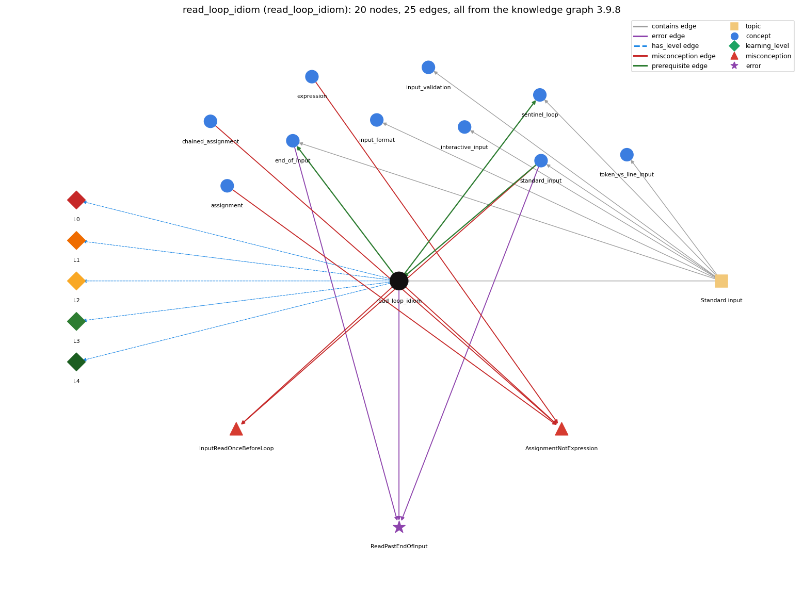

# read_loop_idiom (`read_loop_idiom`)

reading until end-of-input

Section 1.5 Input and Output, topic 1.5.c Standard input. From the knowledge graph 3.9.8 (`data/raw/chapter1_kg_updated.json`).

## Concepts associated with read\_loop\_idiom (10)

| Concept | Description | How it is associated |
| --- | --- | --- |
| **assignment** | = stores the computed value of the right side | shares misconception AssignmentNotExpression |
| **chained\_assignment** | a = b = 0 assigns right to left | shares misconception AssignmentNotExpression |
| **end\_of\_input** | StdIn.isEmpty() and the end-of-file keystroke | builds on it (needs it) composition rule (R) with it shares error ReadPastEndOfInput same topic (topic1.5.c) |
| **expression** | anything that evaluates to a value | shares misconception AssignmentNotExpression |
| **input\_format** | StdIn reads whitespace-separated tokens of the expected type | same topic (topic1.5.c) |
| **input\_validation** | checking the next input before reading it | same topic (topic1.5.c) |
| **interactive\_input** | the user's input can change the program's control flow while it runs | same topic (topic1.5.c) |
| **sentinel\_loop** | reading until a special stop value (Rainfall problem) | builds on it (needs it) composition rule (R) with it same topic (topic1.5.c) |
| **standard\_input** | StdIn -- reading a stream of values | prerequisite of it (it needs this) composition rule (R) with it shares error ReadPastEndOfInput shares misconception InputReadOnceBeforeLoop same topic (topic1.5.c) |
| **token\_vs\_line\_input** | reading tokens (readInt) versus whole lines (readLine) | same topic (topic1.5.c) |

## Every edge in this view and its full label (25)

| From | Edge | To | Full edge label |
| --- | --- | --- | --- |
| **read\_loop\_idiom** | prerequisite | **end\_of\_input** | The read loop runs until StdIn.isEmpty() returns true, which happens when the user types the end-of-file sequence (&lt;ctrl-d&gt;). grounding: book\_passage composition rule (R) of read\_loop\_idiom with end\_of\_input: The loop ends only when isEmpty() becomes true: at the end of a redirected file, or after the end-of-file keystroke (&lt;ctrl-d&gt;, or &lt;ctrl-z&gt; on some systems). composition rule (R) of end\_of\_input with read\_loop\_idiom: isEmpty() is the condition of the read loop, so the loop ends exactly when end-of-file is reached (&lt;ctrl-d&gt; at the keyboard, end of file with &lt;). |
| **read\_loop\_idiom** | prerequisite | **sentinel\_loop** | The sentinel loop is a read loop with its own stop value. grounding: questionable composition rule (R) of read\_loop\_idiom with sentinel\_loop: A sentinel loop keeps the read-then-test structure but stops on a special data value instead of, or as well as, isEmpty(). The sentinel must be tested before it is processed. composition rule (R) of sentinel\_loop with read\_loop\_idiom: The sentinel test replaces, or is added to, the isEmpty() test. If the sentinel may be missing, keep !StdIn.isEmpty() in the condition so the program does not read past the end. |
| **standard\_input** | prerequisite | **read\_loop\_idiom** | The read loop repeats StdIn reads until StdIn.isEmpty() returns true. grounding: book\_passage composition rule (R) of standard\_input with read\_loop\_idiom: To read an unknown number of values, each read must be guarded by !StdIn.isEmpty() as the condition of a while loop whose body reads. composition rule (R) of read\_loop\_idiom with standard\_input: isEmpty() false guarantees only one more token. A body that reads k values per pass assumes the input count is a multiple of k. |
| **assignment** | misconception | **AssignmentNotExpression** | **wrong rule:** An assignment cannot be used inside a larger expression, so a condition like (x = read()) != v is not allowed. **right rule:** An assignment is an expression whose value is the value assigned, so (x = v) both stores v in x and gives v. role: primary |
| **chained\_assignment** | misconception | **AssignmentNotExpression** | **wrong rule:** an assignment cannot be used inside a larger expression **right rule:** An assignment is an expression whose value is the value assigned, so (x = v) both stores v in x and gives v. role: context |
| **expression** | misconception | **AssignmentNotExpression** | **wrong rule:** An assignment cannot be used inside a larger expression, so a condition like (x = read()) != v is not allowed. **right rule:** An assignment is an expression whose value is the value assigned, so (x = v) both stores v in x and gives v. role: context |
| **read\_loop\_idiom** | misconception | **AssignmentNotExpression** | **wrong rule:** A read and a test cannot be combined, so while ((x = read()) != end) is not allowed. **right rule:** while ((x = read()) != end) reads a value into x and tests that same value in one expression. role: context |
| **read\_loop\_idiom** | misconception | **InputReadOnceBeforeLoop** | **wrong rule:** Reading a value once before the loop is enough; the loop will process each new input value. **right rule:** A read loop must read the next value inside the body on every pass; otherwise it keeps processing the same value. role: primary |
| **standard\_input** | misconception | **InputReadOnceBeforeLoop** | **wrong rule:** Reading a value once before the loop is enough; the loop will process each new input value. **right rule:** A read loop must read the next value inside the body on every pass; otherwise it keeps processing the same value. role: context |
| **end\_of\_input** | error | **ReadPastEndOfInput** | **wrong rule:** Calls StdIn.readInt() again after the input has run out. **right rule:** Reading after standard input is exhausted is a run-time error; test StdIn.isEmpty() before each read. role: primary |
| **read\_loop\_idiom** | error | **ReadPastEndOfInput** | **wrong rule:** Calls StdIn.readInt() again after the input has run out. **right rule:** Reading after standard input is exhausted is a run-time error; test StdIn.isEmpty() before each read. role: context |
| **standard\_input** | error | **ReadPastEndOfInput** | **wrong rule:** Calls StdIn.readInt() again after the input has run out. **right rule:** Reading after standard input is exhausted is a run-time error; test StdIn.isEmpty() before each read. role: context |
| **read\_loop\_idiom** | has\_level | **read\_loop\_idiom@L0** | read loop idiom -&gt; L0 (Prestructural): the answer holds a rule that contradicts Java (4 ways). **[0] everyday\_reading** (E): Everyday 'read until the end' assumes you know how long the text is, and 'empty' suggests a blank screen or line. The stream's length is unknown to the program, and isEmpty() is true only when no more tokens remain. **[1] misconception** (M) &rarr; InputReadOnceBeforeLoop: wrong rule: Reading a value once before the loop is enough; the loop will process each new input value. Right rule: The read must be inside the loop body so that every pass consumes a new value. **[2] inconsistent\_trace** (T) &rarr; InputReadOnceBeforeLoop: Points to LT (test !isEmpty(), then read, then process, on every pass). An uneven trace processes the old value before reading on some passes, or reads twice on one pass. (here mixing in: "Reading a value once before the loop is enough; the loop will process each new input value") **[3] misconception** (M) &rarr; AssignmentNotExpression: wrong rule: An assignment cannot be used inside a larger expression. Right rule: An assignment is an expression whose value is the value assigned, so (x = v) both stores v in x and yields v. This is used, for example, in while ((line = in.readLine()) != null). |
| **read\_loop\_idiom** | has\_level | **read\_loop\_idiom@L1** | read loop idiom -&gt; L1 (Unistructural): the answer states one correct rule without applying it (2 ways). **[0] names\_the\_element** (N): The read loop is an input idiom: a while loop whose condition is !StdIn.isEmpty() and whose body reads one value and processes it. **[1] states\_the\_rule** (S): Before each read, call StdIn.isEmpty() to check whether more values remain. isEmpty() is true when only whitespace is left. |
| **read\_loop\_idiom** | has\_level | **read\_loop\_idiom@L2** | read loop idiom -&gt; L2 (Multistructural): the answer applies the rules of read loop idiom to every part of the code, in order (3 ways). **[0] line\_by\_line\_trace** (LT): Each pass: evaluate !StdIn.isEmpty(). If it is true, read one value, then process it (e.g. sum += value; cnt++;) and go back to the test. If it is false, leave the loop and run the code after it (e.g. compute and print the average). **[1] output\_prediction** (OP): After the loop, every value has been read exactly once and the accumulators hold their totals. Average with input 10.0 5.0 6.0 3.0 7.0 32.0 &lt;ctrl-d&gt; prints Average is 10.5. **[2] one\_step\_execution** (OS): One pass consumes exactly one value (or one fixed group, e.g. an x, y pair) and updates the loop's accumulators. The isEmpty() test consumes nothing. |
| **read\_loop\_idiom** | has\_level | **read\_loop\_idiom@L3** | read loop idiom -&gt; L3 (Relational): the answer relates the parts (4 ways). **[0] relation\_to\_neighbour** (R): isEmpty() false guarantees only one more token. A body that reads k values per pass assumes the input count is a multiple of k. **[1] relation\_to\_neighbour** (R): The loop ends only when isEmpty() becomes true: at the end of a redirected file, or after the end-of-file keystroke (&lt;ctrl-d&gt;, or &lt;ctrl-z&gt; on some systems). **[2] relation\_to\_neighbour** (R): A sentinel loop keeps the read-then-test structure but stops on a special data value instead of, or as well as, isEmpty(). The sentinel must be tested before it is processed. **[3] purpose\_of\_the\_whole** (P): Plan: the process-all-input loop (Soloway's read/process loop). sum is a gatherer and cnt a counter (stepper), and value is a most-recent holder. |
| **read\_loop\_idiom** | has\_level | **read\_loop\_idiom@L4** | read loop idiom -&gt; L4 (Extended abstract): the answer reasons beyond the given code (4 ways). **[0] predict\_a\_change** (C) &rarr; InputReadOnceBeforeLoop: The loop works for any input length, including 0 (the body is skipped). With empty input, though, Average's sum / cnt is 0.0/0 = NaN. Moving the read out of the loop breaks it, so one value is reused forever. **[1] transfer\_to\_a\_new\_program** (X): Use the read loop when the number of values is unknown and all input should be processed. When N is given first, use a counted for loop (AddInts). Use a sentinel loop when a stop value marks the end. **[2] diagnose\_an\_error** (D): rule broken: Every read needs a preceding isEmpty() check that guarantees a value. Kind: run-time exception. Trigger class: A body that reads more values than remain (two reads per pass with an odd count), or a condition that does not test isEmpty(). **[3] diagnose\_an\_error** (D): rule broken: Do not divide by a count of 0. Kind: silent logic error. Trigger class: Empty input: the double average sum / cnt evaluates to NaN instead of stopping (it would be ArithmeticException if both were int). |
| **topic1.5.c** | contains | **end\_of\_input** | topic topic1.5.c contains end\_of\_input |
| **topic1.5.c** | contains | **input\_format** | topic topic1.5.c contains input\_format |
| **topic1.5.c** | contains | **input\_validation** | topic topic1.5.c contains input\_validation |
| **topic1.5.c** | contains | **interactive\_input** | topic topic1.5.c contains interactive\_input |
| **topic1.5.c** | contains | **read\_loop\_idiom** | topic topic1.5.c contains read\_loop\_idiom |
| **topic1.5.c** | contains | **sentinel\_loop** | topic topic1.5.c contains sentinel\_loop |
| **topic1.5.c** | contains | **standard\_input** | topic topic1.5.c contains standard\_input |
| **topic1.5.c** | contains | **token\_vs\_line\_input** | topic topic1.5.c contains token\_vs\_line\_input |
