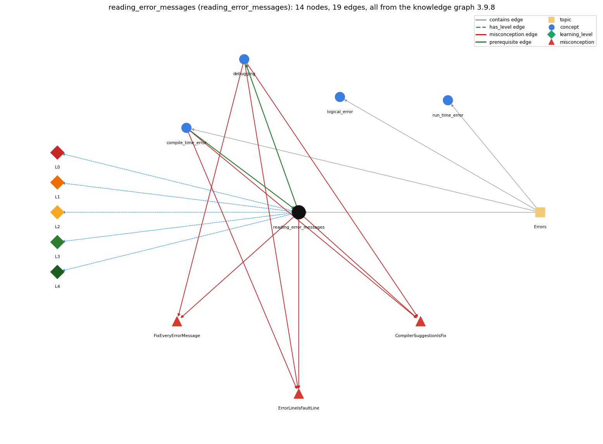

# reading_error_messages (`reading_error_messages`)

how to read compiler error messages: first error first; reported line may follow the real fault

Section 1.1 Your First Program, topic 1.1.c Errors.

## At a glance

- **Needs first:** `compile_time_error`
- **Leads to:** `debugging`
- **Learned alongside:** nothing
- **Misconceptions:** `CompilerSuggestionIsFix`, `ErrorLineIsFaultLine`, `FixEveryErrorMessage`
- **Errors:** none
- **Levels:** L0, L1, L2, L3, L4

Everything below comes from the knowledge graph 3.9.8 (`data/raw/chapter1_kg_updated.json`): 19 edges around this concept. The edge logic, the wrong and right rules and the exact rules of the ways are copied word for word from the graph.

## To work on (1)

- no aliases: a student's words cannot name this concept

## What it needs first (1)

A prerequisite edge means the other concept has to be understood before `reading_error_messages`.

### `compile_time_error` comes before `reading_error_messages`

*an error javac reports before the program can run (syntax, types)*

- **Edge:** `pre:compile_time_error->reading_error_messages`
- **Exact edge logic:** Reading error messages is how compile-time errors are found and fixed.
- **Grounding:** book\_passage
- **Composition rule (R) of `reading_error_messages` with `compile_time_error`:** Compile-time errors are found and fixed by reading their messages; the message maps imperfectly to the fault.
- **Composition rule (R) of `compile_time_error` with `reading_error_messages`:** Each compile-time error comes with a message; reading it (first error first, line may be late) is how it is found and fixed.

## What it leads to (1)

These concepts need `reading_error_messages` first.

### `reading_error_messages` comes before `debugging`

*finding and fixing the cause of a wrong result or error by forming a hypothesis, changing the program and checking the prediction*

- **Edge:** `pre:reading_error_messages->debugging`
- **Exact edge logic:** Reading an error message tells you where to start looking; debugging goes on from there to the cause.
- **Grounding:** book\_passage
- **Composition rule (R) of `debugging` with `reading_error_messages`:** An error message gives the place where Java noticed the problem; the cause may be earlier, so it is the start of the search, not the answer.

## Learned alongside (0)

A parallel edge joins two concepts that sit side by side: neither is needed before the other.

No parallel edge touches this concept.

## Misconceptions (3)

A misconception edge states the wrong rule a student may hold about this concept, and the right rule.

### CompilerSuggestionIsFix

- **Edge:** `reading_error_messages` &rarr; `CompilerSuggestionIsFix` (misconception)
- **Exact edge logic (the wrong rule):** Doing exactly what the compiler message suggests will fix the error.
- **Twin logic (the right rule):** An error message is evidence that something is wrong, but its suggested remedy may be wrong; find the actual cause.
- **Wrong belief (on the node):** Doing exactly what the compiler message suggests will fix the error.
- **Correct rule (on the node):** An error message is evidence that something is wrong, but its suggested remedy may be wrong; find the actual cause.
- **Provenance:** textbook
- **Role of this concept:** primary
- **L0 way linked to it:** yes
- **L0 way [3] misconception, exact rule:** wrong rule: Doing exactly what the compiler message suggests will fix the error. Right rule: An error message is evidence that something is wrong, but its suggested remedy may be wrong; find the actual cause.
- **Edge `compile_time_error` &rarr; `CompilerSuggestionIsFix`, exact edge logic:** Doing exactly what the compiler message suggests will fix the error. **Twin logic:** An error message is evidence that something is wrong, but its suggested remedy may be wrong; find the actual cause. (role: context)
- **Edge `debugging` &rarr; `CompilerSuggestionIsFix`, exact edge logic:** Doing exactly what the compiler message suggests will fix the error. **Twin logic:** An error message is evidence that something is wrong, but its suggested remedy may be wrong; find the actual cause. (role: context)

### ErrorLineIsFaultLine

- **Edge:** `reading_error_messages` &rarr; `ErrorLineIsFaultLine` (misconception)
- **Exact edge logic (the wrong rule):** The line number in a javac error is always the line that has the mistake.
- **Twin logic (the right rule):** The compiler reports where it noticed the problem, which can be after the real fault; for example, omitting the second left brace of HelloWorld produces errors reported on later lines.
- **Wrong belief (on the node):** The line number in a javac error is always the line that has the mistake.
- **Correct rule (on the node):** The compiler reports where it noticed the problem, which can be after the real fault; for example, omitting the second left brace of HelloWorld produces errors reported on later lines.
- **Provenance:** textbook
- **Role of this concept:** primary
- **L0 way linked to it:** yes
- **L0 way [1] misconception, exact rule:** wrong rule: The line number in a javac error is always the line that has the mistake. Right rule: The compiler reports where it noticed the problem, which can be after the real fault.
- **L0 way [4] inconsistent\_trace, exact rule:** Applies the read-first-error rule unevenly: starts from the first message on one compile but from the last on another, or looks only at the reported line without checking the lines before it. (here mixing in: "The line number in a javac error is always the line that has the mistake")
- **Edge `compile_time_error` &rarr; `ErrorLineIsFaultLine`, exact edge logic:** The line number in a javac error is always the line that has the mistake. **Twin logic:** The compiler reports where it noticed the problem, which can be after the real fault; for example, omitting the second left brace of HelloWorld produces errors reported on later lines. (role: context)
- **Edge `debugging` &rarr; `ErrorLineIsFaultLine`, exact edge logic:** The line number in a javac error is always the line that has the mistake. **Twin logic:** The compiler reports where it noticed the problem, which can be after the real fault; for example, omitting the second left brace of HelloWorld produces errors reported on later lines. (role: context)

### FixEveryErrorMessage

- **Edge:** `reading_error_messages` &rarr; `FixEveryErrorMessage` (misconception)
- **Exact edge logic (the wrong rule):** Each error message is a separate mistake that needs its own fix.
- **Twin logic (the right rule):** One fault can produce several messages; fix the first and recompile.
- **Wrong belief (on the node):** Each error message is a separate mistake that needs its own fix.
- **Correct rule (on the node):** One fault can produce several messages; fix the first and recompile.
- **Provenance:** textbook
- **Role of this concept:** primary
- **L0 way linked to it:** yes
- **L0 way [2] misconception, exact rule:** wrong rule: Each error message is a separate mistake that needs its own fix. Right rule: One fault can produce several messages; fix the first and recompile.
- **Edge `debugging` &rarr; `FixEveryErrorMessage`, exact edge logic:** Each error message is a separate mistake that needs its own fix. **Twin logic:** One fault can produce several messages; fix the first and recompile. (role: context)

## Errors (0)

An error edge states the rule that gets broken in a program, and the right rule.

The graph has no error edge from this concept.

## Levels L0 to L4 (5 of 5)

Each level edge lists the ways a student shows that level, each with its exact rule.

### L0: Prestructural / sensorimotor

L0 for reading error messages: the answer holds a rule that contradicts Java.

*Deciding question: Does every rule the answer applies to reading error messages agree with the language rule? If it reads the code with everyday meanings, applies a wrong rule, or switches rules within one trace, it is L0. A slip in an otherwise rule-correct trace is L2 with an error, not L0.*

- **Edge:** `reading_error_messages` &rarr; `reading_error_messages@L0` (has_level)
- **Exact edge logic:** reading error messages -&gt; L0 (Prestructural): the answer holds a rule that contradicts Java (5 ways).

Ways (5), each with its exact rule:

- **[0] everyday\_reading** (rule type E, folk-meaning rule): Everyday reading: an error message is like a teacher's correction, naming the exact mistake, its line and its fix, one message per mistake. Java rule: the message reports what javac detected and where it noticed it; one fault can cause several messages and the suggested remedy may be wrong.
- **[1] misconception** (rule type M, wrong rule / right rule) &rarr; `ErrorLineIsFaultLine`: wrong rule: The line number in a javac error is always the line that has the mistake. Right rule: The compiler reports where it noticed the problem, which can be after the real fault.
- **[2] misconception** (rule type M, wrong rule / right rule) &rarr; `FixEveryErrorMessage`: wrong rule: Each error message is a separate mistake that needs its own fix. Right rule: One fault can produce several messages; fix the first and recompile.
- **[3] misconception** (rule type M, wrong rule / right rule) &rarr; `CompilerSuggestionIsFix`: wrong rule: Doing exactly what the compiler message suggests will fix the error. Right rule: An error message is evidence that something is wrong, but its suggested remedy may be wrong; find the actual cause.
- **[4] inconsistent\_trace** (rule type T, uneven-application rule) &rarr; `ErrorLineIsFaultLine`: Applies the read-first-error rule unevenly: starts from the first message on one compile but from the last on another, or looks only at the reported line without checking the lines before it. (here mixing in: "The line number in a javac error is always the line that has the mistake")

### L1: Unistructural / atom x text surface

L1 for reading error messages: the answer states one correct rule without applying it.

*Deciding question: Does the answer cover every part of the code, in order, with the values (L2)? If it covers one part or only states the rule, it is L1.*

- **Edge:** `reading_error_messages` &rarr; `reading_error_messages@L1` (has_level)
- **Exact edge logic:** reading error messages -&gt; L1 (Unistructural): the answer states one correct rule without applying it (2 ways).

Ways (2), each with its exact rule:

- **[0] names\_the\_element** (rule type N, identity rule): Reading error messages is the debugging skill of interpreting a compiler (or JVM) message, File.java:line: description, to locate and fix the fault.
- **[1] states\_the\_rule** (rule type S, declarative rule): Each javac message gives the file, the line where the error was detected and a description; only the first message is truly reliable, and the real error is generally at or before the reported line.

### L2: Multistructural / block x execution / preoperational

L2 for reading error messages: the answer applies these rules to every part of the code, in order.

*Deciding question: Is the answer many segments mapped onto lines (L2), or one segment stating the purpose of the whole (L3)? A correct output with no value-by-value justification is not levelled.*

- **Edge:** `reading_error_messages` &rarr; `reading_error_messages@L2` (has_level)
- **Exact edge logic:** reading error messages -&gt; L2 (Multistructural): the answer applies the rules of reading error messages to every part of the code, in order (3 ways).

Ways (3), each with its exact rule:

- **[0] line\_by\_line\_trace** (rule type LT, operational sequencing rule): Read the first message, go to its line, look there and then backwards for the cause, fix that one error, recompile, and repeat.
- **[1] output\_prediction** (rule type OP, evaluation / result rule): Reading 'Bad.java:2: '{' expected' yields the location (file Bad.java, line 2) and the kind of problem (a missing left brace); with a later or vaguer message, it yields only where to start looking.
- **[2] one\_step\_execution** (rule type OS, state-transition rule): One read-fix-recompile cycle removes one fault and often several messages; the message count after recompiling can drop sharply.

### L3: Relational / relations x function (concrete operational begins)

L3 for reading error messages: the answer relates the parts by these rules.

*Deciding question: Was the purpose deduced from the code, or only guessed from traced input/output pairs (then L2)? Does the answer stay within the given code (L3), or reason about changed code, an error class or a new program (L4)?*

- **Edge:** `reading_error_messages` &rarr; `reading_error_messages@L3` (has_level)
- **Exact edge logic:** reading error messages -&gt; L3 (Relational): the answer relates the parts (3 ways).

Ways (3), each with its exact rule:

- **[0] relation\_to\_neighbour** (rule type R, composition rule (with a neighbour)): Compile-time errors are found and fixed by reading their messages; the message maps imperfectly to the fault.
- **[1] relation\_to\_neighbour** (rule type R, composition rule (with a neighbour)): Reading an error message tells you where to start looking; debugging goes on from there to the cause.
- **[2] purpose\_of\_the\_whole** (rule type P, plan / role rule): Purpose: use the compiler as a friend that says something is wrong, turning its message into a hypothesis about the fault.

### L4: Extended abstract (concrete-operational reversibility and conservation)

L4 for reading error messages: the answer reasons beyond the given code by these rules.

*Deciding question: Does the answer link the code to a broader context: a changed program, a class of inputs, an unseen problem? Re-tracing changed code value by value is L2; fixing one given failing case is L3.*

- **Edge:** `reading_error_messages` &rarr; `reading_error_messages@L4` (has_level)
- **Exact edge logic:** reading error messages -&gt; L4 (Extended abstract): the answer reasons beyond the given code (5 ways).

Ways (5), each with its exact rule:

- **[0] predict\_a\_change** (rule type C, conservation rule) &rarr; `ErrorLineIsFaultLine`: Introducing a known mistake into a working program and reading the resulting message shows which messages a fault produces; adding a fault earlier in the file can change messages reported later.
- **[1] transfer\_to\_a\_new\_program** (rule type X, applicability rule): Read messages first-error-first whenever javac or the JVM reports an error; for logic errors there is no message, so use tracing and print statements instead.
- **[2] diagnose\_an\_error** (rule type D, error rule): rule broken: Reported line = where javac noticed the problem. Kind: compile-time. Trigger class: a missing brace or quote, reported lines later (e.g. reached end of file while parsing)
- **[3] diagnose\_an\_error** (rule type D, error rule): rule broken: Suggested remedies are unreliable. Kind: compile-time. Trigger class: a message whose literal advice (e.g. declare a class abstract) is wrong
- **[4] diagnose\_an\_error** (rule type D, error rule): rule broken: Run-time messages name the exception and the line. Kind: run-time exception. Trigger class: reading Exception in thread "main" java.lang.ArrayIndexOutOfBoundsException: 0 at UseArgument.main(UseArgument.java:6)

## Same topic

`reading_error_messages` belongs to the topic **Errors** (`topic1.1.c`). The topic also contains: `compile_time_error`, `logical_error`, `run_time_error`.

## Rules of the concept (17)

- **Book** (SW-1e, p. 11 (pdf 21)): "But the compiler may not be able to tell you exactly what mistake you made, so the error message may be hard to understand."
- **Book** (RS, ): "A good rule of thumb to follow is that the first error reported by the compiler is the most important one to pay attention to. The rest might be the result of that first error."
- **E** (folk-meaning rule): Everyday reading: an error message is like a teacher's correction, naming the exact mistake, its line and its fix, one message per mistake. Java rule: the message reports what javac detected and where it noticed it; one fault can cause several messages and the suggested remedy may be wrong.
- **M** (wrong rule / right rule): ErrorLineIsFaultLine: wrong: The line number in a javac error is always the line that has the mistake. \| right: The compiler reports where it noticed the problem, which can be after the real fault.
- **M** (wrong rule / right rule): FixEveryErrorMessage: wrong: Each error message is a separate mistake that needs its own fix. \| right: One fault can produce several messages; fix the first and recompile.
- **M** (wrong rule / right rule): CompilerSuggestionIsFix: wrong: Doing exactly what the compiler message suggests will fix the error. \| right: An error message is evidence that something is wrong, but its suggested remedy may be wrong; find the actual cause.
- **T** (uneven-application rule): Applies the read-first-error rule unevenly: starts from the first message on one compile but from the last on another, or looks only at the reported line without checking the lines before it.
- **N** (identity rule): Reading error messages is the debugging skill of interpreting a compiler (or JVM) message, File.java:line: description, to locate and fix the fault.
- **S** (declarative rule): Each javac message gives the file, the line where the error was detected and a description; only the first message is truly reliable, and the real error is generally at or before the reported line.
- **LT** (operational sequencing rule): Read the first message, go to its line, look there and then backwards for the cause, fix that one error, recompile, and repeat.
- **OP** (evaluation / result rule): Reading 'Bad.java:2: '{' expected' yields the location (file Bad.java, line 2) and the kind of problem (a missing left brace); with a later or vaguer message, it yields only where to start looking.
- **OS** (state-transition rule): One read-fix-recompile cycle removes one fault and often several messages; the message count after recompiling can drop sharply.
- **R** (composition rule (with a neighbour)): with compile\_time\_error: Compile-time errors are found and fixed by reading their messages; the message maps imperfectly to the fault.
- **P** (plan / role rule): Purpose: use the compiler as a friend that says something is wrong, turning its message into a hypothesis about the fault.
- **C** (conservation rule): Introducing a known mistake into a working program and reading the resulting message shows which messages a fault produces; adding a fault earlier in the file can change messages reported later.
- **D** (error rule): rule broken: Reported line = where javac noticed the problem (compile-time)
- **D** (error rule): rule broken: Suggested remedies are unreliable (compile-time)
- **D** (error rule): rule broken: Run-time messages name the exception and the line (run-time exception)
- **X** (applicability rule): Read messages first-error-first whenever javac or the JVM reports an error; for logic errors there is no message, so use tracing and print statements instead.

## How it is found in code and answers (reader block)

- **Aliases:** none
- **Code patterns:** `\.java:\d+:\s*error`, `\berror:`, `Exception in thread`
- **Operator symbols:** none
- **Java types:** none

## The whole prerequisite chain

- **Everything it builds on (3):** `compile`, `compile_time_error`, `program_text`
- **Everything that builds on it (1):** `debugging`

## Every edge in this view and its exact edge logic (19)

All the edges drawn in the picture, in the order: prerequisite, parallel, misconception, error, has_level, contains.

**1. `compile_time_error` &rarr; `reading_error_messages`** (prerequisite)

- **Exact edge logic:** Reading error messages is how compile-time errors are found and fixed.
- **Grounding:** book\_passage
- **Composition rule (R) of `compile_time_error` with `reading_error_messages`:** Each compile-time error comes with a message; reading it (first error first, line may be late) is how it is found and fixed.
- **Composition rule (R) of `reading_error_messages` with `compile_time_error`:** Compile-time errors are found and fixed by reading their messages; the message maps imperfectly to the fault.

**2. `reading_error_messages` &rarr; `debugging`** (prerequisite)

- **Exact edge logic:** Reading an error message tells you where to start looking; debugging goes on from there to the cause.
- **Grounding:** book\_passage
- **Composition rule (R) of `debugging` with `reading_error_messages`:** An error message gives the place where Java noticed the problem; the cause may be earlier, so it is the start of the search, not the answer.

**3. `reading_error_messages` &rarr; `CompilerSuggestionIsFix`** (misconception)

- **Exact edge logic (the wrong rule):** Doing exactly what the compiler message suggests will fix the error.
- **Twin logic (the right rule):** An error message is evidence that something is wrong, but its suggested remedy may be wrong; find the actual cause.
- **Role:** primary

**4. `reading_error_messages` &rarr; `ErrorLineIsFaultLine`** (misconception)

- **Exact edge logic (the wrong rule):** The line number in a javac error is always the line that has the mistake.
- **Twin logic (the right rule):** The compiler reports where it noticed the problem, which can be after the real fault; for example, omitting the second left brace of HelloWorld produces errors reported on later lines.
- **Role:** primary

**5. `reading_error_messages` &rarr; `FixEveryErrorMessage`** (misconception)

- **Exact edge logic (the wrong rule):** Each error message is a separate mistake that needs its own fix.
- **Twin logic (the right rule):** One fault can produce several messages; fix the first and recompile.
- **Role:** primary

**6. `compile_time_error` &rarr; `CompilerSuggestionIsFix`** (misconception)

- **Exact edge logic (the wrong rule):** Doing exactly what the compiler message suggests will fix the error.
- **Twin logic (the right rule):** An error message is evidence that something is wrong, but its suggested remedy may be wrong; find the actual cause.
- **Role:** context

**7. `compile_time_error` &rarr; `ErrorLineIsFaultLine`** (misconception)

- **Exact edge logic (the wrong rule):** The line number in a javac error is always the line that has the mistake.
- **Twin logic (the right rule):** The compiler reports where it noticed the problem, which can be after the real fault; for example, omitting the second left brace of HelloWorld produces errors reported on later lines.
- **Role:** context

**8. `debugging` &rarr; `CompilerSuggestionIsFix`** (misconception)

- **Exact edge logic (the wrong rule):** Doing exactly what the compiler message suggests will fix the error.
- **Twin logic (the right rule):** An error message is evidence that something is wrong, but its suggested remedy may be wrong; find the actual cause.
- **Role:** context

**9. `debugging` &rarr; `ErrorLineIsFaultLine`** (misconception)

- **Exact edge logic (the wrong rule):** The line number in a javac error is always the line that has the mistake.
- **Twin logic (the right rule):** The compiler reports where it noticed the problem, which can be after the real fault; for example, omitting the second left brace of HelloWorld produces errors reported on later lines.
- **Role:** context

**10. `debugging` &rarr; `FixEveryErrorMessage`** (misconception)

- **Exact edge logic (the wrong rule):** Each error message is a separate mistake that needs its own fix.
- **Twin logic (the right rule):** One fault can produce several messages; fix the first and recompile.
- **Role:** context

**11. `reading_error_messages` &rarr; `reading_error_messages@L0`** (has_level)

- **Exact edge logic:** reading error messages -&gt; L0 (Prestructural): the answer holds a rule that contradicts Java (5 ways).
  - **[0] everyday\_reading** (rule type E, folk-meaning rule): Everyday reading: an error message is like a teacher's correction, naming the exact mistake, its line and its fix, one message per mistake. Java rule: the message reports what javac detected and where it noticed it; one fault can cause several messages and the suggested remedy may be wrong.
  - **[1] misconception** (rule type M, wrong rule / right rule) &rarr; `ErrorLineIsFaultLine`: wrong rule: The line number in a javac error is always the line that has the mistake. Right rule: The compiler reports where it noticed the problem, which can be after the real fault.
  - **[2] misconception** (rule type M, wrong rule / right rule) &rarr; `FixEveryErrorMessage`: wrong rule: Each error message is a separate mistake that needs its own fix. Right rule: One fault can produce several messages; fix the first and recompile.
  - **[3] misconception** (rule type M, wrong rule / right rule) &rarr; `CompilerSuggestionIsFix`: wrong rule: Doing exactly what the compiler message suggests will fix the error. Right rule: An error message is evidence that something is wrong, but its suggested remedy may be wrong; find the actual cause.
  - **[4] inconsistent\_trace** (rule type T, uneven-application rule) &rarr; `ErrorLineIsFaultLine`: Applies the read-first-error rule unevenly: starts from the first message on one compile but from the last on another, or looks only at the reported line without checking the lines before it. (here mixing in: "The line number in a javac error is always the line that has the mistake")

**12. `reading_error_messages` &rarr; `reading_error_messages@L1`** (has_level)

- **Exact edge logic:** reading error messages -&gt; L1 (Unistructural): the answer states one correct rule without applying it (2 ways).
  - **[0] names\_the\_element** (rule type N, identity rule): Reading error messages is the debugging skill of interpreting a compiler (or JVM) message, File.java:line: description, to locate and fix the fault.
  - **[1] states\_the\_rule** (rule type S, declarative rule): Each javac message gives the file, the line where the error was detected and a description; only the first message is truly reliable, and the real error is generally at or before the reported line.

**13. `reading_error_messages` &rarr; `reading_error_messages@L2`** (has_level)

- **Exact edge logic:** reading error messages -&gt; L2 (Multistructural): the answer applies the rules of reading error messages to every part of the code, in order (3 ways).
  - **[0] line\_by\_line\_trace** (rule type LT, operational sequencing rule): Read the first message, go to its line, look there and then backwards for the cause, fix that one error, recompile, and repeat.
  - **[1] output\_prediction** (rule type OP, evaluation / result rule): Reading 'Bad.java:2: '{' expected' yields the location (file Bad.java, line 2) and the kind of problem (a missing left brace); with a later or vaguer message, it yields only where to start looking.
  - **[2] one\_step\_execution** (rule type OS, state-transition rule): One read-fix-recompile cycle removes one fault and often several messages; the message count after recompiling can drop sharply.

**14. `reading_error_messages` &rarr; `reading_error_messages@L3`** (has_level)

- **Exact edge logic:** reading error messages -&gt; L3 (Relational): the answer relates the parts (3 ways).
  - **[0] relation\_to\_neighbour** (rule type R, composition rule (with a neighbour)): Compile-time errors are found and fixed by reading their messages; the message maps imperfectly to the fault.
  - **[1] relation\_to\_neighbour** (rule type R, composition rule (with a neighbour)): Reading an error message tells you where to start looking; debugging goes on from there to the cause.
  - **[2] purpose\_of\_the\_whole** (rule type P, plan / role rule): Purpose: use the compiler as a friend that says something is wrong, turning its message into a hypothesis about the fault.

**15. `reading_error_messages` &rarr; `reading_error_messages@L4`** (has_level)

- **Exact edge logic:** reading error messages -&gt; L4 (Extended abstract): the answer reasons beyond the given code (5 ways).
  - **[0] predict\_a\_change** (rule type C, conservation rule) &rarr; `ErrorLineIsFaultLine`: Introducing a known mistake into a working program and reading the resulting message shows which messages a fault produces; adding a fault earlier in the file can change messages reported later.
  - **[1] transfer\_to\_a\_new\_program** (rule type X, applicability rule): Read messages first-error-first whenever javac or the JVM reports an error; for logic errors there is no message, so use tracing and print statements instead.
  - **[2] diagnose\_an\_error** (rule type D, error rule): rule broken: Reported line = where javac noticed the problem. Kind: compile-time. Trigger class: a missing brace or quote, reported lines later (e.g. reached end of file while parsing)
  - **[3] diagnose\_an\_error** (rule type D, error rule): rule broken: Suggested remedies are unreliable. Kind: compile-time. Trigger class: a message whose literal advice (e.g. declare a class abstract) is wrong
  - **[4] diagnose\_an\_error** (rule type D, error rule): rule broken: Run-time messages name the exception and the line. Kind: run-time exception. Trigger class: reading Exception in thread "main" java.lang.ArrayIndexOutOfBoundsException: 0 at UseArgument.main(UseArgument.java:6)

**16. `topic1.1.c` &rarr; `reading_error_messages`** (contains)

- topic `topic1.1.c` contains `reading_error_messages`

**17. `topic1.1.c` &rarr; `compile_time_error`** (contains)

- topic `topic1.1.c` contains `compile_time_error`

**18. `topic1.1.c` &rarr; `logical_error`** (contains)

- topic `topic1.1.c` contains `logical_error`

**19. `topic1.1.c` &rarr; `run_time_error`** (contains)

- topic `topic1.1.c` contains `run_time_error`
