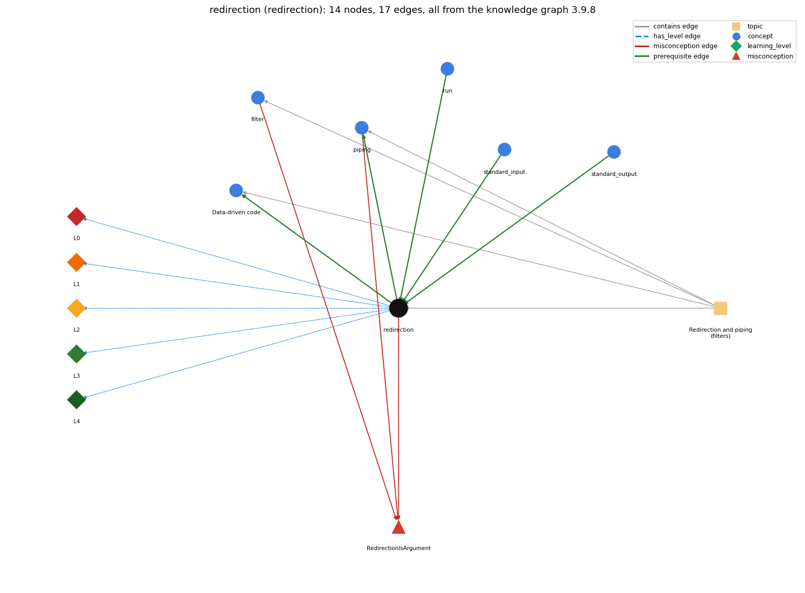

# redirection (`redirection`)

&lt; / &gt; send a file in/out as standard input/output

Section 1.5 Input and Output, topic 1.5.d Redirection and piping (filters). From the knowledge graph 3.9.8 (`data/raw/chapter1_kg_updated.json`).

## Concepts associated with redirection (6)

| Concept | Description | How it is associated |
| --- | --- | --- |
| **data\_driven\_code** | keeping data in files and writing programs that read it from standard input, so the data can change without changing the program | builds on it (needs it) composition rule (R) with it same topic (topic1.5.d) |
| **filter** | a program that reads standard input and writes standard output | shares misconception RedirectionIsArgument same topic (topic1.5.d) |
| **piping** | \| connects one program's output to another's input | builds on it (needs it) composition rule (R) with it shares misconception RedirectionIsArgument same topic (topic1.5.d) |
| **run** | java executes main in the JVM | prerequisite of it (it needs this) |
| **standard\_input** | StdIn -- reading a stream of values | prerequisite of it (it needs this) composition rule (R) with it |
| **standard\_output** | StdOut / System.out | prerequisite of it (it needs this) composition rule (R) with it |

## Every edge in this view and its full label (17)

| From | Edge | To | Full edge label |
| --- | --- | --- | --- |
| **redirection** | prerequisite | **data\_driven\_code** | Redirecting a file to standard input lets the same program process different data files without being changed. grounding: book\_passage composition rule (R) of redirection with data\_driven\_code: Redirecting different files into the same program changes the data it processes without changing the program. composition rule (R) of data\_driven\_code with redirection: Redirecting a different data file to standard input changes what the unchanged program processes. |
| **redirection** | prerequisite | **piping** | A pipe A \| B connects A's standard output directly to B's standard input, with no file in between. grounding: book\_passage composition rule (R) of redirection with piping: \`A &gt; f\` followed by \`B &lt; f\` has the same effect as \`A \| B\`, except that the pipe creates no file. composition rule (R) of piping with redirection: A pipe has the same effect as \`&gt; file\` then \`&lt; file\`, but there is no intermediate file, so the data size is not limited by disk space. |
| **run** | prerequisite | **redirection** | Redirection is written on the command that runs a program, with &lt; or &gt;. grounding: book\_passage |
| **standard\_input** | prerequisite | **redirection** | &lt; file makes the contents of the file the standard input stream. grounding: book\_passage composition rule (R) of standard\_input with redirection: With \`&lt; file\` the same StdIn calls read from the file instead of the keyboard. The program text does not change. composition rule (R) of redirection with standard\_input: \`&lt; file\` makes the file's contents the standard input stream: the same StdIn calls read the file's tokens in order. |
| **standard\_output** | prerequisite | **redirection** | &gt; file sends everything written to standard output into the file instead of the screen. grounding: book\_passage composition rule (R) of standard\_output with redirection: With \`&gt; file\`, every print/println/printf writes to the file and nothing appears in the terminal. The program code is unchanged. composition rule (R) of redirection with standard\_output: \`&gt; file\` diverts all standard output (print, println, printf) into the file, so nothing appears in the terminal. |
| **filter** | misconception | **RedirectionIsArgument** | **wrong rule:** a redirected file shows up in args[] **right rule:** With &lt; data.txt the operating system implements the standard input stream by reading from the file; the program just reads standard input and has no dependence on the source of the input stream. role: context |
| **piping** | misconception | **RedirectionIsArgument** | **wrong rule:** a redirected file shows up in args[] **right rule:** With &lt; data.txt the operating system implements the standard input stream by reading from the file; the program just reads standard input and has no dependence on the source of the input stream. role: context |
| **redirection** | misconception | **RedirectionIsArgument** | **wrong rule:** java Prog &lt; in.txt puts the name in.txt into args[0]. **right rule:** With &lt; data.txt the operating system implements the standard input stream by reading from the file; the program just reads standard input and has no dependence on the source of the input stream. role: primary |
| **redirection** | has\_level | **redirection@L0** | redirection -&gt; L0 (Prestructural): the answer holds a rule that contradicts Java (3 ways). **[0] everyday\_reading** (E): In maths \`&lt;\` and \`&gt;\` mean less-than and greater-than. In a command line they are directives to the operating system: \`&lt; file\` makes the file the standard input and \`&gt; file\` sends standard output to the file. They are not part of Java or of args[]. **[1] misconception** (M) &rarr; RedirectionIsArgument: wrong rule: A redirected file shows up in args[]. Right rule: With \`&lt; data.txt\` the operating system supplies standard input from the file. args[] does not contain it, and the program just reads standard input whatever the source. **[2] inconsistent\_trace** (T) &rarr; RedirectionIsArgument: Points to LT (the OS connects the file before the program runs; reads come from the file and writes go only to the file). An uneven trace shows output on the screen as well as in the file, or treats the file name as a command-line argument. (here mixing in: "a redirected file shows up in args[]") |
| **redirection** | has\_level | **redirection@L1** | redirection -&gt; L1 (Unistructural): the answer states one correct rule without applying it (2 ways). **[0] names\_the\_element** (N): Redirection is an operating-system (shell) mechanism that connects a program's standard input or standard output to a file. **[1] states\_the\_rule** (S): \`java P &gt; data.txt\` writes standard output to data.txt instead of the terminal. \`java P &lt; data.txt\` makes StdIn read from data.txt. The program itself is not changed. |
| **redirection** | has\_level | **redirection@L2** | redirection -&gt; L2 (Multistructural): the answer applies the rules of redirection to every part of the code, in order (3 ways). **[0] line\_by\_line\_trace** (LT): The shell opens the file and connects it before main starts. Each StdIn read then takes the next value from the file, and each print appends text at the end of the output file. **[1] output\_prediction** (OP): \`java RandomSeq 1000 &gt; data.txt\` prints nothing in the terminal and leaves a file of 1,000 values. \`java Average &lt; data.txt\` prints their average. **[2] one\_step\_execution** (OS): Each read or print still does exactly what it does at a terminal; only the source or destination is a file (one print appends to the file). |
| **redirection** | has\_level | **redirection@L3** | redirection -&gt; L3 (Relational): the answer relates the parts (5 ways). **[0] relation\_to\_neighbour** (R): \`&gt; file\` diverts all standard output (print, println, printf) into the file, so nothing appears in the terminal. **[1] relation\_to\_neighbour** (R): \`&lt; file\` makes the file's contents the standard input stream: the same StdIn calls read the file's tokens in order. **[2] relation\_to\_neighbour** (R): \`A &gt; f\` followed by \`B &lt; f\` has the same effect as \`A \| B\`, except that the pipe creates no file. **[3] relation\_to\_neighbour** (R): Redirecting different files into the same program changes the data it processes without changing the program. **[4] purpose\_of\_the\_whole** (P): Redirection saves output for later and feeds large amounts of data from files, without typing. |
| **redirection** | has\_level | **redirection@L4** | redirection -&gt; L4 (Extended abstract): the answer reasons beyond the given code (5 ways). **[0] predict\_a\_change** (C) &rarr; RedirectionIsArgument: The program is unchanged whether its input or output is the terminal or a file: the I/O abstraction is conserved. Changing only the file changes only the data. **[1] transfer\_to\_a\_new\_program** (X): Use redirection when the data are in a file or the results should be saved. When a program needs several input or output files at once, use In/Out instead (one standard stream each way). **[2] diagnose\_an\_error** (D): rule broken: \`&gt; file\` replaces the file's previous contents. Kind: silent logic error. Trigger class: Redirecting output onto an existing data file (or onto the input file itself) overwrites it. **[3] diagnose\_an\_error** (D): rule broken: The input file must exist and be readable. Kind: launch error. Trigger class: \`java Average &lt; missing.txt\`: the shell reports that the file does not exist, and the program never starts. **[4] diagnose\_an\_error** (D): rule broken: A redirected file is finite. Kind: run-time exception. Trigger class: The program reads more values than the file contains. |
| **topic1.5.d** | contains | **data\_driven\_code** | topic topic1.5.d contains data\_driven\_code |
| **topic1.5.d** | contains | **filter** | topic topic1.5.d contains filter |
| **topic1.5.d** | contains | **piping** | topic topic1.5.d contains piping |
| **topic1.5.d** | contains | **redirection** | topic topic1.5.d contains redirection |
