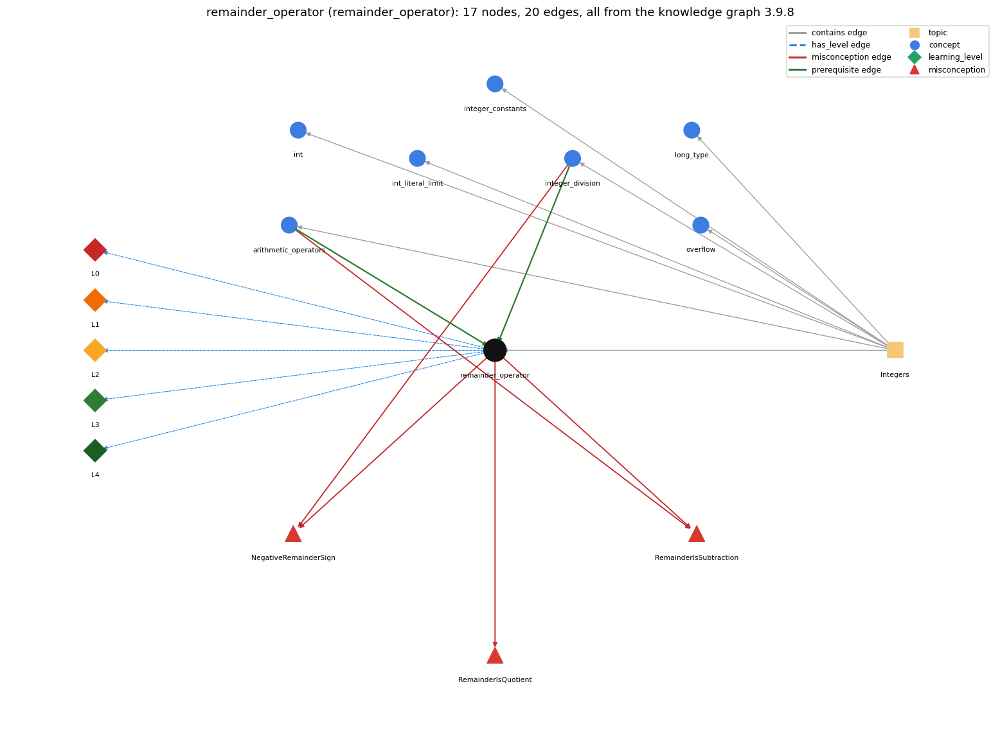

# remainder_operator (`remainder_operator`)

% gives the remainder of integer division

Section 1.2 Built-in Types of Data, topic 1.2.c Integers.

## At a glance

- **Needs first:** `arithmetic_operators`, `integer_division`
- **Leads to:** nothing
- **Learned alongside:** nothing
- **Misconceptions:** `NegativeRemainderSign`, `RemainderIsQuotient`, `RemainderIsSubtraction`
- **Errors:** none
- **Levels:** L0, L1, L2, L3, L4

Everything below comes from the knowledge graph 3.9.8 (`data/raw/chapter1_kg_updated.json`): 20 edges around this concept. The edge logic, the wrong and right rules and the exact rules of the ways are copied word for word from the graph.

## To work on (1)

- misconceptions with no L0 way linked to them: RemainderIsSubtraction

## What it needs first (2)

A prerequisite edge means the other concept has to be understood before `remainder_operator`.

### `arithmetic_operators` comes before `remainder_operator`

*+ - \* / %*

- **Edge:** `pre:arithmetic_operators->remainder_operator`
- **Exact edge logic:** % is one of the int arithmetic operators; it gives the remainder of the division.
- **Grounding:** book\_passage

### `integer_division` comes before `remainder_operator`

*/ on two ints truncates; % is the remainder*

- **Edge:** `pre:integer_division->remainder_operator`
- **Exact edge logic:** % is the companion of integer division: a = (a / b) \* b + a % b.
- **Grounding:** book\_passage
- **Composition rule (R) of `remainder_operator` with `integer_division`:** % is the companion of integer division, since a == (a / b) \* b + a % b. Both use the same quotient rounded toward 0.
- **Composition rule (R) of `integer_division` with `remainder_operator`:** % gives the remainder of the same truncating division: (a / b) \* b + a % b == a.

## What it leads to (0)

These concepts need `remainder_operator` first.

No concept has this one as a prerequisite.

## Learned alongside (0)

A parallel edge joins two concepts that sit side by side: neither is needed before the other.

No parallel edge touches this concept.

## Misconceptions (3)

A misconception edge states the wrong rule a student may hold about this concept, and the right rule.

### NegativeRemainderSign

- **Edge:** `remainder_operator` &rarr; `NegativeRemainderSign` (misconception)
- **Exact edge logic (the wrong rule):** a % b is never negative, and integer division of a negative number rounds down.
- **Twin logic (the right rule):** a / b rounds toward 0 and a % b takes the sign of a: -14 / 3 is -4 and -14 % 3 is -2.
- **Wrong belief (on the node):** a % b is never negative, and integer division of a negative number rounds down.
- **Correct rule (on the node):** a / b rounds toward 0 and a % b takes the sign of a: -14 / 3 is -4 and -14 % 3 is -2.
- **Provenance:** textbook
- **Role of this concept:** primary
- **L0 way linked to it:** yes
- **L0 way [2] misconception, exact rule:** wrong rule: a % b is never negative, and integer division of a negative number rounds down. Right rule: a / b rounds toward 0 and a % b takes the sign of a: -14 / 3 is -4 and -14 % 3 is -2.
- **Edge `integer_division` &rarr; `NegativeRemainderSign`, exact edge logic:** a % b is never negative, and integer division of a negative number rounds down. **Twin logic:** a / b rounds toward 0 and a % b takes the sign of a: -14 / 3 is -4 and -14 % 3 is -2. (role: context)

### RemainderIsQuotient

- **Edge:** `remainder_operator` &rarr; `RemainderIsQuotient` (misconception)
- **Exact edge logic (the wrong rule):** 17 % 5 is 3 (the quotient).
- **Twin logic (the right rule):** % returns the remainder, so 17 % 5 is 2.
- **Wrong belief (on the node):** 17 % 5 is 3 (the quotient).
- **Correct rule (on the node):** % returns the remainder, so 17 % 5 is 2.
- **Provenance:** derived
- **Role of this concept:** primary
- **L0 way linked to it:** yes
- **L0 way [1] misconception, exact rule:** wrong rule: 17 % 5 is 3 (the quotient). Right rule: % returns the remainder, so 17 % 5 is 2.
- **L0 way [3] inconsistent\_trace, exact rule:** Points to LT (compute the truncated quotient, then the remainder). Applied unevenly, a student gives the remainder for positive operands but the mathematical mod for negatives, or swaps quotient and remainder (17 % 5 as 3). (here mixing in: "17 % 5 is 3 (the quotient)")

### RemainderIsSubtraction

- **Edge:** `remainder_operator` &rarr; `RemainderIsSubtraction` (misconception)
- **Exact edge logic (the wrong rule):** 9 % 5 means 9 minus 5 (a % b subtracts b from a).
- **Twin logic (the right rule):** % gives the remainder after integer division: 9 % 5 is 4 because 9 = 1 \* 5 + 4, and 17 % 5 is 2, not 12.
- **Wrong belief (on the node):** 9 % 5 means 9 minus 5 (a % b subtracts b from a).
- **Correct rule (on the node):** % gives the remainder after integer division: 9 % 5 is 4 because 9 = 1 \* 5 + 4, and 17 % 5 is 2, not 12.
- **Provenance:** scenario
- **Role of this concept:** primary
- **L0 way linked to it:** no
- **Edge `arithmetic_operators` &rarr; `RemainderIsSubtraction`, exact edge logic:** 9 % 5 means 9 minus 5 (a % b subtracts b from a). **Twin logic:** % gives the remainder after integer division: 9 % 5 is 4 because 9 = 1 \* 5 + 4, and 17 % 5 is 2, not 12. (role: context)

## Errors (0)

An error edge states the rule that gets broken in a program, and the right rule.

The graph has no error edge from this concept.

## Levels L0 to L4 (5 of 5)

Each level edge lists the ways a student shows that level, each with its exact rule.

### L0: Prestructural / sensorimotor

L0 for remainder operator: the answer holds a rule that contradicts Java.

*Deciding question: Does every rule the answer applies to remainder operator agree with the language rule? If it reads the code with everyday meanings, applies a wrong rule, or switches rules within one trace, it is L0. A slip in an otherwise rule-correct trace is L2 with an error, not L0.*

- **Edge:** `remainder_operator` &rarr; `remainder_operator@L0` (has_level)
- **Exact edge logic:** remainder operator -&gt; L0 (Prestructural): the answer holds a rule that contradicts Java (4 ways).

Ways (4), each with its exact rule:

- **[0] everyday\_reading** (rule type E, folk-meaning rule): In everyday use % means percent (50% of x), and in maths 'mod' always gives a non-negative result. In Java % is the remainder of truncating division, and its sign follows the left operand (-14 % 3 is -2).
- **[1] misconception** (rule type M, wrong rule / right rule) &rarr; `RemainderIsQuotient`: wrong rule: 17 % 5 is 3 (the quotient). Right rule: % returns the remainder, so 17 % 5 is 2.
- **[2] misconception** (rule type M, wrong rule / right rule) &rarr; `NegativeRemainderSign`: wrong rule: a % b is never negative, and integer division of a negative number rounds down. Right rule: a / b rounds toward 0 and a % b takes the sign of a: -14 / 3 is -4 and -14 % 3 is -2.
- **[3] inconsistent\_trace** (rule type T, uneven-application rule) &rarr; `RemainderIsQuotient`: Points to LT (compute the truncated quotient, then the remainder). Applied unevenly, a student gives the remainder for positive operands but the mathematical mod for negatives, or swaps quotient and remainder (17 % 5 as 3). (here mixing in: "17 % 5 is 3 (the quotient)")

### L1: Unistructural / atom x text surface

L1 for remainder operator: the answer states one correct rule without applying it.

*Deciding question: Does the answer cover every part of the code, in order, with the values (L2)? If it covers one part or only states the rule, it is L1.*

- **Edge:** `remainder_operator` &rarr; `remainder_operator@L1` (has_level)
- **Exact edge logic:** remainder operator -&gt; L1 (Unistructural): the answer states one correct rule without applying it (2 ways).

Ways (2), each with its exact rule:

- **[0] names\_the\_element** (rule type N, identity rule): Remainder operator %: the binary operator that gives the remainder after dividing a by b.
- **[1] states\_the\_rule** (rule type S, declarative rule): For ints, a % b is defined so that (a / b) \* b + a % b equals a. The result takes the sign of a, % by zero throws ArithmeticException, and % also works on doubles.

### L2: Multistructural / block x execution / preoperational

L2 for remainder operator: the answer applies these rules to every part of the code, in order.

*Deciding question: Is the answer many segments mapped onto lines (L2), or one segment stating the purpose of the whole (L3)? A correct output with no value-by-value justification is not levelled.*

- **Edge:** `remainder_operator` &rarr; `remainder_operator@L2` (has_level)
- **Exact edge logic:** remainder operator -&gt; L2 (Multistructural): the answer applies the rules of remainder operator to every part of the code, in order (3 ways).

Ways (3), each with its exact rule:

- **[0] line\_by\_line\_trace** (rule type LT, operational sequencing rule): Evaluate a, then b, take the quotient rounded toward 0, and give what is left over. % has the same precedence as \* and /, and they group left to right.
- **[1] output\_prediction** (rule type OP, evaluation / result rule): 17 % 3 is 2, 76 % 12 is 4, 1234 % 99 is 46, -14 % 3 is -2, and 14 % -3 is 2.
- **[2] one\_step\_execution** (rule type OS, state-transition rule): r = a % b stores a remainder smaller in size than b and leaves a and b unchanged. If b is 0, ArithmeticException is thrown before anything is stored.

### L3: Relational / relations x function (concrete operational begins)

L3 for remainder operator: the answer relates the parts by these rules.

*Deciding question: Was the purpose deduced from the code, or only guessed from traced input/output pairs (then L2)? Does the answer stay within the given code (L3), or reason about changed code, an error class or a new program (L4)?*

- **Edge:** `remainder_operator` &rarr; `remainder_operator@L3` (has_level)
- **Exact edge logic:** remainder operator -&gt; L3 (Relational): the answer relates the parts (2 ways).

Ways (2), each with its exact rule:

- **[0] relation\_to\_neighbour** (rule type R, composition rule (with a neighbour)): % is the companion of integer division, since a == (a / b) \* b + a % b. Both use the same quotient rounded toward 0.
- **[1] purpose\_of\_the\_whole** (rule type P, plan / role rule): Plans: divisibility and parity tests (x % 2 == 0), digit extraction (x % 10), cyclic wrap-around ((i + 1) % n), leap-year rules, and splitting units (76 % 12 inches).

### L4: Extended abstract (concrete-operational reversibility and conservation)

L4 for remainder operator: the answer reasons beyond the given code by these rules.

*Deciding question: Does the answer link the code to a broader context: a changed program, a class of inputs, an unseen problem? Re-tracing changed code value by value is L2; fixing one given failing case is L3.*

- **Edge:** `remainder_operator` &rarr; `remainder_operator@L4` (has_level)
- **Exact edge logic:** remainder operator -&gt; L4 (Extended abstract): the answer reasons beyond the given code (5 ways).

Ways (5), each with its exact rule:

- **[0] predict\_a\_change** (rule type C, conservation rule) &rarr; `RemainderIsQuotient`: Negating a flips the remainder's sign, so n % 2 == 1 fails for negative odd n while n % 2 != 0 still works. Changing the divisor changes the cycle length. Swapping % with / swaps the remainder for the quotient.
- **[1] transfer\_to\_a\_new\_program** (rule type X, applicability rule): Use % for divisibility, parity, digits, cyclic indices and unit splitting. Do not use it for percentages (use \* / 100.0), and do not use it where a non-negative mathematical mod is needed for negative values (adjust the result or use Math.floorMod).
- **[2] diagnose\_an\_error** (rule type D, error rule): rule broken: int remainder by zero is undefined. Kind: run-time exception. Trigger class: x % 0, or a divisor variable that is 0: ArithmeticException: / by zero.
- **[3] diagnose\_an\_error** (rule type D, error rule): rule broken: The remainder takes the sign of the dividend. Kind: silent logic error. Trigger class: Negative inputs in an odd test written as x % 2 == 1, or in a wrap-around index computed as (i - 1) % n.
- **[4] diagnose\_an\_error** (rule type D, error rule): rule broken: % is the remainder, not a percentage. Kind: silent logic error. Trigger class: Writing price % 15 for 15 percent of price.

## Same topic

`remainder_operator` belongs to the topic **Integers** (`topic1.2.c`). The topic also contains: `arithmetic_operators`, `int`, `int_literal_limit`, `integer_constants`, `integer_division`, `long_type`, `overflow`.

## Rules of the concept (16)

- **Book** (SW-1e, p. 21 (pdf 31)): "the value of a % b is the remainder that you get when you divide a by b."
- **Book** (SW-1e, p. 38 (pdf 48)): "The quotient a / b rounds toward 0; the remainder a % b is defined such that (a / b) \* b + a % b is always equal to a."
- **Book** (OT-Op1, ): "The only symbol that might look new to you is "%", which divides one operand by another and returns the remainder as its result."
- **Book** (RS, ): "x % y = x - (x / y) \* y"
- **Book** (RS, ): "the expression 10.2 % 2.4 evaluates to 0.6 because you can take away four 2.4's from 10.2, leaving you with 0.6 left over."
- **E** (folk-meaning rule): In everyday use % means percent (50% of x), and in maths 'mod' always gives a non-negative result. In Java % is the remainder of truncating division, and its sign follows the left operand (-14 % 3 is -2).
- **M** (wrong rule / right rule): RemainderIsQuotient: wrong: 17 % 5 is 3 (the quotient). \| right: % returns the remainder, so 17 % 5 is 2.
- **M** (wrong rule / right rule): NegativeRemainderSign: wrong: a % b is never negative, and integer division of a negative number rounds down. \| right: a / b rounds toward 0 and a % b takes the sign of a: -14 / 3 is -4 and -14 % 3 is -2.
- **T** (uneven-application rule): Points to LT (compute the truncated quotient, then the remainder). Applied unevenly, a student gives the remainder for positive operands but the mathematical mod for negatives, or swaps quotient and remainder (17 % 5 as 3).
- **N** (identity rule): Remainder operator %: the binary operator that gives the remainder after dividing a by b.
- **S** (declarative rule): For ints, a % b is defined so that (a / b) \* b + a % b equals a. The result takes the sign of a, % by zero throws ArithmeticException, and % also works on doubles.
- **LT** (operational sequencing rule): Evaluate a, then b, take the quotient rounded toward 0, and give what is left over. % has the same precedence as \* and /, and they group left to right.
- **OP** (evaluation / result rule): 17 % 3 is 2, 76 % 12 is 4, 1234 % 99 is 46, -14 % 3 is -2, and 14 % -3 is 2.
- **OS** (state-transition rule): r = a % b stores a remainder smaller in size than b and leaves a and b unchanged. If b is 0, ArithmeticException is thrown before anything is stored.
- **R** (composition rule (with a neighbour)): with integer\_division: % is the companion of integer division, since a == (a / b) \* b + a % b. Both use the same quotient rounded toward 0.
- **P** (plan / role rule): Plans: divisibility and parity tests (x % 2 == 0), digit extraction (x % 10), cyclic wrap-around ((i + 1) % n), leap-year rules, and splitting units (76 % 12 inches).
- **C** (conservation rule): Negating a flips the remainder's sign, so n % 2 == 1 fails for negative odd n while n % 2 != 0 still works. Changing the divisor changes the cycle length. Swapping % with / swaps the remainder for the quotient.
- **D** (error rule): rule broken: int remainder by zero is undefined. (run-time exception)
- **D** (error rule): rule broken: The remainder takes the sign of the dividend. (silent logic error)
- **D** (error rule): rule broken: % is the remainder, not a percentage. (silent logic error)
- **X** (applicability rule): Use % for divisibility, parity, digits, cyclic indices and unit splitting. Do not use it for percentages (use \* / 100.0), and do not use it where a non-negative mathematical mod is needed for negative values (adjust the result or use Math.floorMod).

## How it is found in code and answers (reader block)

- **Aliases:** remainder, modulo, mod, modulus
- **Code patterns:** `[A-Za-z_0-9)\]][ \t]*%(?=[ \t]*[A-Za-z_0-9(])`
- **Operator symbols:** none
- **Java types:** none
- **Signal remainder\_expr** (scope statement, decisive): `(?<![=!<>+\-*/%])=(?!=)[^;]*[\w)\]][ \t]*%(?=[ \t]*[\w(])`

## The whole prerequisite chain

- **Everything it builds on (2):** `arithmetic_operators`, `integer_division`
- **Everything that builds on it (0):** nothing

## Every edge in this view and its exact edge logic (20)

All the edges drawn in the picture, in the order: prerequisite, parallel, misconception, error, has_level, contains.

**1. `arithmetic_operators` &rarr; `remainder_operator`** (prerequisite)

- **Exact edge logic:** % is one of the int arithmetic operators; it gives the remainder of the division.
- **Grounding:** book\_passage

**2. `integer_division` &rarr; `remainder_operator`** (prerequisite)

- **Exact edge logic:** % is the companion of integer division: a = (a / b) \* b + a % b.
- **Grounding:** book\_passage
- **Composition rule (R) of `integer_division` with `remainder_operator`:** % gives the remainder of the same truncating division: (a / b) \* b + a % b == a.
- **Composition rule (R) of `remainder_operator` with `integer_division`:** % is the companion of integer division, since a == (a / b) \* b + a % b. Both use the same quotient rounded toward 0.

**3. `remainder_operator` &rarr; `NegativeRemainderSign`** (misconception)

- **Exact edge logic (the wrong rule):** a % b is never negative, and integer division of a negative number rounds down.
- **Twin logic (the right rule):** a / b rounds toward 0 and a % b takes the sign of a: -14 / 3 is -4 and -14 % 3 is -2.
- **Role:** primary

**4. `remainder_operator` &rarr; `RemainderIsQuotient`** (misconception)

- **Exact edge logic (the wrong rule):** 17 % 5 is 3 (the quotient).
- **Twin logic (the right rule):** % returns the remainder, so 17 % 5 is 2.
- **Role:** primary

**5. `remainder_operator` &rarr; `RemainderIsSubtraction`** (misconception)

- **Exact edge logic (the wrong rule):** 9 % 5 means 9 minus 5 (a % b subtracts b from a).
- **Twin logic (the right rule):** % gives the remainder after integer division: 9 % 5 is 4 because 9 = 1 \* 5 + 4, and 17 % 5 is 2, not 12.
- **Role:** primary

**6. `arithmetic_operators` &rarr; `RemainderIsSubtraction`** (misconception)

- **Exact edge logic (the wrong rule):** 9 % 5 means 9 minus 5 (a % b subtracts b from a).
- **Twin logic (the right rule):** % gives the remainder after integer division: 9 % 5 is 4 because 9 = 1 \* 5 + 4, and 17 % 5 is 2, not 12.
- **Role:** context

**7. `integer_division` &rarr; `NegativeRemainderSign`** (misconception)

- **Exact edge logic (the wrong rule):** a % b is never negative, and integer division of a negative number rounds down.
- **Twin logic (the right rule):** a / b rounds toward 0 and a % b takes the sign of a: -14 / 3 is -4 and -14 % 3 is -2.
- **Role:** context

**8. `remainder_operator` &rarr; `remainder_operator@L0`** (has_level)

- **Exact edge logic:** remainder operator -&gt; L0 (Prestructural): the answer holds a rule that contradicts Java (4 ways).
  - **[0] everyday\_reading** (rule type E, folk-meaning rule): In everyday use % means percent (50% of x), and in maths 'mod' always gives a non-negative result. In Java % is the remainder of truncating division, and its sign follows the left operand (-14 % 3 is -2).
  - **[1] misconception** (rule type M, wrong rule / right rule) &rarr; `RemainderIsQuotient`: wrong rule: 17 % 5 is 3 (the quotient). Right rule: % returns the remainder, so 17 % 5 is 2.
  - **[2] misconception** (rule type M, wrong rule / right rule) &rarr; `NegativeRemainderSign`: wrong rule: a % b is never negative, and integer division of a negative number rounds down. Right rule: a / b rounds toward 0 and a % b takes the sign of a: -14 / 3 is -4 and -14 % 3 is -2.
  - **[3] inconsistent\_trace** (rule type T, uneven-application rule) &rarr; `RemainderIsQuotient`: Points to LT (compute the truncated quotient, then the remainder). Applied unevenly, a student gives the remainder for positive operands but the mathematical mod for negatives, or swaps quotient and remainder (17 % 5 as 3). (here mixing in: "17 % 5 is 3 (the quotient)")

**9. `remainder_operator` &rarr; `remainder_operator@L1`** (has_level)

- **Exact edge logic:** remainder operator -&gt; L1 (Unistructural): the answer states one correct rule without applying it (2 ways).
  - **[0] names\_the\_element** (rule type N, identity rule): Remainder operator %: the binary operator that gives the remainder after dividing a by b.
  - **[1] states\_the\_rule** (rule type S, declarative rule): For ints, a % b is defined so that (a / b) \* b + a % b equals a. The result takes the sign of a, % by zero throws ArithmeticException, and % also works on doubles.

**10. `remainder_operator` &rarr; `remainder_operator@L2`** (has_level)

- **Exact edge logic:** remainder operator -&gt; L2 (Multistructural): the answer applies the rules of remainder operator to every part of the code, in order (3 ways).
  - **[0] line\_by\_line\_trace** (rule type LT, operational sequencing rule): Evaluate a, then b, take the quotient rounded toward 0, and give what is left over. % has the same precedence as \* and /, and they group left to right.
  - **[1] output\_prediction** (rule type OP, evaluation / result rule): 17 % 3 is 2, 76 % 12 is 4, 1234 % 99 is 46, -14 % 3 is -2, and 14 % -3 is 2.
  - **[2] one\_step\_execution** (rule type OS, state-transition rule): r = a % b stores a remainder smaller in size than b and leaves a and b unchanged. If b is 0, ArithmeticException is thrown before anything is stored.

**11. `remainder_operator` &rarr; `remainder_operator@L3`** (has_level)

- **Exact edge logic:** remainder operator -&gt; L3 (Relational): the answer relates the parts (2 ways).
  - **[0] relation\_to\_neighbour** (rule type R, composition rule (with a neighbour)): % is the companion of integer division, since a == (a / b) \* b + a % b. Both use the same quotient rounded toward 0.
  - **[1] purpose\_of\_the\_whole** (rule type P, plan / role rule): Plans: divisibility and parity tests (x % 2 == 0), digit extraction (x % 10), cyclic wrap-around ((i + 1) % n), leap-year rules, and splitting units (76 % 12 inches).

**12. `remainder_operator` &rarr; `remainder_operator@L4`** (has_level)

- **Exact edge logic:** remainder operator -&gt; L4 (Extended abstract): the answer reasons beyond the given code (5 ways).
  - **[0] predict\_a\_change** (rule type C, conservation rule) &rarr; `RemainderIsQuotient`: Negating a flips the remainder's sign, so n % 2 == 1 fails for negative odd n while n % 2 != 0 still works. Changing the divisor changes the cycle length. Swapping % with / swaps the remainder for the quotient.
  - **[1] transfer\_to\_a\_new\_program** (rule type X, applicability rule): Use % for divisibility, parity, digits, cyclic indices and unit splitting. Do not use it for percentages (use \* / 100.0), and do not use it where a non-negative mathematical mod is needed for negative values (adjust the result or use Math.floorMod).
  - **[2] diagnose\_an\_error** (rule type D, error rule): rule broken: int remainder by zero is undefined. Kind: run-time exception. Trigger class: x % 0, or a divisor variable that is 0: ArithmeticException: / by zero.
  - **[3] diagnose\_an\_error** (rule type D, error rule): rule broken: The remainder takes the sign of the dividend. Kind: silent logic error. Trigger class: Negative inputs in an odd test written as x % 2 == 1, or in a wrap-around index computed as (i - 1) % n.
  - **[4] diagnose\_an\_error** (rule type D, error rule): rule broken: % is the remainder, not a percentage. Kind: silent logic error. Trigger class: Writing price % 15 for 15 percent of price.

**13. `topic1.2.c` &rarr; `remainder_operator`** (contains)

- topic `topic1.2.c` contains `remainder_operator`

**14. `topic1.2.c` &rarr; `arithmetic_operators`** (contains)

- topic `topic1.2.c` contains `arithmetic_operators`

**15. `topic1.2.c` &rarr; `int`** (contains)

- topic `topic1.2.c` contains `int`

**16. `topic1.2.c` &rarr; `int_literal_limit`** (contains)

- topic `topic1.2.c` contains `int_literal_limit`

**17. `topic1.2.c` &rarr; `integer_constants`** (contains)

- topic `topic1.2.c` contains `integer_constants`

**18. `topic1.2.c` &rarr; `integer_division`** (contains)

- topic `topic1.2.c` contains `integer_division`

**19. `topic1.2.c` &rarr; `long_type`** (contains)

- topic `topic1.2.c` contains `long_type`

**20. `topic1.2.c` &rarr; `overflow`** (contains)

- topic `topic1.2.c` contains `overflow`
