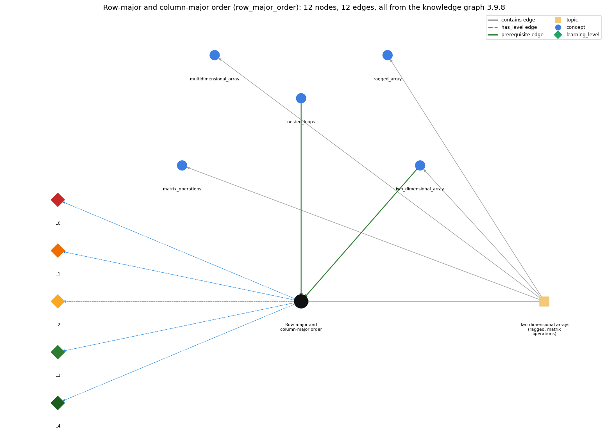

# Row-major and column-major order (`row_major_order`)

processing a 2-D array row by row (row-major) or column by column (column-major)

Section 1.4 1.4 Arrays, topic 1.4.g Two-dimensional arrays (ragged, matrix operations).

## At a glance

- **Needs first:** `nested_loops`, `two_dimensional_array`
- **Leads to:** nothing
- **Learned alongside:** nothing
- **Misconceptions:** none
- **Errors:** none
- **Levels:** L0, L1, L2, L3, L4

Everything below comes from the knowledge graph 3.9.8 (`data/raw/chapter1_kg_updated.json`): 12 edges around this concept. The edge logic, the wrong and right rules and the exact rules of the ways are copied word for word from the graph.

## To work on (2)

- no misconception or error edge
- no aliases: a student's words cannot name this concept

## What it needs first (2)

A prerequisite edge means the other concept has to be understood before `row_major_order`.

### `nested_loops` comes before `row_major_order`

*a loop inside a loop*

- **Edge:** `pre:nested_loops->row_major_order`
- **Exact edge logic:** Which loop is outside decides whether the entries are processed row by row or column by column.
- **Grounding:** book\_passage
- **Composition rule (R) of `row_major_order` with `nested_loops`:** Which loop is outside decides whether entries are processed row by row or column by column; the inner loop finishes for each outer value.
- **Composition rule (R) of `nested_loops` with `row_major_order`:** Which loop is outside decides the visiting order: row index outside gives row-major order, column index outside gives column-major order.

### `two_dimensional_array` comes before `row_major_order`

*an array of arrays (a[i][j])*

- **Edge:** `pre:two_dimensional_array->row_major_order`
- **Exact edge logic:** Row-major order visits a[i][j] row by row (outer loop over i); column-major order puts the column loop outside.
- **Grounding:** book\_passage
- **Composition rule (R) of `row_major_order` with `two_dimensional_array`:** Because a[i] is a row array, row-major order walks along each row array in turn; column-major jumps between row arrays at each step.
- **Composition rule (R) of `two_dimensional_array` with `row_major_order`:** Row-major order visits a[i][j] with the outer loop over rows i; column-major puts the loop over j outside.

## What it leads to (0)

These concepts need `row_major_order` first.

No concept has this one as a prerequisite.

## Learned alongside (0)

A parallel edge joins two concepts that sit side by side: neither is needed before the other.

No parallel edge touches this concept.

## Misconceptions (0)

A misconception edge states the wrong rule a student may hold about this concept, and the right rule.

The graph has no misconception edge from this concept.

## Errors (0)

An error edge states the rule that gets broken in a program, and the right rule.

The graph has no error edge from this concept.

## Levels L0 to L4 (5 of 5)

Each level edge lists the ways a student shows that level, each with its exact rule.

### L0: Prestructural / sensorimotor

L0 for Row-major and column-major order: the answer holds a rule that contradicts Java.

*Deciding question: Does every rule the answer applies to Row-major and column-major order agree with the language rule? If it reads the code with everyday meanings, applies a wrong rule, or switches rules within one trace, it is L0. A slip in an otherwise rule-correct trace is L2 with an error, not L0.*

- **Edge:** `row_major_order` &rarr; `row_major_order@L0` (has_level)
- **Exact edge logic:** Row-major and column-major order -&gt; L0 (Prestructural): the answer holds a rule that contradicts Java (1 way).

Ways (1), each with its exact rule:

- **[0] everyday\_reading** (rule type E, folk-meaning rule): Folk meaning: tables are read left to right, top to bottom, as the only natural order, and 'row' and 'column' are easily swapped. Rule: the loop that is outside decides the order: an outer loop over rows i gives row-major order, an outer loop over columns j gives column-major order.

### L1: Unistructural / atom x text surface

L1 for Row-major and column-major order: the answer states one correct rule without applying it.

*Deciding question: Does the answer cover every part of the code, in order, with the values (L2)? If it covers one part or only states the rule, it is L1.*

- **Edge:** `row_major_order` &rarr; `row_major_order@L1` (has_level)
- **Exact edge logic:** Row-major and column-major order -&gt; L1 (Unistructural): the answer states one correct rule without applying it (2 ways).

Ways (2), each with its exact rule:

- **[0] names\_the\_element** (rule type N, identity rule): Identity: row-major order processes a 2-D array row by row; column-major order processes it column by column.
- **[1] states\_the\_rule** (rule type S, declarative rule): Declarative: for (i &lt; M) { for (j &lt; N) ... a[i][j] } is row-major; for (j &lt; N) { for (i &lt; M) ... a[i][j] } is column-major. Both keep a[i][j] with i as the row.

### L2: Multistructural / block x execution / preoperational

L2 for Row-major and column-major order: the answer applies these rules to every part of the code, in order.

*Deciding question: Is the answer many segments mapped onto lines (L2), or one segment stating the purpose of the whole (L3)? A correct output with no value-by-value justification is not levelled.*

- **Edge:** `row_major_order` &rarr; `row_major_order@L2` (has_level)
- **Exact edge logic:** Row-major and column-major order -&gt; L2 (Multistructural): the answer applies the rules of Row-major and column-major order to every part of the code, in order (3 ways).

Ways (3), each with its exact rule:

- **[0] line\_by\_line\_trace** (rule type LT, operational sequencing rule): Sequencing (row-major print): i = 0, j runs over 0..N-1 printing a[0][j], newline; i = 1, ... So a[0][0], a[0][1], ..., a[1][0], ... in that order.
- **[1] output\_prediction** (rule type OP, evaluation / result rule): Result: row-major processing yields per-row results (row averages in column N, rows printed as lines); column-major yields per-column results (column averages in row M).
- **[2] one\_step\_execution** (rule type OS, state-transition rule): State transition: each inner step processes one entry; each outer step completes one whole row (row-major) or column (column-major) and resets the per-row sum.

### L3: Relational / relations x function (concrete operational begins)

L3 for Row-major and column-major order: the answer relates the parts by these rules.

*Deciding question: Was the purpose deduced from the code, or only guessed from traced input/output pairs (then L2)? Does the answer stay within the given code (L3), or reason about changed code, an error class or a new program (L4)?*

- **Edge:** `row_major_order` &rarr; `row_major_order@L3` (has_level)
- **Exact edge logic:** Row-major and column-major order -&gt; L3 (Relational): the answer relates the parts (3 ways).

Ways (3), each with its exact rule:

- **[0] relation\_to\_neighbour** (rule type R, composition rule (with a neighbour)): Because a[i] is a row array, row-major order walks along each row array in turn; column-major jumps between row arrays at each step.
- **[1] relation\_to\_neighbour** (rule type R, composition rule (with a neighbour)): Which loop is outside decides whether entries are processed row by row or column by column; the inner loop finishes for each outer value.
- **[2] purpose\_of\_the\_whole** (rule type P, plan / role rule): Plan/role: choose the order that matches the result wanted, row-major for per-row results (and for printing), column-major for per-column results.

### L4: Extended abstract (concrete-operational reversibility and conservation)

L4 for Row-major and column-major order: the answer reasons beyond the given code by these rules.

*Deciding question: Does the answer link the code to a broader context: a changed program, a class of inputs, an unseen problem? Re-tracing changed code value by value is L2; fixing one given failing case is L3.*

- **Edge:** `row_major_order` &rarr; `row_major_order@L4` (has_level)
- **Exact edge logic:** Row-major and column-major order -&gt; L4 (Extended abstract): the answer reasons beyond the given code (4 ways).

Ways (4), each with its exact rule:

- **[0] predict\_a\_change** (rule type C, conservation rule): Conservation: swapping the loops of an element-wise operation (copy, add) keeps the result and changes only the visiting order. For printing or per-row sums, swapping changes the output (transposed layout, column results).
- **[1] transfer\_to\_a\_new\_program** (rule type X, applicability rule): Applicability: use row-major by default in Java (rows are arrays; printing goes line by line). Use column-major when the result is per column, and remember that ragged arrays have no full columns.
- **[2] diagnose\_an\_error** (rule type D, error rule): rule broken: Each loop bound must match the index it controls (i &lt; M rows, j &lt; N columns). Kind: run-time exception. Trigger class: after swapping the loops the bounds are not swapped with them, so in a non-square array a[i][j] gets i up to N-1 (ArrayIndexOutOfBoundsException)
- **[3] diagnose\_an\_error** (rule type D, error rule): rule broken: Per-row or per-column accumulators must be reset for each outer pass. Kind: silent logic error. Trigger class: sum is declared before the outer loop, so each row average includes all earlier rows

## Same topic

`row_major_order` belongs to the topic **Two-dimensional arrays (ragged, matrix operations)** (`topic1.4.g`). The topic also contains: `matrix_operations`, `multidimensional_array`, `ragged_array`, `two_dimensional_array`.

## Rules of the concept (14)

- **Book** (SW-1e, p. 105 (pdf 115)): "is known as row-major order"
- **Book** (SW-1e, p. 105 (pdf 115)): "known as column-major order"
- **E** (folk-meaning rule): Folk meaning: tables are read left to right, top to bottom, as the only natural order, and 'row' and 'column' are easily swapped. Rule: the loop that is outside decides the order: an outer loop over rows i gives row-major order, an outer loop over columns j gives column-major order.
- **T** (uneven-application rule): Points to LT: the inner loop runs through completely for each value of the outer loop. Inconsistent application: the trace advances the outer index after every inner step, or swaps which index belongs to which loop.
- **N** (identity rule): Identity: row-major order processes a 2-D array row by row; column-major order processes it column by column.
- **S** (declarative rule): Declarative: for (i &lt; M) { for (j &lt; N) ... a[i][j] } is row-major; for (j &lt; N) { for (i &lt; M) ... a[i][j] } is column-major. Both keep a[i][j] with i as the row.
- **LT** (operational sequencing rule): Sequencing (row-major print): i = 0, j runs over 0..N-1 printing a[0][j], newline; i = 1, ... So a[0][0], a[0][1], ..., a[1][0], ... in that order.
- **OP** (evaluation / result rule): Result: row-major processing yields per-row results (row averages in column N, rows printed as lines); column-major yields per-column results (column averages in row M).
- **OS** (state-transition rule): State transition: each inner step processes one entry; each outer step completes one whole row (row-major) or column (column-major) and resets the per-row sum.
- **R** (composition rule (with a neighbour)): with two\_dimensional\_array: Because a[i] is a row array, row-major order walks along each row array in turn; column-major jumps between row arrays at each step.
- **R** (composition rule (with a neighbour)): with nested\_loops: Which loop is outside decides whether entries are processed row by row or column by column; the inner loop finishes for each outer value.
- **P** (plan / role rule): Plan/role: choose the order that matches the result wanted, row-major for per-row results (and for printing), column-major for per-column results.
- **C** (conservation rule): Conservation: swapping the loops of an element-wise operation (copy, add) keeps the result and changes only the visiting order. For printing or per-row sums, swapping changes the output (transposed layout, column results).
- **D** (error rule): rule broken: Each loop bound must match the index it controls (i &lt; M rows, j &lt; N columns). (run-time exception)
- **D** (error rule): rule broken: Per-row or per-column accumulators must be reset for each outer pass. (silent logic error)
- **X** (applicability rule): Applicability: use row-major by default in Java (rows are arrays; printing goes line by line). Use column-major when the result is per column, and remember that ragged arrays have no full columns.

## How it is found in code and answers (reader block)

- **Aliases:** none
- **Code patterns:** none
- **Operator symbols:** none
- **Java types:** none
- **Signal nested\_2d\_traversal** (scope program): `\bfor\s*\([^)]*\)\s*\{?\s*for\s*\([^)]*\)[\s\S]{0,200}?\w\s*\[\s*\w+\s*\]\s*\[\s*\w+\s*\]`

## The whole prerequisite chain

- **Everything it builds on (23):** `arithmetic_operators`, `array_creation`, `array_declaration`, `array_initializer`, `boolean`, `boolean_expression`, `comparison_operators`, `data_structure`, `data_type`, `do_while_loop`, `expression`, `for_loop`, `identifier`, `indexing`, `literal`, `logical_operators`, `loop_control`, `loop_variable`, `nested_loops`, `primitive_type`, `two_dimensional_array`, `variable`, `while_loop`
- **Everything that builds on it (0):** nothing

## Every edge in this view and its exact edge logic (12)

All the edges drawn in the picture, in the order: prerequisite, parallel, misconception, error, has_level, contains.

**1. `nested_loops` &rarr; `row_major_order`** (prerequisite)

- **Exact edge logic:** Which loop is outside decides whether the entries are processed row by row or column by column.
- **Grounding:** book\_passage
- **Composition rule (R) of `nested_loops` with `row_major_order`:** Which loop is outside decides the visiting order: row index outside gives row-major order, column index outside gives column-major order.
- **Composition rule (R) of `row_major_order` with `nested_loops`:** Which loop is outside decides whether entries are processed row by row or column by column; the inner loop finishes for each outer value.

**2. `two_dimensional_array` &rarr; `row_major_order`** (prerequisite)

- **Exact edge logic:** Row-major order visits a[i][j] row by row (outer loop over i); column-major order puts the column loop outside.
- **Grounding:** book\_passage
- **Composition rule (R) of `two_dimensional_array` with `row_major_order`:** Row-major order visits a[i][j] with the outer loop over rows i; column-major puts the loop over j outside.
- **Composition rule (R) of `row_major_order` with `two_dimensional_array`:** Because a[i] is a row array, row-major order walks along each row array in turn; column-major jumps between row arrays at each step.

**3. `row_major_order` &rarr; `row_major_order@L0`** (has_level)

- **Exact edge logic:** Row-major and column-major order -&gt; L0 (Prestructural): the answer holds a rule that contradicts Java (1 way).
  - **[0] everyday\_reading** (rule type E, folk-meaning rule): Folk meaning: tables are read left to right, top to bottom, as the only natural order, and 'row' and 'column' are easily swapped. Rule: the loop that is outside decides the order: an outer loop over rows i gives row-major order, an outer loop over columns j gives column-major order.

**4. `row_major_order` &rarr; `row_major_order@L1`** (has_level)

- **Exact edge logic:** Row-major and column-major order -&gt; L1 (Unistructural): the answer states one correct rule without applying it (2 ways).
  - **[0] names\_the\_element** (rule type N, identity rule): Identity: row-major order processes a 2-D array row by row; column-major order processes it column by column.
  - **[1] states\_the\_rule** (rule type S, declarative rule): Declarative: for (i &lt; M) { for (j &lt; N) ... a[i][j] } is row-major; for (j &lt; N) { for (i &lt; M) ... a[i][j] } is column-major. Both keep a[i][j] with i as the row.

**5. `row_major_order` &rarr; `row_major_order@L2`** (has_level)

- **Exact edge logic:** Row-major and column-major order -&gt; L2 (Multistructural): the answer applies the rules of Row-major and column-major order to every part of the code, in order (3 ways).
  - **[0] line\_by\_line\_trace** (rule type LT, operational sequencing rule): Sequencing (row-major print): i = 0, j runs over 0..N-1 printing a[0][j], newline; i = 1, ... So a[0][0], a[0][1], ..., a[1][0], ... in that order.
  - **[1] output\_prediction** (rule type OP, evaluation / result rule): Result: row-major processing yields per-row results (row averages in column N, rows printed as lines); column-major yields per-column results (column averages in row M).
  - **[2] one\_step\_execution** (rule type OS, state-transition rule): State transition: each inner step processes one entry; each outer step completes one whole row (row-major) or column (column-major) and resets the per-row sum.

**6. `row_major_order` &rarr; `row_major_order@L3`** (has_level)

- **Exact edge logic:** Row-major and column-major order -&gt; L3 (Relational): the answer relates the parts (3 ways).
  - **[0] relation\_to\_neighbour** (rule type R, composition rule (with a neighbour)): Because a[i] is a row array, row-major order walks along each row array in turn; column-major jumps between row arrays at each step.
  - **[1] relation\_to\_neighbour** (rule type R, composition rule (with a neighbour)): Which loop is outside decides whether entries are processed row by row or column by column; the inner loop finishes for each outer value.
  - **[2] purpose\_of\_the\_whole** (rule type P, plan / role rule): Plan/role: choose the order that matches the result wanted, row-major for per-row results (and for printing), column-major for per-column results.

**7. `row_major_order` &rarr; `row_major_order@L4`** (has_level)

- **Exact edge logic:** Row-major and column-major order -&gt; L4 (Extended abstract): the answer reasons beyond the given code (4 ways).
  - **[0] predict\_a\_change** (rule type C, conservation rule): Conservation: swapping the loops of an element-wise operation (copy, add) keeps the result and changes only the visiting order. For printing or per-row sums, swapping changes the output (transposed layout, column results).
  - **[1] transfer\_to\_a\_new\_program** (rule type X, applicability rule): Applicability: use row-major by default in Java (rows are arrays; printing goes line by line). Use column-major when the result is per column, and remember that ragged arrays have no full columns.
  - **[2] diagnose\_an\_error** (rule type D, error rule): rule broken: Each loop bound must match the index it controls (i &lt; M rows, j &lt; N columns). Kind: run-time exception. Trigger class: after swapping the loops the bounds are not swapped with them, so in a non-square array a[i][j] gets i up to N-1 (ArrayIndexOutOfBoundsException)
  - **[3] diagnose\_an\_error** (rule type D, error rule): rule broken: Per-row or per-column accumulators must be reset for each outer pass. Kind: silent logic error. Trigger class: sum is declared before the outer loop, so each row average includes all earlier rows

**8. `topic1.4.g` &rarr; `row_major_order`** (contains)

- topic `topic1.4.g` contains `row_major_order`

**9. `topic1.4.g` &rarr; `matrix_operations`** (contains)

- topic `topic1.4.g` contains `matrix_operations`

**10. `topic1.4.g` &rarr; `multidimensional_array`** (contains)

- topic `topic1.4.g` contains `multidimensional_array`

**11. `topic1.4.g` &rarr; `ragged_array`** (contains)

- topic `topic1.4.g` contains `ragged_array`

**12. `topic1.4.g` &rarr; `two_dimensional_array`** (contains)

- topic `topic1.4.g` contains `two_dimensional_array`
