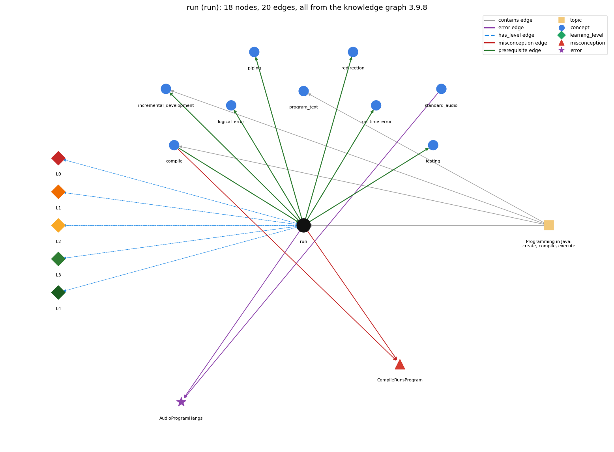

# run (`run`)

java executes main in the JVM

Section 1.1 Your First Program, topic 1.1.a Programming in Java: create, compile, execute.

## At a glance

- **Needs first:** `compile`
- **Leads to:** `incremental_development`, `logical_error`, `piping`, `redirection`, `run_time_error`, `testing`
- **Learned alongside:** nothing
- **Misconceptions:** `CompileRunsProgram`
- **Errors:** `AudioProgramHangs`
- **Levels:** L0, L1, L2, L3, L4

Everything below comes from the knowledge graph 3.9.8 (`data/raw/chapter1_kg_updated.json`): 20 edges around this concept. The edge logic, the wrong and right rules and the exact rules of the ways are copied word for word from the graph.

## To work on (1)

- no code pattern or signal: the code cannot tag this concept

## What it needs first (1)

A prerequisite edge means the other concept has to be understood before `run`.

### `compile` comes before `run`

*javac turns source into bytecode*

- **Edge:** `pre:compile->run`
- **Exact edge logic:** java Name runs the Name.class file that javac produced, so compiling must succeed before the program can run.
- **Grounding:** book\_passage
- **Composition rule (R) of `run` with `compile`:** java Name runs the Name.class that javac produced, so compiling must succeed first; the run reflects the source as of the last successful compile.
- **Composition rule (R) of `compile` with `run`:** java Name loads the Name.class made by javac, so a successful compile must come before running, and edits take effect only after recompiling.

## What it leads to (6)

These concepts need `run` first.

### `run` comes before `incremental_development`

*building a program in small steps from a version that works, compiling and testing after each change*

- **Edge:** `pre:run->incremental_development`
- **Exact edge logic:** Each small step is run and checked before the next one is added.
- **Grounding:** book\_passage
- **Composition rule (R) of `incremental_development` with `run`:** Running after each step shows at once whether the new lines do what was intended.

### `run` comes before `logical_error`

*the program runs but computes the wrong result*

- **Edge:** `pre:run->logical_error`
- **Exact edge logic:** A logical error is seen only by running the program and comparing its output with the intended output.
- **Grounding:** book\_passage
- **Composition rule (R) of `run` with `logical_error`:** A logic error is seen only by running the program and comparing its output with the intended output.
- **Composition rule (R) of `logical_error` with `run`:** A logic error is seen only by running the program and comparing its output with the intended output.

### `run` comes before `piping`

*\| connects one program's output to another's input*

- **Edge:** `pre:run->piping`
- **Exact edge logic:** Piping joins the commands that run two programs, so one program's output becomes the other's input.
- **Grounding:** book\_passage

### `run` comes before `redirection`

*&lt; / &gt; send a file in/out as standard input/output*

- **Edge:** `pre:run->redirection`
- **Exact edge logic:** Redirection is written on the command that runs a program, with &lt; or &gt;.
- **Grounding:** book\_passage

### `run` comes before `run_time_error`

*an error raised while the program executes (e.g. ArrayIndexOutOfBounds, NumberFormatException)*

- **Edge:** `pre:run->run_time_error`
- **Exact edge logic:** A run-time error appears only while java Name executes, after compiling has succeeded.
- **Grounding:** book\_passage
- **Composition rule (R) of `run` with `run_time_error`:** A run-time error appears only while java Name executes; the JVM stops the program and prints the exception.
- **Composition rule (R) of `run_time_error` with `run`:** A run-time error appears only while java Name executes, after compiling has succeeded.

### `run` comes before `testing`

*running a program on chosen inputs, including boundary and unusual ones, and comparing the output with what it should be*

- **Edge:** `pre:run->testing`
- **Exact edge logic:** A program is tested by running it on chosen inputs and comparing what it prints with what it should print.
- **Grounding:** book\_passage
- **Composition rule (R) of `testing` with `run`:** Each test is one run with one input: java Name followed by the test arguments (or with input redirected from a file).

## Learned alongside (0)

A parallel edge joins two concepts that sit side by side: neither is needed before the other.

No parallel edge touches this concept.

## Misconceptions (1)

A misconception edge states the wrong rule a student may hold about this concept, and the right rule.

### CompileRunsProgram

- **Edge:** `run` &rarr; `CompileRunsProgram` (misconception)
- **Exact edge logic (the wrong rule):** If javac Name.java finishes without errors, the program already works and has run.
- **Twin logic (the right rule):** javac only translates Name.java into Name.class; the program runs only with java Name, and run-time errors can still appear then.
- **Wrong belief (on the node):** compiling also executes the program
- **Correct rule (on the node):** javac only translates Name.java into Name.class; the program runs only with java Name, and run-time errors can still appear then.
- **Provenance:** derived
- **Role of this concept:** context
- **L0 way linked to it:** yes
- **L0 way [1] misconception, exact rule:** wrong rule: Compiling also executes the program. Right rule: The program runs only when java Name is typed; javac only translates it.
- **L0 way [2] inconsistent\_trace, exact rule:** Applies the run rule (LT: main's statements execute in order, one by one, each once) unevenly: e.g. executes the print statements in written order on one trace but skips one or reorders them on another. (here mixing in: "compiling also executes the program")
- **Edge `compile` &rarr; `CompileRunsProgram`, exact edge logic:** If javac Name.java finishes without errors, the program already works and has run. **Twin logic:** javac only translates Name.java into Name.class; the program runs only with java Name, and run-time errors can still appear then. (role: primary)

## Errors (1)

An error edge states the rule that gets broken in a program, and the right rule.

### AudioProgramHangs

- **Edge:** `run` &rarr; `AudioProgramHangs` (error)
- **Exact edge logic (the wrong rule):** Ends a StdAudio program with no System.exit(0), so the terminal hangs and needs &lt;ctrl-c&gt;.
- **Twin logic (the right rule):** In the book's setup, a program that uses StdAudio should end main() with System.exit(0).
- **Wrong belief (on the node):** Ends a StdAudio program with no System.exit(0), so the terminal hangs and needs &lt;ctrl-c&gt;.
- **Correct rule (on the node):** In the book's setup, a program that uses StdAudio should end main() with System.exit(0).
- **Provenance:** textbook
- **Role of this concept:** context
- **Edge `standard_audio` &rarr; `AudioProgramHangs`, exact edge logic:** Ends a StdAudio program with no System.exit(0), so the terminal hangs and needs &lt;ctrl-c&gt;. **Twin logic:** In the book's setup, a program that uses StdAudio should end main() with System.exit(0). (role: primary)

## Levels L0 to L4 (5 of 5)

Each level edge lists the ways a student shows that level, each with its exact rule.

### L0: Prestructural / sensorimotor

L0 for run: the answer holds a rule that contradicts Java.

*Deciding question: Does every rule the answer applies to run agree with the language rule? If it reads the code with everyday meanings, applies a wrong rule, or switches rules within one trace, it is L0. A slip in an otherwise rule-correct trace is L2 with an error, not L0.*

- **Edge:** `run` &rarr; `run@L0` (has_level)
- **Exact edge logic:** run -&gt; L0 (Prestructural): the answer holds a rule that contradicts Java (3 ways).

Ways (3), each with its exact rule:

- **[0] everyday\_reading** (rule type E, folk-meaning rule): Everyday meaning: 'run the program' as if the file ran itself, or the program 'looks at all of itself at once'. Java rule: java Name starts the JVM, which calls Name's main() and executes its statements one at a time, in order.
- **[1] misconception** (rule type M, wrong rule / right rule) &rarr; `CompileRunsProgram`: wrong rule: Compiling also executes the program. Right rule: The program runs only when java Name is typed; javac only translates it.
- **[2] inconsistent\_trace** (rule type T, uneven-application rule) &rarr; `CompileRunsProgram`: Applies the run rule (LT: main's statements execute in order, one by one, each once) unevenly: e.g. executes the print statements in written order on one trace but skips one or reorders them on another. (here mixing in: "compiling also executes the program")

### L1: Unistructural / atom x text surface

L1 for run: the answer states one correct rule without applying it.

*Deciding question: Does the answer cover every part of the code, in order, with the values (L2)? If it covers one part or only states the rule, it is L1.*

- **Edge:** `run` &rarr; `run@L1` (has_level)
- **Exact edge logic:** run -&gt; L1 (Unistructural): the answer states one correct rule without applying it (2 ways).

Ways (2), each with its exact rule:

- **[0] names\_the\_element** (rule type N, identity rule): Running (executing) a program is launching it with java Name so that the Java Virtual Machine follows its instructions.
- **[1] states\_the\_rule** (rule type S, declarative rule): Typing java followed by a class name makes the system call the main() method defined in that class and execute its statements; java Name args... also passes the command-line arguments to main. The development cycle is the same in any environment (terminal or IDE): edit the .java file, compile it with javac, run it with java.

### L2: Multistructural / block x execution / preoperational

L2 for run: the answer applies these rules to every part of the code, in order.

*Deciding question: Is the answer many segments mapped onto lines (L2), or one segment stating the purpose of the whole (L3)? A correct output with no value-by-value justification is not levelled.*

- **Edge:** `run` &rarr; `run@L2` (has_level)
- **Exact edge logic:** run -&gt; L2 (Multistructural): the answer applies the rules of run to every part of the code, in order (3 ways).

Ways (3), each with its exact rule:

- **[0] line\_by\_line\_trace** (rule type LT, operational sequencing rule): The JVM starts at the first statement of main and ends when it finishes the last statement; statements run one by one, in order, and control returns to the system when main finishes.
- **[1] output\_prediction** (rule type OP, evaluation / result rule): The result of a run is what the program prints to the terminal (for java HelloWorld: Hello, World), or an exception message if a run-time error occurs.
- **[2] one\_step\_execution** (rule type OS, state-transition rule): One execution step runs one statement of main, which changes the program state (a variable or the output) and passes control to the next statement.

### L3: Relational / relations x function (concrete operational begins)

L3 for run: the answer relates the parts by these rules.

*Deciding question: Was the purpose deduced from the code, or only guessed from traced input/output pairs (then L2)? Does the answer stay within the given code (L3), or reason about changed code, an error class or a new program (L4)?*

- **Edge:** `run` &rarr; `run@L3` (has_level)
- **Exact edge logic:** run -&gt; L3 (Relational): the answer relates the parts (6 ways).

Ways (6), each with its exact rule:

- **[0] relation\_to\_neighbour** (rule type R, composition rule (with a neighbour)): java Name runs the Name.class that javac produced, so compiling must succeed first; the run reflects the source as of the last successful compile.
- **[1] relation\_to\_neighbour** (rule type R, composition rule (with a neighbour)): A run-time error appears only while java Name executes; the JVM stops the program and prints the exception.
- **[2] relation\_to\_neighbour** (rule type R, composition rule (with a neighbour)): A logic error is seen only by running the program and comparing its output with the intended output.
- **[3] relation\_to\_neighbour** (rule type R, composition rule (with a neighbour)): A program is tested by running it on chosen inputs and comparing what it prints with what it should print.
- **[4] relation\_to\_neighbour** (rule type R, composition rule (with a neighbour)): Each small step is run and checked before the next one is added.
- **[5] purpose\_of\_the\_whole** (rule type P, plan / role rule): Purpose: make the computer carry out the program on particular inputs; running the same compiled program with different command-line arguments gives different results.

### L4: Extended abstract (concrete-operational reversibility and conservation)

L4 for run: the answer reasons beyond the given code by these rules.

*Deciding question: Does the answer link the code to a broader context: a changed program, a class of inputs, an unseen problem? Re-tracing changed code value by value is L2; fixing one given failing case is L3.*

- **Edge:** `run` &rarr; `run@L4` (has_level)
- **Exact edge logic:** run -&gt; L4 (Extended abstract): the answer reasons beyond the given code (5 ways).

Ways (5), each with its exact rule:

- **[0] predict\_a\_change** (rule type C, conservation rule) &rarr; `CompileRunsProgram`: Running again with the same arguments reproduces the same output (for programs without randomness or input); changing the arguments changes the output without recompiling; editing the source changes nothing until recompiled.
- **[1] transfer\_to\_a\_new\_program** (rule type X, applicability rule): Run the program to test it on chosen inputs and to see run-time and logic errors that compiling cannot find; adding print statements and rerunning is a simple way to check what is actually executing.
- **[2] diagnose\_an\_error** (rule type D, error rule): rule broken: In the book's setup a StdAudio program should end main() with System.exit(0). Kind: silent logic error. Trigger class: a program that uses StdAudio and finishes main without System.exit(0): the terminal hangs and needs &lt;ctrl-c&gt;
- **[3] diagnose\_an\_error** (rule type D, error rule): rule broken: Run only after a successful compile; java takes a class name. Kind: launch error. Trigger class: running java Name when Name.class is missing or stale, or typing java Name.java
- **[4] diagnose\_an\_error** (rule type D, error rule): rule broken: A required command-line argument must be typed. Kind: run-time exception. Trigger class: running a program that reads args[0] with no argument

## Same topic

`run` belongs to the topic **Programming in Java: create, compile, execute** (`topic1.1.a`). The topic also contains: `compile`, `incremental_development`, `program_text`.

## Rules of the concept (17)

- **Book** (SW-1e, p. 5 (pdf 15)): "Once you compile the program, you can run it."
- **Book** (SW-1e, p. 7 (pdf 17)): "When you type java followed by a class name in your terminal application, the system calls the main() method that you defined in that class"
- **Book** (SW-1.1, ): "Execute (or run) it by typing "java MyProgram" in the terminal window."
- **E** (folk-meaning rule): Everyday meaning: 'run the program' as if the file ran itself, or the program 'looks at all of itself at once'. Java rule: java Name starts the JVM, which calls Name's main() and executes its statements one at a time, in order.
- **M** (wrong rule / right rule): CompileRunsProgram: wrong: Compiling also executes the program. \| right: The program runs only when java Name is typed; javac only translates it.
- **T** (uneven-application rule): Applies the run rule (LT: main's statements execute in order, one by one, each once) unevenly: e.g. executes the print statements in written order on one trace but skips one or reorders them on another.
- **N** (identity rule): Running (executing) a program is launching it with java Name so that the Java Virtual Machine follows its instructions.
- **S** (declarative rule): Typing java followed by a class name makes the system call the main() method defined in that class and execute its statements; java Name args... also passes the command-line arguments to main. The development cycle is the same in any environment (terminal or IDE): edit the .java file, compile it with javac, run it with java.
- **LT** (operational sequencing rule): The JVM starts at the first statement of main and ends when it finishes the last statement; statements run one by one, in order, and control returns to the system when main finishes.
- **OP** (evaluation / result rule): The result of a run is what the program prints to the terminal (for java HelloWorld: Hello, World), or an exception message if a run-time error occurs.
- **OS** (state-transition rule): One execution step runs one statement of main, which changes the program state (a variable or the output) and passes control to the next statement.
- **R** (composition rule (with a neighbour)): with compile: java Name runs the Name.class that javac produced, so compiling must succeed first; the run reflects the source as of the last successful compile.
- **R** (composition rule (with a neighbour)): with run\_time\_error: A run-time error appears only while java Name executes; the JVM stops the program and prints the exception.
- **R** (composition rule (with a neighbour)): with logical\_error: A logic error is seen only by running the program and comparing its output with the intended output.
- **P** (plan / role rule): Purpose: make the computer carry out the program on particular inputs; running the same compiled program with different command-line arguments gives different results.
- **C** (conservation rule): Running again with the same arguments reproduces the same output (for programs without randomness or input); changing the arguments changes the output without recompiling; editing the source changes nothing until recompiled.
- **D** (error rule): rule broken: In the book's setup a StdAudio program should end main() with System.exit(0) (silent logic error)
- **D** (error rule): rule broken: Run only after a successful compile; java takes a class name (launch error)
- **D** (error rule): rule broken: A required command-line argument must be typed (run-time exception)
- **X** (applicability rule): Run the program to test it on chosen inputs and to see run-time and logic errors that compiling cannot find; adding print statements and rerunning is a simple way to check what is actually executing.

## How it is found in code and answers (reader block)

- **Aliases:** execute, executes, execution, java command
- **Code patterns:** none
- **Operator symbols:** none
- **Java types:** none

## The whole prerequisite chain

- **Everything it builds on (2):** `compile`, `program_text`
- **Everything that builds on it (9):** `data_driven_code`, `debugging`, `filter`, `incremental_development`, `logical_error`, `piping`, `redirection`, `run_time_error`, `testing`

## Every edge in this view and its exact edge logic (20)

All the edges drawn in the picture, in the order: prerequisite, parallel, misconception, error, has_level, contains.

**1. `compile` &rarr; `run`** (prerequisite)

- **Exact edge logic:** java Name runs the Name.class file that javac produced, so compiling must succeed before the program can run.
- **Grounding:** book\_passage
- **Composition rule (R) of `compile` with `run`:** java Name loads the Name.class made by javac, so a successful compile must come before running, and edits take effect only after recompiling.
- **Composition rule (R) of `run` with `compile`:** java Name runs the Name.class that javac produced, so compiling must succeed first; the run reflects the source as of the last successful compile.

**2. `run` &rarr; `incremental_development`** (prerequisite)

- **Exact edge logic:** Each small step is run and checked before the next one is added.
- **Grounding:** book\_passage
- **Composition rule (R) of `incremental_development` with `run`:** Running after each step shows at once whether the new lines do what was intended.

**3. `run` &rarr; `logical_error`** (prerequisite)

- **Exact edge logic:** A logical error is seen only by running the program and comparing its output with the intended output.
- **Grounding:** book\_passage
- **Composition rule (R) of `run` with `logical_error`:** A logic error is seen only by running the program and comparing its output with the intended output.
- **Composition rule (R) of `logical_error` with `run`:** A logic error is seen only by running the program and comparing its output with the intended output.

**4. `run` &rarr; `piping`** (prerequisite)

- **Exact edge logic:** Piping joins the commands that run two programs, so one program's output becomes the other's input.
- **Grounding:** book\_passage

**5. `run` &rarr; `redirection`** (prerequisite)

- **Exact edge logic:** Redirection is written on the command that runs a program, with &lt; or &gt;.
- **Grounding:** book\_passage

**6. `run` &rarr; `run_time_error`** (prerequisite)

- **Exact edge logic:** A run-time error appears only while java Name executes, after compiling has succeeded.
- **Grounding:** book\_passage
- **Composition rule (R) of `run` with `run_time_error`:** A run-time error appears only while java Name executes; the JVM stops the program and prints the exception.
- **Composition rule (R) of `run_time_error` with `run`:** A run-time error appears only while java Name executes, after compiling has succeeded.

**7. `run` &rarr; `testing`** (prerequisite)

- **Exact edge logic:** A program is tested by running it on chosen inputs and comparing what it prints with what it should print.
- **Grounding:** book\_passage
- **Composition rule (R) of `testing` with `run`:** Each test is one run with one input: java Name followed by the test arguments (or with input redirected from a file).

**8. `run` &rarr; `CompileRunsProgram`** (misconception)

- **Exact edge logic (the wrong rule):** If javac Name.java finishes without errors, the program already works and has run.
- **Twin logic (the right rule):** javac only translates Name.java into Name.class; the program runs only with java Name, and run-time errors can still appear then.
- **Role:** context

**9. `compile` &rarr; `CompileRunsProgram`** (misconception)

- **Exact edge logic (the wrong rule):** If javac Name.java finishes without errors, the program already works and has run.
- **Twin logic (the right rule):** javac only translates Name.java into Name.class; the program runs only with java Name, and run-time errors can still appear then.
- **Role:** primary

**10. `run` &rarr; `AudioProgramHangs`** (error)

- **Exact edge logic (the wrong rule):** Ends a StdAudio program with no System.exit(0), so the terminal hangs and needs &lt;ctrl-c&gt;.
- **Twin logic (the right rule):** In the book's setup, a program that uses StdAudio should end main() with System.exit(0).
- **Role:** context

**11. `standard_audio` &rarr; `AudioProgramHangs`** (error)

- **Exact edge logic (the wrong rule):** Ends a StdAudio program with no System.exit(0), so the terminal hangs and needs &lt;ctrl-c&gt;.
- **Twin logic (the right rule):** In the book's setup, a program that uses StdAudio should end main() with System.exit(0).
- **Role:** primary

**12. `run` &rarr; `run@L0`** (has_level)

- **Exact edge logic:** run -&gt; L0 (Prestructural): the answer holds a rule that contradicts Java (3 ways).
  - **[0] everyday\_reading** (rule type E, folk-meaning rule): Everyday meaning: 'run the program' as if the file ran itself, or the program 'looks at all of itself at once'. Java rule: java Name starts the JVM, which calls Name's main() and executes its statements one at a time, in order.
  - **[1] misconception** (rule type M, wrong rule / right rule) &rarr; `CompileRunsProgram`: wrong rule: Compiling also executes the program. Right rule: The program runs only when java Name is typed; javac only translates it.
  - **[2] inconsistent\_trace** (rule type T, uneven-application rule) &rarr; `CompileRunsProgram`: Applies the run rule (LT: main's statements execute in order, one by one, each once) unevenly: e.g. executes the print statements in written order on one trace but skips one or reorders them on another. (here mixing in: "compiling also executes the program")

**13. `run` &rarr; `run@L1`** (has_level)

- **Exact edge logic:** run -&gt; L1 (Unistructural): the answer states one correct rule without applying it (2 ways).
  - **[0] names\_the\_element** (rule type N, identity rule): Running (executing) a program is launching it with java Name so that the Java Virtual Machine follows its instructions.
  - **[1] states\_the\_rule** (rule type S, declarative rule): Typing java followed by a class name makes the system call the main() method defined in that class and execute its statements; java Name args... also passes the command-line arguments to main. The development cycle is the same in any environment (terminal or IDE): edit the .java file, compile it with javac, run it with java.

**14. `run` &rarr; `run@L2`** (has_level)

- **Exact edge logic:** run -&gt; L2 (Multistructural): the answer applies the rules of run to every part of the code, in order (3 ways).
  - **[0] line\_by\_line\_trace** (rule type LT, operational sequencing rule): The JVM starts at the first statement of main and ends when it finishes the last statement; statements run one by one, in order, and control returns to the system when main finishes.
  - **[1] output\_prediction** (rule type OP, evaluation / result rule): The result of a run is what the program prints to the terminal (for java HelloWorld: Hello, World), or an exception message if a run-time error occurs.
  - **[2] one\_step\_execution** (rule type OS, state-transition rule): One execution step runs one statement of main, which changes the program state (a variable or the output) and passes control to the next statement.

**15. `run` &rarr; `run@L3`** (has_level)

- **Exact edge logic:** run -&gt; L3 (Relational): the answer relates the parts (6 ways).
  - **[0] relation\_to\_neighbour** (rule type R, composition rule (with a neighbour)): java Name runs the Name.class that javac produced, so compiling must succeed first; the run reflects the source as of the last successful compile.
  - **[1] relation\_to\_neighbour** (rule type R, composition rule (with a neighbour)): A run-time error appears only while java Name executes; the JVM stops the program and prints the exception.
  - **[2] relation\_to\_neighbour** (rule type R, composition rule (with a neighbour)): A logic error is seen only by running the program and comparing its output with the intended output.
  - **[3] relation\_to\_neighbour** (rule type R, composition rule (with a neighbour)): A program is tested by running it on chosen inputs and comparing what it prints with what it should print.
  - **[4] relation\_to\_neighbour** (rule type R, composition rule (with a neighbour)): Each small step is run and checked before the next one is added.
  - **[5] purpose\_of\_the\_whole** (rule type P, plan / role rule): Purpose: make the computer carry out the program on particular inputs; running the same compiled program with different command-line arguments gives different results.

**16. `run` &rarr; `run@L4`** (has_level)

- **Exact edge logic:** run -&gt; L4 (Extended abstract): the answer reasons beyond the given code (5 ways).
  - **[0] predict\_a\_change** (rule type C, conservation rule) &rarr; `CompileRunsProgram`: Running again with the same arguments reproduces the same output (for programs without randomness or input); changing the arguments changes the output without recompiling; editing the source changes nothing until recompiled.
  - **[1] transfer\_to\_a\_new\_program** (rule type X, applicability rule): Run the program to test it on chosen inputs and to see run-time and logic errors that compiling cannot find; adding print statements and rerunning is a simple way to check what is actually executing.
  - **[2] diagnose\_an\_error** (rule type D, error rule): rule broken: In the book's setup a StdAudio program should end main() with System.exit(0). Kind: silent logic error. Trigger class: a program that uses StdAudio and finishes main without System.exit(0): the terminal hangs and needs &lt;ctrl-c&gt;
  - **[3] diagnose\_an\_error** (rule type D, error rule): rule broken: Run only after a successful compile; java takes a class name. Kind: launch error. Trigger class: running java Name when Name.class is missing or stale, or typing java Name.java
  - **[4] diagnose\_an\_error** (rule type D, error rule): rule broken: A required command-line argument must be typed. Kind: run-time exception. Trigger class: running a program that reads args[0] with no argument

**17. `topic1.1.a` &rarr; `run`** (contains)

- topic `topic1.1.a` contains `run`

**18. `topic1.1.a` &rarr; `compile`** (contains)

- topic `topic1.1.a` contains `compile`

**19. `topic1.1.a` &rarr; `incremental_development`** (contains)

- topic `topic1.1.a` contains `incremental_development`

**20. `topic1.1.a` &rarr; `program_text`** (contains)

- topic `topic1.1.a` contains `program_text`
